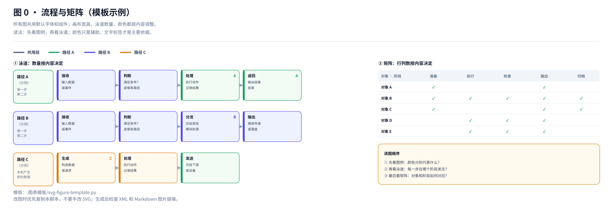

# 目录说明

本目录是仓库工具，不是学习笔记。统一 SVG 图表模板：定义本仓库技术示意图的字体、版式、组件和生成方式。画布宽高、泳道/列数、颜色都按内容调整，不强制固定 1660、三泳道或固定配色。以后新增图片按本目录的规范和脚本生成。

## 文件

- [figure-style.md](./figure-style.md)：图表格式、**按知识点选图型**、版式框架、色彩语义、组件规范、检查清单。
- [svg-figure-template.py](./svg-figure-template.py)：只依赖 Python 标准库的 SVG 生成模板。
- [example.svg](./example.svg)：由模板脚本生成的示例图（节点 + 泳道 + 矩阵）。
- [examples/](./examples/.readme.md)：五种图型的可复制样板（层叠、时序、有向图、决策、时间线）。

## 示例



示例尺寸为 `1660×580`，这是由当前内容决定的，不是固定画布；删减节点或矩阵后会自动缩小，默认最小 `800×400`。

**图不是"节点 + 流程"型时，先看 [examples/](./examples/.readme.md)**：

| 知识点 | 看哪个样板 |
|---|---|
| 分层、分区、栈 | [01-stack.svg](./examples/01-stack.svg) |
| 谁对谁说的交互 | [02-sequence.svg](./examples/02-sequence.svg) |
| 分叉、依赖、提交图 | [03-graph.svg](./examples/03-graph.svg) |
| 报错分流、排障路径 | [04-decision.svg](./examples/04-decision.svg) |
| 版本演化、里程碑 | [05-timeline.svg](./examples/05-timeline.svg) |

选型规则见 [figure-style.md §2.1](./figure-style.md)。

## 使用

```bash
python3 .图表模板/svg-figure-template.py
```

默认生成同目录的 `example.svg`，也可以指定输出路径：

```bash
python3 .图表模板/svg-figure-template.py /tmp/my-figure.svg
```

## 维护约定

- 新增技术图时，先读 [figure-style.md](./figure-style.md)，**按 §2.1 选图型**，再复用对应组件和语义色。
- 改图优先改脚本，不手改 `example.svg` / `examples/*.svg`。
- 修改模板后，同步更新规范、脚本和示例。
- 新增图型时，先补选择表，再补组件与 examples 样板。
- 图片文件命名为 `图NN-主题.svg`，存放在对应笔记的 `images/` 目录。
