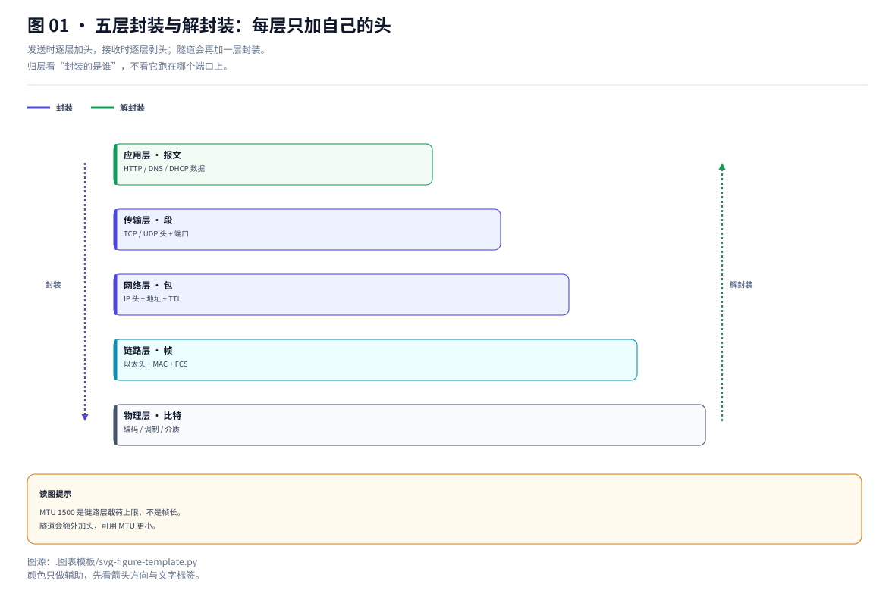
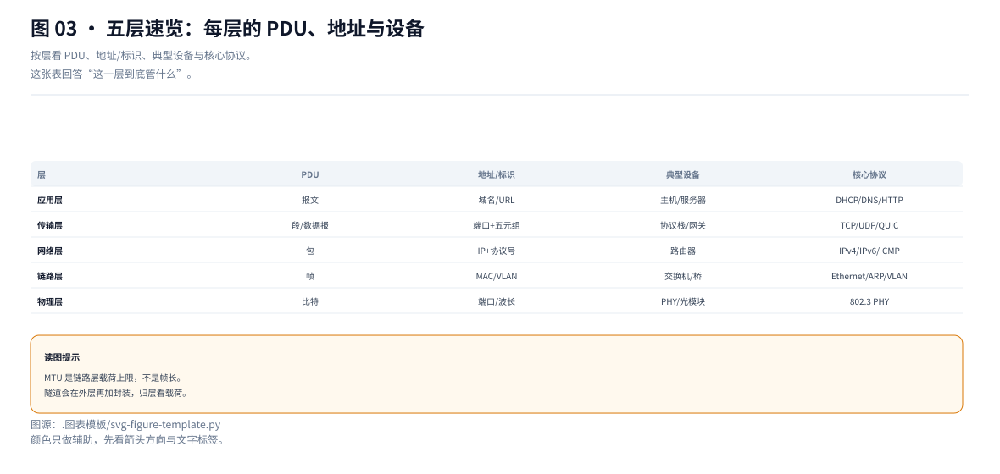
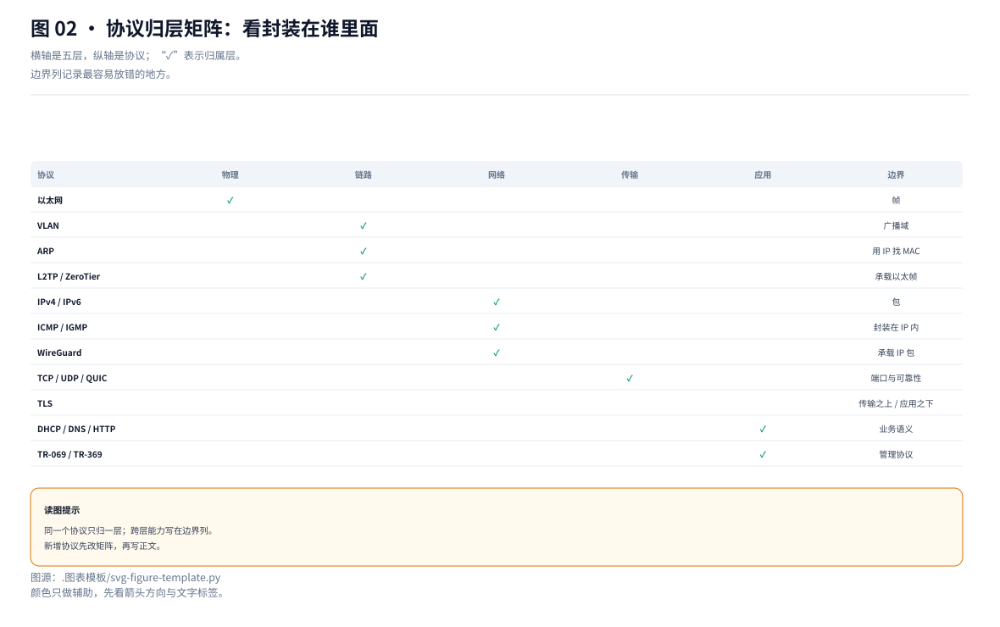
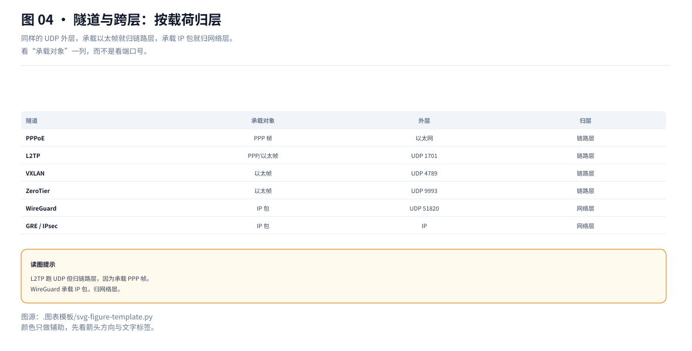

# 网络分层与模型

分层的本质不是把协议分类，而是**让每一层只解决一个问题，并把其余问题交给上下层**。看懂封装关系，比背五层名字有用。

> 本篇定位：网络科学的总入口。先给五层模型和封装过程，再用三张矩阵回答「某个协议属于哪层、被封在谁里面、该去哪篇看」。

## 目录

- [1 为什么分层](#s1)
- [2 五层与 OSI](#s2)
- [3 封装与解封装](#s3)
- [4 五层速览矩阵](#s4)
- [5 协议归属矩阵](#s5)
- [6 隧道与跨层协议](#s6)
- [7 分层的排障顺序](#s7)
- [8 边界与常见误解](#s8)
- [9 参考与关联](#s9)

## 1 · 为什么分层

网络要同时解决很多问题：信号怎么发、帧怎么定界、跨网怎么找路、丢了怎么补、应用怎么对话。把它们塞进一个模块，任何一处改动都会牵动全身。

分层带来三个好处：

- **每层只暴露接口**：上层不需要知道下层怎么实现。IP 不关心以太网还是 Wi-Fi，TCP 不关心 IP 怎么路由。
- **每层可以独立替换**：物理介质从双绞线换成光纤，IP 以上不用改；传输层从 TCP 换成 QUIC，应用可以逐步迁移。
- **问题可以分层定位**：先判断「是哪一层的标识/封装出了问题」，再往下查，比漫无目的抓包快得多。

代价是**封装开销**和**跨层信息丢失**：每层加头，下层看不到上层的语义；有些优化必须跨层（如 MSS 依赖 MTU），这也是各种「层间泄漏」的来源。

## 2 · 五层与 OSI

| TCP/IP 五层 | OSI 七层 | 一句话职责 | 典型协议 |
| --- | --- | --- | --- |
| 应用层 | 应用层 / 表示层 / 会话层 | 进程之间的业务语义 | DHCP、DNS、HTTP、SNMP、TR-069 |
| 传输层 | 传输层 | 进程到进程的交付 | TCP、UDP、QUIC |
| 网络层 | 网络层 | 主机到主机的寻址与转发 | IPv4、IPv6、ICMP、路由协议 |
| 链路层 | 数据链路层 | 同一链路上的帧传输 | Ethernet、VLAN、ARP、PPP、L2TP |
| 物理层 | 物理层 | 比特到电/光信号 | 以太网 PHY、光模块、线缆 |

两套模型的差异只在「链路层」和「应用层」的切法：

- OSI 把链路层拆成 MAC 和 LLC 两个子层，把应用层拆成应用/表示/会话三层。
- TCP/IP 把物理层单独拿出来，把上面三层合并成应用层。

工程上不必纠结「到底几层」。真正有用的是：**看到一个协议，能说出它封装了什么、被谁封装、用什么地址定位。**

### 2.1 五层各自解决什么

| 层 | 解决 | 不解决 |
| --- | --- | --- |
| 物理层 | 比特能不能传过去 | 帧边界、地址、重传 |
| 链路层 | 这一跳送给谁、帧有没有坏 | 跨网段、端到端可靠 |
| 网络层 | 跨网怎么找到目的主机 | 进程是谁、数据是否可靠 |
| 传输层 | 交给哪个进程、要不要可靠 | 业务语义、内容格式 |
| 应用层 | 业务怎么交互 | 底下怎么传 |

## 3 · 封装与解封装



**读图**：箭头向下是封装、向上是解封装；每层只加自己的头，隧道会在链路层/网络层外再套一层。

> 图源：`images/图01-五层封装与解封装.svg`

发送时逐层加头，接收时逐层剥头：

```text
应用数据
  └─ 应用层头（如 HTTP 请求行）      → 报文 message
       └─ 传输层头（TCP/UDP）        → 段/数据报 segment/datagram
            └─ 网络层头（IP）        → 包 packet
                 └─ 链路层头尾（以太网）→ 帧 frame
                      └─ 物理层        → 比特 bit
```

每一层的头只服务于本层：

| 层 | 头里最关键的信息 | 作用 |
| --- | --- | --- |
| 链路层 | 源/目的 MAC、EtherType、VLAN | 这一跳送到哪块网卡 |
| 网络层 | 源/目的 IP、协议号、TTL | 跨网送到哪台主机 |
| 传输层 | 源/目的端口、序号、窗口 | 交给哪个进程、是否可靠 |
| 应用层 | 方法、域名、事务 ID | 业务要做什么 |

**封装关系决定了归层**：一个协议属于哪层，看它封装的是什么、被谁封装，而不是看它跑在哪个端口上。例如 L2TP 跑在 UDP 1701 上，但它封装的是 PPP 帧，所以归链路层。

## 4 · 五层速览矩阵



**读图**：按层看 PDU、地址/标识、设备与核心协议，先建立“这一层管什么”的整体印象。

> 图源：`images/图03-五层速览矩阵.svg`


| 层 | PDU | 地址/标识 | 封装关系 | 典型设备 | 核心协议 | 本目录 |
| --- | --- | --- | --- | --- | --- | --- |
| 应用层 | 报文 message | 域名、URL、事务 ID | 交给传输层选端口 | 主机、服务器、ACS | DHCP、DNS、HTTP、SNMP、UPnP、TR-069/369、OMA DM | [05-应用层](./05-应用层/.readme.md) |
| 传输层 | 段/数据报 | 端口（16 位）+ 五元组 | 加 TCP/UDP 头 | 主机协议栈、网关 | TCP、UDP、QUIC | [04-传输层](./04-传输层/.readme.md) |
| 网络层 | 包 packet | IP 地址、协议号 | 加 IP 头，查路由 | 路由器 | IPv4、IPv6、ICMP、组播、NAT、VRRP、WireGuard | [03-网络层](./03-网络层/.readme.md) |
| 链路层 | 帧 frame | MAC（48 位）、VLAN ID | 加以太头，查 FDB | 交换机、桥 | Ethernet、VLAN、STP、LACP、ARP、PPP/PPPoE、L2TP、ZeroTier | [02-链路层](./02-链路层/.readme.md) |
| 物理层 | 比特 bit | 端口、波长、时隙 | 帧转电/光信号 | PHY、光模块、线缆 | 以太网 PHY（802.3） | [01-物理层](./01-物理层/.readme.md) |

## 5 · 协议归属矩阵



**读图**：横轴是五层、纵轴是协议；先看 ✓ 的归属，再看边界列的例外，例如 L2TP 跑 UDP 但归链路层。

> 图源：`images/图02-协议归层矩阵.svg`

这张表是归层 SSOT。**看「封装在谁里面」一列，就能推出归属层**；「易错点」一列记录最容易放错的地方。

| 协议/机制 | 归属层 | 封装在谁里面 | 端口/协议号/以太类型 | 易错点 |
| --- | --- | --- | --- | --- |
| 以太网 II | 链路层 | 物理层 | EtherType 0x0800/0x86DD/0x0806 | 类型字段 < 0x0600 时是 802.3 长度 |
| VLAN / QinQ | 链路层 | 以太网 | 0x8100 / 0x88A8 | VID 12 位，可用 4094；别和 PCP 混 |
| STP/RSTP/MSTP | 链路层 | 以太网（LLC） | — | BPDU 不可路由，只在桥之间 |
| LACP | 链路层 | 慢协议 | 0x8809 | 成员口速率/双工必须一致 |
| ARP | 链路层 | 以太网 | 0x0806 | 用三层地址找二层地址 |
| PPP / PPPoE | 链路层 | 以太网 | 0x8863 / 0x8864 | 发现与会话是两个阶段 |
| L2TP | 链路层 | UDP | 1701 | 隧道 PPP 帧，不因 UDP 归传输层 |
| VXLAN | 链路层 | UDP | 4789 | 承载以太帧，属二层 overlay |
| ZeroTier | 链路层 | UDP | 9993 | 虚拟二层交换机，不是三层 VPN |
| MPLS | 2.5 层 | 以太网/PPP | 0x8847 / 0x8848 | 转发看标签不看 IP |
| IPv4 / IPv6 | 网络层 | 链路层 | 0x0800 / 0x86DD | 分片、扩展头是两套机制 |
| ICMP / ICMPv6 | 网络层 | IP | 1 / 58 | 封装在 IP 里，但不是传输层 |
| IGMP / MLD | 网络层 | IP / ICMPv6 | 2 / 58 子类型 | 组播管理，不是组播数据 |
| NAT | 网络层 | IP | — | 改 IP 还改端口，依赖传输层字段 |
| VRRP | 网络层 | IP | 112 | 虚拟 MAC 00:00:5E:00:01:XX |
| 路由协议 | 网络层 | IP/TCP/UDP | OSPF 89、BGP 179、RIP 520 | 路由协议本身也要被路由 |
| GRE / IPsec | 网络层 | IP | 47 / 50、51 | 封装 IP 包，归网络层 |
| WireGuard | 网络层 | UDP | 默认 51820 | 封装 IP 包，三层隧道 |
| TCP / UDP | 传输层 | IP | 6 / 17 | 端口是传输层标识 |
| QUIC | 传输层 | UDP | 443 常用 | 跑在 UDP 上，但提供可靠传输 |
| TLS | 传输层之上、应用层之下 | TCP | 443 | 安全子层，矩阵单独备注 |
| DHCPv4 / DHCPv6 | 应用层 | UDP | 67/68、546/547 | 地址配置是应用层协议 |
| DNS | 应用层 | UDP/TCP | 53（DoT 853、DoH 443） | 递归与迭代是两种方式 |
| HTTP | 应用层 | TCP / QUIC | 80、443 | HTTP/3 走 QUIC，不经过 TCP |
| SNMP | 应用层 | UDP | 161、162 | Trap 由设备主动发 |
| UPnP | 应用层 | UDP + HTTP | SSDP 1900、HTTP 动态端口 | 依赖组播发现，跨网段失效 |
| TR-069 / TR-369 / OMA DM | 应用层 | HTTP(S)/MQTT/WebSocket | 7547、443 等 | 管理协议，正本在本目录 |

维护规则：

- 新增协议先定层、再改本表、最后写正文。
- 每篇正文 frontmatter 的 `layer` 必须与本表一致。
- 协议未写时先放纯文本名称，写完后再挂链接，避免死链。

## 6 · 隧道与跨层协议



**读图**：看“承载对象”而不是端口：承载以太帧归链路层，承载 IP 包归网络层。

> 图源：`images/图04-隧道与跨层封装.svg`


隧道最容易放错层。判据只有一条：**看它封装的载荷，不看它跑在哪个端口上。**

| 隧道/封装 | 承载对象 | 跑在哪 | 归层 |
| --- | --- | --- | --- |
| PPPoE | PPP 帧 | 以太网 | 链路层 |
| L2TP | PPP 帧（v2）/ 以太帧、PPP、HDLC（v3） | UDP 1701 / IP 115 | 链路层 |
| VXLAN | 以太帧 | UDP 4789 | 链路层 |
| ZeroTier | 以太帧（L2 overlay） | UDP 9993 | 链路层 |
| GRE / IPsec | IP 包 | IP | 网络层 |
| WireGuard | IP 包 | UDP | 网络层 |
| MPLS | 标签交换 | 以太网/PPP | 2.5 层 |

另外两个边界：

- **TLS** 跑在 TCP 之上、应用之下，通常归「安全子层」，不要硬塞进传输层。
- **QUIC** 跑在 UDP 之上，但提供可靠传输与多路复用，归传输层。

## 7 · 分层的排障顺序

分层不是只用来画图，它决定排查顺序。任何网络问题都先问三个问题：

| 顺序 | 问什么 | 判断依据 | 判错的后果 |
| --- | --- | --- | --- |
| ① 哪一层 | 出问题的是地址、端口、域名，还是帧？ | 看现象用到哪种标识：MAC/帧 → 链路层；IP → 网络层；端口 → 传输层；域名/URL → 应用层 | 层判错，后面查哪都是白查 |
| ② 哪一段 | 是同一链路、跨网段，还是端到端？ | 同网段看广播域/MAC；跨网段看路由/NAT；端到端看连接状态 | 把链路问题当路由问题，越查越偏 |
| ③ 哪一跳 | 封装在哪一跳被改、被丢、被解？ | 对比每跳的头：MAC 逐跳变，IP 端到端不变，端口不变 | 分不清「没发出去」和「没收到」 |

举三个例子：

- **能 ping 通 IP、打不开网页**：网络层通，问题在传输层或应用层（端口、DNS、TLS、HTTP）。
- **同网段通、跨网段不通**：链路层和 IP 地址没问题，重点看网关、路由、NAT。
- **时通时断、MAC 表漂移**：链路层环路或 MAC 冲突，不要先怀疑应用。

## 8 · 边界与常见误解

### 8.1 分层是设计模型，不是内核边界

Linux 内核里一个 `sk_buff` 从驱动到协议栈再到应用，跨层共享；netfilter 在 IP 层挂五个钩子，却能看传输层端口。分层描述的是「职责」，不是「代码必须隔离」。

### 8.2 端到端原则

可靠性、加密、重传这些能力，通常放在端主机而不是中间网络。网络只负责尽力转发，这样中间设备简单、可扩展。代价是端主机要承担状态与复杂度，这也是 TCP 状态机和拥塞控制存在的原因。

### 8.3 层号会因隧道而失真

一个 WireGuard 包在物理链路上看是「UDP → IP → Ethernet」，但它的载荷是另一个 IP 包。按「最外层」归层会把它归到传输层，按「载荷」归层才是网络层。本目录统一按载荷归层。

### 8.4 五层不是唯一答案

OSI 七层、TCP/IP 四层、五层教学模型都在用。数量不重要，重要的是每层的职责、地址和封装关系。看到「二层转发」「三层转发」这类说法，要能立刻映射到「按 MAC」还是「按 IP」。

### 8.5 ARP、ICMP 的归属

- ARP 封装在以太网里，为 IP 服务，归链路层（常称 2.5 层）。
- ICMP 封装在 IP 里，是网络层的控制协议，不是传输层。
- IGMP/MLD 也封装在 IP/ICMPv6 里，归网络层。

判断标准仍是「封装在谁里面、为谁服务」，不是「名字里有没有 IP」。

## 9 · 参考与关联

**标准与教材**

- RFC 1122：Requirements for Internet Hosts — Communication Layers
- RFC 1123：Requirements for Internet Hosts — Application and Support
- 《TCP/IP 详解 卷 1：协议》
- 《计算机网络：自顶向下方法》

**关联**

- [01-物理层](./01-物理层/.readme.md)
- [02-链路层](./02-链路层/.readme.md)：已有[以太网与 MAC](./02-链路层/01-以太网与MAC.md)、[ARP](./02-链路层/05-ARP.md)
- [03-网络层](./03-网络层/.readme.md)
- [04-传输层](./04-传输层/.readme.md)：已有 [TCP](./04-传输层/01-TCP.md)
- [05-应用层](./05-应用层/.readme.md)：已有 [DHCPv4](./05-应用层/01-DHCPv4.md)
- Linux 网络栈实现：`20-平台与系统/21-Linux/06-网络子系统`

---

> **本篇定位**：网络科学总入口，给五层模型、封装关系、协议归属矩阵和分层排障顺序。
> **素材来源**：`studyspace/1.知识体系/1.计算机网络/m-1-计算机网络和因特网.md`（主），协议归属按本仓库 35 篇规划整理。
> **待验证**：管理协议常用端口随产品配置而变（如 TR-069 的 7547 并非强制）。
