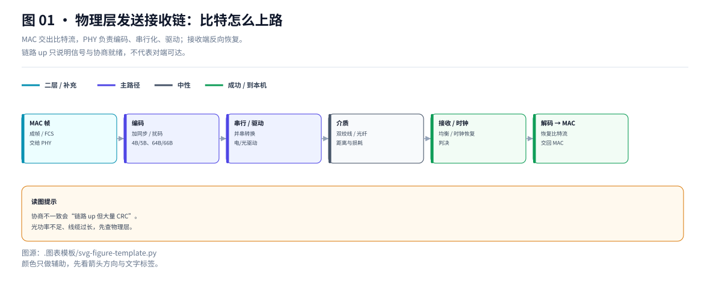

# 物理层概览

物理层只做一件事：把比特变成能在介质上传输的信号，再从信号里恢复比特。它不认帧、不认地址，也不保证数据一定正确。

> 本篇定位：五层中的第一层，建立「信号、介质、PHY、接口」的基本认知。光通信与无线细节归 12-通信科学，本篇只留网络视角的边界。

## 目录

- [1 一句话模型](#s1)
- [2 速览](#s2)
- [3 关键概念](#s3)
- [4 发送与接收过程](#s4)
- [5 与链路层的边界](#s5)
- [6 设计取舍](#s6)
- [7 与相邻领域的关系](#s7)
- [8 参考与关联](#s8)

## 1 · 一句话模型：比特上路面

把物理层想成「修路 + 定交通规则」：路是介质（双绞线、光纤、空气），规则是编码、速率、双工和协商。路修好只代表「车能开」，不代表「货一定送到」。

三个关键认知：

1. **物理层传输的是比特流**，没有帧边界，也没有地址。
2. **链路状态（link up）只说明物理与协商就绪**，不代表对端可达、更不代表业务通。
3. **速率、距离、介质互相约束**：更高速率通常意味着更短距离或更好介质。

## 2 · 速览

| 项 | 内容 |
| --- | --- |
| 所属层 | 物理层（OSI 第一层） |
| PDU | 比特（bit） |
| 关键参数 | 速率、双工、编码、波长、距离、误码率 |
| 常见介质 | 双绞线、光纤、同轴、无线信道 |
| 常见接口 | MII/RGMII/SGMII/SerDes、光模块接口 |
| 典型设备 | PHY 芯片、光模块、变压器、连接器、线缆 |
| 主要标准 | IEEE 802.3（以太网物理层）、ITU-T G.652/G.984 等（光纤/GPON） |
| 上层接口 | 向 MAC 提供比特流与链路状态 |

## 3 · 关键概念

### 3.1 编码与调制

- **编码**：把比特映射成电平/光强变化，如 4B/5B、8B/10B、64B/66B。
- **调制**：把比特映射到载波的幅度/相位/频率，如 PAM4、QAM。
- 编码解决「0/1 怎么表示、时钟怎么恢复」；调制解决「有限带宽里怎么放更多比特」。

### 3.2 速率与带宽

- **线速率**是物理层每秒传输的符号/比特数；**有效吞吐**还要扣除编码开销、帧头、协议开销。
- 带宽是介质的频率资源，不等于吞吐；信噪比决定在给定带宽下能可靠传输多少比特。

### 3.3 双工与协商

| 模式 | 行为 | 风险 |
| --- | --- | --- |
| 全双工 | 收发同时进行，无冲突 | 对端半双工时会出现冲突/CRC 错误 |
| 半双工 | 收发共享介质，需要冲突检测 | 现代交换网络基本不用 |
| 自协商 | 双方交换能力，取共同支持的最高配置 | 一端强制、一端自协商，容易降速或双工不匹配 |

### 3.4 介质与距离

| 介质 | 典型场景 | 特点 |
| --- | --- | --- |
| 双绞线 | 家庭/办公以太网 | 便宜、距离短（100 米级） |
| 光纤 | 园区骨干、FTTR、运营商 | 带宽高、距离远、抗干扰 |
| 同轴 | 老式有线电视/部分接入 | 逐步被光纤取代 |
| 无线 | Wi-Fi、蜂窝 | 共享介质、受干扰、移动性 |

### 3.5 PHY 与 MAC 的分工

- **PHY**：并串转换、编码、驱动、接收均衡、时钟恢复、链路状态。
- **MAC**：成帧、地址、CRC、介质访问。
- 两者通过 MII/RGMII/SGMII 等接口连接；交换芯片内部常用 SerDes。

## 4 · 发送与接收过程



**读图**：从左到右是发送链，从右到左是接收链；链路 up 只代表信号与协商就绪，不代表对端可达。

> 图源：`images/图01-物理层发送接收链.svg`

```text
发送：
  MAC 给出比特流
    └─ PHY 编码（加同步、扰码）
         └─ 串行化 → 驱动 → 介质

接收：
  介质 → 接收器 → 时钟恢复 → 解码
    └─ PHY 输出比特流 + 链路状态
         └─ MAC 找帧边界、校验 FCS
```

四个环节最容易出问题：

1. **协商**：速率/双工不一致，链路可能 up 但大量出错。
2. **信号完整性**：线缆质量、长度、串扰、光功率不足，表现为误码/CRC。
3. **时钟恢复**：长连 0/1 或编码不合适，接收端无法同步。
4. **模块兼容**：光模块类型、波长、速率与端口不匹配。

## 5 · 与链路层的边界

| 问题 | 归属 | 说明 |
| --- | --- | --- |
| 比特能不能传 | 物理层 | 信号、编码、介质、光功率 |
| 帧从哪开始、到哪结束 | 链路层 | 前导码/SFD、长度/类型 |
| 帧有没有坏 | 链路层 | FCS/CRC |
| 这一帧发给谁 | 链路层 | MAC 地址 |
| 链路是否 up | 物理层 + 链路层 | 物理信号 + 协商 + MAC 状态 |

因此，「链路 up 但 ping 不通」通常不是物理层问题；「链路频繁 up/down、CRC 增长」才优先查物理层。

## 6 · 设计取舍

### 6.1 速率与距离

更高的符号率带来更高吞吐，但信号衰减、串扰、色散更严重，距离更短。工程上用更好的介质（光纤）、更强的编码（PAM4）或更多光纤并行来换速率。

### 6.2 电口与光口

- 电口（双绞线）便宜、易部署，适合短距接入。
- 光口带宽高、距离远、抗电磁干扰，适合骨干、FTTR、长距回传。
- 光模块把电信号转成光信号，类型/波长/速率必须与对端匹配。

### 6.3 自协商的价值与代价

自协商让设备即插即用，但依赖双方都开启。一端强制全双工、另一端自协商，可能出现「一端全双工、一端半双工」的经典故障。工程上要么两端都自协商，要么两端都强制且配置一致。

### 6.4 误码不可避免

物理层无法保证零误码，只能把误码率降到可接受范围。链路层用 FCS 检测并丢弃坏帧，传输层再用校验和/重传兜底。**越往上，越不依赖物理层的完美。**

## 7 · 与相邻领域的关系

| 相邻对象 | 关系 |
| --- | --- |
| 链路层 | PHY 提供比特流和链路状态，MAC 负责成帧、地址、FCS |
| 光通信 | 光模块、光纤、GPON/FTTR 的物理层细节归 12-通信科学 |
| 无线通信 | 802.11/蜂窝的调制、射频、天线归 12-通信科学 |
| 硬件/芯片 | PHY、SerDes、交换芯片的选型与调试归 30-平台与芯片 |
| 产品方案 | 端口形态、光模块配置、布线方案归 40-产品与方案 |

一句话：**物理层决定「能不能传」，链路层决定「传给谁」，网络层决定「怎么走到」。**

## 8 · 参考与关联

**标准**

- IEEE 802.3（Ethernet）
- ITU-T G.652（单模光纤）、G.984（GPON）
- 各光模块 MSA（SFP/SFP+/QSFP 等）

**关联**

- [02-链路层](../02-链路层/.readme.md)：成帧、MAC、FCS
- [01-以太网与MAC](../02-链路层/01-以太网与MAC.md)：帧格式与最小帧长
- 12-通信科学：光通信、无线通信、射频与天线
- 30-平台与芯片：PHY/SerDes/交换芯片
- 40-产品与方案：端口与布线方案

---

> **本篇定位**：物理层的最小必要认知，重点在「物理层管什么、不管什么」以及和链路层的边界。
> **素材来源**：`studyspace/1.知识体系/1.计算机网络/m-1-计算机网络和因特网.md` 物理媒体节、`m-6-无线网络和移动网络.md` 物理层节；其余按 IEEE 802.3 通用知识补写。
> **待验证**：具体速率/距离/光模块型号随标准与厂商而变。
