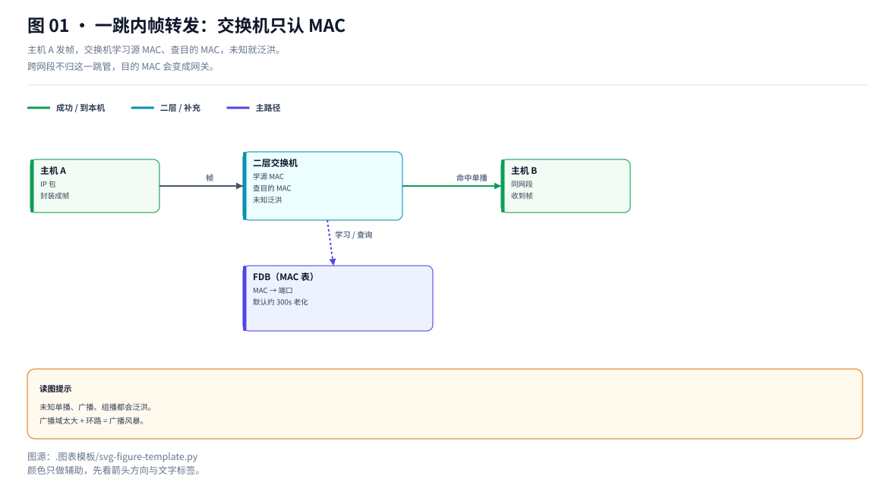

# 链路层概览

链路层解决一个问题：**在同一个链路上，把帧从一块网卡送到另一块网卡**。它管帧、管 MAC、管这一跳的差错，不管跨网段，也不管端到端可靠。

> 本篇定位：链路层的入口，给职责、核心机制、协议地图和边界。具体协议看各篇正文。

## 目录

- [1 一句话模型](#s1)
- [2 速览](#s2)
- [3 核心机制](#s3)
- [4 子层与协议族](#s4)
- [5 本层协议地图](#s5)
- [6 边界与设计取舍](#s6)
- [7 与相邻层的关系](#s7)
- [名词解释](#名词解释)
- [8 参考与关联](#s8)

## 1 · 一句话模型：一跳内的快递

网络层说「送到哪个城市」，链路层说「这条街上送到哪扇门」。它只负责当前这一段：

```text
IP 包 → 加以太头 → 帧 → 从一块网卡送到下一块网卡
                          └─ 这一跳可以是交换机、AP、PPP 链路
```

三个关键认知：

1. **MAC 只在一跳内有效**，跨网段时目的 MAC 是网关。
2. **链路层不保证可靠**，坏帧丢弃，不重传。
3. **广播域和冲突域不是一回事**，交换机隔离冲突域，VLAN 才隔离广播域。

## 2 · 速览

| 项 | 内容 |
| --- | --- |
| 所属层 | 链路层（OSI 第二层） |
| PDU | 帧（frame） |
| 地址 | MAC 48 位；VLAN ID 12 位 |
| 核心服务 | 成帧、链路接入、MAC 寻址、差错检测 |
| 典型设备 | 网卡、网桥、二层交换机、AP、交换芯片 |
| 主要标准 | IEEE 802.3（以太网）、802.1Q（VLAN）、802.1D/w（STP）、802.3ad（LACP）、RFC 826（ARP） |
| 上层 | IP、ARP、PPPoE、L2TP 等 |
| 下层 | 物理层 |

## 3 · 核心机制



**读图**：交换机学习源 MAC、查目的 MAC；未知、广播、组播都泛洪，跨网段不归这一跳管。

> 图源：`images/图01-一跳内帧转发.svg`

### 3.1 成帧

把上层数据加上头尾，界定「一帧从哪开始、到哪结束」。以太网用前导码 + SFD 定界，用类型/长度字段标识载荷，用 FCS 校验。

### 3.2 寻址

用 MAC 地址标识同一链路上的网卡。MAC 是扁平地址，不表示位置，不能跨网段推导。

### 3.3 介质访问

共享介质时代用 CSMA/CD 解决冲突；现代交换网络全双工、点对点，冲突检测退场，但最小帧长等兼容设计保留。

### 3.4 差错检测

以太网用 CRC-32 做 FCS，坏帧直接丢。链路层不做重传，可靠交付交给传输层。

### 3.5 交换转发

交换机学习源 MAC、查目的 MAC、未知泛洪、表项老化。它不改帧，对终端透明。环路靠 STP 逻辑阻断。

## 4 · 子层与协议族

| 子层/协议族 | 管什么 | 典型代表 |
| --- | --- | --- |
| MAC | 成帧、介质访问、MAC 寻址、FCS | 以太网 MAC、802.11 MAC |
| LLC | 对上提供统一接口 | 802.2 LLC、SNAP |
| 以太网 | 有线局域网主流 | Ethernet II、VLAN |
| 点对点 | 串行/拨号链路 | PPP、PPPoE、HDLC |
| 无线 | 共享无线介质 | IEEE 802.11 |
| 隧道 | 把二层帧封装进其他协议 | L2TP、VXLAN、ZeroTier |

## 5 · 本层协议地图

| 协议/机制 | 一句话 | 篇目 |
| --- | --- | --- |
| 以太网与 MAC | 帧格式、MAC、交换机转发 | [01-以太网与MAC.md](./01-以太网与MAC.md) |
| VLAN 与 Trunk | 802.1Q 标签、Access/Trunk、广播域隔离 | [02-VLAN与Trunk](02-VLAN与Trunk.md) |
| STP/RSTP/MSTP | 阻断环路，把环变成树 | [03-STP-RSTP-MSTP](03-STP-RSTP-MSTP.md) |
| 链路聚合 LACP | 多链路捆绑与负载分担 | [04-链路聚合LACP](04-链路聚合LACP.md) |
| ARP | IP → MAC 的地址解析 | [05-ARP.md](./05-ARP.md) |
| PPP 与 PPPoE | 点对点链路与宽带拨号 | [06-PPP与PPPoE](06-PPP与PPPoE.md) |
| L2TP | 把 PPP 帧隧道到远端 | [07-L2TP](07-L2TP.md) |
| ZeroTier | 虚拟二层交换机 / L2 overlay | [08-ZeroTier](08-ZeroTier.md) |

## 6 · 边界与设计取舍

### 6.1 不跨网段

广播帧不出广播域，MAC 地址没有层次。跨网段必须交给 IP 路由。

### 6.2 不保证可靠

FCS 只保证一跳内没有检测到错误，不重传、不排序。端到端可靠由 TCP/QUIC 负责。

### 6.3 广播域的代价

交换机默认不隔离广播域，广播/未知单播/组播都会泛洪。广播域越大，泛洪成本越高。VLAN 是划分广播域的手段，STP 是防环的手段，两者不能互相替代。

### 6.4 简单与安全的取舍

二层即插即用，没有身份认证：MAC 可伪造，ARP 可欺骗，FDB 可被撑爆。安全依赖接入控制（端口安全、DHCP Snooping、DAI、802.1X），不是协议自身。

## 7 · 与相邻层的关系

| 相邻对象 | 关系 |
| --- | --- |
| 物理层 | 帧变成电/光信号；链路 up 不等于对端可达 |
| 网络层 | IP 包是帧的载荷；MTU 由链路层决定 |
| ARP | 为 IPv4 解析 MAC；报文直接封装在以太帧里 |
| VLAN/STP | 本层内的隔离与防环机制 |
| 隧道 | L2TP/VXLAN/ZeroTier 封装以太帧，仍归本层 |
| 20-网络子系统 | 网桥、DSA、交换芯片实现细节归 20 |

一句话：**链路层负责「这一跳送到」，不负责「一定送到」，也不负责「送到哪张网」。**

## 名词解释

> 缩写给出英文全称；非缩写用“—”表示。

| 术语 | 英文全称 | 解释 |
| --- | --- | --- |
| 帧 | — | 链路层传输单位。 |
| MAC | Media Access Control | 链路层地址，48 位。 |
| FDB | Forwarding Database | 交换机维护的 MAC 到端口映射表。 |
| 广播域 | — | 广播帧能到达的范围。 |
| 冲突域 | — | 会互相碰撞的介质范围。 |
| VLAN | Virtual Local Area Network | 用标签划分的逻辑广播域。 |
| STP | Spanning Tree Protocol | 生成树协议，防二层环路。 |
| LACP | Link Aggregation Control Protocol | 链路聚合控制协议。 |
| ARP | Address Resolution Protocol | IPv4 地址到 MAC 的解析协议。 |

## 8 · 参考与关联

**标准**

- IEEE 802.3（Ethernet）
- IEEE 802.1Q（VLAN）
- IEEE 802.1D / 802.1w（STP/RSTP）
- IEEE 802.3ad（LACP）
- RFC 826（ARP）

**关联**

- [01-以太网与MAC.md](./01-以太网与MAC.md)
- [05-ARP.md](./05-ARP.md)
- 03-网络层：IP、分片、MTU
- 20-平台与系统/21-Linux/06-网络子系统：网桥/DSA/交换芯片

---

> **本篇定位**：链路层入口，先建立职责与协议地图，再进入具体协议。
> **素材来源**：`studyspace/1.知识体系/2.TCP IP协议/m-2-链路层.md`、`studyspace/1.知识体系/1.计算机网络/m-5-链路层.md`。
> **待验证**：不同介质的 MTU、交换机老化时间随标准/厂商而变。
