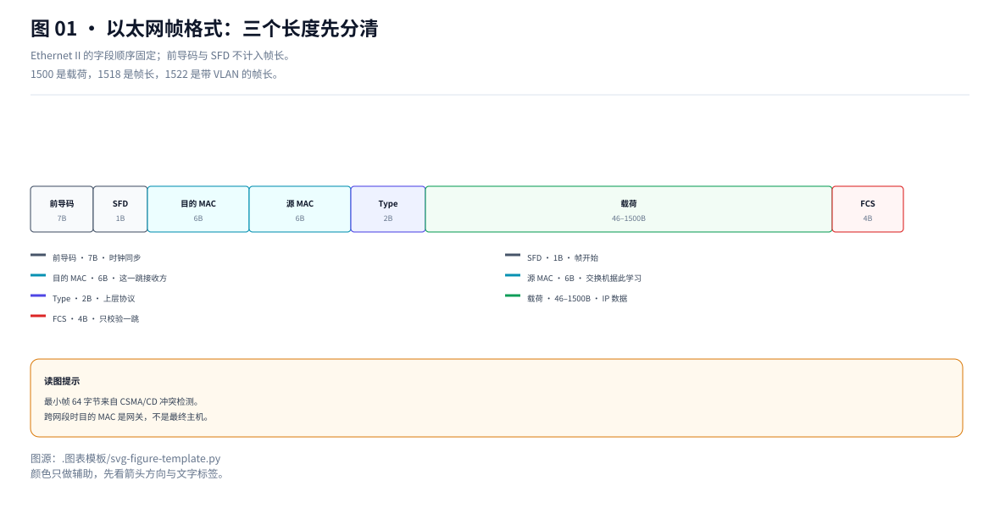
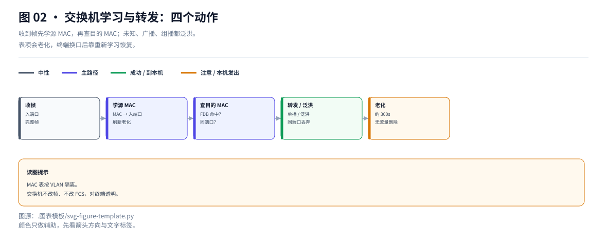

# 以太网与 MAC

以太网只干三件事：把 IP 包装进帧、用 MAC 找到同链路的下一条、用 FCS 校验这一跳有没有坏。跨网段不归它管。

> 本篇定位：链路层入门，讲 Ethernet II 帧、MAC 地址和交换机转发。VLAN、STP、ARP 只在这里点到为止，细节看各自篇目。

## 目录

- [1 一句话模型](#s1)
- [2 速览](#s2)
- [3 帧格式](#s3)
- [4 MAC 地址](#s4)
- [5 交换机怎么转发](#s5)
- [6 设计取舍与边界](#s6)
- [7 与相邻层的关系](#s7)
- [名词解释](#名词解释)
- [8 参考与关联](#s8)

## 1 · 一句话模型：帧、MAC、FDB

把链路层想成寄信：**帧是信封，MAC 是收件人，FDB 是交换机脑子里的地址簿**。信只能在同一段链路上一站一站转，跨城市（跨网段）要交给 IP 路由。

| 概念 | 一句话 | 容易混淆的地方 |
| --- | --- | --- |
| 帧（frame） | 链路层的传输单位，= 以太头 + 载荷 + 校验 | 帧不是包；IP 包是帧的载荷 |
| MAC 地址 | 同一链路上标识一块网卡 | 不是主机地址，也不随设备移动而变 |
| FDB / MAC 表 | 交换机记录的「MAC → 端口」映射 | VLAN 下同一 MAC 在不同 VLAN 各有一份 |
| MTU | 帧能承载的 IP 包上限，以太网默认 1500 | 不是帧长；帧长还要加 18 字节头尾 |

由此得到两条实用推论：

- **端到端看 IP，一跳一看 MAC。** 数据包跨网段时，目的 MAC 一直是「下一跳网关」，不是最终主机。
- **交换机只认 MAC，不认 IP。** 它不改帧、不改 IP，只决定从哪个口送出去。

## 2 · 速览

| 项 | 内容 |
| --- | --- |
| 所属层 | 链路层（OSI 第二层） |
| PDU | 帧（frame） |
| 地址 | MAC 48 位；VLAN ID 12 位 |
| 主要标准 | IEEE 802.3（以太网）、IEEE 802.1Q（VLAN） |
| 帧长 | 最小 64 字节，最大 1518 字节（带 VLAN 标签 1522） |
| MTU | 1500 字节（IP 载荷上限） |
| 典型设备 | 网卡、网桥、二层交换机、交换芯片 |
| 封装关系 | 以太头 → IP 包 / ARP / PPPoE；由物理层发成电或光信号 |

三个长度先记住，后面不再重复：

```text
MTU 1500        = IP 包最大长度
帧长 1518       = 14 字节头 + 1500 载荷 + 4 字节 FCS
带 VLAN 1522    = 1518 + 4 字节 802.1Q 标签
```

## 3 · 帧格式



**读图**：按字段顺序看：前导码/SFD 不计入帧长；1500 是载荷，1518 是帧长，1522 是带 VLAN 的帧长。

> 图源：`images/图01-以太网帧格式.svg`

### 3.1 Ethernet II 全字段

| 字段 | 长度 | 作用 | 常见值 / 注意 |
| --- | --- | --- | --- |
| 前导码 Preamble | 7 字节 | 接收方时钟同步，`10101010` 重复 | 不计入帧长 |
| 帧起始符 SFD | 1 字节 | `10101011`，标志帧开始 | 不计入帧长 |
| 目的 MAC（DA） | 6 字节 | 这一跳的接收方 | 跨网段时是网关 MAC，不是目的主机 |
| 源 MAC（SA） | 6 字节 | 这一跳的发送方 | 交换机靠它学习 |
| 类型 EtherType | 2 字节 | 标识载荷是什么协议 | `>= 0x0600` 才是类型；小于等于 1500 是 802.3 长度 |
| 载荷 Payload | 46–1500 字节 | 上层数据；不足 46 补零 | 补零不算 IP 长度，靠 IP 头总长度字段区分 |
| 帧校验 FCS | 4 字节 | CRC-32，覆盖 DA 到载荷 | 只校验这一跳，不端到端 |

帧布局（不含前导码与 SFD）：

```text
+--------+--------+--------+------------------+--------+
| DA 6B  | SA 6B  | Type 2B| Payload 46-1500B | FCS 4B |
+--------+--------+--------+------------------+--------+
```

### 3.2 为什么最小帧是 64 字节

`6 + 6 + 2 + 46 + 4 = 64`。这个 46 字节的最小载荷不是随便定的：早期以太网是共享介质、半双工，靠 CSMA/CD 边发边听检测碰撞。帧太短，发送方可能在碰撞信号回来之前就发完了，从而漏检。

今天交换网络全双工、点对点，CSMA/CD 已经退场，但**最小帧长仍保留**，用来兼容和识别异常小帧（runt）。

### 3.3 Ethernet II 与 IEEE 802.3 怎么区分

看第 13、14 字节（类型/长度字段）：

| 帧格式 | 字段含义 | 判别 | 上层怎么找 |
| --- | --- | --- | --- |
| Ethernet II | EtherType | 值 `>= 0x0600` | 直接按类型分发，如 `0x0800` → IPv4 |
| IEEE 802.3 | Length | 值 `<= 1500` | 需要 LLC/SNAP 头再标识上层 |

两个区间不重叠，所以能靠数值判别。现代网络基本全是 Ethernet II；看到 `length` 而不是 `type`，通常说明碰上了老式 802.3 帧或某些控制协议。

### 3.4 常用 EtherType

| 值 | 协议 | 说明 |
| --- | --- | --- |
| `0x0800` | IPv4 | 最常见 |
| `0x0806` | ARP | 直接封装在以太网里，不过 IP |
| `0x86DD` | IPv6 | — |
| `0x8100` | 802.1Q VLAN | 标签插在 SA 与 Type 之间 |
| `0x88A8` | QinQ | 外层标签 |
| `0x8863` / `0x8864` | PPPoE 发现 / 会话 | 宽带拨号 |
| `0x88CC` | LLDP | 邻居发现，交换机之间常见 |
| `0x8809` | 慢协议 | LACP 等 |

### 3.5 VLAN 标签插在哪

802.1Q 在源 MAC 和 EtherType 之间插入 4 字节：`TPID(0x8100) + PCP(3bit) + DEI(1bit) + VID(12bit)`。帧长因此从 1518 变成 1522。

这里只记一句：**VLAN 是二层标签，不是 IP 字段**。划分、Trunk、QinQ 的细节属于 VLAN 篇，不在本篇展开。

## 4 · MAC 地址

### 4.1 结构

48 位、6 字节，写成 `00:1A:2B:3C:4D:5E`。

| 部分 | 长度 | 谁分配 | 含义 |
| --- | --- | --- | --- |
| OUI | 前 3 字节 | IEEE 统一分配 | 厂商标识 |
| 接口标识 | 后 3 字节 | 厂商分配 | 厂商内唯一 |

MAC 是**扁平地址**：没有层次，不表示位置，也不随设备换网段而变化。这决定了它只能用于「同一链路内」寻址，跨网段必须靠 IP 的层次化地址。

### 4.2 首字节的两个特殊位

| 位 | 名称 | 值 | 含义 |
| --- | --- | --- | --- |
| 第 0 位（最低位） | I/G | 0 | 单播，唯一标识一块网卡 |
| 第 0 位 | I/G | 1 | 组播，标识一组接收者 |
| 第 1 位 | U/L | 0 | 全局唯一，IEEE 分配 |
| 第 1 位 | U/L | 1 | 本地管理，管理员自定义（虚拟网卡常见） |

判断口诀：**看第一个字节的最低位，0 单播、1 组播；次低位 0 全局、1 本地**。例如 `01:00:5E:...` 第一个字节 `0x01` 最低位是 1，所以是组播。

### 4.3 常见特殊地址

| MAC | 类型 | 用途 |
| --- | --- | --- |
| `FF:FF:FF:FF:FF:FF` | 广播 | 链路上所有节点；ARP 请求用它 |
| `01:00:5E:xx:xx:xx` | IPv4 组播 | 取组播 IP 低 23 位映射 |
| `33:33:xx:xx:xx:xx` | IPv6 组播 | 取组播 IP 低 32 位映射 |
| `01:80:C2:00:00:00` | 保留组播 | STP 等桥接协议，普通端口不转发 |
| `00:00:5E:00:01:xx` | VRRP 虚拟 MAC | 虚拟路由器冗余协议使用 |

### 4.4 三个容易误解的点

1. **MAC 属于网卡，不属于主机。** 一台主机有多块网卡就有多个 MAC；容器、虚拟机、VLAN 接口还会各有一个。
2. **MAC 不用于跨网段寻址。** 跨网段时，目的 MAC 是下一跳网关的 MAC，最终主机的 MAC 只在最后一跳出现。
3. **虚拟 MAC 可能重复。** 手工配置、克隆虚拟机、容器批量创建都可能撞 MAC，结果是交换机 FDB 抖动、流量时通时断。

## 5 · 交换机怎么转发



**读图**：四个动作循环：学源 MAC、查目的 MAC、转发/泛洪/过滤、老化；MAC 表按 VLAN 隔离。

> 图源：`images/图02-交换机学习与转发.svg`

交换机本质是**多端口透明网桥**，核心是一张 FDB（MAC 地址表）。它做四件事：

1. **学习**：收到帧，把「源 MAC → 入端口」写进 FDB，并刷新老化时间。
2. **查找**：拿目的 MAC 查 FDB。
3. **转发 / 过滤**：命中且不是入端口 → 只从该口转发；命中且就是入端口 → 丢弃；未命中、广播、组播 → 从除入端口外所有口泛洪。
4. **老化**：表项默认约 300 秒无流量就删除，避免终端换口后残留错表。

| 场景 | 交换机动作 |
| --- | --- |
| 目的 MAC 已知，且不是入端口 | 单播转发 |
| 目的 MAC 未知 | 泛洪 |
| 目的 MAC 与源 MAC 同端口 | 过滤丢弃 |
| 广播 / 组播 | 泛洪（VLAN 内） |
| 有环路且没有 STP | 广播风暴、FDB 抖动 |

### 5.1 三个「域」不要混

| 域 | 含义 | 谁隔离 |
| --- | --- | --- |
| 冲突域 | 会互相碰撞的介质范围 | 交换机每个端口一个冲突域 |
| 广播域 | 广播帧能到达的范围 | 默认整个交换机是一个；VLAN 才能隔离 |
| 管理域 | 同一套配置/故障排查边界 | 按设备或网管划分 |

所以「交换机隔离冲突域，但不隔离广播域」这句话要记牢。广播风暴的根因通常不是交换机坏，而是**广播域太大 + 有环路**。

### 5.2 环路必须有 STP

交换机泛洪 + 冗余链路 = 帧在环里无限转。STP/RSTP/MSTP 的作用是逻辑上阻断部分端口，把环变成树。没有 STP 的网络，一根网线接错就能把整个广播域打满。

STP 的端口状态、BPDU、收敛过程属于 STP 篇，这里只留判断：**看到广播风暴、MAC 表频繁漂移、CPU 飙高，先查环路和 STP 状态**。

### 5.3 交换机不改帧

透明网桥对终端透明：不替换源 MAC、不重写 FCS、不改 IP。它只做「从哪个口出去」的决定。所以：

- 终端看到的源 MAC 仍是原始发送方，不是交换机。
- 如果帧内容被改，改它的一定不是普通二层转发（可能是 NAT、代理、隧道或 ACL 重写）。

## 6 · 设计取舍与边界

### 6.1 成帧与最小帧长

以太网用「前导码 + SFD」定界，用「长度/类型 + FCS」自描述。最小帧长 64 字节是为半双工冲突检测设计的，全双工时代保留它是为了兼容和异常识别，不是性能需要。

### 6.2 差错检测不等于可靠交付

FCS 只覆盖一跳，且每跳重算。交换机收到坏帧直接丢，不会重传；端到端丢包、乱序、重复由 TCP 等上层处理。**以太网是尽力而为，不是可靠传输。**

### 6.3 学习 + 泛洪的代价

交换机靠「源 MAC 学习、未知目的泛洪」做到即插即用。代价有两个：

- 未知单播、广播、组播都会泛洪，广播域越大，泛洪成本越高。
- FDB 是软状态，表项会老化；终端换口后短时间内可能仍按旧表转发，直到学习到新位置。

### 6.4 二层没有身份认证

源 MAC 可以伪造，FDB 也能被大量虚假源 MAC 撑爆（MAC flooding），极端情况下交换机退化成集线器。防护靠端口安全、MAC 数量限制、DHCP Snooping/动态 ARP 检测。这是「简单、即插即用」换来的代价，不是某个厂商的实现缺陷。

### 6.5 透明网桥的边界

透明网桥只按 MAC 转发，不关心 IP、不关心业务语义。因此：

- 它不能替代路由：跨网段仍然要 IP 路由。
- 它不能做安全隔离：VLAN 只是广播域隔离，不是安全域。
- 它不能保证路径最优：生成树只保证无环，不保证最短。

## 7 · 与相邻层的关系

| 相邻对象 | 关系 | 边界 |
| --- | --- | --- |
| 物理层 | 帧变成电/光信号发送 | 链路 up 只说明物理与协商就绪，不代表对端可达 |
| IP（网络层） | IP 包作为以太帧载荷，MTU 1500 | 跨网段的目的 MAC 是网关，不是最终主机 |
| ARP | ARP 报文直接封装在以太帧里，EtherType `0x0806` | ARP 负责 IP → MAC，以太网只负责把 ARP 帧送到广播域 |
| VLAN | 在以太头中插入 4 字节标签 | VLAN 隔离广播域，不改变 MAC 寻址规则 |
| STP | 通过 BPDU 阻断冗余端口 | 只解决环路，不解决广播域过大 |
| PPPoE | 以太类型 `0x8863/0x8864` | 发现与会话是两个阶段，细节在 PPP 篇 |
| IP 分片/MTU | 帧载荷上限决定 MTU | 分片、PMTUD 属于网络层，不在链路层解决 |

一句话总结：**链路层负责「这一跳送到」，不负责「一定送到」，也不负责「送到哪张网」。**

## 名词解释

> 缩写给出英文全称；非缩写用“—”表示。

| 术语 | 英文全称 | 解释 |
| --- | --- | --- |
| Ethernet II | — | 最常见的以太网帧格式。 |
| EtherType | — | 以太帧中标识上层协议的 2 字节字段。 |
| FCS | Frame Check Sequence | 帧校验序列，使用 CRC-32。 |
| CRC | Cyclic Redundancy Check | 循环冗余校验。 |
| OUI | Organizationally Unique Identifier | MAC 前 3 字节的厂商标识。 |
| I/G | Individual/Group | MAC 首字节最低位，区分单播/组播。 |
| U/L | Universal/Local | MAC 首字节次低位，区分全局/本地管理。 |
| FDB | Forwarding Database | 交换机 MAC 地址表。 |
| runt | — | 小于最小帧长的异常小帧。 |

## 8 · 参考与关联

**标准**

- IEEE 802.3（Ethernet）
- IEEE 802.1Q（VLAN）
- RFC 894（IP over Ethernet II）
- RFC 1042（IP over IEEE 802.3）
- RFC 2464（IPv6 over Ethernet）

**关联**

- 本层索引：`02-链路层/.readme.md`
- [VLAN 与 Trunk](02-VLAN与Trunk.md)：标签位置、Access/Trunk、QinQ
- [STP/RSTP/MSTP](03-STP-RSTP-MSTP.md)：环路与端口状态
- [ARP](05-ARP.md)：IP → MAC 的解析过程
- [IP 分片与 MTU](../03-网络层/03-IP分片与MTU.md)：1500 之后的故事
- Linux 网桥与交换实现：`20-平台与系统/21-Linux/06-网络子系统`

---

> **本篇定位**：链路层入门，解决「帧长什么样、MAC 怎么用、交换机怎么转」。
> **素材来源**：`studyspace/1.知识体系/2.TCP IP协议/m-2-链路层.md`（主）、`studyspace/1.知识体系/1.计算机网络/m-5-链路层.md`（补）。
> **待验证**：交换机/网桥 FDB 老化时间（Linux 默认 300 秒，厂商设备可能不同）；巨型帧支持取决于设备与配置。
