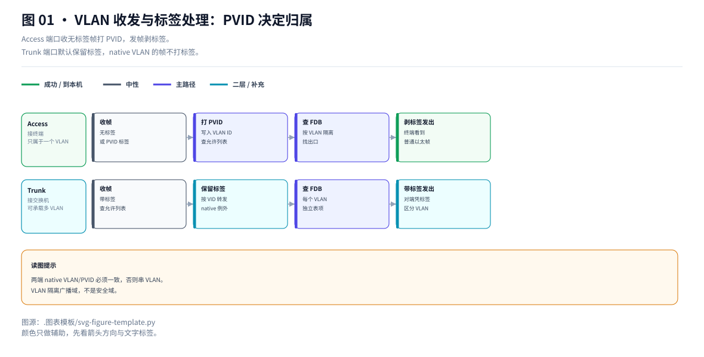
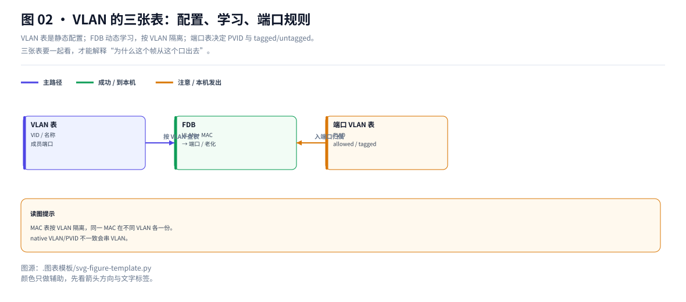

# VLAN 与 Trunk

VLAN 用 12 位标签把一台物理交换机切成多个逻辑广播域：同一 VLAN 内二层直通，不同 VLAN 必须经过三层。

> 本篇定位：802.1Q 标签、Access/Trunk/Hybrid 端口的收发规则、PVID 与 native VLAN、VLAN 间通信。STP 与 LACP 只做关联。

## 目录

- [1 一句话模型](#s1)
- [2 速览](#s2)
- [3 标签格式](#s3)
- [4 端口与转发流程](#s4)
- [5 状态与表项](#s5)
- [6 设计取舍与边界](#s6)
- [7 与相邻协议的关系](#s7)
- [8 参考与关联](#s8)

## 1 · 一句话模型：在帧上贴房间号

交换机像一栋楼，VLAN 是楼层。帧进楼时贴一个「楼层号」，出门时按楼层号决定从哪个门走。没有标签的帧，按端口的默认楼层（PVID）处理。

```text
带标签帧（Trunk）──► 交换机 ──► 按 VID 查表转发 ──► 带标签/剥标签发出
不带标签帧（Access）──► 打上 PVID ──► 同上
```

三个关键认知：

1. **VLAN 是二层隔离**：隔离广播域，不改变 IP 寻址，也不等于安全域。
2. **标签只在交换机之间有意义**：终端通常看不到标签，Access 端口负责打/剥。
3. **PVID 决定「没标签的帧归哪个 VLAN」**：两端 PVID 不一致，流量就会串 VLAN。

## 2 · 速览

| 项 | 内容 |
| --- | --- |
| 所属层 | 链路层 |
| 标准 | IEEE 802.1Q；QinQ 用 802.1ad |
| 标签长度 | 4 字节（32 位） |
| 关键字段 | TPID `0x8100`、PCP 3 位、DEI 1 位、VID 12 位 |
| 可用 VLAN | 1–4094（0 和 4095 保留） |
| 帧长变化 | 1518 → 1522 字节 |
| 端口类型 | Access、Trunk、Hybrid |
| 默认 PVID | 通常为 1 |
| 典型设备 | 交换机、网桥、AP、路由器子接口 |

## 3 · 标签格式

### 3.1 四个字段

| 字段 | 长度 | 作用 | 注意 |
| --- | --- | --- | --- |
| TPID | 16 位 | 标签协议标识 | 固定 `0x8100`；QinQ 外层用 `0x88A8` |
| PCP | 3 位 | 优先级 0–7 | 供 QoS 队列调度，和 VLAN 归属无关 |
| DEI | 1 位 | 丢弃合格指示 | 旧称 CFI，以太网通常为 0 |
| VID | 12 位 | VLAN ID | 0 和 4095 保留，可用 1–4094 |

### 3.2 插在哪

标签插在**源 MAC 与 EtherType 之间**：

```text
原帧：  DA(6) | SA(6) | Type(2) | Payload | FCS
带标：  DA(6) | SA(6) | TPID(2) | TCI(2) | Type(2) | Payload | FCS
```

因此最大帧长从 1518 变成 1522。抓包工具通常把带标签的帧显示为 `vlan <id>`，并把内层类型标成 IPv4/ARP 等。

### 3.3 QinQ

802.1Q 只有 4094 个 VLAN，运营商要为每个用户区分业务时不够用。QinQ（802.1ad）在以太帧里再套一层标签：

```text
DA | SA | 外层 TPID(0x88A8) | 外层 VID | 内层 TPID(0x8100) | 内层 VID | Type | Payload
```

外层标识业务/运营商，内层标识用户。代价是帧更长、MTU 开销更大，且两端必须约定好标签层次。

## 4 · 端口与转发流程



**读图**：上行 Access、下行 Trunk：收帧按 PVID 归属，发帧按端口类型决定剥标签还是保留标签。

> 图源：`images/图01-VLAN收发与标签处理.svg`

### 4.1 三种端口

| 端口类型 | 收到带标签帧 | 收到不带标签帧 | 发送时 |
| --- | --- | --- | --- |
| Access | 标签不是 PVID 则丢弃 | 打上 PVID | 总是剥标签 |
| Trunk | 在允许列表内则转发 | 打上 PVID（native VLAN） | 默认保留标签；native VLAN 剥标签 |
| Hybrid | 按允许列表，可配置是否剥 | 打上 PVID | 按配置决定剥/留 |

### 4.2 Access 端口

- 只属于一个 VLAN，PVID 就是该 VLAN。
- 收无标签帧 → 打 PVID；收带标签帧 → 标签不等于 PVID 就丢弃。
- 发帧 → 剥标签，终端看到普通以太帧。

Access 端口适合接 PC、打印机、AP 管理口等不认识 VLAN 的设备。

### 4.3 Trunk 端口

- 连接交换机、路由器子接口、虚拟化主机。
- 默认允许所有 VLAN，可用允许列表限制。
- 发帧默认保留标签；**native VLAN** 的帧不打标签。
- 两端 native VLAN/PVID 必须一致，否则无标签帧会被归到不同 VLAN，形成「VLAN 错位」。

### 4.4 Hybrid 端口

介于 Access 与 Trunk 之间：可以按 VLAN 配置「发送时剥标签」还是「保留标签」。适合一个端口既接普通终端又透传多个 VLAN 的场景，配置灵活但更容易出错。

### 4.5 转发流程

```text
收帧
 ├─ 带标签：查该端口允许列表 → 允许则按 VID 转发，否则丢弃
 └─ 不带标签：打上端口 PVID → 按该 VLAN 转发
查目标 MAC（在该 VLAN 的 FDB 内）
 ├─ 命中：从对应端口发出（按端口类型决定剥/留标签）
 └─ 未命中/广播/组播：在该 VLAN 内泛洪
```

关键点：**MAC 表按 VLAN 隔离**。同一个 MAC 在 VLAN 10 和 VLAN 20 各有一份表项，不会互相覆盖。

### 4.6 VLAN 间通信

VLAN 隔离了二层，跨 VLAN 必须经过三层：

| 方式 | 做法 | 适用 |
| --- | --- | --- |
| 单臂路由 | 路由器一个物理口做多个子接口，每个子接口对应一个 VLAN | 小型网络 |
| 三层交换机 SVI | 每个 VLAN 一个虚拟接口，交换机内部路由 | 园区网主流 |
| 多物理接口 | 每个 VLAN 一个独立接口 | 少见，成本高 |

无论哪种方式，**默认网关**都要指向对应 VLAN 的三层接口。

## 5 · 状态与表项



**读图**：VLAN 表是静态配置，FDB 动态学习且按 VLAN 隔离，端口表决定 PVID 与 tagged/untagged。

> 图源：`images/图02-VLAN三张表.svg`


VLAN 本身没有协议状态机，它的「状态」体现在三张表：

| 表 | 内容 | 老化/更新 |
| --- | --- | --- |
| VLAN 表 | VID、名称、成员端口 | 静态配置 |
| FDB（MAC 表） | VLAN + MAC → 端口 | 动态学习，默认约 300 秒老化 |
| 端口 VLAN 表 | 端口允许的 VLAN、PVID、tagged/untagged | 静态配置 |

STP 按 VLAN 或 MSTP 实例运行：每个实例独立选举根桥、独立阻塞端口。所以「VLAN 划分」和「STP 实例划分」要一起设计，否则可能出现某个 VLAN 被阻塞、另一个 VLAN 正常的现象。

## 6 · 设计取舍与边界

### 6.1 标签 vs 端口隔离

VLAN 用标签在共享链路上区分广播域，比「每个 VLAN 拉一根线」节省端口和布线。代价是标签增加 4 字节、配置复杂、跨厂商互通要约定 TPID/PVID。

### 6.2 4094 个 VLAN 的上限

12 位 VID 决定了上限。大型网络用 QinQ 扩展，或直接用 VXLAN 等 overlay 把二层域解耦。VLAN 数量不是无限的，规划时要留余量。

### 6.3 native VLAN 的坑

native VLAN 的帧不带标签，两端 PVID 不一致时，帧会被归到错误的 VLAN。很多「时通时断」「串 VLAN」问题都源于此。工程上要么两端显式配置一致，要么干脆不用 native VLAN。

### 6.4 VLAN 不是安全边界

VLAN 只隔离广播域，不提供加密或访问控制。攻击者可以通过 trunk 协商、VLAN 跳转、ARP 欺骗跨越 VLAN。安全要靠 ACL、防火墙、私有 VLAN、端口安全。

### 6.5 Access/Trunk 的取舍

Access 简单、终端无感；Trunk 灵活、节省链路。混合场景用 Hybrid，但规则越灵活越容易配错。能用简单模型解决，就不要用 Hybrid。

## 7 · 与相邻协议的关系

| 相邻对象 | 关系 |
| --- | --- |
| 以太网 | VLAN 标签插在以太头中；帧长 1518 → 1522 |
| ARP | ARP 广播只在本 VLAN 内泛洪，跨 VLAN 需要网关代理 |
| STP/MSTP | 每个 VLAN 或实例独立防环；VLAN 与实例要一起规划 |
| LACP | 聚合链路通常承载多个 VLAN 的 Trunk |
| 三层交换/路由 | VLAN 间通信必须经过三层接口 |
| 20-网络子系统 | Linux bridge 的 VLAN filtering、DSA 的 VLAN 处理归 20 |

一句话：**VLAN 负责「把广播域切开」，不负责「让不同 VLAN 通」，后者是三层的事。**

## 8 · 参考与关联

**标准**

- IEEE 802.1Q：Virtual Bridged Local Area Networks
- IEEE 802.1ad：Provider Bridging（QinQ）
- IEEE 802.1D/w/s：STP/RSTP/MSTP

**关联**

- [00-链路层概览.md](./00-链路层概览.md)
- [01-以太网与MAC.md](./01-以太网与MAC.md)：帧格式与 FDB
- [05-ARP.md](./05-ARP.md)：广播域内的地址解析
- [STP/RSTP/MSTP](03-STP-RSTP-MSTP.md)：VLAN 与实例的防环
- [链路聚合 LACP](04-链路聚合LACP.md)：Trunk 的链路捆绑
- 20-平台与系统/21-Linux/06-网络子系统：bridge VLAN filtering

---

> **本篇定位**：VLAN 的标签、端口规则与转发流程，重点讲清 PVID、native VLAN 和 Access/Trunk 的差别。
> **素材来源**：`studyspace/1.知识体系/8.路由与交换/m-3-VLAN.md`（主）、`studyspace/1.知识体系/2.TCP IP协议/m-2-链路层.md`（补）。
> **待验证**：各厂商对 native VLAN、Hybrid 端口、允许列表的默认行为不同。
