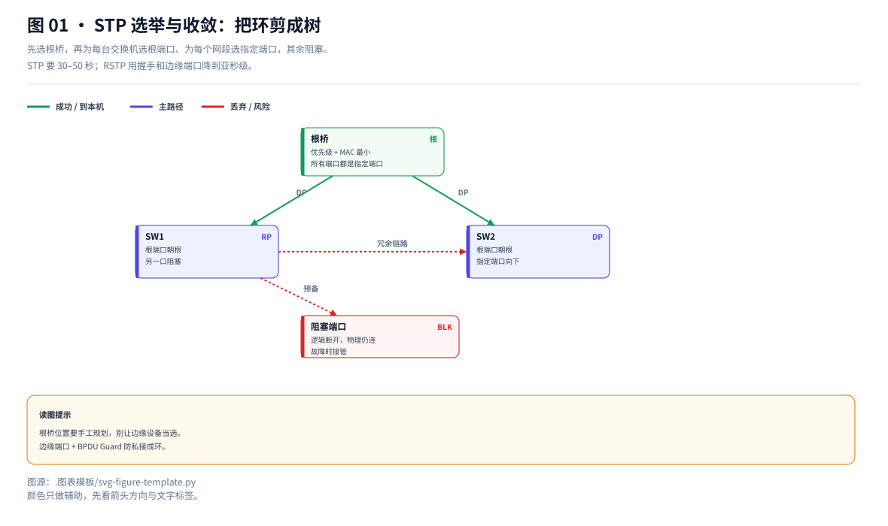
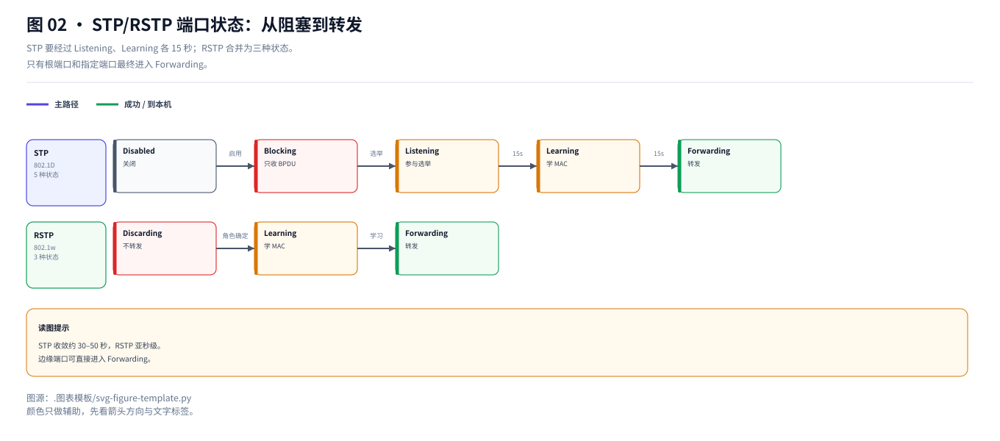

# STP/RSTP/MSTP

二层网络最怕环路：广播帧会无限循环。STP 用 BPDU 选出一棵无环的树，逻辑上堵住冗余端口；RSTP 把收敛从几十秒压到亚秒级；MSTP 让不同 VLAN 走不同的树。

> 本篇定位：STP 的选举与端口状态、BPDU、RSTP 的快速收敛、MSTP 的实例映射。VLAN 与 LACP 只做关联。

## 目录

- [1 一句话模型](#s1)
- [2 速览](#s2)
- [3 BPDU 报文](#s3)
- [4 选举与收敛流程](#s4)
- [5 状态与定时器](#s5)
- [6 设计取舍与边界](#s6)
- [7 与相邻协议的关系](#s7)
- [名词解释](#名词解释)
- [8 参考与关联](#s8)

## 1 · 一句话模型：把环剪成树

交换机之间有多条路径时，STP 选一个「树根」，再为每个网段选一个「唯一出口」，其余端口逻辑阻塞。物理上仍有环，逻辑上没有环。

```text
      根桥
     /    \
    A      B
     \    /
      C（冗余链路）
```

三个关键认知：

1. **根桥是选举出来的**，不是配置出来的（除非手工指定优先级）。
2. **只有根端口和指定端口转发**，其余阻塞，所以无环。
3. **STP 只防环，不隔离广播域**；广播域要靠 VLAN。

## 2 · 速览

| 项 | 内容 |
| --- | --- |
| 所属层 | 链路层 |
| 标准 | IEEE 802.1D（STP）、802.1w（RSTP）、802.1s（MSTP） |
| 报文 | BPDU，目的组播 `01:80:C2:00:00:00` |
| 发送间隔 | Hello Time 默认 2 秒 |
| 端口状态 | STP 5 种；RSTP 3 种 |
| 定时器 | Hello 2s、Forward Delay 15s、Max Age 20s |
| 收敛时间 | STP 约 30–50s；RSTP 亚秒级 |
| 端口角色 | 根端口、指定端口、预备/替代端口、备份端口 |
| 典型设备 | 交换机、网桥 |

## 3 · BPDU 报文

BPDU 采用 802.3 封装，目的 MAC 是保留组播地址 `01:80:C2:00:00:00`，普通终端不转发。默认每 2 秒发一次。

配置 BPDU 的关键字段：

| 字段 | 作用 |
| --- | --- |
| 根桥 ID | 当前认为的根桥：优先级 + MAC |
| 根路径开销 | 本端口到根桥的累计开销 |
| 发送桥 ID | 发送该 BPDU 的交换机：优先级 + MAC |
| 发送端口 ID | 发送端口：端口优先级 + 端口号 |
| 定时器 | Hello、Max Age、Forward Delay |
| 标志 | 拓扑变化、拓扑变化确认等 |

比较规则（越小越优）：

```text
根桥 ID → 根路径开销 → 发送桥 ID → 发送端口 ID
```

先比根桥，根桥相同再比开销，开销相同再比上游桥，最后比端口。

## 4 · 选举与收敛流程



**读图**：根桥在上，根端口朝根、指定端口向下、其余阻塞；RSTP 用 Proposal/Agreement 替代定时器等待。

> 图源：`images/图01-STP选举与收敛.svg`

### 4.1 STP 四步

1. **选根桥**：所有交换机比较桥 ID，最小者成为根桥。根桥所有端口都是指定端口。
2. **选根端口**：每台非根交换机选一个到根桥开销最小的端口。
3. **选指定端口**：每个网段选一个到根桥开销最小的端口，负责向该网段转发。
4. **阻塞其余端口**：既不是根端口也不是指定端口的，进入阻塞。

端口角色一句话：

- **根端口**：交换机用来「找根」的端口，朝向上游。
- **指定端口**：交换机用来「喂数据」给下游网段的端口。
- **预备/替代端口**：备份根端口，根端口故障时接管。
- **备份端口**：备份指定端口，指定端口故障时接管（RSTP 定义）。

### 4.2 STP 的收敛慢在哪

端口从阻塞到转发要经过：

```text
Blocking → Listening（15s）→ Learning（15s）→ Forwarding
```

链路故障后还要等 Max Age（20s）判定失效，因此总收敛约 30–50 秒。这段时间业务中断，是 RSTP 出现的直接原因。

### 4.3 RSTP 的四个加速机制

| 机制 | 做法 |
| --- | --- |
| Proposal/Agreement | 指定端口发 Proposal，对端根端口回 Agreement，双方立即进入转发，不等定时器 |
| 边缘端口 | 接终端的端口直接转发，不参与生成树；收到 BPDU 自动降级为普通端口 |
| 根端口快速切换 | 替代端口检测到根端口故障后立即接管（点对点链路） |
| 拓扑变化传播 | 只在收到 TC 时清相关 FDB，不再周期性泛洪 TC |

RSTP 把 5 种状态合并为 3 种：Discarding、Learning、Forwarding；端口角色增加替代端口和备份端口。

### 4.4 MSTP 的实例映射

MSTP 把多个 VLAN 映射到一个「实例」，每个实例独立跑 RSTP，独立选根。这样可以做到：

- VLAN 10 走左边链路，VLAN 20 走右边链路，实现负载分担。
- 不同实例的阻塞端口不同，避免「一棵树堵死所有冗余链路」。

MSTP 还有 IST（内部生成树）和 CST（公共生成树）的概念，用于与单实例区域互通；配置时必须保证区域名、修订级别、VLAN 映射三者一致，否则会分成不同区域。

## 5 · 状态与定时器



**读图**：STP 要经过 Listening/Learning 各 15 秒；RSTP 合并为 Discarding/Learning/Forwarding 三种。

> 图源：`images/图02-STP端口状态.svg`


### 5.1 STP 五种端口状态

| 状态 | 收 BPDU | 发 BPDU | 学 MAC | 转发数据 |
| --- | --- | --- | --- | --- |
| Disabled | 否 | 否 | 否 | 否 |
| Blocking | 是 | 否 | 否 | 否 |
| Listening | 是 | 是 | 否 | 否 |
| Learning | 是 | 是 | 是 | 否 |
| Forwarding | 是 | 是 | 是 | 是 |

### 5.2 RSTP 三种状态

| 状态 | 含义 |
| --- | --- |
| Discarding | 不转发、不学 MAC（合并 Disabled/Blocking/Listening） |
| Learning | 学 MAC，不转发 |
| Forwarding | 正常转发 |

### 5.3 三个定时器

| 定时器 | 默认 | 作用 |
| --- | --- | --- |
| Hello Time | 2s | BPDU 发送间隔 |
| Forward Delay | 15s | Listening/Learning 停留时间 |
| Max Age | 20s | 多久收不到 BPDU 就认为根/链路失效 |

定时器只在 STP 中强依赖；RSTP 主要靠握手，定时器只用于超时判定。

## 6 · 设计取舍与边界

### 6.1 无环 vs 收敛速度

STP 用「先阻塞、再慢慢放开」保证无环，代价是收敛慢。RSTP 用显式握手和边缘端口加速，但依赖点对点链路和对端配合。MSTP 在此之上增加多实例，复杂度更高。

### 6.2 边缘端口的两面性

接终端的端口设为边缘端口，可以立即转发、避免终端上下线触发拓扑变化。但如果边缘端口误接到交换机，收到 BPDU 后必须降级；否则可能形成环路。工程上配合 **BPDU Guard**：收到 BPDU 就关闭端口。

### 6.3 根桥的位置

根桥应放在网络中心、性能高的交换机上。默认优先级 32768，所有交换机相同时靠 MAC 比较，可能选到一台边缘设备。手工把核心交换机优先级调低（如 4096）可以稳定根桥位置。

### 6.4 保护机制

| 机制 | 防什么 |
| --- | --- |
| BPDU Guard | 边缘端口收到 BPDU，防私接交换机成环 |
| Root Guard | 防止下游设备抢占根桥 |
| Loop Guard | 防止单向链路导致阻塞端口误转发 |
| TC 保护 | 限制拓扑变化报文频率，防 FDB 频繁刷新 |

### 6.5 STP 不是万能

- 只防二层环，不防三层环（路由协议自己处理）。
- 不隔离广播域，广播域过大仍会风暴。
- 不防 MAC 欺骗、ARP 欺骗。
- 收敛期间仍可能短暂环路/丢包。

## 7 · 与相邻协议的关系

| 相邻对象 | 关系 |
| --- | --- |
| 以太网 | BPDU 是以太帧，目的 MAC 为保留组播 |
| VLAN | 每个 VLAN 或 MSTP 实例独立防环；VLAN 与实例要一起规划 |
| LACP | 聚合链路对 STP 表现为一条逻辑链路，避免成员口被分别阻塞 |
| ARP/广播 | STP 防止广播帧在环里无限循环 |
| 三层路由 | 三层环由路由协议/水平分割处理，不归 STP |

一句话：**STP 负责「把二层环剪成树」，不负责「隔离广播域」，也不负责「三层选路」。**

## 名词解释

> 缩写给出英文全称；非缩写用“—”表示。

| 术语 | 英文全称 | 解释 |
| --- | --- | --- |
| STP/RSTP/MSTP | Spanning Tree Protocol / Rapid Spanning Tree Protocol / Multiple Spanning Tree Protocol | 生成树/快速生成树/多实例生成树。 |
| BPDU | Bridge Protocol Data Unit | 生成树协议报文。 |
| 根桥 | — | 被选为树根的交换机。 |
| 根端口 | — | 交换机到根桥开销最小的端口。 |
| 指定端口 | — | 网段上负责转发的端口。 |
| 阻塞端口 | — | 逻辑上不转发、用于防环的端口。 |
| Hello/Forward Delay/Max Age | — | STP 的三个定时器。 |
| 边缘端口 | — | 接终端、可直接转发的端口。 |
| BPDU Guard | Bridge Protocol Data Unit Guard | 边缘口收到 BPDU 就关闭的保护。 |
| TC | Topology Change | 拓扑变化通知。 |

## 8 · 参考与关联

**标准**

- IEEE 802.1D：MAC Bridges（STP）
- IEEE 802.1w：Rapid Reconfiguration（RSTP）
- IEEE 802.1s：Multiple Spanning Trees（MSTP）
- IEEE 802.1Q：VLAN

**关联**

- [00-链路层概览.md](./00-链路层概览.md)
- [01-以太网与MAC.md](./01-以太网与MAC.md)：FDB 与泛洪
- [02-VLAN与Trunk.md](./02-VLAN与Trunk.md)：广播域与实例映射
- [链路聚合 LACP](04-链路聚合LACP.md)：聚合链路与 STP 的关系
- 20-平台与系统/21-Linux/06-网络子系统：Linux bridge STP 实现

---

> **本篇定位**：STP/RSTP/MSTP 的选举、BPDU、状态与收敛机制，重点讲清「为什么慢、RSTP 怎么快、MSTP 怎么分担」。
> **素材来源**：`studyspace/1.知识体系/8.路由与交换/m-4-STP.md`（主），BPDU 字段与保护机制按 IEEE 802.1D/w 补写。
> **待验证**：各厂商默认优先级、路径开销算法（短/长）、边缘端口与 Guard 默认行为不同。
