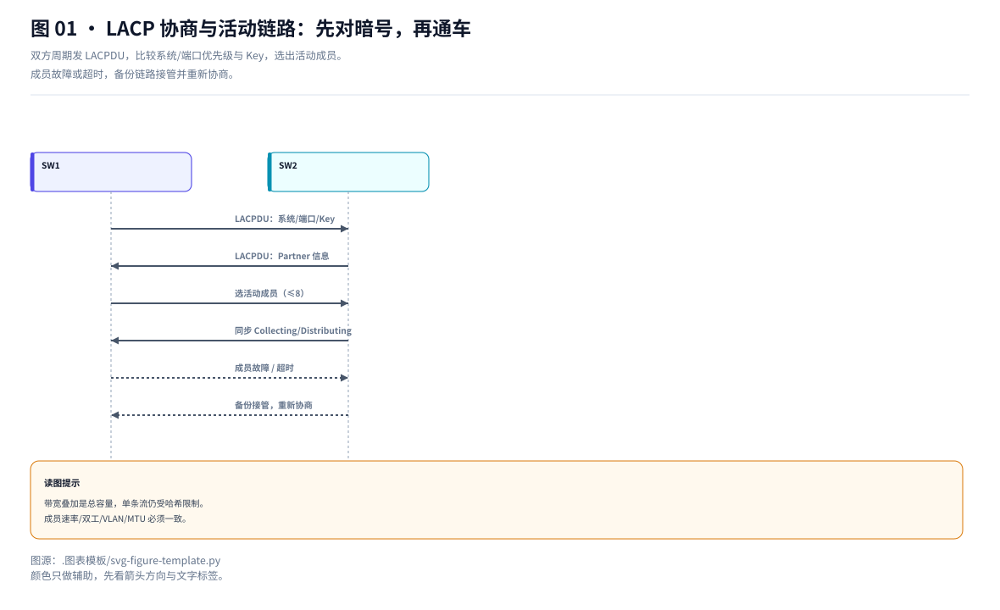
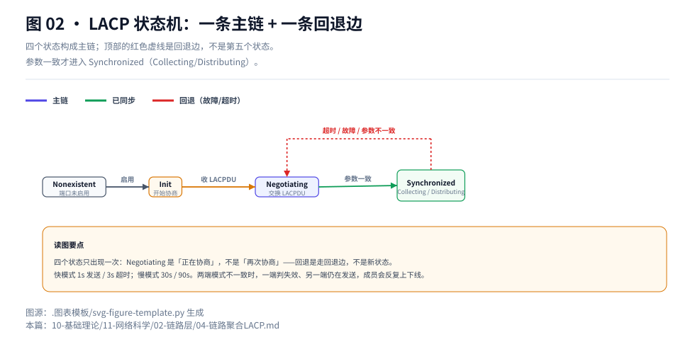

# 链路聚合与 LACP

链路聚合把多条物理链路捆成一条逻辑链路：带宽叠加、单线故障不断网。LACP 负责和对端协商，确认哪些成员能一起工作。

> 本篇定位：聚合的逻辑、LACPDU 协商、活动链路选择、负载分担与边界。STP、VLAN 只做关联。

## 目录

- [1 一句话模型](#s1)
- [2 速览](#s2)
- [3 LACPDU 报文](#s3)
- [4 协商与故障切换流程](#s4)
- [5 状态机与定时器](#s5)
- [6 设计取舍与边界](#s6)
- [7 与相邻协议的关系](#s7)
- [名词解释](#名词解释)
- [8 参考与关联](#s8)

## 1 · 一句话模型：多车道，一个出口

聚合组像高速公路的多条车道：上层看到的是一个逻辑接口，底层把流量按哈希分到各条物理链路。LACP 是车道之间的对讲机，确认对端也在同一组、哪几条能通车。

```text
        ┌─ 成员口 1 ─┐
应用 ──►├─ 成员口 2 ─┤──► 对端聚合组
        └─ 成员口 3 ─┘
        逻辑接口（一个 IP/MAC/STP 端口）
```

三个关键认知：

1. **聚合是逻辑接口**：STP、VLAN、路由都把它当一条链路。
2. **带宽叠加是「总容量」**，单条流仍受哈希限制，可能只走一条成员链路。
3. **成员链路必须参数一致**：速率、双工、VLAN 模式、MTU 不一致会导致协商失败或流量异常。

## 2 · 速览

| 项 | 内容 |
| --- | --- |
| 所属层 | 链路层 |
| 标准 | IEEE 802.3ad（现并入 802.1AX） |
| 报文 | LACPDU（慢协议，EtherType `0x8809`，子类型 1） |
| 目的 MAC | `01:80:C2:00:00:02` |
| 发送周期 | 快 1 秒 / 慢 30 秒 |
| 超时 | 短 3 秒 / 长 90 秒 |
| 最大活动成员 | 标准 8 条（厂商可扩展） |
| 关键参数 | 系统优先级、系统 MAC、端口优先级、端口号、Key |
| 聚合方式 | 手工/静态、LACP 动态 |

## 3 · LACPDU 报文

LACPDU 携带本端（Actor）和对端（Partner）的状态信息，核心字段：

| 字段 | 作用 |
| --- | --- |
| Actor System Priority | 本端系统优先级，数值小者优先 |
| Actor System MAC | 本端系统标识 |
| Actor Key | 本端聚合组标识，Key 相同才可能聚在一起 |
| Actor Port Priority | 本端端口优先级，决定成员取舍 |
| Actor Port Number | 本端端口号 |
| Partner 同组字段 | 对端对应的系统/端口/Key 信息 |
| State | 活动、超时、聚合、同步、收集、分发等状态位 |

State 里的关键位：

| 位 | 含义 |
| --- | --- |
| Activity | 主动/被动模式 |
| Timeout | 快/慢超时 |
| Aggregation | 是否允许聚合 |
| Synchronization | 是否已同步，可参与转发 |
| Collecting / Distributing | 是否允许收/发 |
| Defaulted / Expired | 对端信息是否超时 |

## 4 · 协商与故障切换流程



**读图**：双方交换 LACPDU，先比系统优先级再比端口；活动成员≤8，故障或超时后备份接管。

> 图源：`images/图01-LACP协商与活动链路.svg`

### 4.1 动态聚合五步

1. 双方周期发送 LACPDU，携带系统优先级、MAC、端口优先级、端口号、Key。
2. 收到对端信息后，比较 Key 与参数；Key 一致、参数兼容的端口进入候选。
3. 按系统优先级、端口优先级、端口号选出**活动链路集合**，其余作为备份。
4. 双方 State 进入同步（Synchronization=1）、收集/分发（Collecting/Distributing=1），开始转发。
5. 成员故障或超时，重新协商，备份链路接管。

### 4.2 主控方与成员选择

- **系统优先级**小的一端成为主控方，由它决定活动成员。
- 系统优先级相同，比系统 MAC，小者优先。
- 端口优先级小者优先加入；再相同比端口号。

### 4.3 静态聚合与动态聚合

| 对比项 | 静态（手工） | 动态（LACP） |
| --- | --- | --- |
| 协商 | 无，直接捆绑 | LACPDU 自动协商 |
| 对端误配 | 难发现，可能成环/丢包 | Key/参数不一致可发现 |
| 故障切换 | 依赖链路状态/上层 | LACP 超时快速剔除 |
| 配置 | 简单 | 两端参数必须一致 |
| 适用 | 对端不支持 LACP、简单环境 | 交换机互联、服务器双网卡 |

### 4.4 异常分支

| 异常 | 表现 | 原因 |
| --- | --- | --- |
| 只有部分成员活动 | 带宽不叠加 | 速率/双工/Key/优先级不一致 |
| 聚合组起不来 | 逻辑口 down | 对端未配置、LACPDU 被拦、静态/动态模式不匹配 |
| 流量只走一条 | 总带宽够但单流慢 | 哈希因子固定，单条流落在一个成员 |
| 成员频繁抖动 | 流量时断时续 | 链路误码、超时模式不匹配、光模块问题 |
| STP 阻塞成员 | 聚合后仍不通 | 成员口被 STP 当成独立链路，需按聚合口计算 |

## 5 · 状态机与定时器



**读图**：端口从 Init 到 Negotiating，参数一致才 Synchronized；故障或超时退回协商。

> 图源：`images/图02-LACP状态机.svg`


LACP 每个端口维护一组状态变量，按事件迁移，核心状态可以简化为：

```text
Nonexistent → Init → Negotiating → Synchronized（Collecting/Distributing）
                                   └─ 超时/故障 → 重新协商
```

| 定时器 | 快模式 | 慢模式 | 作用 |
| --- | --- | --- | --- |
| 发送周期 | 1s | 30s | LACPDU 发送间隔 |
| 超时 | 3s | 90s | 多久收不到对端就判定失效 |

快模式检测快，但报文多；慢模式开销小，故障发现慢。两端超时模式不一致时，可能一端认为对端失效、另一端还在正常发送，导致成员反复上下线。

## 6 · 设计取舍与边界

### 6.1 带宽叠加的真相

聚合增加的是**总容量**，不是单条流的带宽。哈希按五元组/ MAC 等因子选成员，同一条流始终走同一条链路。要提升单流带宽，需要多流并行或换更高带宽的链路。

### 6.2 哈希不均

常见哈希因子：源 MAC、目的 MAC、源/目的 IP、源/目的端口。流量特征单一时（如只有一对 IP 的大流量），哈希会退化到一条成员。解决方法是调整哈希因子或增加流数量，而不是盲目加成员。

### 6.3 成员一致性

以下参数必须一致，否则协商失败或行为异常：

- 速率、双工、MTU
- VLAN 模式（Access/Trunk）、允许列表、PVID
- STP 状态、QoS 策略
- LACP 模式（静态/动态）、Key、超时模式

### 6.4 8 条成员的上限

标准规定一个聚合组最多 8 条活动链路，更多成员只能做备份。厂商扩展可以支持更多，但跨厂商互联时按标准来。

### 6.5 跨设备聚合

MC-LAG/堆叠可以把成员分散到两台设备，提高可靠性，但需要厂商私有协议或标准扩展，配置复杂、排障困难。普通 LACP 只解决「同一对设备之间」的捆绑。

### 6.6 与 STP 的关系

聚合口对 STP 是一个逻辑端口，STP 不会单独阻塞某个成员。如果配置成「成员口各自跑 STP」，可能出现成员被阻塞、聚合失效。正确做法是先在物理口做聚合，再在聚合口上跑 STP/VLAN。

## 7 · 与相邻协议的关系

| 相邻对象 | 关系 |
| --- | --- |
| 以太网 | 成员口是以太网端口；LACPDU 是以太慢协议帧 |
| VLAN | 聚合口通常承载 Trunk，成员口 VLAN 配置必须一致 |
| STP | 聚合口是一个逻辑端口，STP 按聚合口计算 |
| 三层 | 聚合口可配 IP/子接口，作为三层链路 |
| 服务器双网卡 | 服务器侧 bonding/teaming 与交换机 LACP 对接 |

一句话：**LACP 负责「把多条链路安全地捆成一条」，不负责「单条流跑得更快」。**

## 名词解释

> 缩写给出英文全称；非缩写用“—”表示。

| 术语 | 英文全称 | 解释 |
| --- | --- | --- |
| LACP | Link Aggregation Control Protocol | 链路聚合控制协议。 |
| LACPDU | Link Aggregation Control Protocol Data Unit | LACP 协商报文。 |
| Actor/Partner | — | 本端/对端的 LACP 状态。 |
| 系统优先级 | — | 决定哪一端主控。 |
| 端口优先级 | — | 决定成员端口取舍。 |
| Key | — | 聚合组标识，相同才可能聚合。 |
| 活动链路 | — | 实际参与转发的成员链路。 |
| 静态聚合 | — | 手工捆绑，不协商。 |
| 动态聚合 | — | 通过 LACP 自动协商。 |
| MC-LAG | Multi-Chassis Link Aggregation Group | 跨设备链路聚合。 |

## 8 · 参考与关联

**标准**

- IEEE 802.3ad：Link Aggregation
- IEEE 802.1AX：Link Aggregation（现行）
- IEEE 802.1Q：VLAN

**关联**

- [00-链路层概览.md](./00-链路层概览.md)
- [01-以太网与MAC.md](./01-以太网与MAC.md)：以太帧与慢协议
- [02-VLAN与Trunk.md](./02-VLAN与Trunk.md)：聚合口上的 Trunk
- [03-STP-RSTP-MSTP.md](./03-STP-RSTP-MSTP.md)：聚合与防环
- 20-平台与系统/21-Linux/06-网络子系统：Linux bonding/team 实现

---

> **本篇定位**：链路聚合的逻辑、LACP 协商与成员选择，重点讲清「带宽叠加不等于单流加速」。
> **素材来源**：`studyspace/1.知识体系/8.路由与交换/m-5-链路聚合.md`（主），LACPDU 字段与状态机按 IEEE 802.1AX 补写。
> **待验证**：各厂商最大成员数、哈希因子、超时默认值与 MC-LAG 支持差异较大。
