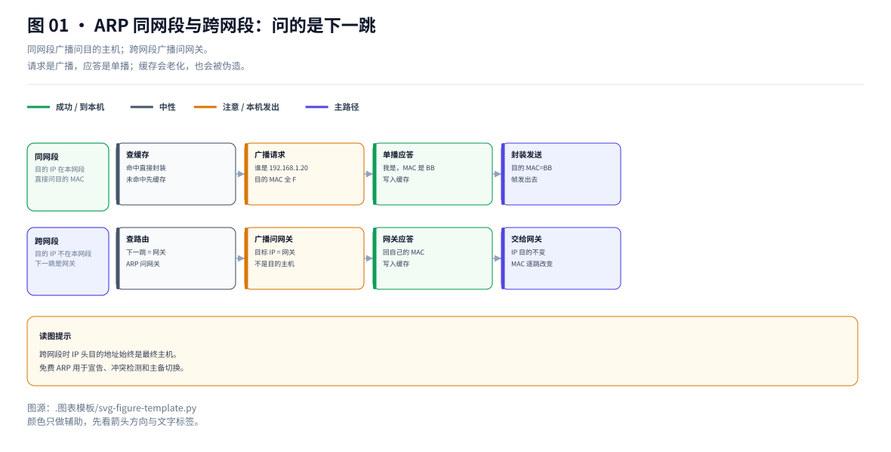
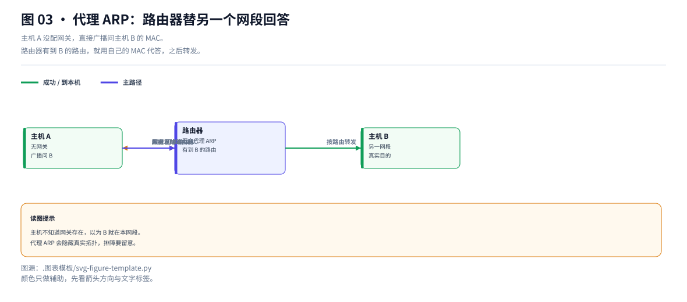
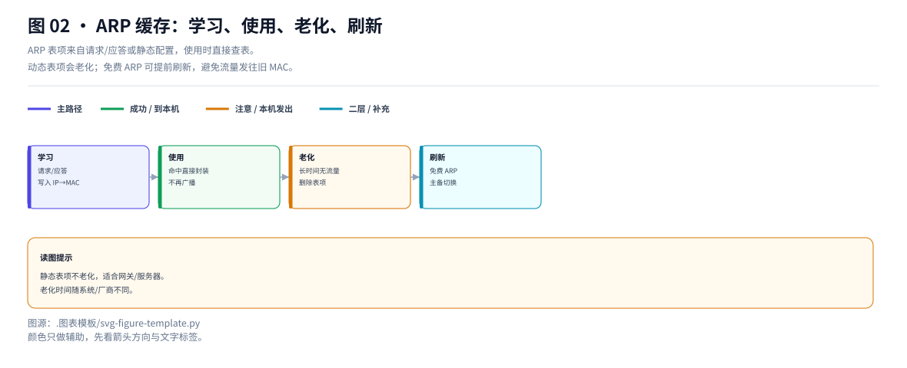

# ARP

ARP 是 IPv4 的地址翻译官：拿 IP 地址换 MAC 地址。它只在本广播域内喊话；跨网段时，问的是网关。

> 本篇定位：讲清 ARP 为什么存在、报文长什么样、同网段与跨网段怎么解析、缓存与免费 ARP 怎么工作。NDP（IPv6 的对应机制）只做对照，细节在 IPv6 篇。

## 目录

- [1 一句话模型](#s1)
- [2 速览](#s2)
- [3 报文格式](#s3)
- [4 交互流程](#s4)
- [5 缓存、老化与定时器](#s5)
- [6 设计取舍与边界](#s6)
- [7 与相邻协议的关系](#s7)
- [名词解释](#名词解释)
- [8 参考与关联](#s8)

## 1 · 一句话模型：IP 是地址，MAC 是门牌

网络层只认 IP，链路层只认 MAC，两者都是 32/48 位，但**没有任何数学关系**，不能互相推导。ARP 就是两者之间的桥：

```text
我要发 IP 包给 192.168.1.20
  └─ 但以太帧只能填 MAC
       └─ 查 ARP 缓存：192.168.1.20 → ?
            └─ 没有？广播问一句「谁的 IP 是 192.168.1.20」
                 └─ 对方单播回答「是我，我的 MAC 是 xx」
```

三个关键认知：

1. **ARP 不跨广播域。** 请求是广播帧，路由器不转发广播，所以 ARP 只能解析同一广播域内的地址。
2. **跨网段解析的是网关。** 主机发现目的 IP 不在本网段，就把「下一跳」设成网关，ARP 问的是网关的 MAC。
3. **ARP 缓存是软状态。** 表项会老化、会被新报文覆盖，也会被伪造报文污染。

## 2 · 速览

| 项 | 内容 |
| --- | --- |
| 所属位置 | 链路层与网络层之间（常称 2.5 层） |
| 封装 | 直接封装在以太帧中，EtherType `0x0806`，不经过 IP |
| 报文长度 | 28 字节（不含以太头）；不足最小帧长时由以太网填充 |
| 请求方式 | 广播（目的 MAC `FF:FF:FF:FF:FF:FF`） |
| 应答方式 | 单播 |
| 核心字段 | 发送端 IP/MAC、目标端 IP/MAC、操作码 |
| 主要标准 | RFC 826（ARP）、RFC 1027（代理 ARP）、RFC 5227（地址冲突检测） |
| IPv6 对应 | NDP（邻居发现），用 ICMPv6 承载，不用 ARP |

## 3 · 报文格式

ARP 报文本体固定 28 字节，前面是以太网头（DA + SA + EtherType `0x0806`）。

| 字段 | 长度 | 说明 | 以太网/IPv4 取值 |
| --- | --- | --- | --- |
| 硬件类型 Hardware Type | 2 字节 | 链路层类型 | 1（以太网） |
| 协议类型 Protocol Type | 2 字节 | 要解析的上层协议 | `0x0800`（IPv4） |
| 硬件地址长度 HLen | 1 字节 | MAC 长度 | 6 |
| 协议地址长度 PLen | 1 字节 | IP 长度 | 4 |
| 操作码 Opcode | 2 字节 | 报文类型 | 1 请求、2 应答、3 RARP 请求、4 RARP 应答 |
| 发送端 MAC | 6 字节 | 发送方硬件地址 | — |
| 发送端 IP | 4 字节 | 发送方协议地址 | — |
| 目标端 MAC | 6 字节 | 接收方硬件地址 | 请求时全 0；应答时填请求方 MAC |
| 目标端 IP | 4 字节 | 要解析的协议地址 | — |

三个字段要特别注意：

- **请求报文的目标 MAC 全 0**：发送方正是因为不知道目标 MAC 才发请求。
- **目标 IP 必须填**：接收方靠它判断「这条请求是不是问我」。
- **发送端 IP/MAC 必须填**：对方收到后可直接把这对映射写进自己的缓存，应答也能直接单播回来。

ARP 没有版本号、没有校验和、没有认证字段。它假设链路是可信的，这是后面所有安全问题的根源。

## 4 · 交互流程



**读图**：上行同网段问目的主机，下行跨网段问网关；请求广播、应答单播，缓存会老化。

> 图源：`images/图01-ARP同网段与跨网段.svg`

### 4.1 同网段：广播问，单播答

```text
主机 A                        主机 B（及网段内其他主机）
  │  ARP 请求：谁是 192.168.1.20？  │
  │  目的 MAC = FF:FF:FF:FF:FF:FF   │
  ├───────────────────────────────►│
  │                                │  其他主机：不是问我，丢弃
  │  ARP 应答：我是，MAC 是 BB     │
  │  目的 MAC = AA（单播）          │
  │◄───────────────────────────────┤
  │  封装数据帧，目的 MAC = BB      │
  ├───────────────────────────────►│
```

四步：

1. 查本地 ARP 缓存，命中就直接封装发送。
2. 未命中，缓存待发数据包，广播 ARP 请求。
3. 目标主机比对目标 IP，命中则把请求方的 IP/MAC 写入自己的缓存，并单播应答。
4. 请求方收到应答，写入缓存，发出缓存的 IP 包。

**为什么请求广播、应答单播**：请求方不知道对方 MAC，只能广播；应答方已经从请求里拿到了请求方的 MAC，没有必要再广播一次。

### 4.2 跨网段：两次解析

主机 A 与主机 B 不在同一网段时，A 不会直接问 B，而是问网关：

```text
主机 A ──ARP 问网关 IP──► 网关 ──ARP 问主机 B IP──► 主机 B
  ◄──网关 MAC──┘            ◄──主机 B MAC──┘
  ──数据帧(DA=网关 MAC)──► 网关 ──数据帧(DA=主机 B MAC)──► 主机 B
```

关键点：**IP 头里的目的地址始终是 B，以太头里的目的 MAC 逐跳改变**。这也是「端到端看 IP、一跳一看 MAC」的由来。

### 4.3 代理 ARP：路由器替别人回答



**读图**：主机没配网关时直接广播问目的；路由器有路由就用自己的 MAC 代答，之后再转发。

> 图源：`images/图03-ARP代理.svg`


当主机没有配置网关，却要访问其他网段时，它会直接广播 ARP 询问目的 IP。开启代理 ARP 的路由器如果发现自己有到该目的的路由，就用自己的 MAC 代答。

| 对比项 | 正常跨网段 | 代理 ARP |
| --- | --- | --- |
| 主机是否配置网关 | 配置了 | 未配置 |
| 主机问谁 | 网关 IP | 目的主机 IP |
| 谁回 MAC | 网关回自己的 MAC | 路由器冒充目的主机，回自己的 MAC |
| 主机是否感知 | 知道要交给网关 | 完全不知道，以为对方就是目的主机 |
| 依赖 | 主机配置正确 | 路由器开启代理 ARP，且有到目的的路由 |

代理 ARP 对主机透明，适合老设备或临时组网；代价是隐藏了真实拓扑，排障时容易误判「目的主机就在本网段」。

### 4.4 免费 ARP：不问自答

免费 ARP 是「发送端 IP = 目标端 IP = 本机 IP，目标 MAC 全 0」的特殊 ARP 请求，不期待解析，只做三件事：

1. **宣告**：告诉广播域内所有设备「这个 IP 现在归我，MAC 是这个」。
2. **冲突检测**：如果收到应答，说明网内已有人使用该 IP，本机应停止使用并告警。
3. **刷新缓存**：网卡更换、主备切换后，让邻居立即更新旧映射。

VRRP/HA 场景里，主备切换时新主机会立刻发免费 ARP，通告「虚拟 IP 对应虚拟 MAC」，避免流量继续发往旧主。

### 4.5 异常分支

| 异常 | 表现 | 协议层原因 |
| --- | --- | --- |
| 请求无应答 | 缓存一直空，IP 包发不出去 | 目标不在线、被隔离、广播被过滤，或不在同一广播域 |
| 多个应答 | 缓存被反复覆盖 | 存在 IP 冲突、代理 ARP 与真实主机同时应答 |
| 应答 MAC 与预期不符 | 流量被引到错误设备 | ARP 欺骗，或网关做了代理 ARP |
| 免费 ARP 收到应答 | 地址冲突告警 | 网内已有相同 IP |

## 5 · 缓存、老化与定时器



**读图**：动态表项学习后直接命中，长时间不用则老化；免费 ARP 可提前刷新。

> 图源：`images/图02-ARP缓存老化.svg`


ARP 本身没有连接状态机，只有一张缓存表。表项分两类：

| 类型 | 来源 | 是否老化 | 特点 |
| --- | --- | --- | --- |
| 动态表项 | ARP 报文自动学习 | 会 | 可被新报文更新，可被静态表项覆盖 |
| 静态表项 | 手工配置 | 不会 | 优先级高，适合网关、服务器等关键设备 |

老化时间的典型值：

| 环境 | 典型老化时间 | 说明 |
| --- | --- | --- |
| 教材/通用描述 | 2 分钟未使用过期，最长 10 分钟 | 不同实现有差异 |
| Linux | 约 30 秒到 3 分钟 | 受 `gc_stale_time` 等参数影响 |
| 企业交换机 | 常见 1200 秒，可配置 | 厂商差异大 |
| 静态表项 | 不老化 | 重启或手工删除才失效 |

老化的意义是**自愈**：终端换端口、换网卡、IP 迁移后，旧表项最终会被清掉，网络自动恢复。代价是**收敛慢**：在老化之前，流量可能一直发往旧 MAC。免费 ARP 就是用来把这段收敛时间压到接近零的。

## 6 · 设计取舍与边界

### 6.1 为什么用广播，而不是查表

ARP 设计在「没有目录服务」的年代：链路上没有中央数据库，主机只能喊话。广播 + 缓存的好处是零配置、即插即用；代价是广播域越大，ARP 广播越多。

### 6.2 为什么不做认证

ARP 没有任何认证字段，收到应答就无条件更新缓存。这是刻意简化：ARP 要在网卡驱动/协议栈早期就能工作，不能依赖证书、密钥或服务器。

代价是**ARP 欺骗**：攻击者伪造应答，把网关 IP 映射到自己的 MAC，就能做中间人、会话劫持或断网。防御不在 ARP 协议内部，而在网络设备侧：

- DAI（动态 ARP 检测）：用 DHCP Snooping 的 IP-MAC 绑定表校验 ARP。
- 静态 ARP：关键设备手工绑定。
- 端口安全/802.1X：限制谁能接入。

### 6.3 代理 ARP 的取舍

代理 ARP 能让「没配网关」的主机跨网段通信，但把三层路径伪装成二层直达。副作用是：广播域被逻辑放大、排障时看不到真实下一跳、地址冲突更难发现。现代网络更倾向显式配置网关，而不是依赖代理 ARP。

### 6.4 RARP 为什么被淘汰

RARP 方向相反：已知 MAC，反查 IP，用于无盘工作站。它要求服务器手工维护 MAC-IP 表、不能跨网段、只能解决地址分配一个问题，已被 BOOTP 和 DHCP 取代。DHCP 报文里的 `chaddr` 字段就是从 RARP/BOOTP 继承下来的。

## 7 · 与相邻协议的关系

| 相邻对象 | 关系 |
| --- | --- |
| 以太网 | ARP 报文直接封装在以太帧里，EtherType `0x0806`；请求用广播 MAC |
| IPv4 | ARP 为 IPv4 提供「IP → MAC」解析；IPv4 的地址冲突检测也常借用 ARP |
| IPv6 / NDP | IPv6 不用 ARP，改用 ICMPv6 的邻居请求/邻居通告（NS/NA），支持地址自动配置 |
| DHCP | 客户端拿到地址后常用 ARP 探测冲突，冲突时发 DECLINE；DHCP Snooping 的绑定表又是 DAI 的依据 |
| VRRP / HA | 主备切换时用免费 ARP 刷新虚拟 IP 与虚拟 MAC 的映射 |
| 交换机 | 交换机只转发 ARP 帧，不参与解析；DAI 等防欺骗功能在交换机侧实现 |
| 路由 | 跨网段时 ARP 只解析网关，路由决定下一跳是谁 |

一句话：**ARP 把三层地址翻译成二层地址，但翻译范围仅限一个广播域。**

## 名词解释

> 缩写给出英文全称；非缩写用“—”表示。

| 术语 | 英文全称 | 解释 |
| --- | --- | --- |
| ARP | Address Resolution Protocol | IPv4 地址到 MAC 的解析协议。 |
| ARP 缓存 | Address Resolution Protocol cache | 本地的 IP 到 MAC 映射表。 |
| 代理 ARP | — | 路由器替其他网段回答 ARP。 |
| 免费 ARP | — | 主动通告或检测冲突的 ARP。 |
| DAI | Dynamic ARP Inspection | 动态 ARP 检测。 |
| RARP | Reverse Address Resolution Protocol | 已知 MAC 反查 IP 的旧协议。 |
| NDP | Neighbor Discovery Protocol | IPv6 的邻居发现。 |
| GARP | Gratuitous Address Resolution Protocol | 免费 ARP 的另一种叫法。 |

## 8 · 参考与关联

**标准**

- RFC 826：An Ethernet Address Resolution Protocol
- RFC 903：A Reverse Address Resolution Protocol
- RFC 1027：Using ARP to Implement Transparent Subnet Gateways（代理 ARP）
- RFC 5227：IPv4 Address Conflict Detection（免费 ARP 与冲突检测）

**关联**

- [01-以太网与MAC.md](./01-以太网与MAC.md)：帧格式、广播 MAC、交换机转发
- [VLAN 与 Trunk](02-VLAN与Trunk.md)：广播域边界
- [IPv6](../03-网络层/02-IPv6.md)：NDP 与 ARP 的对照
- [DHCPv4](../05-应用层/01-DHCPv4.md)：地址冲突检测与 DECLINE
- [VRRP](../03-网络层/08-VRRP.md)：免费 ARP 在主备切换中的作用
- 邻居表与内核实现：`20-平台与系统/21-Linux/06-网络子系统`

---

> **本篇定位**：IPv4 地址解析的完整机制，覆盖报文、同网段/跨网段、代理 ARP、免费 ARP、缓存与安全边界。
> **素材来源**：`studyspace/1.知识体系/2.TCP IP协议/m-3-ARP协议.md`（主），合并 `studyspace/1.知识体系/8.路由与交换/m-1-ARP.md`、`studyspace/3.协议应用/3.arp/ARP.md` 的差异内容。
> **待验证**：各系统 ARP 老化默认值；代理 ARP 默认开关随发行版/厂商而变。
