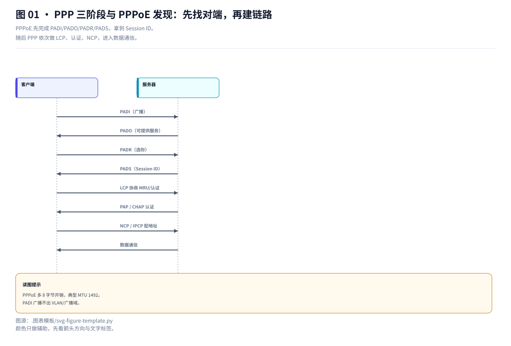
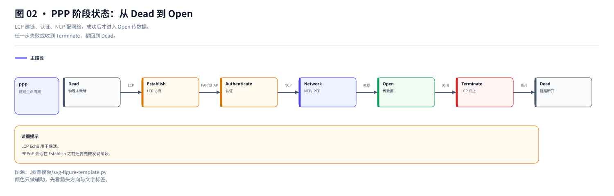

# PPP 与 PPPoE

PPP 是点对点链路上的「三件套」：先建链路（LCP），再验身份（PAP/CHAP），最后配网络（NCP）。PPPoE 把这套流程装进以太网，成为宽带拨号的标准方式。

> 本篇定位：PPP 的帧、LCP/认证/NCP 三阶段，以及 PPPoE 的发现/会话两阶段、Session ID 与 MTU 开销。L2TP 只做关联。

## 目录

- [1 一句话模型](#s1)
- [2 速览](#s2)
- [3 报文格式](#s3)
- [4 交互流程](#s4)
- [5 状态与定时器](#s5)
- [6 设计取舍与边界](#s6)
- [7 与相邻协议的关系](#s7)
- [名词解释](#名词解释)
- [8 参考与关联](#s8)

## 1 · 一句话模型：先握手，再验身，最后配地址

PPP 把一条点对点链路的使用分成三个阶段：

```text
① LCP：链路能不能用、最大帧多大、要不要认证
② 认证：PAP 或 CHAP，确认「你是谁」
③ NCP：网络层怎么配，如 IPCP 分配 IP 和 DNS
   └─ 进入数据通信，直到 LCP 终止
```

PPPoE 在 PPP 前面加了一个「找对端」的发现阶段：

```text
PPPoE 发现（PADI/PADO/PADR/PADS）→ 得到 Session ID
  └─ PPP 三阶段（LCP → 认证 → NCP）
       └─ 数据
```

三个关键认知：

1. **PPP 是链路层协议**，但它能承载多种网络层协议（IPv4、IPv6 等），靠 Protocol 字段区分。
2. **PPPoE 的发现阶段不传 PPP 数据**，只负责找到服务器并分配 Session ID。
3. **PPPoE 有 8 字节额外开销**，所以典型 MTU 是 1492，不是 1500。

## 2 · 速览

| 项 | 内容 |
| --- | --- |
| 所属层 | 链路层 |
| PPP 帧 | Flag + Address + Control + Protocol + Payload + FCS + Flag |
| 关键协议 | LCP（链路控制）、PAP/CHAP（认证）、NCP/IPCP（网络配置） |
| PPPoE 以太类型 | 发现 `0x8863`，会话 `0x8864` |
| PPPoE 报文 | PADI、PADO、PADR、PADS、PADT |
| 会话标识 | Session ID，由服务器分配，会话期间不变 |
| 典型 MTU | PPPoE 1492（1500 − 8） |
| 主要标准 | RFC 1661（PPP）、RFC 1332（IPCP）、RFC 1994（CHAP）、RFC 2516（PPPoE） |
| 典型场景 | 家庭宽带、FTTH、DSL、企业专线、L2TP 承载 |

## 3 · 报文格式

### 3.1 PPP 帧

| 字段 | 长度 | 作用 |
| --- | --- | --- |
| Flag | 1 字节 | 帧定界，`0x7E` |
| Address | 1 字节 | 固定 `0xFF`，点对点无实际寻址意义 |
| Control | 1 字节 | 固定 `0x03`，无编号帧 |
| Protocol | 2 字节 | 载荷类型：LCP、PAP、CHAP、IPCP、IPv4 等 |
| Payload | 变长 | 协议数据 |
| FCS | 2/4 字节 | 帧校验 |
| Flag | 1 字节 | 结束定界，`0x7E` |

常用 Protocol 值：

| 值 | 协议 |
| --- | --- |
| `0xC021` | LCP |
| `0xC023` | PAP |
| `0xC223` | CHAP |
| `0x8021` | IPCP |
| `0x8057` | IPv6CP |
| `0x0021` | IPv4 |
| `0x0057` | IPv6 |

> 转义：Payload 中出现的 `0x7E` 和 `0x7D` 要转义，避免与定界符冲突。转义由 PPP 成帧层处理，上层不感知。

### 3.2 PPPoE 报文

PPPoE 头 6 字节，后面跟 PPP 帧：

| 字段 | 长度 | 作用 |
| --- | --- | --- |
| Version/Type | 1 字节 | 通常 `0x11` |
| Code | 1 字节 | 发现阶段报文类型；会话阶段为 0 |
| Session ID | 2 字节 | 发现阶段为 0；会话阶段由服务器分配 |
| Length | 2 字节 | PPPoE 载荷长度 |

以太网 + PPPoE + PPP 的封装：

```text
Ethernet II (14B)
  └─ PPPoE (6B)
       └─ PPP (2B Protocol + Payload + FCS)
            └─ IP
```

因此 PPPoE 的 IP MTU 典型为 `1500 − 6 − 2 = 1492`（不同实现可能把 PPP 头算入，配置上常见 1492）。

### 3.3 发现阶段五种报文

| 报文 | 方向 | 作用 |
| --- | --- | --- |
| PADI | 客户端 → 广播 | 发起发现，携带服务类型 |
| PADO | 服务器 → 客户端单播 | 表示可提供服务 |
| PADR | 客户端 → 服务器单播 | 选定服务器，请求会话 |
| PADS | 服务器 → 客户端单播 | 分配 Session ID，进入会话 |
| PADT | 任一方 → 单播 | 终止会话 |

发现阶段用广播/单播在以太网内完成，不涉及 IP；Session ID 确定后，会话阶段所有 PPP 帧都必须带这个 ID。

## 4 · 交互流程



**读图**：先 PADI/PADO/PADR/PADS 拿 Session ID，再 LCP→认证→NCP；PPPoE 比 PPP 多一层以太封装。

> 图源：`images/图01-PPP三阶段与PPPoE发现.svg`

### 4.1 PPP 三阶段

```text
物理层 up
  └─ LCP 协商：MRU、认证协议、魔术字、压缩等
       └─ 认证：PAP 或 CHAP
            └─ NCP 协商：IPCP 分配 IP、DNS；IPv6CP 分配接口 ID
                 └─ 数据通信
                      └─ LCP Terminate / 链路断开
```

### 4.2 LCP 协商什么

- **MRU**：最大接收单元，决定对端能发多大的 PPP 帧。
- **认证协议**：PAP、CHAP，或双方约定的其他方式。
- **魔术字**：检测环路。
- **压缩/回显**：是否启用协议压缩、LCP Echo 保活。

LCP 是双向协商：双方各自发 Configure-Request，收到 Configure-Ack 才算成功；一方拒绝会发 Configure-Nak/Reject，重新协商。

### 4.3 PAP 与 CHAP

| 对比项 | PAP | CHAP |
| --- | --- | --- |
| 口令传输 | 明文 | 不传口令，传挑战响应 |
| 握手次数 | 两次（请求/接受） | 三次（挑战/响应/结果） |
| 安全性 | 低，易被窃听 | 较高，防重放 |
| 协议值 | `0xC023` | `0xC223` |

CHAP 的三步：

1. 认证方发挑战（随机数）。
2. 被认证方用口令 + 挑战计算哈希，回响应。
3. 认证方用同样方式计算并比对，一致则通过。

### 4.4 PPPoE 发现 + 会话

```text
客户端                          服务器
  │ PADI（广播）                  │
  ├──────────────────────────────►│
  │ PADO（单播，我可提供）         │
  │◄──────────────────────────────┤
  │ PADR（单播，选你）             │
  ├──────────────────────────────►│
  │ PADS（单播，Session ID=0x1234）│
  │◄──────────────────────────────┤
  │ PPP LCP → 认证 → IPCP          │
  ├──────────────────────────────►│
  │ 数据（带 Session ID）          │
```

关键点：PADI 是广播，所以只能在本广播域内；跨 VLAN/跨接入设备时，需要 PPPoE 中继或把服务器部署在同一个二层域。

### 4.5 NCP/IPCP 配什么

IPCP 是 NCP 的一种，负责 IPv4：

- 双方通告自己的 IP 地址（通常是服务器分配）。
- 协商 DNS 服务器地址（主/备）。
- 协商 IP 压缩等选项。

IPv6 场景用 IPv6CP 协商接口标识，地址前缀通常由 RA 下发。

### 4.6 异常分支

| 异常 | 表现 | 原因 |
| --- | --- | --- |
| 收不到 PADO | 一直重发 PADI | 服务器不可达、VLAN 隔离、广播被过滤 |
| 收到多个 PADO | 选最先到达的 | 同域有多台服务器，正常但需治理 |
| PADS 后会话断 | 认证失败/ Session ID 丢失 | 账号密码错、服务器回收会话、中间设备改写 |
| LCP 协商失败 | 链路起不来 | MRU/认证方式不一致、对端拒绝 |
| 认证失败 | PAP/CHAP 拒绝 | 账号密码错、CHAP 密钥不一致 |
| 能拨上但大包不通 | 小包通、大包丢 | MTU/MRU 不一致、PPPoE 开销未扣、MSS 未钳制 |
| 会话反复掉线 | 间歇性断连 | LCP Echo 超时、链路误码、服务器限制 |

## 5 · 状态与定时器



**读图**：六个阶段首尾相接；顶部红线是 Terminate 回到 Dead。注意失败**不回退到上一步**，而是回到起点 Dead。

> 图源：`images/图02-PPP阶段状态.svg`


PPP 没有 TCP 那样的状态机，但有一条明确的阶段链：

```text
Dead → Establish（LCP）→ Authenticate → Network（NCP）→ Open → Terminate → Dead
```

| 阶段 | 主要动作 | 失败后 |
| --- | --- | --- |
| Establish | LCP Configure-Request/Ack | 重试，超时回 Dead |
| Authenticate | PAP/CHAP | 拒绝则 Terminate |
| Network | IPCP/IPv6CP | 重试，失败则 Terminate |
| Open | 传数据，LCP Echo 保活 | Echo 超时则 Terminate |
| Terminate | LCP Terminate-Request/Ack | 回 Dead |

PPPoE 侧有发现重传定时器（PADI/PADR 超时重发）和会话保活；Session ID 本身没有老化，但服务器可以随时发 PADT 终止。

## 6 · 设计取舍与边界

### 6.1 为什么 PPP 还要认证

PPP 设计用于拨号/专线，链路对端不一定是可信设备。PAP/CHAP 在链路层完成身份验证，避免未授权用户占用线路。代价是额外的协商往返和配置（账号、密钥）。

### 6.2 PPPoE 的 8 字节开销

PPPoE 头 6 字节 + PPP 协议字段 2 字节，使有效 MTU 降到 1492。如果不调整 MTU/MSS，大包会被分片或丢弃，表现为「能打开网页、下载大文件失败」。这是 PPPoE 场景最典型的 MTU 问题。

### 6.3 PPPoE vs DHCP/IPoE

| 方式 | 优点 | 缺点 |
| --- | --- | --- |
| PPPoE | 认证、计费、会话管理成熟；可绑定用户 | 有额外开销、需要客户端、MTU 1492 |
| DHCP/IPoE | 简单、开销小、即插即用 | 认证弱，依赖其他机制（如 802.1X、Option 82） |

运营商选择取决于认证与运维体系，不是单纯的性能比较。

### 6.4 PAP 与 CHAP 的选择

PAP 明文传口令，任何能抓包的人都看得到；CHAP 不传口令，但依赖双方预共享密钥。现代部署优先 CHAP，PAP 只在兼容老设备时使用。

### 6.5 BCP 的边界

BCP（PPP Bridging Control Protocol）可以在 PPP 链路上桥接二层帧，把两端子网连成一个二层域。它适合特定场景（如远程分支二层互通），但会放大广播域，带来环路和广播风暴风险，通常不如三层路由清晰。

## 7 · 与相邻协议的关系

| 相邻对象 | 关系 |
| --- | --- |
| 以太网 | PPPoE 把 PPP 帧装进以太帧；EtherType 0x8863/0x8864 |
| L2TP | L2TP 把 PPP 帧隧道到远端，PPP 是它的载荷 |
| IP | PPP 的 NCP（IPCP）负责分配 IP/DNS；PPP 帧承载 IP |
| DHCP | PPPoE 用 IPCP 分配地址，DHCP 用于 LAN 侧，二者常在同一网关共存 |
| VLAN | PADI 广播受 VLAN 限制；PPPoE 服务器通常部署在特定 VLAN |
| BNG/BRAS | 运营商侧终结 PPPoE 会话，做认证、计费、限速 |

一句话：**PPP 负责「点对点链路怎么建、怎么验、怎么配」，PPPoE 负责「把这条链路装进以太网」。**

## 名词解释

> 缩写给出英文全称；非缩写用“—”表示。

| 术语 | 英文全称 | 解释 |
| --- | --- | --- |
| PPP | Point-to-Point Protocol | 点对点链路协议。 |
| LCP | Link Control Protocol | 链路控制协议。 |
| PAP | Password Authentication Protocol | 明文口令认证。 |
| CHAP | Challenge Handshake Authentication Protocol | 挑战握手认证。 |
| NCP | Network Control Protocol | 网络控制协议族。 |
| IPCP | Internet Protocol Control Protocol | PPP 上的 IPv4 配置协议。 |
| MRU | Maximum Receive Unit | 最大接收单元。 |
| PPPoE | Point-to-Point Protocol over Ethernet | 把 PPP 装进以太网。 |
| PADI/PADO/PADR/PADS/PADT | PPPoE Active Discovery Initiation / Offer / Request / Session-confirmation / Terminate | PPPoE 发现与会话的五种报文。 |
| Session ID | — | PPPoE 会话标识。 |

## 8 · 参考与关联

**标准**

- RFC 1661：The Point-to-Point Protocol（PPP）
- RFC 1332：The PPP Internet Protocol Control Protocol（IPCP）
- RFC 1994：PPP Challenge Handshake Authentication Protocol（CHAP）
- RFC 2516：A Method for Transmitting PPP Over Ethernet（PPPoE）
- RFC 4638：Accommodating a Maximum Transit Unit/Maximum Receive Unit（MTU/MRU）Greater Than 1492 in PPPoE

**关联**

- [00-链路层概览.md](./00-链路层概览.md)
- [01-以太网与MAC.md](./01-以太网与MAC.md)：以太类型与广播
- [02-VLAN与Trunk.md](./02-VLAN与Trunk.md)：PPPoE 的 VLAN 边界
- [L2TP](07-L2TP.md)：PPP 帧的隧道承载
- DHCPv4（已写）：LAN 侧地址分配
- [IP 分片与 MTU](../03-网络层/03-IP分片与MTU.md)：1492 之后的分片与 MSS

---

> **本篇定位**：PPP 的三阶段与 PPPoE 的发现/会话流程，重点讲清 Session ID、认证与 MTU 开销。
> **素材来源**：`studyspace/1.知识体系/8.路由与交换/m-2-PPP.md`（主）、`studyspace/3.协议应用/6.pppoe/pppoe.md`（补）。
> **待验证**：各运营商/设备的 MRU、认证方式、LCP Echo 参数与 MTU 处理不同。
