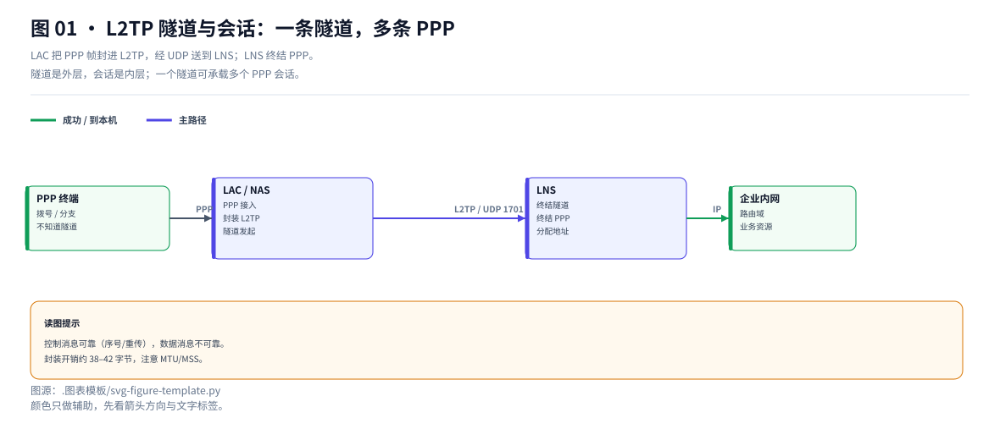

# L2TP

L2TP 把 PPP 会话从本地延伸到远端：用户的 PPP 帧被封装进隧道，跨越 IP 网络送到企业侧的 LNS，由 LNS 终结 PPP、分配地址。

> 本篇定位：L2TP 的隧道/会话模型、LAC/LNS 角色、控制消息与数据消息、封装与 MTU。PPP 与 IPsec 只做关联。

## 目录

- [1 一句话模型](#s1)
- [2 速览](#s2)
- [3 报文格式](#s3)
- [4 交互流程](#s4)
- [5 状态、重传与保活](#s5)
- [6 设计取舍与边界](#s6)
- [7 与相邻协议的关系](#s7)
- [8 参考与关联](#s8)

## 1 · 一句话模型：把 PPP 拨号拉长

PPP 原本是「拨号到本地 NAS」。L2TP 把这段 PPP 会话装进隧道，延伸到企业总部的 LNS：

```text
PPP 终端 ──PPP──► LAC/NAS ══L2TP 隧道（IP/UDP）══► LNS ──► 企业内网
                    │                                  │
              把 PPP 帧封进 L2TP                 终结 PPP、分配地址
```

三个关键认知：

1. **隧道（Tunnel）和会话（Session）是两级概念**：一个隧道可以承载多个 PPP 会话。
2. **LAC 是隧道的发起端，LNS 是终结端**；PPP 终端可能完全不知道 L2TP 的存在。
3. **控制消息可靠，数据消息不可靠**：控制通道负责建/拆/保活，数据通道只转发 PPP 帧。

## 2 · 速览

| 项 | 内容 |
| --- | --- |
| 所属层 | 链路层（承载 PPP 帧） |
| 传输 | UDP，目的端口 1701 |
| 角色 | PPP 终端、NAS、LAC、LNS |
| 两级连接 | 隧道（Tunnel）、会话（Session） |
| 消息类型 | 控制消息、数据消息 |
| 标准 | RFC 2661（L2TPv2）、RFC 3931（L2TPv3） |
| 典型场景 | 远程办公、企业分支接入、宽带拨号的 VPDN |
| 安全 | 本身不加密，常与 IPsec 组合 |

## 3 · 报文格式

### 3.1 L2TP 头

L2TP 头在 UDP 之上、PPP 帧之外：

| 字段 | 长度 | 作用 |
| --- | --- | --- |
| Flags/Version | 2 字节 | T（控制/数据）、L（有 Length）、S（有序列号）、O（有 Offset）、版本 |
| Length | 2 字节 | 可选，置 L 位时存在 |
| Tunnel ID | 2 字节 | 标识隧道 |
| Session ID | 2 字节 | 标识会话；控制消息中为 0 |
| Ns | 2 字节 | 发送序号，置 S 位时存在 |
| Nr | 2 字节 | 期望接收序号，置 S 位时存在 |
| Offset Size | 2 字节 | 可选，置 O 位时存在 |

控制消息与数据消息共用这个头，靠 **T 位**区分：

- **T=1**：控制消息，用于隧道/会话建立、维护、拆除。
- **T=0**：数据消息，携带 PPP 帧。

### 3.2 封装层次

```text
Ethernet
  └─ IP
       └─ UDP（目的 1701）
            └─ L2TP（Tunnel ID + Session ID）
                 └─ PPP（Protocol + Payload）
                      └─ IP / 其他网络层协议
```

L2TP 本身不提供分片。封装后报文变大，超过出接口 MTU 时要靠 IP 分片或提前控制 PPP 的 MRU/MSS。

## 4 · 交互流程



**读图**：PPP 终端→LAC→LNS→内网；一条隧道可承载多条 PPP 会话，控制消息可靠、数据消息不可靠。

> 图源：`images/图01-L2TP隧道与会话.svg`

### 4.1 三种组网角色

| 场景 | 谁做 LAC | 说明 |
| --- | --- | --- |
| NAS-Initiated | ISP 的 NAS/BRAS | 传统拨号，NAS 把 PPP 会话延伸给企业 LNS |
| L2TP Client-Initiated | 企业分支网关 | 网关主动建隧道，不需要终端拨号触发 |
| Client-Initiated | 出差用户的 PC/终端 | 终端自带 L2TP 客户端，直接连 LNS |

### 4.2 隧道建立

```text
LAC                                   LNS
  │ SCCRQ（Start-Control-Connection-Request）│
  ├──────────────────────────────────────────►│
  │ SCCRP（Reply）                            │
  │◄──────────────────────────────────────────┤
  │ SCCCN（Connected）                        │
  ├──────────────────────────────────────────►│
  │ 隧道建立，双方记录 Tunnel ID               │
```

隧道建立后，控制通道保持连接，定期用 HELLO 保活。

### 4.3 会话建立

```text
LAC                                   LNS
  │ ICRQ（Incoming-Call-Request）             │
  ├──────────────────────────────────────────►│
  │ ICRP（Reply，分配 Session ID）             │
  │◄──────────────────────────────────────────┤
  │ ICCN（Connected）                         │
  ├──────────────────────────────────────────►│
  │ 会话建立，开始传 PPP 帧                    │
```

一个隧道可以依次建立多个会话，每个会话对应一条 PPP 连接。

### 4.4 数据传输

- LAC 收到 PPP 帧，加 L2TP 头（Session ID），UDP/IP 封装后发给 LNS。
- LNS 按 Session ID 找到对应 PPP 会话，剥封装后交给 PPP 栈。
- 反向同理。

数据消息**不重传**，丢了就丢了；PPP 之上的 TCP 或应用层负责恢复。

### 4.5 拆除

| 消息 | 作用 |
| --- | --- |
| CDN（Call-Disconnect-Notify） | 拆除某个会话 |
| StopCCN（Stop-Control-Connection-Notification） | 拆除整个隧道 |
| ZLB ACK | 零长度应答，确认收到控制消息 |

### 4.6 异常分支

| 异常 | 表现 | 原因 |
| --- | --- | --- |
| 隧道建不起来 | SCCRQ 无响应 | UDP 1701 被拦、LNS 不可达、共享密钥/配置不匹配 |
| 会话建不起来 | ICRQ 被拒 | 认证失败、地址池耗尽、策略不允许 |
| PPP 能起但数据不通 | 隧道通、会话不通 | Session ID 不匹配、路由/NAT 问题、MTU 过大 |
| 大包丢 | 小包通、大包断 | 封装开销导致超 MTU，未做 MSS 钳制或分片 |
| 间歇断线 | 隧道周期性重建 | HELLO 超时、NAT 映射过期、链路误码 |
| 无法穿透 NAT | 客户端在 NAT 后建不起 | NAT 设备不支持 UDP 1701 或映射超时太短 |

## 5 · 状态、重传与保活

L2TP 有两套通道，可靠性设计完全不同：

| 通道 | 承载 | 可靠性 | 机制 |
| --- | --- | --- | --- |
| 控制通道 | SCCRQ/SCCRP/SCCCN、ICRQ/ICRP/ICCN、CDN、StopCCN、HELLO | 可靠 | Ns/Nr 序号、超时重传、ZLB ACK |
| 数据通道 | PPP 帧 | 不可靠 | 不重传、不排序、不做流控 |

控制消息的重传是「指数退避 + 最大次数」，超过次数就拆除隧道/会话。HELLO 用于检测隧道连通性，收不到应答就认为对端失效。

## 6 · 设计取舍与边界

### 6.1 为什么用 UDP 1701

L2TP 需要穿透 NAT、复用多条会话，UDP 比 IP 协议号更通用。目的端口 1701 用于建立隧道；双方随后使用各自选定的源端口，隧道期间保持不变。这样 NAT 只需维护一条映射。

### 6.2 控制可靠、数据不可靠

控制消息决定隧道/会话的生死，必须可靠；数据消息承载 PPP 帧，可靠性交给 PPP 之上的协议。这样避免在隧道层重复实现重传，也避免「隧道重传 + TCP 重传」的双重开销。

### 6.3 封装开销与 MTU

L2TP over UDP/IPv4 的封装开销约 38 字节（带序列号约 42 字节），加上 PPP 头，实际可用 MTU 明显小于 1500。工程上要同步调整 PPP 的 MRU/MSS，或允许 IP 分片；否则会出现「能 ping 通、传大文件失败」。

### 6.4 不加密

L2TP 本身不提供加密或完整性保护，只做隧道封装。远程接入通常用 **L2TP/IPsec**：先用 IPsec 保护隧道，再跑 L2TP。单独用 L2TP 等于把 PPP 明文暴露在公网上。

### 6.5 L2TPv2 与 L2TPv3

| 对比项 | L2TPv2 | L2TPv3 |
| --- | --- | --- |
| 主要用途 | PPP 远程接入 | 承载多种二层协议（以太网、PPP、HDLC、帧中继） |
| 控制消息 | SCCRQ/ICRQ 等 | 增加 OCRQ/OCRP/OCCN 等 |
| 隧道标识 | 16 位 Tunnel ID | 32 位 Session/Tunnel ID |
| 典型场景 | 宽带 VPDN、远程拨号 | 运营商二层专线、数据中心互联 |

本篇以 L2TPv2 为主；v3 的差异只在需要时提。

### 6.6 BCP 的边界

BCP 让 PPP 链路承载桥接帧，把两端子网连成一个二层域。它适合特定远程分支场景，但会放大广播域、引入环路风险，通常不如三层路由清晰。

## 7 · 与相邻协议的关系

| 相邻对象 | 关系 |
| --- | --- |
| PPP | L2TP 的载荷就是 PPP 帧；PPP 负责认证与地址协商 |
| PPPoE | 用户先 PPPoE 拨到 LAC，再由 LAC 用 L2TP 延伸到 LNS |
| UDP/IP | L2TP 跑在 UDP 1701 上，受 NAT/防火墙影响 |
| IPsec | 常与 L2TP 组合，提供加密与完整性 |
| MTU/分片 | 封装开销导致 MTU 变小，需要 MSS 钳制或分片 |
| 路由 | LNS 分配地址后，流量进入企业路由域 |

一句话：**L2TP 负责「把 PPP 会话拉到远端」，不负责「加密」，也不负责「可靠传输数据」。**

## 8 · 参考与关联

**标准**

- RFC 2661：Layer Two Tunneling Protocol（L2TPv2）
- RFC 3931：Layer Two Tunneling Protocol — Version 3（L2TPv3）
- RFC 3193：Securing L2TP using IPsec
- RFC 1661：PPP

**关联**

- [00-链路层概览.md](./00-链路层概览.md)
- [06-PPP与PPPoE.md](./06-PPP与PPPoE.md)：PPP 与 PPPoE
- IPsec（归安全）：L2TP 的加密搭档
- [IP 分片与 MTU](../03-网络层/03-IP分片与MTU.md)：封装开销与 MSS
- 20-平台与系统：L2TP 内核实现与配置

---

> **本篇定位**：L2TP 的隧道/会话模型、控制与数据通道、封装与 MTU，重点讲清 LAC/LNS 的分工。
> **素材来源**：`studyspace/3.协议应用/10.L2TP/L2TP.md`（主）、`studyspace/1.知识体系/8.路由与交换/m-2-PPP.md`（补）。
> **待验证**：不同实现的源端口选择、HELLO 间隔、重传次数与 MTU 处理不同。
