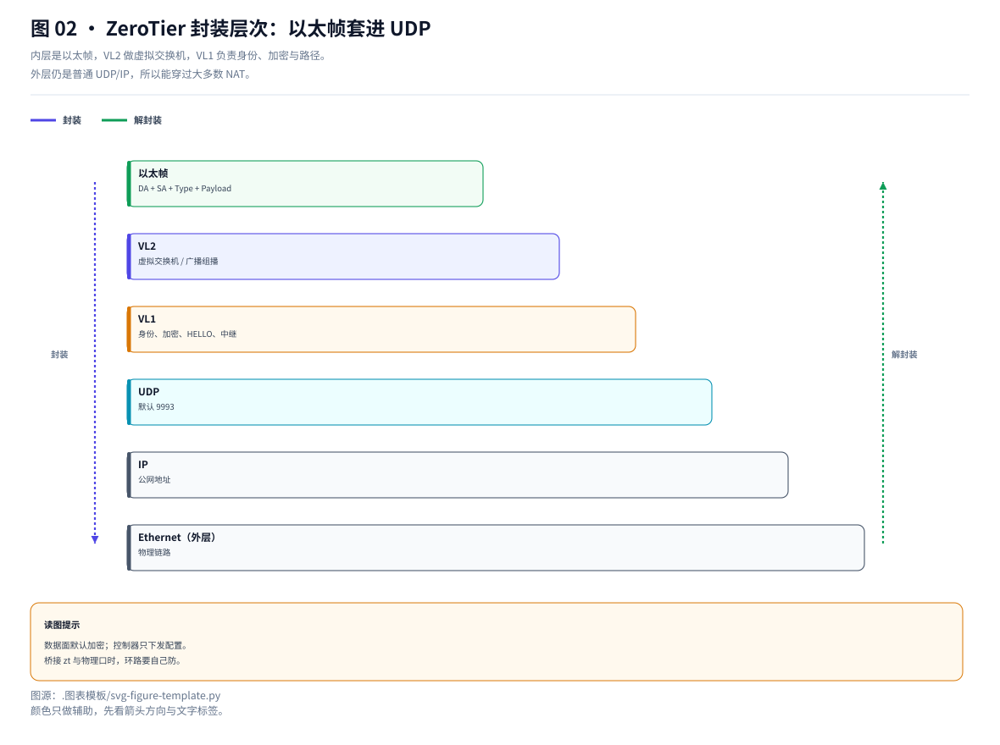
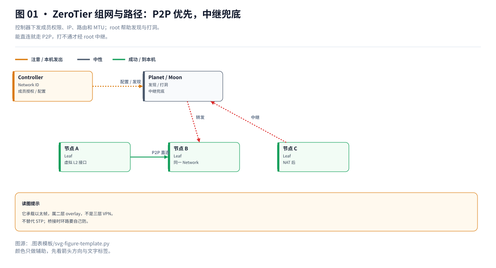

# ZeroTier

ZeroTier 把一台虚拟二层交换机铺在公网上：节点之间传的是以太帧，加入同一个网络 ID 的设备，就像插在同一台交换机上。

> 本篇定位：ZeroTier 的 L2 overlay 模型、身份与网络 ID、VL1/VL2、P2P 与中继、OpenWrt 侧的配置语义。它不是 IETF 标准，协议细节以官方文档与源码版本为准。

## 目录

- [1 一句话模型](#s1)
- [2 速览](#s2)
- [3 封装与报文](#s3)
- [4 加入与通信流程](#s4)
- [5 状态与保活](#s5)
- [6 设计取舍与边界](#s6)
- [7 与相邻协议的关系](#s7)
- [8 参考与关联](#s8)

## 1 · 一句话模型：公网上的虚拟交换机

把 ZeroTier 想成一台放在云端的交换机，每个节点通过一条 UDP 隧道接到它的某个端口：

```text
节点 A ──UDP 隧道──┐
节点 B ──UDP 隧道──┼── 虚拟二层交换机（同一个 Network ID）──► 以太帧互通
节点 C ──UDP 隧道──┘
```

三个关键认知：

1. **它转发的是以太帧**，所以归链路层；不是「IP 层 VPN」。
2. **网络 ID 决定「插在哪台交换机」**，控制器决定「谁可以加入、拿到什么地址」。
3. **数据面尽量 P2P 直连**，打不通洞时才经 root 中继；中继会增加延迟。

## 2 · 速览

| 项 | 内容 |
| --- | --- |
| 所属层 | 链路层（L2 overlay） |
| 传输 | UDP，默认 9993 |
| 载荷 | 以太帧（Ethernet frame） |
| 节点标识 | 40 位地址（由身份公钥派生，通常写成 10 位十六进制） |
| 网络标识 | 16 位十六进制 Network ID |
| 角色 | Leaf（普通节点）、Controller（网络控制器）、Root/Planet、Moon（私有根） |
| 分层 | VL1（传输、身份、加密）、VL2（以太网仿真、虚拟交换机） |
| 控制面 | 控制器下发网络配置（地址、路由、MTU、成员权限） |
| 默认 MTU | 由网络配置下发，常见默认 2800；实际受底层路径限制 |
| 参考实现 | ZeroTierOne 1.10.x（源仓库验证版本 1.10.3） |

## 3 · 封装与报文



**读图**：以太帧在 VL2 里转发，VL1 负责身份/加密/路径，外层才是 UDP/IP。

> 图源：`images/图02-ZeroTier封装层次.svg`


### 3.1 封装层次

```text
Ethernet（外层，公网）
  └─ IP
       └─ UDP（默认 9993）
            └─ ZeroTier VL1（身份、加密、会话）
                 └─ VL2（以太帧：DA + SA + Type + Payload）
```

内层是以太帧，所以 ZeroTier 网络里的设备可以跑 ARP、DHCP、IPv4/IPv6、组播——只要二层能做的事，它都尽量模拟。

### 3.2 身份与地址

- 每个节点有一对公私钥，公钥派生出一个 **40 位地址**（10 位十六进制）。
- 地址不是 IP，不表示位置；它标识的是「这个身份」，不是「这台机器当前在哪」。
- 网络 ID 是 16 位十六进制：前 40 位是控制器的地址，后 24 位是网络编号。

### 3.3 VL1 与 VL2

| 层 | 作用 | 关键内容 |
| --- | --- | --- |
| VL1 | 节点之间的传输层 | 身份认证、加密、HELLO、路径发现、中继 |
| VL2 | 虚拟二层 | 以太帧转发、广播/组播、网络成员与权限 |

VL1 的报文类型包括 HELLO（建立/维持会话）、FRAME/EXT_FRAME（承载以太帧）、RENDEZVOUS（打洞/路径协商）、NETWORK_CONFIG_REQUEST（向控制器要配置）等。具体类型编号与字段随版本演进，排障时以官方协议文档和源码为准。

### 3.4 加密

ZeroTier 在 VL1 做端到端加密与身份认证，常用 Curve25519 做密钥交换、对称算法做帧加密。算法细节与版本相关，不在本篇展开；结论是：**数据面默认加密，控制器只下发配置，不转发业务流量**（除非走中继）。

## 4 · 加入与通信流程



**读图**：控制器下发配置，root 帮发现与中继；能打洞就走 P2P，打不通才经 root 中继。

> 图源：`images/图01-ZeroTier组网与路径.svg`

### 4.1 加入网络

```text
① 节点启动，生成/加载身份（地址、公私钥）
② 读取 Network ID，向控制器请求网络配置
③ 控制器校验成员权限，下发：虚拟 IP、路由、MTU、广播/组播策略
④ 节点创建 zt 虚拟接口，加入虚拟交换机
⑤ 与同网络节点建立 VL1 会话，开始交换以太帧
```

### 4.2 对端发现与 NAT 穿透

1. 节点通过 Planet/Moon（root）获取同网络其他节点的地址信息。
2. 双方尝试直接 UDP 打洞；成功则走 P2P。
3. 打洞失败（对称 NAT、防火墙严格）则经 root 中继。
4. 路径建立后，定期用 HELLO/探测维持；路径变化时重新协商。

### 4.3 以太帧转发

- 单播：查虚拟交换机的 MAC 表，从对应隧道发出。
- 广播/组播：按网络策略复制给成员；ZeroTier 对广播/组播有限速与优化，避免把 overlay 打成广播风暴。
- 未知单播：在虚拟交换机内泛洪（受策略限制）。

### 4.4 多播与二层语义

ZeroTier 尽量模拟二层：ARP、DHCP、mDNS 等广播/组播都能工作。但广播会被复制到多个节点，规模大时开销明显；跨地域组网应尽量用三层路由，减少广播域。

### 4.5 OpenWrt 侧配置语义

配置文件是 `/etc/config/zerotier`，常见选项：

| 选项 | 作用 |
| --- | --- |
| `enabled` | 是否启动实例 |
| `port` | 主端口，默认 9993（UDP 数据面与控制面共用） |
| `join` | 要加入的 Network ID 列表；默认配置常带公共 Earth 网络，需清空后按需加入 |
| `secret` | 身份私钥；首次启动自动生成并回写，不要手工泄露 |
| `config_path` | 持久化配置目录（控制器/特殊模式） |
| `copy_config_path` | 是否复制到内存，减少闪存写入 |
| `local_conf` | 额外 local.conf 路径 |

防火墙侧要放行 **UDP 9993**（只放 TCP 不够）；如果要把 zt 网段接入 LAN，还需要转发/NAT 规则。OpenWrt 的 fw3（iptables）与 fw4（nftables）语法不同，配置脚本要按后端分流。

## 5 · 状态与保活

ZeroTier 没有传统路由协议的状态机，核心状态是「路径」和「成员权限」：

| 状态 | 含义 | 维护方式 |
| --- | --- | --- |
| 身份 | 地址、公私钥 | 本地持久化，首次生成 |
| 网络成员 | 是否被控制器授权 | 控制器下发，定期刷新 |
| 对端路径 | 直连还是中继 | HELLO/探测，路径变化时重协商 |
| 虚拟接口 | zt 网卡、IP、路由 | 网络配置下发后创建/更新 |

保活与超时：

- 节点定期向 root/对端发 HELLO，维持可达性。
- 直连路径失效后回退中继，恢复后再切回直连。
- 网络配置有刷新周期；控制器不可达时，节点保留最后一次配置继续工作（具体行为随版本）。

## 6 · 设计取舍与边界

### 6.1 P2P 与中继

P2P 直连延迟低、带宽好；中继保证连通性但增加延迟、消耗 root 带宽。对称 NAT、严格防火墙、UDP 被封都会让流量走中继。排障时先看「是否直连」，再看业务。

### 6.2 控制器是信任中心

网络 ID、成员授权、IP/路由/MTU 都由控制器决定。控制器可以是官方服务，也可以自建。控制面集中带来管理便利，也带来单点依赖：控制器不可达时，新成员加入和配置变更会受影响。

### 6.3 L2 overlay 的代价

- **广播/组播放大**：一个广播会被复制给多个成员，规模大时开销高。
- **MTU 与分片**：overlay 头增加开销，底层路径 MTU 不足时会影响大包。
- **环路**：ZeroTier 不替代 STP。把 zt 接口与物理接口桥接时，环路风险由你自己的桥/STP 处理。

### 6.4 UDP 9993 的边界

很多企业/酒店网络只放行 TCP 443，UDP 9993 可能被拦。此时节点无法直连，甚至无法加入网络。部署前要确认 UDP 出站策略；必要时用中继或换端口。

### 6.5 安全边界

- 数据面默认加密，但成员权限由控制器决定；授权过宽等于把陌生人放进同一个二层域。
- `secret` 是身份私钥，泄露等于身份被冒用；不要提交到仓库或贴到工单。
- 它解决「连通与虚拟二层」，不替代防火墙、ACL、入侵检测。

### 6.6 与 WireGuard/L2TP 的区别

| 方案 | 层次 | 模型 | 典型用途 |
| --- | --- | --- | --- |
| ZeroTier | 链路层 | 虚拟二层交换机 + 控制器 | 多地设备像在同一 LAN |
| WireGuard | 网络层 | 点对点/星型 IP 隧道 | 站点互联、远程接入 |
| L2TP | 链路层 | PPP 会话隧道 | 运营商/企业远程拨号 |

要二层互通选 ZeroTier/VXLAN；要简单三层互联选 WireGuard。

## 7 · 与相邻协议的关系

| 相邻对象 | 关系 |
| --- | --- |
| 以太网 | 内层是以太帧；ARP/DHCP/组播都跑在虚拟二层上 |
| VLAN/STP | ZeroTier 不替代 VLAN/STP；桥接时环路与广播域要自己控制 |
| UDP/IP | 外层是 UDP 9993，受 NAT/防火墙影响 |
| 控制器 | 下发成员权限、IP、路由、MTU |
| 40-产品与方案 | 具体产品的 ZeroTier 集成、UI、开机自启归 40 |
| 20-平台与系统 | OpenWrt 服务、防火墙后端、TUN 依赖归 20 |

一句话：**ZeroTier 负责「把二层网络铺到公网上」，不负责「加密之外的访问控制」，也不替代路由与防环。**

## 8 · 参考与关联

**参考**

- ZeroTier 官方协议文档与手册（VL1/VL2、Network ID、Controller）
- ZeroTierOne 源码与版本说明（源仓库验证版本 1.10.3）
- OpenWrt 包 `zerotier` 的 `/etc/config/zerotier` 与 init 脚本
- `luci-app-zerotier` 的防火墙辅助脚本（fw3/fw4 分流）

**关联**

- [00-链路层概览.md](./00-链路层概览.md)
- [01-以太网与MAC.md](./01-以太网与MAC.md)：以太帧与广播
- [02-VLAN与Trunk.md](./02-VLAN与Trunk.md)：二层隔离与桥接
- [03-STP-RSTP-MSTP.md](./03-STP-RSTP-MSTP.md)：桥接时的防环
- [09-WireGuard](../03-网络层/09-WireGuard.md)：三层隧道对照
- 40-产品与方案：ZeroTier 产品集成
- 20-平台与系统/21-Linux/06-网络子系统：TUN、防火墙、转发

---

> **本篇定位**：ZeroTier 的 L2 overlay 模型、身份/网络 ID、P2P 与中继、OpenWrt 配置语义与边界。
> **素材来源**：`studyspace/3.协议应用/12.zerotier/zerotier-uci与防火墙配置分析.md`、`zerotier-openwrt-uci防火墙调试教程.md`；协议机制按 ZeroTier 官方文档与 1.10.3 源码补写。
> **待验证**：VL1 报文类型编号、默认 MTU、路径保活周期、控制器离线行为随版本而变；以实际版本与官方文档为准。
