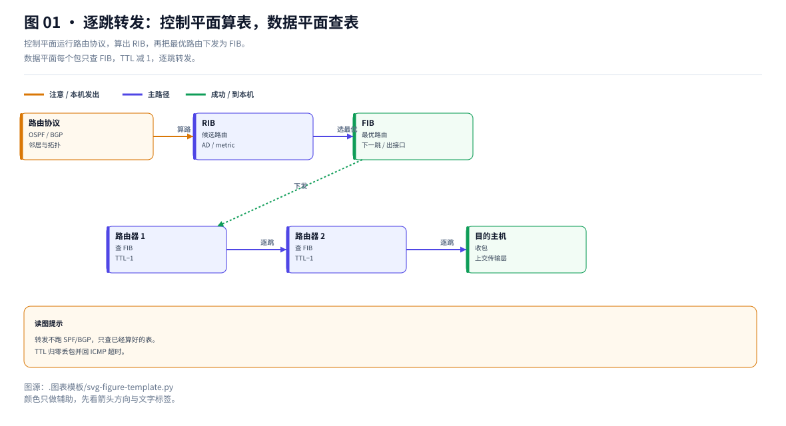

# 网络层概览

网络层解决一个问题：**跨多个网络，把包送到目的主机**。它靠 IP 地址寻址、靠路由表选路、靠 TTL 防环，但不保证送达。

> 本篇定位：网络层入口，给职责、数据平面/控制平面、协议地图和边界。具体协议看各篇正文。

## 目录

- [1 一句话模型](#s1)
- [2 速览](#s2)
- [3 核心机制](#s3)
- [4 数据平面与控制平面](#s4)
- [5 本层协议地图](#s5)
- [6 边界与设计取舍](#s6)
- [7 与相邻层的关系](#s7)
- [8 参考与关联](#s8)

## 1 · 一句话模型：逐跳问路

每个路由器只做一件事：**看目的 IP，查路由表，决定下一跳**。它不知道整条路径，也不保证包能到。

```text
主机 A ──► 路由器 1 ──► 路由器 2 ──► 主机 B
          查表选下一跳  查表选下一跳
          TTL-1         TTL-1
```

三个关键认知：

1. **IP 地址是端到端的**，MAC 是逐跳的；跨网段时 MAC 一直换，IP 不变。
2. **转发靠表，不靠算法**：数据包到达时只查 already-computed 路由表，路由协议负责提前算表。
3. **网络层尽力而为**：不保证送达、不保证顺序、不保证不重复。

## 2 · 速览

| 项 | 内容 |
| --- | --- |
| 所属层 | 网络层（OSI 第三层） |
| PDU | 包（packet） |
| 地址 | IPv4 32 位 / IPv6 128 位；协议号标识上层 |
| 核心设备 | 路由器、三层交换机、防火墙 |
| 核心功能 | 编址、转发、路由、分片、NAT、差错报告、组播 |
| 主要标准 | RFC 791（IPv4）、RFC 8200（IPv6）、RFC 792（ICMP）、RFC 1812（路由器要求） |
| 上层 | TCP、UDP、QUIC、ICMP |
| 下层 | 链路层 |

## 3 · 核心机制



**读图**：控制平面算 RIB/FIB，数据平面逐跳查表；TTL 每跳减 1，归零丢弃并回 ICMP。

> 图源：`images/图01-逐跳转发与数据控制平面.svg`

### 3.1 编址

IP 地址标识主机/接口，前缀表示网络。IPv4 靠子网掩码/CIDR，IPv6 靠前缀长度。地址是拓扑相关的：换网络就要换地址（或做 NAT）。

### 3.2 转发

路由器收到包，取目的 IP，在路由表中做**最长前缀匹配**，得到下一跳和出接口，然后把 TTL 减 1、重写链路头、发出去。TTL 归零则丢弃并回 ICMP 超时。

### 3.3 路由

- **静态路由**：手工配置，简单、可控，适合小网络和默认路由。
- **动态路由**：路由器之间交换信息，自动收敛，适合中大型网络。
- **路由选路**：先比前缀长度，再比管理距离/优先级，最后比度量值。

### 3.4 分片与 MTU

链路层 MTU 限制包的大小。IPv4 可在源或中间路由器分片；IPv6 只允许源主机分片，中间路由器丢弃并回 ICMPv6「包太大」。PMTUD 靠 DF 位 + ICMP 反馈探测路径 MTU。

### 3.5 NAT

NAT 修改 IP 地址（常同时改端口），让多个内网主机共享公网地址。它依赖连接跟踪，破坏了端到端透明性，也让部分应用需要 ALG 或穿透方案。

### 3.6 差错与控制

ICMP 报告不可达、超时、重定向、包太大；IGMP/MLD 管理组播成员；VRRP 提供网关冗余。它们都封装在 IP 里，属于网络层的控制协议。

## 4 · 数据平面与控制平面

| 平面 | 做什么 | 典型内容 |
| --- | --- | --- |
| 数据平面 | 每个包到达时的快速处理 | 查 FIB、TTL-1、分片、ACL、NAT |
| 控制平面 | 提前计算和维护转发表 | 静态路由、OSPF/BGP、ARP/NDP、路由策略 |

数据平面要求快，通常在硬件/内核快速路径；控制平面要求正确，允许慢。两者分离是现代路由器和软件定义网络的基础。

## 5 · 本层协议地图

| 协议/机制 | 一句话 | 篇目 |
| --- | --- | --- |
| IPv4 | 32 位地址、首部、分片 | [01-IPv4](01-IPv4.md) |
| IPv6 | 128 位地址、扩展头、NDP | [02-IPv6](02-IPv6.md) |
| 分片与 MTU | 包太大怎么办 | [03-IP分片与MTU](03-IP分片与MTU.md) |
| 路由与路由协议 | 路由表、静态、RIP/OSPF/IS-IS/BGP | [04-路由与路由协议](04-路由与路由协议.md) |
| NAT | 地址/端口转换与穿透 | [05-NAT](05-NAT.md) |
| ICMP 与 ICMPv6 | 差错报告、ping/traceroute、NDP | [06-ICMP与ICMPv6](06-ICMP与ICMPv6.md) |
| 组播 IGMP/MLD | 组播成员管理 | [07-组播IGMP-MLD](07-组播IGMP-MLD.md) |
| VRRP | 网关冗余与虚拟 MAC | [08-VRRP](08-VRRP.md) |
| WireGuard | IP-in-UDP 的三层隧道 | [09-WireGuard](09-WireGuard.md) |

## 6 · 边界与设计取舍

### 6.1 不保证可靠

网络层只负责「尽力送到」，丢包、乱序、重复都可能发生。可靠传输由 TCP/QUIC 在端主机实现。这样中间设备简单、可扩展，代价是端主机复杂。

### 6.2 不关心进程

IP 只送到主机，不知道交给哪个应用。端口是传输层的事；NAT 虽然看端口，但那是为了复用地址，不是网络层的职责。

### 6.3 地址与拓扑绑定

IP 地址包含网络前缀，主机换网络通常要换地址。移动 IP、NAT、overlay 都是对这个约束的补偿。

### 6.4 分片的代价

分片增加重组状态、放大丢包影响、降低性能。现代网络倾向用 PMTUD + MSS 钳制避免分片，而不是依赖中间路由器分片。

### 6.5 端到端与中间盒

NAT、防火墙、代理破坏了端到端透明性。IPv6 试图恢复端到端，但现实中中间盒仍然存在。理解这一点，才能理解为什么需要 STUN/TURN、ALG、隧道。

## 7 · 与相邻层的关系

| 相邻对象 | 关系 |
| --- | --- |
| 链路层 | IP 包是帧的载荷；MTU 由链路层决定 |
| 传输层 | TCP/UDP/QUIC 作为 IP 载荷，协议号区分 |
| ICMP | 封装在 IP 内，报告网络层错误 |
| NAT/防火墙 | 在网络层处理，但常依赖传输层端口 |
| 20-网络子系统 | 路由表、netfilter、转发实现归 20 |

一句话：**网络层负责「怎么走到目的主机」，不负责「一定送到」，也不负责「交给哪个进程」。**

## 8 · 参考与关联

**标准**

- RFC 791（IPv4）
- RFC 8200（IPv6）
- RFC 792（ICMP）
- RFC 1812（IPv4 路由器要求）
- RFC 1191（PMTUD）

**关联**

- [02-链路层](../02-链路层/.readme.md)：帧与 MTU
- [04-传输层](../04-传输层/.readme.md)：TCP/UDP/QUIC
- [05-应用层](../05-应用层/.readme.md)：应用协议
- 20-平台与系统/21-Linux/06-网络子系统：路由、netfilter、转发

---

> **本篇定位**：网络层入口，先建立「逐跳转发 + 控制平面算表」的模型，再进入具体协议。
> **素材来源**：`studyspace/1.知识体系/1.计算机网络/m-4-网络层--.md`、`studyspace/1.知识体系/8.路由与交换/m-7-路由.md`。
> **待验证**：具体路由协议的度量与管理距离随厂商实现而变。
