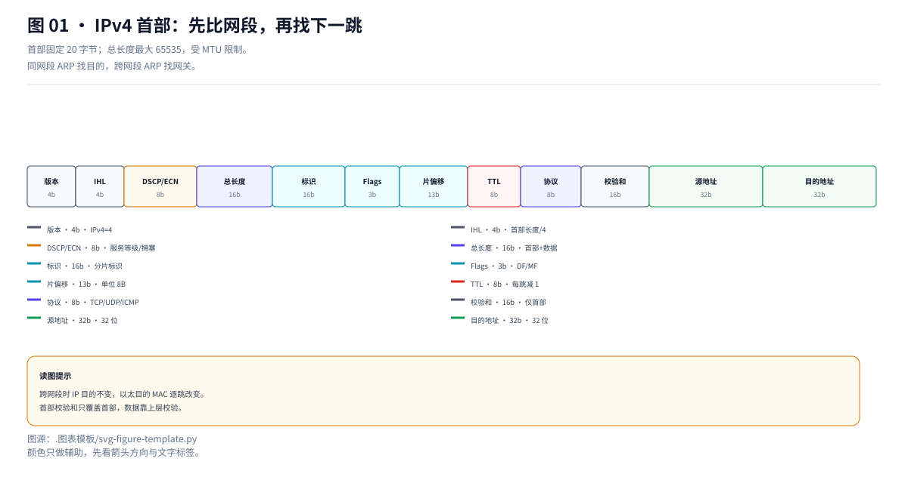
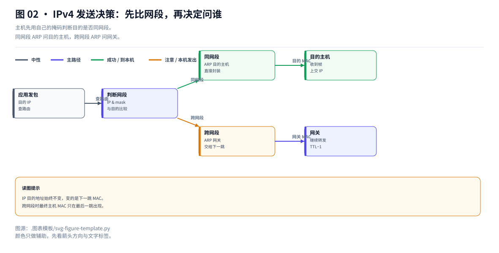

# IPv4

IPv4 用 32 位地址和「网络前缀 + 主机」的层次结构做跨网寻址：先判断目的在不在本网段，在就 ARP 找主机，不在就交给网关。

> 本篇定位：IPv4 的地址与首部、单播/组播/广播/任播、同网段与跨网段发送决策。分片与 MTU 的细节在专篇，ICMP 只做关联。

## 目录

- [1 一句话模型](#s1)
- [2 速览](#s2)
- [3 报文格式](#s3)
- [4 地址与编址](#s4)
- [5 发送与转发流程](#s5)
- [6 设计取舍与边界](#s6)
- [7 与相邻协议的关系](#s7)
- [8 参考与关联](#s8)

## 1 · 一句话模型：先比网段，再找下一跳

主机要发包时只做两个判断：

```text
目的 IP 与我在同一网段？
  ├─ 是 → ARP 问目的主机的 MAC，直接发
  └─ 否 → ARP 问网关的 MAC，把包交给网关
```

由此得到三个关键认知：

1. **IP 地址是层次化的**：网络前缀决定「在哪个网」，主机位决定「网内哪台」。
2. **IP 是端到端的，MAC 是逐跳的**：跨网段时目的 IP 不变，目的 MAC 每跳都变。
3. **IPv4 尽力而为**：不保证送达、不保证顺序、不保证不重复。

## 2 · 速览

| 项 | 内容 |
| --- | --- |
| 所属层 | 网络层 |
| 地址长度 | 32 位（4 字节） |
| 首部长度 | 20 字节固定 + 最多 40 字节选项 |
| 最大报文 | 65535 字节（受 Total Length 16 位限制） |
| 实际上限 | 受链路 MTU 限制，以太网通常 1500 |
| 地址结构 | 网络前缀 + 主机位（CIDR） |
| 特殊地址 | 私有、环回、链路本地、组播、广播 |
| 主要标准 | RFC 791、RFC 950（子网）、RFC 1519（CIDR）、RFC 1918（私有地址） |
| 上层协议 | TCP(6)、UDP(17)、ICMP(1)、IGMP(2)、OSPF(89) |

## 3 · 报文格式



**读图**：按位看首部；发送时先比网段：同网段 ARP 找目的，跨网段 ARP 找网关。

> 图源：`images/图01-IPv4首部与发送决策.svg`

### 3.1 首部字段

```text
 0                   1                   2                   3
 0 1 2 3 4 5 6 7 8 9 0 1 2 3 4 5 6 7 8 9 0 1 2 3 4 5 6 7 8 9 0 1
+-+-+-+-+-+-+-+-+-+-+-+-+-+-+-+-+-+-+-+-+-+-+-+-+-+-+-+-+-+-+-+-+
|Version| IHL |    DSCP   |ECN|          Total Length           |
+-+-+-+-+-+-+-+-+-+-+-+-+-+-+-+-+-+-+-+-+-+-+-+-+-+-+-+-+-+-+-+-+
|         Identification        |Flags|      Fragment Offset    |
+-+-+-+-+-+-+-+-+-+-+-+-+-+-+-+-+-+-+-+-+-+-+-+-+-+-+-+-+-+-+-+-+
|      TTL      |    Protocol   |        Header Checksum        |
+-+-+-+-+-+-+-+-+-+-+-+-+-+-+-+-+-+-+-+-+-+-+-+-+-+-+-+-+-+-+-+-+
|                       Source Address                          |
+-+-+-+-+-+-+-+-+-+-+-+-+-+-+-+-+-+-+-+-+-+-+-+-+-+-+-+-+-+-+-+-+
|                    Destination Address                        |
+-+-+-+-+-+-+-+-+-+-+-+-+-+-+-+-+-+-+-+-+-+-+-+-+-+-+-+-+-+-+-+-+
|                    Options (0-40B)  + Padding                 |
+-+-+-+-+-+-+-+-+-+-+-+-+-+-+-+-+-+-+-+-+-+-+-+-+-+-+-+-+-+-+-+-+
```

| 字段 | 长度 | 作用 | 注意 |
| --- | --- | --- | --- |
| Version | 4 位 | 版本号 | IPv4 为 4 |
| IHL | 4 位 | 首部长度，单位 4 字节 | 最小 5（20 字节），最大 15（60 字节） |
| DSCP / ECN | 6 + 2 位 | 服务等级与拥塞通知 | 常被运营商清零或重标记 |
| Total Length | 16 位 | 首部 + 数据总长度 | 最大 65535；不含链路层填充 |
| Identification | 16 位 | 分片标识 | 同一数据报的分片共享该值 |
| Flags | 3 位 | 保留、DF、MF | DF=1 禁止分片；MF=1 表示后面还有分片 |
| Fragment Offset | 13 位 | 分片在原数据报中的偏移 | 单位 8 字节 |
| TTL | 8 位 | 剩余跳数 | 每经路由器减 1，归零丢弃 |
| Protocol | 8 位 | 上层协议 | TCP 6、UDP 17、ICMP 1、IGMP 2 |
| Header Checksum | 16 位 | 仅校验首部 | 每跳因 TTL 变化要重算 |
| Source / Destination | 各 32 位 | 源/目的地址 | 端到端保持不变（NAT 除外） |
| Options | 0–40 字节 | 源路由、记录路由、时间戳等 | 现代网络很少用，常被过滤 |

### 3.2 首部校验和只覆盖首部

IPv4 的校验和只校验首部，不校验数据。数据完整性由传输层（TCP/UDP 校验和）或链路层 FCS 负责。这样路由器转发时只需重算首部（TTL 变了），不必碰数据。

### 3.3 分片相关字段

| 字段 | 作用 |
| --- | --- |
| Identification | 同一数据报的所有分片共用，用于重组 |
| DF | 置 1 表示不允许分片；路径 MTU 变小时路由器丢弃并回 ICMP |
| MF | 置 1 表示不是最后一片 |
| Fragment Offset | 该片数据在原数据报中的位置，单位 8 字节 |

分片可以在源主机或中间路由器发生；重组只在目的主机做。分片的完整机制见《IP 分片与 MTU》篇。

## 4 · 地址与编址

### 4.1 从分类地址到 CIDR

早期用 A/B/C/D/E 分类：

| 类 | 首位模式 | 范围（第一字节） | 用途 |
| --- | --- | --- | --- |
| A | 0 | 1–126 | 超大型网络 |
| B | 10 | 128–191 | 中型网络 |
| C | 110 | 192–223 | 小型网络 |
| D | 1110 | 224–239 | 组播 |
| E | 1111 | 240–255 | 保留/实验 |

分类地址的缺点是粒度太粗：一个 B 类网络有 65534 个地址，很多组织用不完，造成浪费。现代网络用 **CIDR（无类域间路由）**：用 `/n` 表示前 n 位是网络前缀，剩余位是主机。

```text
192.168.1.0/24
  网络前缀 24 位：192.168.1
  主机位 8 位：0-255（其中 .0 是网络地址，.255 是广播地址）
```

### 4.2 子网掩码与同网段判断

子网掩码把 IP 分成网络位和主机位。判断两个地址是否同网段：

```text
(A & mask) == (B & mask)  → 同网段
```

例如 `192.168.1.10/24` 与 `192.168.1.20/24` 同网段；与 `192.168.2.20/24` 不同网段。

### 4.3 私有地址

| 前缀 | 范围 | 说明 |
| --- | --- | --- |
| 10.0.0.0/8 | 10.0.0.0–10.255.255.255 | 大型内网 |
| 172.16.0.0/12 | 172.16.0.0–172.31.255.255 | 中型内网 |
| 192.168.0.0/16 | 192.168.0.0–192.168.255.255 | 家庭/小型办公 |

私有地址不能直接在公网路由，出公网需要 NAT。另有 `100.64.0.0/10` 用于运营商级 NAT（CGNAT），也不是公网地址。

### 4.4 特殊地址

| 地址/前缀 | 含义 | 注意 |
| --- | --- | --- |
| 0.0.0.0/8 | 本网络/未指定 | 客户端未取得地址时作源地址 |
| 127.0.0.0/8 | 环回 | 本机协议栈，不出网卡 |
| 169.254.0.0/16 | 链路本地 | 自动配置失败时使用（APIPA） |
| 224.0.0.0/4 | 组播 | D 类地址 |
| 240.0.0.0/4 | 保留 | 除 255.255.255.255 外一般不可用 |
| 255.255.255.255 | 受限广播 | 只在本广播域内传播 |

### 4.5 单播、组播、广播、任播

| 类型 | 含义 | 典型用途 |
| --- | --- | --- |
| 单播 | 一对一 | 绝大多数通信 |
| 组播 | 一对多，加入组才收 | IPTV、路由协议、mDNS |
| 广播 | 一对全广播域 | ARP、DHCP 发现 |
| 任播 | 一对多中选一个最近/最优 | DNS 根、CDN、部分 anycast 服务 |

任播在 IPv4 中不是独立地址类型，而是「同一地址部署在多处，由路由选最近的一处」；IPv6 把任播写进了地址模型。

## 5 · 发送与转发流程



**读图**：先判断目的是否同网段：同网段问目的 MAC，跨网段问网关 MAC；IP 目的地址始终不变。

> 图源：`images/图02-IPv4发送决策.svg`

### 5.1 主机发送

```text
应用数据 → TCP/UDP 段 → 加 IP 头
  ├─ 目的同网段：ARP 找目的 MAC → 封装帧 → 发出
  └─ 目的跨网段：ARP 找网关 MAC → 封装帧 → 交给网关
```

关键点：**IP 头里的目的地址始终是最终目的，以太头里的目的 MAC 是下一跳。**

### 5.2 路由器转发

1. 收帧、校验 FCS、剥链路头。
2. 查目的 IP，做最长前缀匹配，得到下一跳与出接口。
3. TTL 减 1；若为 0，丢弃并回 ICMP 超时。
4. 重算首部校验和，按出接口 MTU 决定是否分片。
5. 用下一跳的 MAC 重新封装帧，发出。

路由器不关心传输层端口（除非做 NAT/ACL），也不维护端到端连接状态。

### 5.3 目的地址的三种归宿

| 目的 | 处理 |
| --- | --- |
| 本机地址 | 上交传输层 |
| 本网段其他主机 | 直接 ARP，链路层送达 |
| 其他网段 | 交给网关，逐跳转发 |

## 6 · 设计取舍与边界

### 6.1 无连接与尽力而为

IPv4 不建连接、不确认、不重传。好处是路由器简单、转发快；代价是可靠性要由端主机补。这也是 TCP 存在的理由。

### 6.2 32 位地址枯竭

IPv4 只有约 43 亿个地址，早期分配又浪费，导致枯竭。应对手段有 CIDR、私有地址 + NAT、地址回收，最终方案是 IPv6。NAT 缓解了枯竭，但破坏了端到端透明性。

### 6.3 首部校验和的取舍

只校验首部，不校验数据：路由器转发时只需重算首部，开销小；数据错误交给传输层。代价是「首部对、数据错」的情况要靠上层发现。

### 6.4 分片的代价

分片让不同 MTU 的链路可以互通，但增加重组状态、放大丢包影响、降低性能。现代网络倾向用 PMTUD + MSS 钳制避免分片。

### 6.5 选项字段的衰落

源路由、记录路由等选项会暴露路径、增加处理开销，常被防火墙丢弃。现代网络基本不用 IPv4 选项。

## 7 · 与相邻协议的关系

| 相邻对象 | 关系 |
| --- | --- |
| 链路层 | IP 包是帧的载荷；MTU 决定是否分片 |
| ARP | 同网段解析目的 MAC，跨网段解析网关 MAC |
| ICMP | 报告不可达、超时、重定向、分片需要 |
| TCP/UDP | 作为 IP 载荷，协议号区分 |
| NAT | 改写源/目的地址与端口，破坏端到端透明 |
| IPv6 | 128 位地址、固定首部、扩展头，解决地址枯竭 |

一句话：**IPv4 负责「跨网找到主机」，不负责「一定送到」，也不负责「交给哪个进程」。**

## 8 · 参考与关联

**标准**

- RFC 791：Internet Protocol
- RFC 950：Internet Standard Subnetting Procedure
- RFC 1519：Classless Inter-Domain Routing（CIDR）
- RFC 1918：Address Allocation for Private Internets
- RFC 6598：IANA-Reserved IPv4 Prefix for Shared Address Space（CGNAT）
- RFC 6890：Special-Purpose IP Address Registries

**关联**

- [00-网络层概览.md](./00-网络层概览.md)
- [05-ARP.md](../02-链路层/05-ARP.md)：地址解析
- [IP 分片与 MTU](03-IP分片与MTU.md)：DF/MF/PMTUD
- [ICMP 与 ICMPv6](06-ICMP与ICMPv6.md)：差错报告
- [IPv6](02-IPv6.md)：地址与首部的演进
- [NAT](05-NAT.md)：地址复用与端到端

---

> **本篇定位**：IPv4 的地址、首部与发送决策，建立「同网段直发、跨网段交给网关」的核心模型。
> **素材来源**：`studyspace/1.知识体系/2.TCP IP协议/m-1-IP地址.md`（主）、`studyspace/1.知识体系/1.计算机网络/m-4-网络层--.md`（补）；地址分类与特殊地址按 RFC 补写。
> **待验证**：不同实现的 TTL 初始值、分片策略与保留地址处理可能不同。
