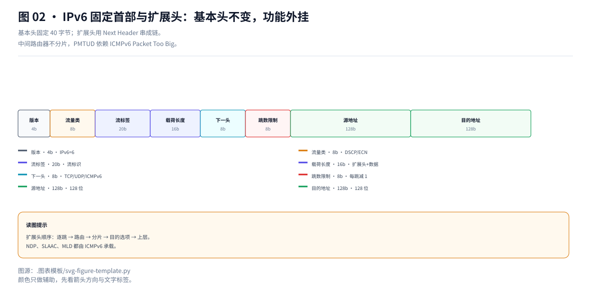
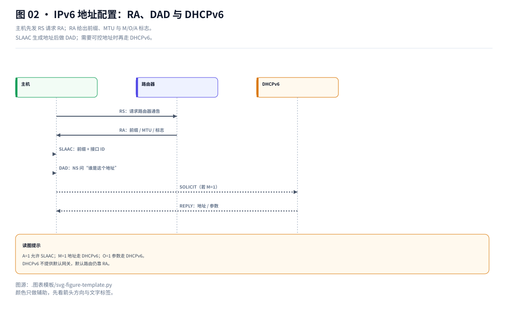
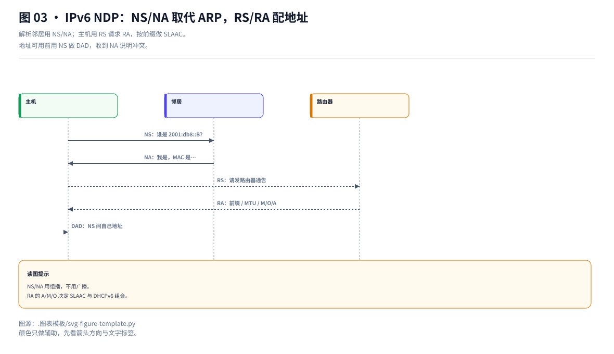

# IPv6

IPv6 用 128 位地址解决 IPv4 枯竭，把首部固定为 40 字节，把扩展功能挪到扩展头；地址配置靠 RA/SLAAC 或 DHCPv6，邻居解析靠 NDP。

> 本篇定位：IPv6 的地址、固定首部与扩展头、SLAAC/DHCPv6、NDP 与转发差异。DHCPv6 的细节、ICMPv6 的类型表在各自篇目。

## 目录

- [1 一句话模型](#s1)
- [2 速览](#s2)
- [3 首部与地址格式](#s3)
- [4 地址类型与配置](#s4)
- [5 交互流程](#s5)
- [6 设计取舍与边界](#s6)
- [7 与相邻协议的关系](#s7)
- [8 参考与关联](#s8)

## 1 · 一句话模型：更大的地址，更薄的中间

IPv6 的思路是「端到端恢复透明，中间设备少做事」：

```text
128 位地址 → 不再需要 NAT 省地址
固定 40 字节首部 → 路由器转发更快
扩展头 → 需要什么加什么，基本头不变
中间路由器不分片 → 源主机负责包大小
```

三个关键认知：

1. **IPv6 没有广播**，用组播和任播替代；ARP 被 NDP 取代。
2. **地址配置有两种主路径**：RA + SLAAC，或 DHCPv6（可组合）。
3. **ICMPv6 是 IPv6 的基石**：NDP、MLD、PMTUD 都靠它，过滤它等于拆地基。

## 2 · 速览

| 项 | 内容 |
| --- | --- |
| 所属层 | 网络层 |
| 地址长度 | 128 位（16 字节） |
| 首部长度 | 固定 40 字节 + 扩展头 |
| 地址表示 | 8 组 4 位十六进制，`:` 分隔，可压缩 |
| 典型前缀 | 主机 /64，站点 /48 或 /56 |
| 地址类型 | 全球单播、链路本地、ULA、组播、任播、环回、未指定 |
| 配置方式 | 静态、SLAAC、DHCPv6、组合 |
| 邻居解析 | NDP（ICMPv6 NS/NA），不用 ARP |
| 分片 | 只允许源主机分片，中间路由器不分片 |
| 主要标准 | RFC 8200、RFC 4291、RFC 4861、RFC 4862、RFC 8415 |

## 3 · 首部与地址格式



**读图**：固定 40 字节基本头 + 扩展头链；地址配置靠 RS/RA、DAD，必要时再用 DHCPv6。

> 图源：`images/图01-IPv6首部与扩展头.svg`

### 3.1 固定首部（40 字节）

| 字段 | 长度 | 作用 |
| --- | --- | --- |
| Version | 4 位 | 固定 6 |
| Traffic Class | 8 位 | 类似 IPv4 的 DSCP/ECN |
| Flow Label | 20 位 | 标识同一流，供 QoS/负载均衡使用 |
| Payload Length | 16 位 | 扩展头 + 上层数据长度 |
| Next Header | 8 位 | 下一个头类型（TCP 6、UDP 17、ICMPv6 58） |
| Hop Limit | 8 位 | 剩余跳数，对应 IPv4 TTL |
| Source Address | 128 位 | 源地址 |
| Destination Address | 128 位 | 目的地址 |

与 IPv4 相比，IPv6 基本头去掉了：首部校验和、分片字段、选项字段、IHL。路由器转发时不用重算校验和，也不处理选项（逐跳选项除外），这是「更薄」的来源。

### 3.2 扩展头

扩展头像链条一样串在基本头后面，用 Next Header 指向下一个：

```text
IPv6 基本头 → 逐跳选项 → 路由 → 分片 → 目的选项 → TCP/UDP → 数据
```

常见扩展头：

| 扩展头 | 作用 |
| --- | --- |
| Hop-by-Hop | 每个路由器都要处理，如 RA 选项 |
| Routing | 源路由/移动 IPv6 |
| Fragment | 分片信息（只由源主机使用） |
| Destination Options | 只有目的主机处理 |
| AH / ESP | IPsec 认证/加密 |

扩展头让基本头保持固定，新功能可以增量部署；代价是解析链变长，防火墙/硬件需要支持多级头。

### 3.3 地址表示

完整写法：

```text
2001:0db8:0000:0000:0000:ff00:0042:8329
```

压缩规则：

- 每组前导 0 可省略：`2001:db8:0:0:0:ff00:42:8329`
- 连续全 0 组可用 `::` 代替，但只能出现一次：`2001:db8::ff00:42:8329`
- IPv4 嵌入写法：`::ffff:192.0.2.1`

前缀用 `/n` 表示，如 `2001:db8:1:2::/64`。

## 4 · 地址类型与配置

### 4.1 地址类型

| 类型 | 前缀 | 作用 |
| --- | --- | --- |
| 全球单播 | `2000::/3` | 公网可路由地址 |
| 链路本地 | `fe80::/10` | 同一链路内通信，NDP 使用 |
| 唯一本地 ULA | `fc00::/7` | 类似私有地址，不出口 |
| 组播 | `ff00::/8` | 一对多，替代广播 |
| 环回 | `::1/128` | 本机 |
| 未指定 | `::/128` | 地址未配置时作源 |
| 任播 | 全球单播中指定 | 一组节点共享地址，路由选最近 |

IPv6 没有广播地址，`ff02::1`（全节点）、`ff02::2`（全路由器）承担类似角色。

### 4.2 三种配置方式

| 方式 | 谁分配 | 特点 |
| --- | --- | --- |
| 静态 | 管理员 | 可控，适合服务器/网关 |
| SLAAC | 主机根据 RA 前缀 + 接口标识生成 | 零配置，网关无状态 |
| DHCPv6 | 服务器 | 可控、可审计，支持租约和前缀委派 |

RA 的 M/O/A 标志决定组合方式：

| 标志 | 含义 | 结果 |
| --- | --- | --- |
| A=1 | 允许 SLAAC | 主机可用 RA 前缀自动配置地址 |
| M=1 | 有状态 DHCPv6 | 地址由 DHCPv6 分配 |
| O=1 | 其他参数走 DHCPv6 | 地址可 SLAAC，DNS 等由 DHCPv6 下发 |

常见组合：A=1、M=0、O=0（纯 SLAAC）；A=0、M=1（纯 DHCPv6）；A=1、M=0、O=1（SLAAC 地址 + DHCPv6 参数）。

### 4.3 接口标识与隐私

SLAAC 早期用 EUI-64 从 MAC 生成接口标识，暴露硬件地址。现代系统默认用**隐私地址（RFC 4941）**：随机生成接口标识，定期更换，兼顾隐私与稳定。

## 5 · 交互流程

### 5.1 地址配置



**读图**：RS/RA 拿到前缀与 M/O/A 标志；SLAAC 生成地址后做 DAD，需要可控地址时再走 DHCPv6。

> 图源：`images/图02-IPv6地址配置.svg`

```text
主机启动
  ├─ 生成链路本地地址 fe80::/64
  ├─ DAD：发 NS 询问「谁是这个地址」，无 NA 则可用
  ├─ 发 RS 请求路由器通告
  ├─ 收 RA：得到前缀、MTU、M/O/A 标志、默认路由
  ├─ 按 A/M 决定 SLAAC 或 DHCPv6
  └─ 对全球地址再做 DAD，成功后可用
```

### 5.2 邻居解析（NDP）



**读图**：NS/NA 解析邻居，RS/RA 拿前缀，DAD 用 NS 检查地址冲突；全部由 ICMPv6 承载。

> 图源：`images/图03-IPv6-NDP.svg`


```text
主机 A 要发帧给 2001:db8::B
  ├─ 查邻居缓存
  ├─ 未命中：发 NS（目的为 B 的 solicited-node 组播）
  ├─ B 回 NA（携带自己的 MAC）
  └─ A 写入缓存，封装帧
```

NS/NA 用组播而不是广播，减少无关节点打扰；NDP 还支持安全邻居发现（SEND），但部署不广。

### 5.3 转发与分片

- 路由器按目的前缀查表，Hop Limit 减 1，归零则回 ICMPv6 超时。
- 中间路由器**不分片**；包大于出接口 MTU 时丢弃并回 ICMPv6 Packet Too Big。
- 源主机靠 PMTUD 调整包大小；TCP 用 MSS 协商避免分片。
- IPv6 最小 MTU 要求 1280 字节，低于此值链路无法正常工作。

### 5.4 过渡技术

| 技术 | 思路 | 适用 |
| --- | --- | --- |
| 双栈 | 同时跑 IPv4 和 IPv6 | 最通用 |
| 隧道 | IPv6-in-IPv4 或反向 | 孤岛互联 |
| NAT64/DNS64 | IPv6 访问 IPv4 资源 | 运营商/移动网络 |
| 464XLAT | 客户端翻译 + 网络侧 NAT64 | 移动终端 |

过渡不是协议的一部分，而是部署策略；选择取决于现有网络和终端支持。

## 6 · 设计取舍与边界

### 6.1 128 位地址

128 位足够大到「不需要省地址」，理论上可以恢复端到端寻址、去掉 NAT。但现实中有状态防火墙、NAT66、代理仍存在，端到端并未完全恢复。

### 6.2 固定首部 + 扩展头

固定首部让路由器转发更快；扩展头让功能可扩展。代价是防火墙/负载均衡要正确解析扩展头链，否则可能漏检或误判。

### 6.3 取消广播

广播被组播/任播替代，减少无关节点打扰。代价是 NDP、DHCPv6 都依赖组播，交换机需要正确处理组播（MLD Snooping），否则会泛洪。

### 6.4 中间不分片

把分片责任交给源主机，网络更简单，但强依赖 ICMPv6 Packet Too Big。ICMPv6 被过滤时，大包会黑洞，表现为「小包通、大包断」。

### 6.5 NDP 的安全边界

NDP 没有内建认证（SEND 部署少），同样面临邻居欺骗/中间人风险。防御靠 RA Guard、NDP 监控、端口安全，而不是协议本身。

## 7 · 与相邻协议的关系

| 相邻对象 | 关系 |
| --- | --- |
| IPv4 | 双栈共存；NAT64/DNS64 做互通 |
| ICMPv6 | NDP、MLD、PMTUD 都依赖它 |
| DHCPv6 | 有状态地址、参数、前缀委派 |
| 以太网 | IPv6 包作为以太载荷，EtherType `0x86DD` |
| 组播 | IPv6 组播映射到 `33:33::/16` MAC |
| 路由 | OSPFv3、IS-IS、BGP 支持 IPv6 前缀 |

一句话：**IPv6 负责「用更大的地址和更薄的中间层跨网送到主机」，但把邻居发现、差错反馈、地址配置都压在 ICMPv6 上。**

## 8 · 参考与关联

**标准**

- RFC 8200：IPv6 Specification
- RFC 4291：IPv6 Addressing Architecture
- RFC 4861：Neighbor Discovery for IPv6
- RFC 4862：IPv6 Stateless Address Autoconfiguration
- RFC 4941：Privacy Extensions for Stateless Address Autoconfiguration
- RFC 8415：DHCPv6

**关联**

- [00-网络层概览.md](./00-网络层概览.md)
- [01-IPv4.md](./01-IPv4.md)：地址与首部对照
- [06-ICMP与ICMPv6.md](./06-ICMP与ICMPv6.md)：NDP 与 PMTUD
- [DHCPv6](../05-应用层/02-DHCPv6.md)：有状态/无状态、PD
- [组播 IGMP/MLD](07-组播IGMP-MLD.md)：MLD 与组播地址
- [01-以太网与MAC.md](../02-链路层/01-以太网与MAC.md)：EtherType 与组播 MAC

---

> **本篇定位**：IPv6 的地址、首部/扩展头、SLAAC/DHCPv6、NDP 与转发差异。
> **素材来源**：`studyspace/1.知识体系/2.TCP IP协议/m-1-IP地址.md` IPv6 节、`m-12-DHCPv6协议.md` NDP 节、`m-7-ICMP协议.md` ICMPv6 节。
> **待验证**：各系统隐私地址策略、RA 默认参数、过渡技术部署差异较大。
