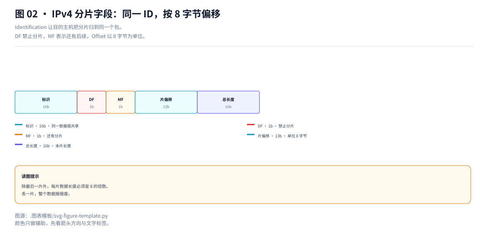
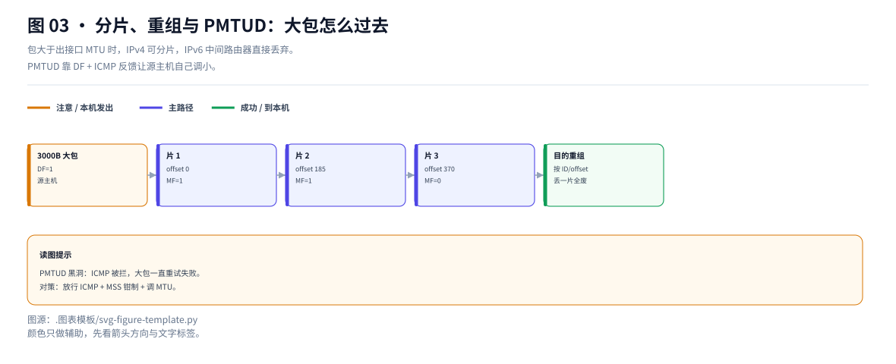

# IP 分片与 MTU

MTU 是链路层能承载的 IP 包上限。包比 MTU 大时只有两条路：分片，或者丢弃并回 ICMP。现代网络尽量不分片，靠 PMTUD 和 MSS 钳制把包控制在路径能承受的范围内。

> 本篇定位：IPv4 分片字段与重组、IPv6 的分片差异、PMTUD、MSS 钳制与隧道开销。TCP 的拥塞控制不在这里展开。

## 目录

- [1 一句话模型](#s1)
- [2 速览](#s2)
- [3 分片字段](#s3)
- [4 分片、重组与 PMTUD](#s4)
- [5 状态与定时器](#s5)
- [6 设计取舍与边界](#s6)
- [7 与相邻协议的关系](#s7)
- [8 参考与关联](#s8)

## 1 · 一句话模型：包太大，要么切，要么退

```text
IP 包长度 ≤ 出接口 MTU  → 直接发
IP 包长度 > 出接口 MTU  → IPv4：可分片；IPv6：中间路由器丢弃并回 ICMPv6
```

三个关键认知：

1. **MTU 是链路层载荷上限**，不是帧长；以太网 MTU 1500，帧长 1518/1522。
2. **分片有代价**：多出头部、重组状态，丢一片等于整个包报废。
3. **PMTUD 让源主机自己变小**：靠 DF 位 + ICMP「包太大」反馈，找到路径最小 MTU。

## 2 · 速览

| 项 | 内容 |
| --- | --- |
| 所属层 | 网络层（与链路层 MTU 紧耦合） |
| 以太网 MTU | 1500 字节 |
| IPv4 最大包 | 65535 字节 |
| IPv4 分片 | 源或中间路由器都可分片 |
| IPv6 分片 | 只允许源主机分片，中间路由器不分片 |
| IPv4 分片字段 | Identification、DF、MF、Fragment Offset |
| IPv6 分片头 | Fragment Extension Header（下一头 44） |
| PMTUD 反馈 | ICMPv4 Type 3 Code 4；ICMPv6 Packet Too Big |
| MSS | IPv4 1460、IPv6 1440（以太网 MTU 1500） |
| 主要标准 | RFC 791、RFC 1191、RFC 8200、RFC 8899 |

## 3 · 分片字段



**读图**：同一 Identification 的分片按 8 字节偏移重组；DF 禁止分片，MF 表示还有后续。

> 图源：`images/图02-IPv4分片字段.svg`


### 3.1 IPv4 首部中的四个字段

| 字段 | 长度 | 作用 |
| --- | --- | --- |
| Identification | 16 位 | 同一数据报的所有分片共享，用于重组 |
| DF | 1 位 | 置 1 禁止分片；路径 MTU 不足时丢弃并回 ICMP |
| MF | 1 位 | 置 1 表示后面还有分片；最后一片 MF=0 |
| Fragment Offset | 13 位 | 该片数据在原数据报中的偏移，单位 8 字节 |

分片时，每个分片都复制原 IP 首部（Options 视情况复制），只改 Total Length、MF、Fragment Offset，并重算首部校验和。

### 3.2 偏移为什么以 8 字节为单位

13 位偏移 × 8 = 最大 65528 字节，刚好覆盖 IPv4 最大包。代价是**除最后一片外，每片的数据长度必须是 8 的倍数**。分片时按 8 字节对齐切分。

### 3.3 IPv6 的分片头

IPv6 基本首部没有分片字段，分片信息放在扩展头里：

| 字段 | 作用 |
| --- | --- |
| Next Header | 下一个头类型 |
| Fragment Offset | 偏移，单位 8 字节 |
| M 标志 | 是否还有分片 |
| Identification | 32 位分片标识 |

IPv6 规定**中间路由器不得分片**，只有源主机可以分片；包超过路径 MTU 时，路由器丢弃并回 ICMPv6 Packet Too Big。

## 4 · 分片、重组与 PMTUD



**读图**：大包切成片，目的主机按 ID/offset 重组；PMTUD 用 DF + ICMP 反馈让源端自己调小。

> 图源：`images/图01-分片重组与PMTUD.svg`

### 4.1 IPv4 分片与重组

```text
源主机/路由器：包 3000 字节，出接口 MTU 1500
  ├─ 片 1：offset 0，MF=1，数据 1480（8 的倍数）
  ├─ 片 2：offset 185，MF=1，数据 1480
  └─ 片 3：offset 370，MF=0，数据 40
目的主机按 Identification + 源/目的 IP + 协议号 聚合，按 offset 重组。
```

重组只在目的主机做，中间路由器不重组。任何一片丢失，整个数据报报废，上层只能重传整个包。

### 4.2 PMTUD 的工作方式

```text
① 源主机发大包，DF=1
② 某跳 MTU 较小 → 路由器丢弃，回 ICMP「Fragmentation needed, DF set」，携带该跳 MTU
③ 源主机调小包，重试
④ 收敛到路径最小 MTU
```

IPv6 用 ICMPv6 Packet Too Big（Type 2），携带 MTU；IPv4 用 Type 3 Code 4。

### 4.3 PMTUD 黑洞

如果中间防火墙/路由器把「需要分片的 ICMP」静默丢弃，源主机永远收不到反馈，大包一直重传失败，表现为：

- 小包（ping、DNS）正常，大包（TLS 握手、下载）卡住。
- TCP 连接能建立，但传大数据时超时。

对策：

- **MSS 钳制（MSS Clamping）**：在网关/TCP 代理上把 SYN 的 MSS 改成较小值（如 1400/1452），从源头避免大包。
- **放行 ICMP**：至少放行 Type 3 Code 4 和 ICMPv6 Type 2，别把 PMTUD 反馈拦掉。
- **调小接口 MTU**：隧道/PPPoE 场景直接按封装开销配置。

### 4.4 隧道与封装开销

| 封装 | 额外开销（约） | 典型可用 MTU |
| --- | --- | --- |
| PPPoE | 8 字节 | 1492 |
| L2TP over UDP/IPv4 | 38–42 字节 | 1450 左右 |
| GRE | 24 字节 | 1476 |
| VXLAN | 50 字节 | 1450 |
| WireGuard | 60 字节左右 | 1420 左右 |
| IPsec | 视模式/算法 | 1400 左右 |

这些数字随实现和选项变化，但结论固定：**封装越深，可用 MTU 越小，越要主动钳制 MSS 或调 MTU。**

### 4.5 IPv6 的额外约束

- IPv6 首部固定 40 字节，比 IPv4 大，MSS 相应更小。
- 中间路由器不分片，PMTUD 更重要；ICMPv6 被拦会导致 IPv6 大包黑洞。
- 最小 MTU 要求 1280 字节；链路 MTU 小于 1280 时，IPv6 无法正常工作（需链路层分片/重组）。

## 5 · 状态与定时器

分片本身没有连接状态，但重组需要缓存和超时：

| 项 | IPv4 | IPv6 |
| --- | --- | --- |
| 重组位置 | 目的主机 | 目的主机 |
| 重组键 | 源/目的 IP + 协议 + Identification | 源/目的 IP + Identification |
| 重组超时 | 常见约 30–60 秒（实现相关） | 60 秒（RFC 8200 建议） |
| 超时后 | 丢弃所有分片，回 ICMP 超时（可选） | 丢弃，回 ICMPv6 超时 |

PMTUD 也没有状态机，只是一次「发大包 → 收 ICMP → 调小」的反馈循环。路径变化后，PMTUD 需要重新收敛；如果缓存了旧的 PMTU，可能长时间不更新。

## 6 · 设计取舍与边界

### 6.1 分片为什么被嫌弃

- **开销**：每片都有 IP 头，隧道里还要再封装。
- **放大丢包**：一片丢失，整包重传。
- **重组资源**：目的主机要缓存乱序分片，易被碎片攻击耗尽。
- **中间设备不友好**：很多防火墙/负载均衡不处理分片，直接丢。

因此现代网络倾向「源端控制包大小」，而不是依赖中间分片。

### 6.2 IPv4 允许中间分片，IPv6 不允许

IPv4 让中间路由器分片，兼容性好，但把重组负担推给目的主机，也让路径 MTU 不透明。IPv6 把分片收回到源主机，强制 PMTUD，网络更简单，但对 ICMPv6 的依赖更强。

### 6.3 DF 位的双刃剑

DF=1 可以避免分片、触发 PMTUD；但如果 ICMP 反馈被拦，就会形成黑洞。DF=0 允许分片，兼容性好，但性能差、易被攻击。工程上通常：DF=1 + 放行 ICMP + MSS 钳制。

### 6.4 MSS 钳制放在哪

- 在网关/路由器上对经过的 SYN 改 MSS，是最常见的做法。
- 在负载均衡/代理上改，适合四层代理。
- 在应用/协议栈上改，粒度最细但覆盖不全。

钳制值要按最小路径 MTU 算，不能一律 1400；太小会降低吞吐，太大仍会丢包。

### 6.5 分片攻击

攻击者发送大量不完整分片，耗尽目的主机重组缓存（如 Teardrop、碎片 Flood）。防御靠重组超时、缓存上限、防火墙丢弃异常分片。现代主机默认限制重组队列。

## 7 · 与相邻协议的关系

| 相邻对象 | 关系 |
| --- | --- |
| 链路层 | MTU 由链路层决定；以太网 1500，PPPoE 1492 |
| TCP | MSS = MTU − IP 头 − TCP 头；MSS 钳制避免分片 |
| UDP | 报文过大直接触发 IP 分片；应用应控制报文大小 |
| ICMP | PMTUD 依赖 ICMPv4 Type 3 Code 4 / ICMPv6 Type 2 |
| 隧道 | PPPoE/L2TP/GRE/VXLAN/WireGuard 都降低可用 MTU |
| NAT | 分片包经过 NAT 时端口信息可能只在前一片，增加处理复杂度 |

一句话：**MTU 决定「一个包最大能多大」，分片是补救，PMTUD + MSS 钳制才是正解。**

## 8 · 参考与关联

**标准**

- RFC 791：Internet Protocol（IPv4 分片）
- RFC 1191：Path MTU Discovery
- RFC 8200：IPv6 Specification
- RFC 8899：Packetization Layer Path MTU Discovery for Datagram Transports
- RFC 8900：IP Fragmentation Considered Fragile

**关联**

- [00-网络层概览.md](./00-网络层概览.md)
- [01-IPv4.md](./01-IPv4.md)：首部字段
- 06-ICMP与ICMPv6：PMTUD 反馈
- [01-以太网与MAC.md](../02-链路层/01-以太网与MAC.md)：1500/1518/1522
- [06-PPP与PPPoE.md](../02-链路层/06-PPP与PPPoE.md)：1492 的来源
- [07-L2TP.md](../02-链路层/07-L2TP.md)：隧道开销

---

> **本篇定位**：MTU、IPv4/IPv6 分片、PMTUD 与 MSS 钳制，重点讲清「为什么大包会黑洞」。
> **素材来源**：`studyspace/1.知识体系/2.TCP IP协议/m-2-链路层.md` §7、`studyspace/1.知识体系/1.计算机网络/m-4-网络层--.md`；PMTUD 与 IPv6 分片按 RFC 补写。
> **待验证**：重组超时、隧道开销、MSS 钳制默认值随内核/厂商实现而变。
