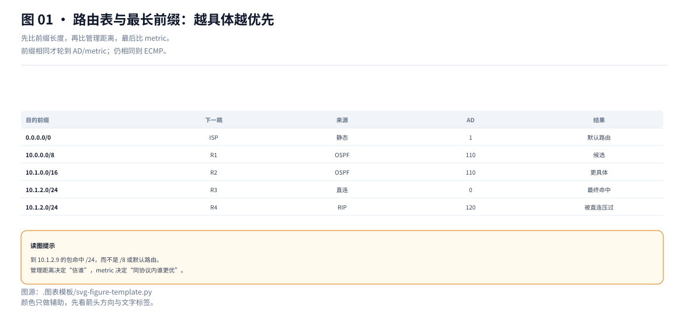
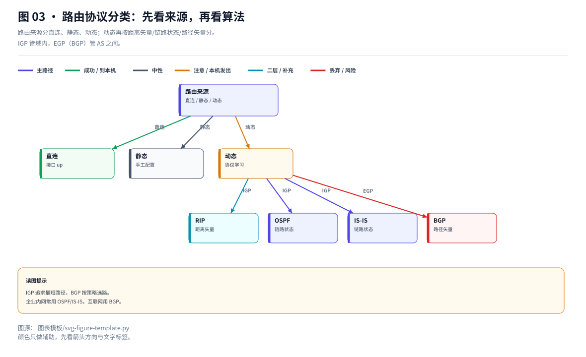
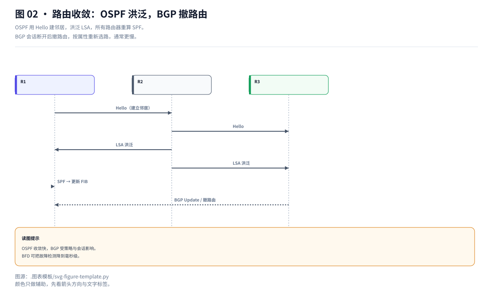

# 路由与路由协议

路由是「把包往哪送」的决策：控制平面提前算好路由表，数据平面每个包只做最长前缀匹配。静态路由靠人，动态路由靠协议。

> 本篇定位：路由表结构、选路顺序、静态/动态路由的分类，以及 RIP/OSPF/IS-IS/BGP 的定位。具体配置与厂商实现不在本篇。

## 目录

- [1 一句话模型](#s1)
- [2 速览](#s2)
- [3 路由表与选路](#s3)
- [4 路由协议分类](#s4)
- [5 交互流程与收敛](#s5)
- [6 状态与定时器](#s6)
- [7 设计取舍与边界](#s7)
- [8 参考与关联](#s8)

## 1 · 一句话模型：先算表，再查表

```text
控制平面：直连/静态/动态协议 → 路由表（RIB）
数据平面：每个包查 FIB → 最长前缀匹配 → 下一跳 + 出接口
```

三个关键认知：

1. **转发不跑算法**，包到达时只查已经算好的表。
2. **最长前缀优先**，越具体的路由越优先，不管它的来源。
3. **前缀相同才比优先级/度量**：管理距离（AD）决定「信谁」，metric 决定「同协议内哪条更优」。

## 2 · 速览

| 项 | 内容 |
| --- | --- |
| 所属层 | 网络层 |
| 核心表 | RIB（路由表）、FIB（转发表） |
| 路由来源 | 直连、静态、动态协议 |
| 选路顺序 | 最长前缀 → 管理距离/优先级 → 度量值 → ECMP |
| 常见 IGP | RIP、OSPF、IS-IS |
| 常见 EGP | BGP |
| 关键概念 | 下一跳、出接口、AS、区域、收敛 |

## 3 · 路由表与选路



**读图**：同一目的先比前缀长度，再比管理距离，最后比 metric；/24 压过 /8 和默认路由。

> 图源：`images/图01-路由表与最长前缀.svg`

### 3.1 一条路由包含什么

| 字段 | 作用 |
| --- | --- |
| 目的网络/掩码 | 目标网段，如 `10.0.0.0/8` |
| 下一跳 | 交给哪个邻居 |
| 出接口 | 从哪个接口发出 |
| 协议来源 | Direct/Static/RIP/OSPF/BGP |
| 管理距离/优先级 | 不同来源之间的可信度 |
| 度量值 metric | 同协议内部的开销 |

### 3.2 选路顺序

```text
① 最长前缀匹配：/32 优于 /24，优于 /8，优于默认路由 /0
② 前缀相同：比管理距离（数值小者优）
③ 管理距离相同：比 metric（数值小者优）
④ 仍相同：ECMP 等价多路径，按哈希分担
```

常见管理距离（不同厂商略有差异）：

| 来源 | 典型 AD |
| --- | --- |
| 直连 | 0 |
| 静态 | 1 |
| OSPF | 110 |
| IS-IS | 115 |
| RIP | 120 |
| eBGP | 20 |
| iBGP | 200 |

「直连最可信、静态次之、动态再次」是常见默认，但可以按需调整。

### 3.3 RIB 与 FIB

- **RIB**：所有路由协议/配置算出来的候选路由，包含来源、AD、metric。
- **FIB**：最终下发给转发硬件的表，只保留最优路由，追求查表速度。

控制平面收敛慢一点没关系，数据平面必须快。两者分离是路由器和 SDN 的基础。

## 4 · 路由协议分类



**读图**：先看路由来源（直连/静态/动态），再看算法（距离矢量/链路状态/路径矢量）与 IGP/EGP。

> 图源：`images/图03-路由协议分类.svg`


| 协议 | 类型 | 承载 | 度量 | 适用范围 |
| --- | --- | --- | --- | --- |
| RIP | 距离矢量 | UDP 520 | 跳数（最大 15） | 小型网络 |
| OSPF | 链路状态 | IP 协议号 89 | 带宽开销 cost | 大型企业内网 |
| IS-IS | 链路状态 | CLNS/二层 | cost | 运营商骨干 |
| BGP | 路径矢量 | TCP 179 | 路径属性/策略 | AS 之间、大型网络 |

### 4.1 距离矢量：RIP

- 每个路由器把「我到各网段的距离」告诉邻居，邻居再加一跳。
- 只知距离和方向，不知全网拓扑。
- 收敛慢，容易环路；靠水平分割、毒性逆转、触发更新缓解。
- 最大 15 跳，超过视为不可达，适合小网络。

### 4.2 链路状态：OSPF / IS-IS

- 每台路由器描述「我的接口和邻居」，洪泛给全网。
- 每台路由器收集完整拓扑，用 SPF（Dijkstra）算最短路径树。
- 收敛快、无环路、支持 ECMP。
- OSPF 用 area 分层，area 0 是骨干；IS-IS 用 L1/L2 分层，天然适合大规模。

### 4.3 路径矢量：BGP

- 不传「距离」，传「到某个前缀经过哪些 AS」。
- 用 AS_PATH 防环，用 LOCAL_PREF、MED、community 等属性做策略选路。
- eBGP 用于 AS 之间，iBGP 用于 AS 内部；需要全互联或路由反射器。
- 互联网骨干的标准协议，强调策略与可控，不追求最短路径。

## 5 · 交互流程与收敛



**读图**：OSPF 用 Hello/LSA/SPF 收敛；BGP 靠会话与 Update，撤路由后按属性重新选路。

> 图源：`images/图02-OSPF与BGP收敛.svg`


### 5.1 直连与静态

- **直连路由**：接口 up 且配置地址后自动生成，AD 最低。
- **静态路由**：手工配置，适合默认路由、专线出口、小型网络。
- **浮动静态**：配置不同 AD 的同目的静态路由，主链路失效时备份生效。

### 5.2 OSPF 的邻居与 SPF

```text
Hello 发现邻居 → 建立邻接（数据库同步）→ 洪泛 LSA
  → 每台路由器收到完整 LSDB → 跑 SPF → 写入路由表
```

关键点：Hello 参数（area、hello/dead 间隔、认证）必须一致，否则邻居起不来；MTU 不一致会影响数据库同步。

### 5.3 BGP 的会话与选路

```text
TCP 179 建会话 → Open → Keepalive → Update（前缀 + 属性）
```

BGP 选路不是「最短」，而是按属性顺序比较：权重、LOCAL_PREF、本地始发、AS_PATH 长度、起源类型、MED、eBGP 优于 iBGP、Router ID 等。策略可以覆盖最短路径。

### 5.4 收敛

| 协议 | 收敛触发 | 典型行为 |
| --- | --- | --- |
| RIP | 周期更新/触发更新 | 逐跳传播，慢 |
| OSPF | 链路变化/Hello 超时 | 洪泛 LSA，重算 SPF |
| IS-IS | 链路变化/Hello 超时 | 类似 OSPF，分层 |
| BGP | 会话断开/Update | 撤路由、重新选路，通常最慢 |

收敛期间可能出现短暂环路或黑洞；ECMP、快速重路由（FRR）、BFD 可以缩短中断。

## 6 · 状态与定时器

| 协议 | 关键定时器/状态 |
| --- | --- |
| RIP | 更新 30s、失效 180s、清除 240s |
| OSPF | Hello 10s（广播）、Dead 40s；邻居状态 Down/Init/2-Way/ExStart/Exchange/Loading/Full |
| IS-IS | Hello、Hold Time；邻接 Up/Down |
| BGP | Keepalive 60s、Hold 180s；Idle/Connect/Active/OpenSent/OpenConfirm/Established |
| 静态 | 无定时器，依赖接口状态/ Track |

BFD 可以提供毫秒级故障检测，常与 OSPF/BGP/静态路由联动，缩短收敛。

## 7 · 设计取舍与边界

### 7.1 静态 vs 动态

静态简单、可控、不泄露拓扑，但不会自动适应变化；动态能自动收敛，但有协议开销、配置复杂、需要防伪造。常见做法：内网动态、出口静态默认路由。

### 7.2 IGP vs EGP

IGP 追求「最快到达」，EGP 追求「按策略可达」。企业内网用 OSPF/IS-IS，互联网用 BGP；把 BGP 用在纯内网会过度复杂，把 OSPF 用在跨 AS 又不合适。

### 7.3 分层与区域

OSPF area、IS-IS level 都是为了控制洪泛范围、降低 SPF 复杂度。区域边界要设计好，否则会出现次优路径、虚连接、LSA 泛洪。

### 7.4 策略 vs 最短路径

BGP 的选路是策略驱动的：商业关系、流量工程、备份路径都可能覆盖「最短 AS_PATH」。理解这一点，才能解释「为什么流量绕路」。

### 7.5 路由不是转发

路由协议只负责「表里有什么」，实际转发由 FIB/硬件完成。排障时先看 FIB 是否有条目，再看协议邻居是否正常，顺序不能反。

## 8 · 参考与关联

**标准**

- RFC 2453：RIP v2
- RFC 2328：OSPF v2
- RFC 1195：IS-IS for IP
- RFC 4271：BGP-4
- RFC 5880：BFD

**关联**

- [00-网络层概览.md](./00-网络层概览.md)
- [01-IPv4.md](./01-IPv4.md)：地址与最长前缀
- [02-IPv6.md](./02-IPv6.md)：OSPFv3/BGP 的 IPv6 支持
- [NAT](05-NAT.md)：出口地址转换
- [VRRP](08-VRRP.md)：网关冗余
- 20-平台与系统/21-Linux/06-网络子系统：Linux 路由表与 FIB

---

> **本篇定位**：路由表、选路顺序与四类路由协议的定位，重点讲清「最长前缀 → AD → metric」。
> **素材来源**：`studyspace/1.知识体系/8.路由与交换/m-7-路由.md`（主）、`studyspace/1.知识体系/1.计算机网络/m-4-网络层--.md`（控制平面）。
> **待验证**：各厂商管理距离默认值、OSPF/BGP 定时器与选路属性优先级可能不同。
