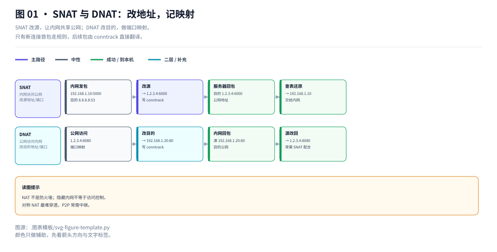

# NAT

NAT 在转发路径上改写 IP 地址（通常还改端口），让多个内网主机共享少量公网地址。它缓解了 IPv4 枯竭，却破坏了端到端透明性。

> 本篇定位：SNAT/DNAT/MASQUERADE/PAT 的区别、转换表与 conntrack、锥型 NAT、ALG 与穿透。iptables/nftables 语法归 20-网络子系统。

## 目录

- [1 一句话模型](#s1)
- [2 速览](#s2)
- [3 转换表与 conntrack](#s3)
- [4 交互流程](#s4)
- [5 状态与定时器](#s5)
- [6 设计取舍与边界](#s6)
- [7 与相邻协议的关系](#s7)
- [8 参考与关联](#s8)

## 1 · 一句话模型：改地址，记映射

NAT 设备在包出门时把「内网源地址:端口」换成「公网地址:端口」，同时记下映射；回包按映射改回去。

```text
内网 192.168.1.10:5000  ──SNAT──►  公网 1.2.3.4:6000  ──► 服务器
服务器 ──► 1.2.3.4:6000  ──查表──►  192.168.1.10:5000
```

三个关键认知：

1. **NAT 是有状态的**：没有映射表，回包就找不到内网主机。
2. **只有新连接的首包走 NAT 规则**，后续包由 conntrack 直接翻译。
3. **NAT 不是防火墙**：它隐藏内网，但不等于访问控制；安全仍要靠 filter/策略。

## 2 · 速览

| 项 | 内容 |
| --- | --- |
| 所属层 | 网络层（常依赖传输层端口） |
| 核心动作 | 改写源/目的 IP，必要时改写端口 |
| 常见类型 | SNAT、DNAT、MASQUERADE、PAT、双向 NAT |
| 状态表 | conntrack（连接跟踪） |
| 转换粒度 | 五元组：源/目的 IP、源/目的端口、协议 |
| 典型设备 | 路由器、防火墙、负载均衡、云网关 |
| 主要标准 | RFC 3022（NAT）、RFC 4787（UDP）、RFC 5382（TCP） |
| 典型场景 | 家庭/企业共享上网、端口映射、云 NAT 网关 |

## 3 · 转换表与 conntrack

### 3.1 四类 NAT

| 类型 | 改什么 | 典型用途 |
| --- | --- | --- |
| SNAT | 源 IP（可加端口） | 内网访问公网 |
| DNAT | 目的 IP（可加端口） | 端口映射、负载均衡 |
| MASQUERADE | 源 IP 取出口接口地址 | 动态公网地址（PPPoE/DHCP） |
| PAT/NAPT | 源 IP + 源端口 | 多主机共享一个公网 IP |
| 双向 NAT | 源和目的都改 | 复杂组网、地址重叠 |

### 3.2 conntrack 表项

一条连接跟踪表项至少包含：

```text
原始方向：源 IP:端口 → 目的 IP:端口（协议）
应答方向：源 IP:端口 → 目的 IP:端口（转换后的）
状态：NEW / ESTABLISHED / RELATED / INVALID
超时：TCP 已建立、UDP、ICMP 各不同
```

NAT 的转换信息挂在 conntrack 上。包到达时，先查 conntrack；命中就按已有映射翻译，不再走 NAT 规则。这就是「NAT 规则计数器只涨 1」的原因。

### 3.3 转换发生在哪

| 方向 | 典型位置 | 动作 |
| --- | --- | --- |
| 出站 | POSTROUTING | SNAT/MASQUERADE |
| 入站 | PREROUTING | DNAT |
| 本机发起 | OUTPUT | 本机 DNAT/SNAT |
| 回程 | 自动 | 按 conntrack 反向翻译 |

DNAT 后如果内网主机回包源地址是内网地址，直接发会绕过 NAT 设备，所以通常还要配一条 SNAT（或自动 masquerade），让回程经过 NAT 设备。

## 4 · 交互流程



**读图**：上行 SNAT 改源，下行 DNAT 改目的；只有新连接首包走规则，后续包由 conntrack 直接翻译。

> 图源：`images/图01-SNAT与DNAT转换.svg`

### 4.1 内网访问公网（SNAT/PAT）

```text
① 内网主机发 192.168.1.10:5000 → 8.8.8.8:53
② NAT 设备改源为 1.2.3.4:6000，记录映射
③ 服务器回 1.2.3.4:6000
④ NAT 设备查表，改回 192.168.1.10:5000
```

公网地址池只有一个时，靠端口区分不同内网主机；端口耗尽会导致新连接失败。

### 4.2 端口映射（DNAT）

```text
① 公网用户访问 1.2.3.4:8080
② NAT 设备改目的为 192.168.1.20:80
③ 内网服务器回包源为 192.168.1.20:80
④ NAT 设备把源改回 1.2.3.4:8080（需要 SNAT 配合）
```

DNAT 只改目的，回程必须靠 conntrack 或额外 SNAT 才能正确还原。

### 4.3 双向 NAT 与 hairpin

- **双向 NAT**：源和目的都改，常用于地址重叠、跨云互联。
- **Hairpin NAT（NAT 回流）**：内网用户通过公网地址访问同一内网的服务器，需要 DNAT + SNAT，否则回包直接走内网，源地址对不上。

### 4.4 ALG 与穿透

有些协议把地址/端口写在应用载荷里（如 FTP、SIP、H.323）。NAT 只改 IP 头，载荷里的地址不会变，需要 **ALG（应用层网关）** 帮忙改。ALG 实现复杂、易出问题，现代方案更倾向：

- 用端到端加密/中继（STUN/TURN）。
- 用支持 NAT 穿透的协议（QUIC、WebRTC）。
- 直接上 IPv6，减少 NAT。

### 4.5 锥型 NAT

| 类型 | 行为 | 穿透难度 |
| --- | --- | --- |
| Full Cone | 同一内网映射对所有外部地址开放 | 容易 |
| Restricted Cone | 只对已通信过的外部 IP 开放 | 中等 |
| Port Restricted | 只对已通信过的 IP:端口开放 | 较难 |
| Symmetric | 每个外部目标分配不同映射 | 最难 |

对称 NAT 下，同一内网主机访问不同目标会用不同公网端口，P2P 打洞需要中继。

## 5 · 状态与定时器

conntrack 的四个状态：

| 状态 | 含义 |
| --- | --- |
| NEW | 新连接的第一个包 |
| ESTABLISHED | 双向都有流量，连接已确认 |
| RELATED | 与已有连接相关的新连接（如 FTP 数据连接、ICMP 错误） |
| INVALID | 不属于任何已知连接（畸形、超时、状态不符） |

超时时间（典型值，随实现/配置变化）：

| 协议 | 状态 | 典型超时 |
| --- | --- | --- |
| TCP | ESTABLISHED | 数天（可配） |
| TCP | SYN_SENT | 数十秒 |
| UDP | 单向/双向 | 30–180 秒 |
| ICMP | — | 数十秒 |

表满会丢新连接，表现为「老连接正常、新连接建不上」。NAT 设备要监控表使用率，必要时调大上限或缩短超时。

## 6 · 设计取舍与边界

### 6.1 缓解枯竭，但破坏端到端

NAT 让大量内网主机共享少量公网地址，延缓了 IPv4 枯竭；代价是外部无法主动访问内网、应用要把地址写进载荷时会失效、P2P 需要穿透。

### 6.2 NAT 不是安全边界

NAT 隐藏了内网拓扑，但它不是访问控制：一旦有 DNAT/UPnP/穿透，外部仍可进入。安全要靠状态防火墙、ACL、最小暴露面。

### 6.3 ALG 的脆弱性

ALG 要解析应用层协议、改载荷、处理分片/加密，任何一个环节出错都会导致「注册失败、语音单通、FTP 卡住」。很多场景选择关闭 ALG，改用其他方案。

### 6.4 端口耗尽与共享

一个公网 IP 最多 65535 个端口，扣除保留端口和超时占用，实际并发有限。运营商级 NAT（CGNAT）用地址池 + 端口块分配缓解，但会带来日志、追溯、性能问题。

### 6.5 IPv6 与 NAT66

IPv6 地址充足，理论上不需要 NAT；但 NAT66 仍被用于「不暴露内网前缀」「快速切换运营商」等场景。它同样破坏端到端，是否使用要看运维取舍。

## 7 · 与相邻协议的关系

| 相邻对象 | 关系 |
| --- | --- |
| IPv4 | NAT 改写 IPv4 地址；依赖首部校验和重算 |
| TCP/UDP | 端口是 PAT 的复用依据；校验和要随地址/端口更新 |
| 防火墙 | conntrack 同时服务 NAT 与状态过滤 |
| ALG | 处理载荷中的地址/端口，易碎 |
| DNS | DNS ALG 可能改写应答地址，常被禁用 |
| 隧道 | 隧道外层可做 NAT，内层地址保持不变 |
| UPnP/PCP | 让应用自动申请端口映射 |

一句话：**NAT 负责「用少量公网地址复用大量内网连接」，不负责「安全」，也不保证「外部可主动访问」。**

## 8 · 参考与关联

**标准**

- RFC 3022：Traditional IP Network Address Translator
- RFC 4787：NAT Behavioral Requirements for Unicast UDP
- RFC 5382：NAT Behavioral Requirements for TCP
- RFC 5128：State of Peer-to-Peer Communication across NAT
- RFC 6887：Port Control Protocol（PCP）

**关联**

- [00-网络层概览.md](./00-网络层概览.md)
- [01-IPv4.md](./01-IPv4.md)：地址与私有地址
- [02-IPv6.md](./02-IPv6.md)：NAT66 与端到端
- [01-TCP.md](../04-传输层/01-TCP.md)：端口与连接
- [02-UDP与QUIC.md](../04-传输层/02-UDP与QUIC.md)：UDP 映射与穿透
- 20-平台与系统/21-Linux/06-网络子系统：conntrack 与 iptables/nftables

---

> **本篇定位**：NAT 的类型、conntrack 转换表、SNAT/DNAT 流程与穿透边界。
> **素材来源**：`studyspace/1.知识体系/2.TCP IP协议/m-6-NAT协议.md`（主）、`studyspace/1.知识体系/6.linux防火墙/NAT原理笔记.md`（补）。
> **待验证**：conntrack 超时、表容量、锥型 NAT 行为随内核/厂商实现而变。
