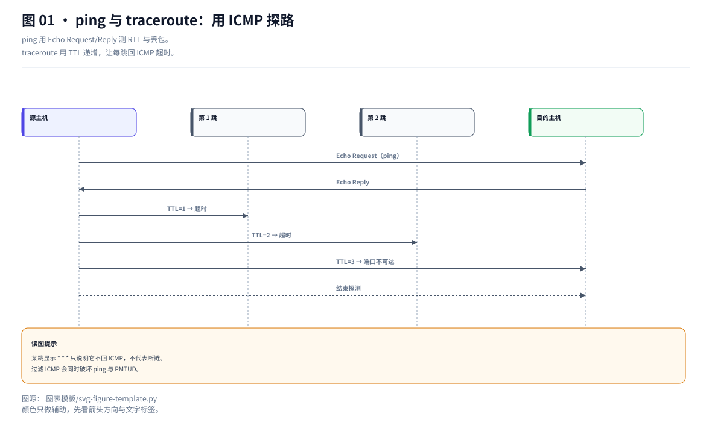
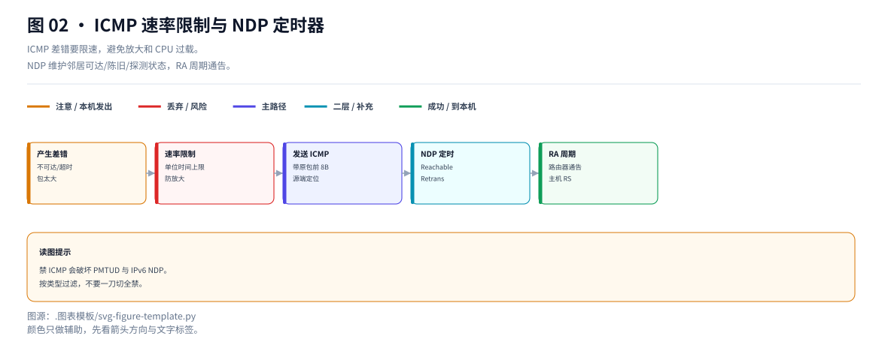

# ICMP 与 ICMPv6

ICMP 是 IP 的差错报告员和诊断工具：路由不通、TTL 耗尽、包太大，都由它回话。IPv6 把它的地位再提高一层——NDP、MLD、PMTUD 都靠 ICMPv6，缺了它 IPv6 根本跑不起来。

> 本篇定位：ICMPv4/ICMPv6 的报文、差错规则、ping/traceroute、NDP 与 MLD、安全边界。IGMP/MLD 的组成员管理细节在组播篇。

## 目录

- [1 一句话模型](#s1)
- [2 速览](#s2)
- [3 报文格式](#s3)
- [4 交互流程](#s4)
- [5 状态与定时器](#s5)
- [6 设计取舍与边界](#s6)
- [7 与相邻协议的关系](#s7)
- [名词解释](#名词解释)
- [8 参考与关联](#s8)

## 1 · 一句话模型：IP 的副官

IP 只负责转发，不负责解释失败。ICMP 补上两件事：

```text
差错报告：不可达、超时、参数错、包太大
诊断查询：ping（回显）、traceroute（TTL 递增）
```

三个关键认知：

1. **ICMP 封装在 IP 里**，不是传输层；IPv4 协议号 1，IPv6 下一头 58。
2. **差错报文会带回出错包的 IP 头 + 前 8 字节**，让源主机知道是哪条连接出问题。
3. **IPv6 离不开 ICMPv6**：地址自动配置、邻居发现、组播管理、PMTUD 都依赖它。

## 2 · 速览

| 项 | ICMPv4 | ICMPv6 |
| --- | --- | --- |
| 封装 | IP 协议号 1 | IPv6 下一头 58 |
| 基本格式 | Type(1) + Code(1) + Checksum(2) + 主体 | 同左 |
| 校验和 | 不包含 IP 伪首部 | **必须包含 IPv6 伪首部** |
| 回显 | Type 8 请求 / 0 应答 | Type 128 请求 / 129 应答 |
| 不可达 | Type 3 | Type 1 |
| 超时 | Type 11 | Type 3 |
| 包太大 | Type 3 Code 4 | Type 2（Packet Too Big） |
| 邻居解析 | ARP（独立协议） | NDP：NS 135 / NA 136 |
| 组播管理 | IGMP（独立协议） | MLD：130–132 |
| 主要标准 | RFC 792 | RFC 4443、RFC 4861 |

## 3 · 报文格式

### 3.1 公共头

所有 ICMP 报文前 4 字节相同：

| 字段 | 长度 | 作用 |
| --- | --- | --- |
| Type | 1 字节 | 报文大类 |
| Code | 1 字节 | 大类下的细分原因 |
| Checksum | 2 字节 | 校验整个 ICMP 报文 |

差错报文的「主体」通常包含：

```text
触发错误的 IP 头（20/40 字节）
  + 原 IP 载荷的前 8 字节（通常是 TCP/UDP 端口）
```

这 8 字节是关键：源主机靠它把错误对应到具体的连接或应用。

### 3.2 ICMPv6 的校验和

ICMPv6 的校验和必须覆盖 IPv6 伪首部（源地址、目的地址、长度、下一头），这与 ICMPv4 不同。原因是 IPv6 基本头没有校验和，需要 ICMPv6 自己把地址信息纳入校验。

### 3.3 常用类型

**ICMPv4**

| Type | 名称 | 关键 Code |
| --- | --- | --- |
| 0 / 8 | 回显应答 / 请求 | 0 |
| 3 | 目的不可达 | 0 网络、1 主机、3 端口、4 需要分片但 DF 置位、13 管理禁止 |
| 5 | 重定向 | 0–3 |
| 11 | 超时 | 0 TTL 耗尽、1 重组超时 |
| 12 | 参数问题 | 0–2 |

**ICMPv6**

| Type | 名称 | 作用 |
| --- | --- | --- |
| 1 | 目的不可达 | 0 无路由、1 管理禁止、3 地址不可达、4 端口不可达 |
| 2 | Packet Too Big | 携带路径 MTU，PMTUD 的核心 |
| 3 | 超时 | 0 跳数耗尽、1 重组超时 |
| 4 | 参数问题 | 头部字段/选项错误 |
| 128 / 129 | 回显请求 / 应答 | ping |
| 130–132 | MLD 查询/报告/离开 | 组播成员管理 |
| 133–136 | RS/RA/NS/NA | 邻居发现与地址自动配置 |

## 4 · 交互流程



**读图**：ping 是 Echo 请求/应答往返；traceroute 逐跳加 TTL，让每跳回 ICMP 超时。

> 图源：`images/图01-ping与traceroute.svg`

### 4.1 差错报文的规则

ICMP 差错不是无条件发送的，否则会无限递归或放大攻击：

| 规则 | 说明 |
| --- | --- |
| 不再为 ICMP 差错报文产生差错 | 防止无限循环 |
| 不为非首片分片产生差错 | 分片里没有完整传输层头 |
| 不向广播/组播地址发差错（少数例外） | 防止放大 |
| 源地址为 0、环回、广播等特殊地址时不发 | 避免无意义/危险报文 |
| 速率限制 | 路由器通常限制 ICMP 产生速率 |

### 4.2 ping

```text
源主机                          目的主机
  │ Echo Request（Type 8/128）    │
  ├──────────────────────────────►│
  │ Echo Reply（Type 0/129）      │
  │◄──────────────────────────────┤
```

- 请求里带 Identifier 和 Sequence，用来匹配应答、计算丢包。
- RTT = 收到应答时间 − 发送时间。
- 应答里的 TTL 是「目的主机初始 TTL − 返回路径跳数」，可粗略推断对端系统，但不可靠。
- **ping 不通不等于主机不可达**：目标可能只是禁用了 ICMP 应答。

### 4.3 traceroute

利用 TTL 递增 + 差错报文：

```text
TTL=1 → 第 1 跳路由器 TTL 减为 0 → 回 ICMP 超时（Type 11/3）
TTL=2 → 第 2 跳 → 回超时
...
TTL=n → 到达目的主机 → 端口不可达（UDP 探测）或回显应答（ICMP 探测）
```

Linux 传统 traceroute 默认用 UDP 高端口（33434 起），Windows tracert 默认用 ICMP Echo，Linux 也支持 `-I`（ICMP）和 `-T`（TCP SYN）。某跳显示 `* * *` 只说明该跳不回 ICMP，不代表链路断了。

### 4.4 NDP：IPv6 的邻居发现

NDP 用四个 ICMPv6 报文取代 ARP 和部分 ICMP 路由发现功能：

| 报文 | 作用 | IPv4 对应 |
| --- | --- | --- |
| RS（133） | 主机请求路由器发 RA | ICMP 路由器请求 |
| RA（134） | 通告前缀、MTU、跳数限制、M/O/A 标志 | ICMP 路由器通告 + DHCP 部分功能 |
| NS（135） | 解析邻居 MAC；也用于 DAD | ARP 请求 |
| NA（136） | 应答 NS；通告自己的 MAC | ARP 应答 |

RA 的关键标志：

- **A**：允许 SLAAC，用前缀 + 接口标识自动配置地址。
- **M**：有状态 DHCPv6，地址由 DHCPv6 分配。
- **O**：其他参数（如 DNS）通过 DHCPv6 获取。

DAD（重复地址检测）用 NS 询问「谁是这个地址」，收到 NA 就说明冲突。

### 4.5 MLD

MLD 是 ICMPv6 承载的组播成员管理，功能对应 IGMP：查询、报告、离开。MLDv1 对应 IGMPv2，MLDv2 对应 IGMPv3（支持源过滤）。细节在组播篇。

### 4.6 异常分支

| 异常 | 表现 | 原因 |
| --- | --- | --- |
| ping 超时 | 无应答 | 目标禁 ICMP、路由不通、防火墙丢弃 |
| 端口不可达 | Type 3 Code 3 / Type 1 Code 4 | 目标端口没监听；traceroute 的正常结束条件 |
| 需要分片但 DF 置位 | Type 3 Code 4 | 路径 MTU 小于包长；PMTUD 的依据 |
| Packet Too Big | ICMPv6 Type 2 | IPv6 中间路由器不分片，必须靠它通知源 |
| 管理禁止 | Type 3 Code 13 / Type 1 Code 1 | 防火墙策略拒绝 |
| 重定向 | Type 5 | 路由器发现更优下一跳；也可能被伪造 |

## 5 · 状态与定时器



**读图**：三个机制互不依赖——差错限速管发不发、NDP 管邻居是否可达、RA 管网关是否还有效；它们只是常同处一台设备。

> 图源：`images/图02-ICMP速率与NDP定时.svg`


ICMP 本身没有连接状态机，只有速率限制和少量定时器：

| 项 | 说明 |
| --- | --- |
| ICMP 速率限制 | 路由器/主机限制单位时间产生的差错报文数，防放大 |
| NDP 邻居缓存 | 可达/陈旧/探测状态，有 Reachable Time、Retrans Timer |
| RA 周期 | 路由器周期性发 RA；主机也可发 RS 主动请求 |
| 分片重组超时 | 重组失败时回 ICMP 超时（IPv4 Type 11 Code 1 / IPv6 Type 3 Code 1） |

ping/traceroute 的定时器在应用侧（超时、重试次数），不在 ICMP 协议内。

## 6 · 设计取舍与边界

### 6.1 ICMP 是「必要之恶」

没有 ICMP，IP 只能静默丢包，排障和 PMTUD 都无法工作。但 ICMP 也可能被用于扫描、放大、隧道，所以很多网络选择「按类型过滤」。

正确的做法不是「全禁」或「全放」，而是：

- 放行 PMTUD 必需的 Type 3 Code 4 / ICMPv6 Type 2。
- 放行必要的诊断（按源/目的/速率限制）。
- 禁止重定向、广播请求等高风险类型。
- 对 ICMPv6 更谨慎：禁了 NDP/RA，IPv6 直接不可用。

### 6.2 过滤 ICMP 的代价

- 禁 Type 3 Code 4 / Type 2 → PMTUD 黑洞，大包不通。
- 禁 RA/NS/NA → IPv6 地址配置、邻居解析失败。
- 禁全部 ICMP → ping 不可用只是表象，真正的问题是路径 MTU 和故障反馈丢失。

### 6.3 安全边界

| 风险 | 原理 | 边界 |
| --- | --- | --- |
| ICMP Flood | 海量回显请求耗尽 CPU/带宽 | 限速、边界清洗 |
| Smurf | 伪造源地址向广播地址发请求，放大应答 | 关闭定向广播、过滤广播 ICMP |
| 重定向攻击 | 伪造 Type 5 改路由 | 只接受当前网关的重定向 |
| ICMP 隧道 | 把数据藏进 Echo 载荷绕过防火墙 | 深度检测/限制载荷 |
| 差错报文干扰 | 伪造 Type 3/11 切断连接或 PMTUD | 校验序列号/连接、限速 |

### 6.4 IPv4 与 IPv6 的依赖程度不同

IPv4 没有 ICMP 还能勉强转发（ARP、DHCP 独立）；IPv6 把 NDP、SLAAC、MLD、PMTUD 都放进 ICMPv6，**过滤 ICMPv6 等于拆掉 IPv6 的地基**。这是两套协议在运维上最大的差异之一。

## 7 · 与相邻协议的关系

| 相邻对象 | 关系 |
| --- | --- |
| IP | ICMP 封装在 IP 内；IPv4 协议号 1，IPv6 下一头 58 |
| ARP / NDP | IPv4 用 ARP 解析 MAC；IPv6 用 NS/NA，且 NS 兼做 DAD |
| PMTUD | 依赖 ICMP Type 3 Code 4 / ICMPv6 Type 2 |
| TCP/UDP | 差错报文带回端口信息，帮助定位连接 |
| IGMP/MLD | 组播成员管理；MLD 由 ICMPv6 承载 |
| 路由 | 重定向、路由器发现属于网络层控制功能 |

一句话：**ICMP 负责「报告 IP 没做成的事」，ICMPv6 还负责「让 IPv6 能开始工作」。**

## 名词解释

> 缩写给出英文全称；非缩写用“—”表示。

| 术语 | 英文全称 | 解释 |
| --- | --- | --- |
| ICMP | Internet Control Message Protocol | 网络层差错与控制协议。 |
| ICMPv6 | Internet Control Message Protocol for IPv6 | IPv6 的 ICMP。 |
| Echo | — | 回显请求/应答，ping 使用。 |
| TTL | Time To Live | 剩余跳数。 |
| traceroute | — | 用 TTL 递增探测路径。 |
| NDP | Neighbor Discovery Protocol | IPv6 邻居发现。 |
| MLD | Multicast Listener Discovery | IPv6 组播成员管理。 |
| PMTUD | Path Maximum Transmission Unit Discovery | 路径 MTU 发现。 |
| Type/Code | — | ICMP 类型/代码。 |
| 差错报文 | — | 报告不可达、超时、参数错误。 |

## 8 · 参考与关联

**标准**

- RFC 792：Internet Control Message Protocol（ICMPv4）
- RFC 4443：ICMPv6
- RFC 4861：Neighbor Discovery for IPv6
- RFC 2710 / RFC 3810：MLDv1 / MLDv2
- RFC 1191 / RFC 1981：IPv4 / IPv6 PMTUD

**关联**

- [00-网络层概览.md](./00-网络层概览.md)
- [01-IPv4.md](./01-IPv4.md)：TTL、协议号、分片
- [03-IP分片与MTU.md](./03-IP分片与MTU.md)：PMTUD 与包太大
- [IPv6](02-IPv6.md)：NDP、SLAAC、RA 标志
- [组播 IGMP/MLD](07-组播IGMP-MLD.md)：组成员管理
- [05-ARP.md](../02-链路层/05-ARP.md)：IPv4 的邻居解析对照

---

> **本篇定位**：ICMPv4/ICMPv6 的报文、差错规则、ping/traceroute、NDP/MLD 与安全边界。
> **素材来源**：`studyspace/1.知识体系/2.TCP IP协议/m-7-ICMP协议.md`（主）、`studyspace/3.协议应用/5.icmp/icmp.md`（补）。
> **待验证**：各系统对 ICMP 的过滤策略、NDP 定时器默认值、traceroute 实现方式不同。
