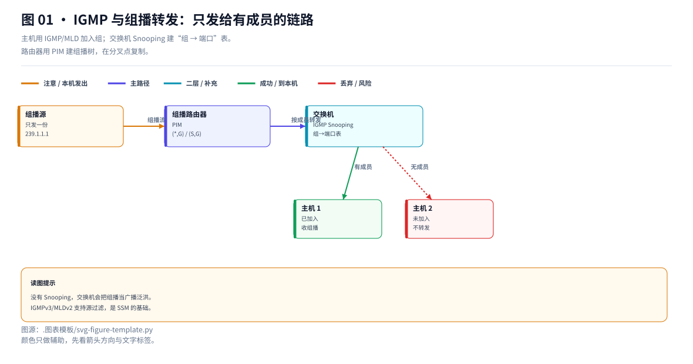
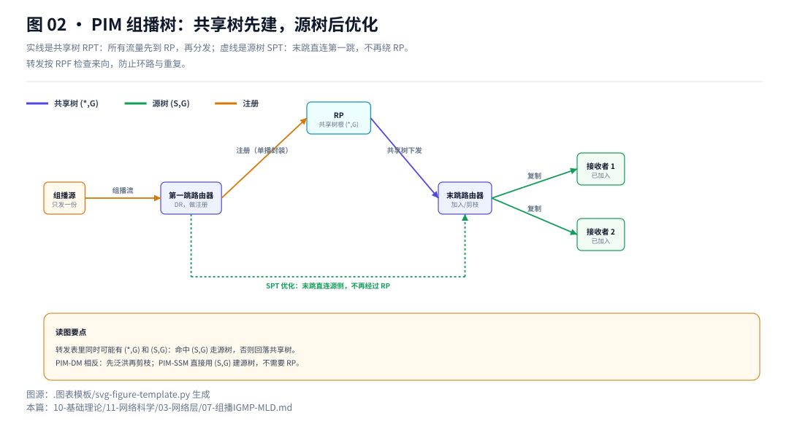

# 组播 IGMP/MLD

组播是「一份流量，多个接收者」：发送方只发一份，网络在分叉点复制。IGMP/MLD 负责让路由器知道「这个网段上还有没有人要这个组」。

> 本篇定位：组播地址与 MAC 映射、IGMPv1/v2/v3、MLDv1/v2、Snooping/Proxy、PIM 的定位。具体组播路由配置不在本篇。

## 目录

- [1 一句话模型](#s1)
- [2 速览](#s2)
- [3 地址与 MAC 映射](#s3)
- [4 成员管理流程](#s4)
- [5 组播路由与状态](#s5)
- [6 设计取舍与边界](#s6)
- [7 与相邻协议的关系](#s7)
- [8 参考与关联](#s8)

## 1 · 一句话模型：订阅，而不是广播

```text
接收者：我要加入 239.1.1.1（IGMP/MLD Report）
路由器：记下这个组在本网段还有成员（*，G）
发送者：往 239.1.1.1 发一份
网络：在分叉点复制，只送给有需求的链路
```

三个关键认知：

1. **组播地址只标识「组」，不标识「谁」**；成员关系靠 IGMP/MLD 维护。
2. **二层组播靠 MAC 映射 + Snooping**；没有 Snooping，交换机会把组播当广播泛洪。
3. **组播路由与单播路由不同**：单播看目的，组播看「从哪里来、往哪些方向发」。

## 2 · 速览

| 项 | 内容 |
| --- | --- |
| 所属层 | 网络层（成员管理）；链路层配合映射/Snooping |
| IPv4 组播 | `224.0.0.0/4`（D 类） |
| IPv6 组播 | `ff00::/8` |
| IPv4 成员协议 | IGMPv1/v2/v3 |
| IPv6 成员协议 | MLDv1/v2（由 ICMPv6 承载） |
| 组播路由协议 | PIM-SM、PIM-SSM、PIM-DM 等 |
| 二层优化 | IGMP/MLD Snooping、IGMP Proxy |
| 典型应用 | IPTV、视频会议、mDNS、路由协议、PTV |

## 3 · 地址与 MAC 映射

### 3.1 IPv4 组播地址

| 范围 | 用途 |
| --- | --- |
| `224.0.0.0/24` | 本地链路控制（如 224.0.0.1 全主机、224.0.0.2 全路由器） |
| `224.0.1.0/24` | 互联网控制/管理 |
| `232.0.0.0/8` | SSM（指定源组播） |
| `233.0.0.0/8` | GLOP（AS 相关） |
| `239.0.0.0/8` | 管理范围（私有组播） |

### 3.2 IPv6 组播地址

`ff00::/8`，格式为 `ff0s:...`，其中 `s` 是范围（scope）：

| Scope | 含义 |
| --- | --- |
| 1 | 接口本地 |
| 2 | 链路本地 |
| 5 | 站点本地 |
| 8 | 组织本地 |
| E | 全球 |

常见：`ff02::1` 全节点、`ff02::2` 全路由器、`ff02::1:2` DHCPv6 服务器/中继。

### 3.3 组播 IP → MAC 映射

**IPv4**：取组播 IP 的低 23 位，加上固定前缀 `01:00:5E`：

```text
239.1.1.1 → 01:00:5E:01:01:01
```

因为只取 23 位，多个组播 IP 可能映射到同一个 MAC，接收方要在 IP 层再过滤。

**IPv6**：取低 32 位，加前缀 `33:33`：

```text
ff02::1 → 33:33:00:00:00:01
```

## 4 · 成员管理流程



**读图**：源只发一份，路由器按成员复制；交换机 Snooping 建“组→端口”表，只发给有成员的口。

> 图源：`images/图01-IGMP与组播转发.svg`

### 4.1 IGMPv1/v2/v3

| 版本 | 加入 | 离开 | 源过滤 |
| --- | --- | --- | --- |
| v1 | Report，无 Leave | 靠查询超时 | 不支持 |
| v2 | Report | 有 Leave | 不支持 |
| v3 | Report（含源列表） | 有 Leave | 支持 Include/Exclude，SSM 基础 |

IGMPv2 的基本流程：

```text
路由器：周期发 Query（默认 125s）
主机：想加入 → 发 Report（主动，不等 Query）
主机：想离开 → 发 Leave
路由器：收到 Leave → 发特定组 Query，确认还有没有成员
        无人应答 → 停止向该链路转发该组
```

IGMPv3 允许主机告诉路由器「我只收这些源」或「这些源除外」，这是 SSM（指定源组播）的基础。

### 4.2 MLDv1/v2

MLD 由 ICMPv6 承载（Type 130–132），功能对应 IGMP：

| MLD | 对应 IGMP |
| --- | --- |
| MLDv1 | IGMPv2 |
| MLDv2 | IGMPv3（支持源过滤） |

MLD 用链路本地组播地址，不依赖广播（IPv6 没有广播）。

### 4.3 Snooping

二层交换机默认把组播当广播泛洪。**IGMP/MLD Snooping** 让交换机监听成员报文，建立「组 → 端口」表：

- 收到 Report：把端口加入该组。
- 收到 Leave/Query：维护/老化表项。
- 转发组播：只发给有成员的端口。

Snooping 是 IPTV 等场景的必备优化；没有它，组播流量会淹没整个 VLAN。

### 4.4 IGMP Proxy

IGMP Proxy 让一台设备代表下游主机向上游路由器发 Report，同时把上游组播转发到下游。家用网关常见：WAN 侧做 Proxy，LAN 侧维持成员关系。

### 4.5 组播路由

| 模式 | 思路 | 适用 |
| --- | --- | --- |
| PIM-DM | 先泛洪，再剪枝 | 小网络、密集成员 |
| PIM-SM | 建共享树（RP），按需加入 | 大网络、稀疏成员 |
| PIM-SSM | 直接建源树（S,G） | 已知源的场景，如 IPTV |

组播路由表项有 `(*, G)`（共享树）和 `(S, G)`（源树）两种，转发时按 RPF（反向路径转发）检查来向，防止环路和重复。

## 5 · 组播路由与状态



**读图**：PIM-SM 先建共享树，接收者加入后再优化；转发按 RPF 检查来向。

> 图源：`images/图02-PIM组播树.svg`


| 状态/定时器 | 说明 |
| --- | --- |
| IGMP Query 间隔 | 默认 125 秒 |
| IGMP 组成员超时 | 通常 260 秒（Query 间隔 × 2 + 余量） |
| IGMPv2 Leave 特定查询 | 收到 Leave 后短间隔查询，确认是否还有成员 |
| MLD 定时器 | 与 IGMP 类似，参数随实现 |
| Snooping 老化 | 组表项无报告后老化删除 |
| PIM Join/Prune | 周期性刷新，超时未刷新则剪枝 |

组播是「软状态」：成员要周期性刷新，路由器/交换机到期就停止转发。这避免了显式拆除，但也意味着丢一个 Report 可能导致短暂中断。

## 6 · 设计取舍与边界

### 6.1 组播 vs 单播复制

单播复制由发送方承担 N 份带宽；组播让网络在分叉点复制，发送方只发一份。代价是网络要维护组成员状态、支持组播路由，复杂度高。

### 6.2 组播 vs 广播

广播打扰整个广播域；组播只打扰有成员的链路。组播地址 + IGMP/MLD 是「有选择的广播」，但二层仍需要 Snooping 才能避免泛洪。

### 6.3 Snooping 的边界

- 只优化二层，不解决跨网段组播路由。
- 依赖 IGMP/MLD 报文可见；加密或隧道会失效。
- 配置不当（如把组播当未知单播泛洪）会失去效果。

### 6.4 SSM 的价值

SSM 让接收者指定源，避免「任意源都能往组里发」的滥用，也简化了组播路由（直接建源树）。IPTV、企业视频常用 SSM。

### 6.5 安全边界

- 组播没有内建认证，任何人都能发组播、加入组。
- 组播可被用于放大/反射（如 mDNS、SSDP 响应）。
- 过度泛洪会耗尽交换机/主机资源。
- 防御靠 IGMP/MLD 鉴权、ACL、速率限制、Snooping。

## 7 · 与相邻协议的关系

| 相邻对象 | 关系 |
| --- | --- |
| IP | 组播是 IP 的一种目的地址类型 |
| ICMPv6 | MLD 由 ICMPv6 承载 |
| 以太网 | 组播 IP 映射到组播 MAC；Snooping 在交换机侧 |
| IGMP/MLD Proxy | 家庭网关代表下游主机 |
| 路由 | PIM 依赖单播路由表做 RPF 检查 |
| mDNS/SSDP | 应用层组播，依赖二层组播可达 |

一句话：**IGMP/MLD 负责「谁还要这个组」，组播路由负责「流量往哪复制」，Snooping 负责「别泛洪到没人的端口」。**

## 8 · 参考与关联

**标准**

- RFC 1112：Host Extensions for IP Multicasting（IGMPv1）
- RFC 2236：IGMPv2
- RFC 3376：IGMPv3
- RFC 2710 / RFC 3810：MLDv1 / MLDv2
- RFC 4601：PIM-SM
- RFC 4541：IGMP/MLD Snooping

**关联**

- [00-网络层概览.md](./00-网络层概览.md)
- [02-IPv6.md](./02-IPv6.md)：IPv6 组播地址与 MLD
- [06-ICMP与ICMPv6.md](./06-ICMP与ICMPv6.md)：MLD 的承载
- [01-以太网与MAC.md](../02-链路层/01-以太网与MAC.md)：组播 MAC 映射
- [02-VLAN与Trunk.md](../02-链路层/02-VLAN与Trunk.md)：组播域与 Snooping

---

> **本篇定位**：组播地址与 MAC 映射、IGMP/MLD 成员管理、Snooping/Proxy 与 PIM 的定位。
> **素材来源**：`studyspace/1.知识体系/2.TCP IP协议/m-8-IGMP和MLD.md`（主），PIM 与 Snooping 按 RFC 补写。
> **待验证**：各厂商 IGMP/MLD 定时器、Snooping 行为、PIM 模式支持差异较大。
