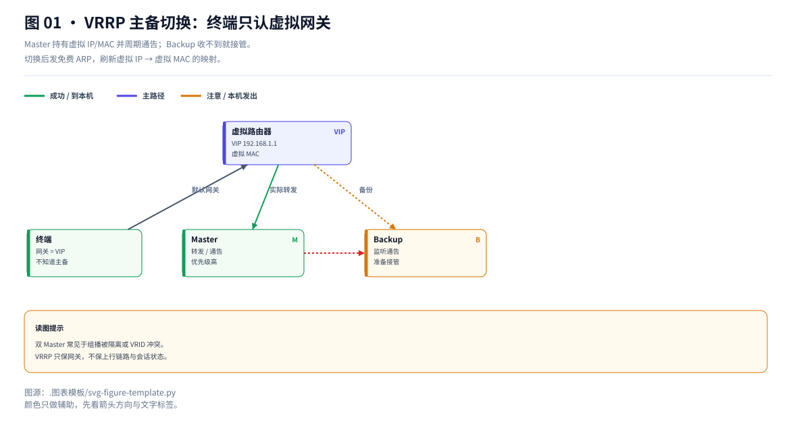

# VRRP

VRRP 把多台路由器组成一台「虚拟路由器」，共享一个虚拟 IP 和虚拟 MAC。终端只认这个虚拟网关，主设备挂了，备设备接管，终端无感。

> 本篇定位：VRRP 的虚拟路由器模型、选举、通告与切换、Track 联动。免费 ARP 的细节在 ARP 篇，HSRP 只做对照。

## 目录

- [1 一句话模型](#s1)
- [2 速览](#s2)
- [3 报文格式](#s3)
- [4 选举与切换流程](#s4)
- [5 状态与定时器](#s5)
- [6 设计取舍与边界](#s6)
- [7 与相邻协议的关系](#s7)
- [8 参考与关联](#s8)

## 1 · 一句话模型：一台虚拟路由器

```text
        ┌─ Master（持有虚拟 IP/MAC，转发） ─┐
终端 ──►│  虚拟路由器：VIP 192.168.1.1      │──► 上行
        └─ Backup（待命，定期收通告） ──────┘
```

三个关键认知：

1. **终端只配置虚拟 IP 作为网关**，不知道背后有几台设备。
2. **Master 周期性发通告**，Backup 收不到就认为 Master 挂了，接管。
3. **切换后要发免费 ARP**，让交换机和主机更新「虚拟 IP → 虚拟 MAC」的映射。

## 2 · 速览

| 项 | 内容 |
| --- | --- |
| 所属层 | 网络层 |
| 封装 | IP 协议号 112 |
| 组播地址 | IPv4 `224.0.0.18`；IPv6 `ff02::12` |
| 虚拟标识 | VRID（1–255） |
| 优先级 | 1–254，默认 100；255 保留给 IP 拥有者 |
| 通告间隔 | 默认 1 秒 |
| Master 失效判定 | 约 3 × 通告间隔 + 偏移 |
| 版本 | VRRPv2（IPv4）、VRRPv3（IPv4/IPv6） |
| 主要标准 | RFC 3768（v2）、RFC 5798（v3） |

## 3 · 报文格式

VRRPv2 报文关键字段：

| 字段 | 长度 | 作用 |
| --- | --- | --- |
| Version/Type | 1 字节 | 版本 + 报文类型（通告） |
| VRID | 1 字节 | 虚拟路由器组号 |
| Priority | 1 字节 | 选举优先级 |
| Count IP Addrs | 1 字节 | 虚拟 IP 数量 |
| Auth Type | 1 字节 | 认证类型（v2 有简单认证，v3 移除） |
| Adver Int | 1 字节 | 通告间隔（秒） |
| Checksum | 2 字节 | 校验 |
| IP Address(es) | 4 × n | 虚拟 IP 列表 |

VRRPv3 的变化：

- 支持 IPv4 和 IPv6。
- 通告间隔改为厘秒（更细）。
- 移除认证字段（原认证不安全），依赖 IPsec 等外部机制。
- 增加 Max Adver Int 等字段。

VRRP 报文的目的 IP 是组播，TTL/Hop Limit 必须为 255；接收方通常校验 TTL，防止跨网段伪造。

## 4 · 选举与切换流程



**读图**：终端只认 VIP；Master 周期通告，Backup 超时接管，切换后发免费 ARP 刷新映射。

> 图源：`images/图01-VRRP主备切换.svg`

### 4.1 选举规则

1. 比较优先级，数值大者成为 Master。
2. 优先级相同，比较接口 IP，大者胜。
3. 若某台设备拥有虚拟 IP（IP 拥有者），优先级视为 255，直接成为 Master。

### 4.2 正常通告

```text
Master：每 1 秒发 VRRP 通告（组播）
Backup：收到通告，重置 Master_Down_Timer，保持 Backup
```

### 4.3 故障切换

```text
Backup 在 Master_Down_Interval 内收不到通告
  → 认为 Master 失效
  → 自己升为 Master
  → 发免费 ARP，通告虚拟 IP 对应虚拟 MAC
  → 开始转发
```

Master_Down_Interval 通常为 `3 × 通告间隔 + 偏移`，偏移与优先级有关，避免多个 Backup 同时抢占。

### 4.4 抢占

- **抢占式（默认）**：优先级更高的 Backup 上线后，会抢回 Master。
- **非抢占式**：先到先得，避免双机热备频繁切换。

### 4.5 Track 联动

Track 让 VRRP 感知接口/路由/链路状态：

| 跟踪对象 | 作用 |
| --- | --- |
| 上行接口 | WAN 断开时降低优先级，让备机接管 |
| 路由 | 关键路由消失时降级 |
| BFD | 毫秒级检测对端故障，比 VRRP 自身超时快 |

示例语义：上行口 down → 优先级减 30 → 低于备机 → 备机抢占。

### 4.6 负载分担

一台设备可以加入多个 VRRP 组，分别担任不同组的 Master：

```text
组 1：R1 Master，R2 Backup（VLAN 10 网关）
组 2：R2 Master，R1 Backup（VLAN 20 网关）
```

这样两台设备都转发流量，互为备份。

### 4.7 异常分支

| 异常 | 表现 | 原因 |
| --- | --- | --- |
| 双 Master | 两个网关都转发，ARP 冲突 | 组播被隔离、VRID 冲突、认证/版本不一致 |
| 切换后不通 | 虚拟 IP  ping 不通 | 免费 ARP 未发/被拦、交换机 FDB 未更新 |
| 频繁切换 | 主备反复抢占 | 链路抖动、Track 阈值不合理、抢占配置 |
| 备机不收通告 | 一直处于 Backup | 组播被过滤、TTL 校验失败、VRID 不匹配 |

## 5 · 状态与定时器

| 状态 | 含义 |
| --- | --- |
| Initialize | 启动/配置变化，准备参与选举 |
| Master | 持有虚拟 IP，转发并周期通告 |
| Backup | 监听通告，准备接管 |

| 定时器 | 作用 |
| --- | --- |
| Adver_Int | Master 通告间隔，默认 1s |
| Master_Down_Interval | Backup 判定 Master 失效的时间，约 3 × Adver_Int + 偏移 |
| Skew_Time | 根据优先级计算的偏移，避免同时抢占 |

VRRP 没有 TCP 那样的连接状态，只有这三个状态和两个定时器。

## 6 · 设计取舍与边界

### 6.1 冗余 vs 资源利用率

主备模式简单，但备机平时闲置；负载分担模式提高利用率，但配置更复杂，故障时容量下降。选择取决于业务对容量和复杂度的容忍度。

### 6.2 抢占的取舍

抢占能保证「高优先级设备始终是 Master」，适合计划性维护；非抢占避免抖动，适合链路质量不稳定的场景。

### 6.3 认证的衰落

VRRPv2 的简单认证（明文/弱校验）不能防伪造，v3 直接移除。安全依赖：

- TTL=255 校验，防跨网段注入。
- 网络侧 ACL/防欺骗。
- 需要强认证时用 IPsec。

### 6.4 VRRP 不解决什么

- 不解决上行链路冗余：两台设备都连同一台坏交换机，照样断。
- 不解决会话同步：切换后已建立的连接可能中断（除非有状态同步）。
- 不解决脑裂：组播被隔离时可能出现双 Master，需要额外检测。

### 6.5 与 HSRP 的差异

| 对比项 | VRRP | HSRP |
| --- | --- | --- |
| 标准 | IETF（RFC 3768/5798） | Cisco 私有 |
| 虚拟 IP | 可等于真实接口 IP | 必须是独立虚拟 IP |
| 组播 | 224.0.0.18 | 224.0.0.2 |
| 封装 | IP 协议 112 | UDP 1985 |
| 抢占 | 默认开启 | 默认关闭 |

## 7 · 与相邻协议的关系

| 相邻对象 | 关系 |
| --- | --- |
| ARP/NDP | 切换后发免费 ARP/NA，刷新虚拟 IP → 虚拟 MAC |
| 路由 | VRRP 提供网关冗余；路由协议提供路径冗余 |
| 交换机 | 依赖 FDB 更新；组播/广播被隔离会影响选举 |
| BFD | 提供快速故障检测，联动降优先级 |
| IPv6 | VRRPv3 支持 IPv6，虚拟 MAC 仍为 `00:00:5E:00:01:XX` |

一句话：**VRRP 负责「网关这一跳的冗余」，不负责「上行链路、会话状态、路由收敛」。**

## 8 · 参考与关联

**标准**

- RFC 3768：Virtual Router Redundancy Protocol（VRRPv2）
- RFC 5798：VRRPv3 for IPv4 and IPv6
- RFC 5880：BFD

**关联**

- [00-网络层概览.md](./00-网络层概览.md)
- [05-ARP.md](../02-链路层/05-ARP.md)：免费 ARP 的作用
- [04-路由与路由协议.md](./04-路由与路由协议.md)：路由冗余
- [02-IPv6.md](./02-IPv6.md)：VRRPv3 与 NDP
- 20-平台与系统：keepalived/VRRP 实现

---

> **本篇定位**：VRRP 的虚拟路由器、选举、通告/切换与 Track 联动。
> **素材来源**：`studyspace/1.知识体系/8.路由与交换/m-6-VRRP.md`（主），VRRPv3 与安全边界按 RFC 5798 补写。
> **待验证**：各厂商 Master_Down_Interval、Track 减优先级、抢占默认值不同。
