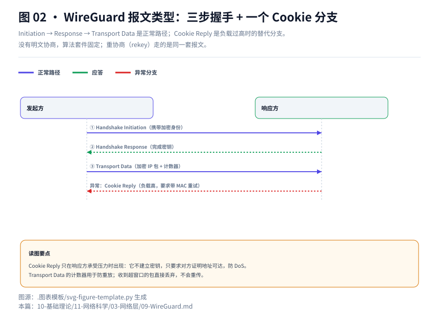
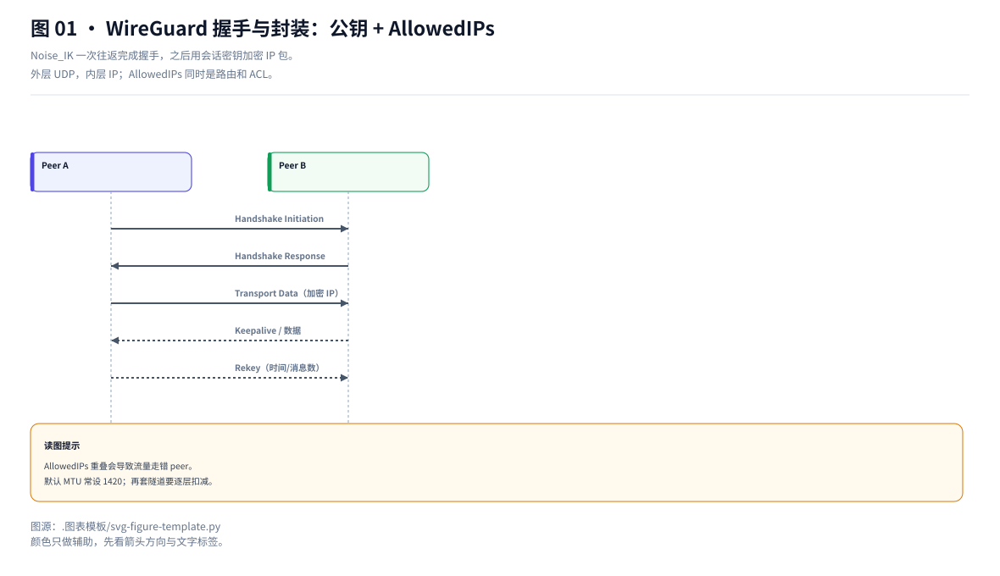

# WireGuard

WireGuard 是一个极简的三层隧道：每个 peer 用公钥标识，AllowedIPs 同时充当「路由表」和「访问控制」，数据面用 UDP 承载 IP 包。

> 本篇定位：WireGuard 的 Cryptokey Routing、Noise 握手、报文与定时器、MTU 与 OpenWrt 配置语义。L2TP/ZeroTier 只做对照。

## 目录

- [1 一句话模型](#s1)
- [2 速览](#s2)
- [3 报文与握手](#s3)
- [4 交互流程](#s4)
- [5 状态与定时器](#s5)
- [6 设计取舍与边界](#s6)
- [7 与相邻协议的关系](#s7)
- [8 参考与关联](#s8)

## 1 · 一句话模型：公钥 + 允许的 IP

WireGuard 没有「连接」的概念，只有 peer：

```text
peer = 公钥 + AllowedIPs（哪些源 IP 从这个 peer 来 / 哪些目的 IP 走这个 peer）
```

三个关键认知：

1. **它封装的是 IP 包**，属于三层隧道，不是二层 overlay。
2. **AllowedIPs 是双向的**：既决定「哪些流量走这个 peer」，也决定「从这个 peer 来的包，源 IP 必须落在允许范围」。
3. **没有动态协商**：加密套件固定，配置即协议；简单、快、易审计。

## 2 · 速览

| 项 | 内容 |
| --- | --- |
| 所属层 | 网络层（IP-in-UDP） |
| 传输 | UDP，默认端口 51820 |
| 握手 | Noise_IK（1-RTT），基于 Curve25519 |
| 加密 | ChaCha20-Poly1305 |
| 哈希/KDF | BLAKE2s、HKDF |
| 标识 | 每个 peer 一对公钥/私钥 |
| 路由/ACL | AllowedIPs（CIDR 列表） |
| 典型 MTU | 1420（以太网 1500 − 80 左右开销） |
| 保活 | PersistentKeepalive，常用 25 秒 |
| 主要参考 | WireGuard 白皮书、官方文档、Linux 内核实现 |

## 3 · 报文与握手



**读图**：握手 Initiation/Response 建会话密钥，Transport Data 传加密 IP；Cookie Reply 是防 DoS 的兜底。

> 图源：`images/图02-WireGuard报文类型.svg`


### 3.1 四种报文

| 类型 | 作用 |
| --- | --- |
| Handshake Initiation | 发起握手，携带加密的静态公钥、时间戳、MAC1 |
| Handshake Response | 响应握手，完成密钥协商 |
| Cookie Reply | 防 DoS，要求对方带 cookie 重试 |
| Transport Data | 承载加密的 IP 包 |

握手完成后，双方各有一对会话密钥（发送/接收），用计数器防重放。

### 3.2 Noise_IK 握手

```text
发起方                                     响应方
  │ Handshake Initiation（I）               │
  ├────────────────────────────────────────►│
  │ Handshake Response（R）                 │
  │◄────────────────────────────────────────┤
  │ Transport Data（加密 IP 包）             │
  ├────────────────────────────────────────►│
```

特点：

- **1-RTT** 建链，比 TLS 快；不支持 0-RTT（避免重放）。
- 身份在握手时加密，不明文暴露公钥。
- 每次握手生成新会话密钥，前向保密。

### 3.3 封装层次

```text
Ethernet
  └─ IP
       └─ UDP（51820）
            └─ WireGuard（handshake/transport）
                 └─ IP（内层，原始源/目的）
```

WireGuard 头 + UDP + IP 的开销约 60–80 字节，所以默认 MTU 常设 1420。

## 4 · 交互流程



**读图**：一次 Noise 握手后传加密 IP 包；AllowedIPs 同时决定“哪些流量走 peer”和“哪些源 IP 能进来”。

> 图源：`images/图01-WireGuard握手与封装.svg`

### 4.1 配置一个 peer

| 配置项 | 作用 |
| --- | --- |
| PrivateKey | 本端私钥 |
| ListenPort | 本端 UDP 端口 |
| Address | 本端隧道接口地址 |
| Peer PublicKey | 对端公钥 |
| AllowedIPs | 对端允许的源/目的网段 |
| Endpoint | 对端公网地址:端口 |
| PersistentKeepalive | 保活间隔 |

### 4.2 发包与路由

```text
应用发一个包到 10.0.0.2
  → 查路由，命中 wg0（因为 AllowedIPs 包含 10.0.0.2）
  → 找到对应 peer
  → 用会话密钥加密，UDP 封装，发往 Endpoint
  → 对端解密，检查内层源 IP 是否在 AllowedIPs
  → 交给本机协议栈/转发
```

AllowedIPs 同时是路由和 ACL：如果对端从隧道发来一个不在 AllowedIPs 里的源 IP，包会被丢弃。

### 4.3 握手触发与密钥轮换

- 有数据要发但会话密钥不存在/过期 → 触发握手。
- 握手失败按指数退避重试。
- 会话密钥有使用时长/消息数上限，到期重新握手（rekey）。
- 收到未知 peer 的握手 → 丢弃（没有「自动发现」）。

### 4.4 漫游与 NAT

WireGuard 不依赖源 IP/端口标识 peer，而是靠公钥和会话；对端地址变化时，只要收到合法的加密包，就更新 Endpoint。这让它在 Wi-Fi/蜂窝切换、NAT 后仍能工作。

NAT 映射会超时，所以常用 `PersistentKeepalive=25` 定期发保活包，维持映射。

### 4.5 OpenWrt 侧配置语义

OpenWrt 用 `proto wireguard` 管理接口，配置在 `/etc/config/network`：

```text
config interface 'wg0'
    option proto 'wireguard'
    option private_key '...'
    option listen_port '51820'
    option addresses '10.0.0.1/24'
    option mtu '1420'

config wireguard_wg0
    option public_key '...'
    option preshared_key '...'
    option allowed_ips '10.0.0.2/32'
    option endpoint_host '...'
    option endpoint_port '51820'
    option persistent_keepalive '25'
    option route_allowed_ips '1'
```

要点：

- peer section 的类型必须是 `wireguard_<接口名>`，这是 netifd 的约定。
- 服务端要放行 WAN → UDP 监听端口；客户端通常只需出站。
- 服务端接口常加入 LAN zone，让客户端访问内网；客户端接口加入 WAN zone，走 NAT 出口。
- `route_allowed_ips=1` 会自动为 AllowedIPs 建路由，适合客户端全局代理；服务端按需开启。

### 4.6 异常分支

| 异常 | 表现 | 原因 |
| --- | --- | --- |
| 握手无响应 | 隧道起不来 | UDP 端口未放行、Endpoint 错、公钥不匹配 |
| 能握手但不能通 | 隧道 up，业务不通 | AllowedIPs 不含目的网段、路由未加、防火墙未放行 |
| 单向通 | 一个方向有包 | NAT/路由/AllowedIPs 只配了一侧 |
| 大包丢 | 小包通、大包断 | MTU 未调、MSS 未钳制、路径 MTU 更小 |
| 间歇断 | 一段时间后失效 | NAT 映射超时、未开 keepalive |
| 多 peer 冲突 | 流量走错 peer | AllowedIPs 重叠，最长前缀/配置顺序决定 |

## 5 · 状态与定时器

WireGuard 是「无连接」的，但每个 peer 维护会话状态：

| 状态/定时器 | 说明 |
| --- | --- |
| Handshake retry | 握手失败后指数退避重试 |
| Rekey after time | 会话密钥使用约 2 分钟后可重新协商 |
| Rekey after messages | 消息数达到上限强制 rekey |
| Reject after time/messages | 超过硬上限，旧密钥失效 |
| PersistentKeepalive | 空闲时定期发保活包，维持 NAT 映射 |

没有 TCP 的握手/挥手状态机，也没有路由协议；peer 的「可达性」靠是否有合法握手/数据判断。

## 6 · 设计取舍与边界

### 6.1 极简的代价

WireGuard 把加密套件固定死，换来代码少、性能高、易审计；代价是没有算法敏捷性，未来迁移要换协议版本。它也不做动态发现、自动组网，peer 要手工/编排配置。

### 6.2 三层 vs 二层

WireGuard 只承载 IP，不能直接传以太帧。需要二层互通时，要在 WireGuard 之上跑 VXLAN/GRE，或选 ZeroTier/L2TP。选型先问「要不要二层」。

### 6.3 AllowedIPs 的双重语义

AllowedIPs 既当路由又当 ACL，配置错会同时影响「流量走不走」和「包收不收」。多 peer 的 AllowedIPs 不要重叠；需要分流时用更具体的前缀。

### 6.4 MTU 与分片

WireGuard 开销大，默认 1420 只适用于 1500 的底层路径。PPPoE（1492）、L2TP、再套 WireGuard 时要逐层扣减，否则大包会丢。必要时在 TCP 侧钳制 MSS。

### 6.5 安全边界

- 数据面加密、身份认证强，但**不隐藏「谁在和谁通信」**（元数据可见）。
- 私钥泄露等于身份被冒用；配置文件要严格权限。
- 它不替代防火墙：隧道内部仍需 ACL/安全组。
- 不提供用户名/密码认证，适合设备/站点互联，不适合直接给员工发账号。

## 7 · 与相邻协议的关系

| 相邻对象 | 关系 |
| --- | --- |
| IP | 内层承载 IP 包；AllowedIPs 决定路由 |
| UDP | 外层传输，受 NAT/防火墙影响 |
| 路由 | 依赖系统路由表把流量导入 wg 接口 |
| NAT | 需要 keepalive 维持 UDP 映射 |
| L2TP | L2TP 是二层隧道，WireGuard 是三层；可组合（L2TP over WireGuard） |
| ZeroTier | ZeroTier 是 L2 overlay + 控制器；WireGuard 是 L3 点对点/星型 |
| IPsec | 同为三层 VPN，WireGuard 更简单，IPsec 生态/策略更丰富 |

一句话：**WireGuard 负责「用公钥和 AllowedIPs 建一条加密的三层隧道」，不负责「自动组网、二层互通、用户认证」。**

## 8 · 参考与关联

**参考**

- WireGuard 官方白皮书与协议文档
- WireGuard 官方 Quick Start / man 手册
- Linux 内核 `drivers/net/wireguard`
- OpenWrt `proto wireguard` 与 netifd 文档

**关联**

- [00-网络层概览.md](./00-网络层概览.md)
- [01-IPv4.md](./01-IPv4.md)：路由与 AllowedIPs
- [05-NAT.md](./05-NAT.md)：UDP 映射与 keepalive
- [07-L2TP.md](../02-链路层/07-L2TP.md)：二层隧道对照
- [08-ZeroTier.md](../02-链路层/08-ZeroTier.md)：L2 overlay 对照
- 20-平台与系统：WireGuard 内核实现与配置

---

> **本篇定位**：WireGuard 的 Cryptokey Routing、Noise 握手、报文/定时器、MTU 与 OpenWrt 配置语义。
> **素材来源**：`studyspace/3.协议应用/9.wireguard/wireguard-uci与防火墙配置分析.md`（配置语义）、`wireguard.md`；协议机制按官方白皮书补写。
> **待验证**：默认 MTU、rekey 时间/消息数、keepalive 默认值随实现与配置而变。
