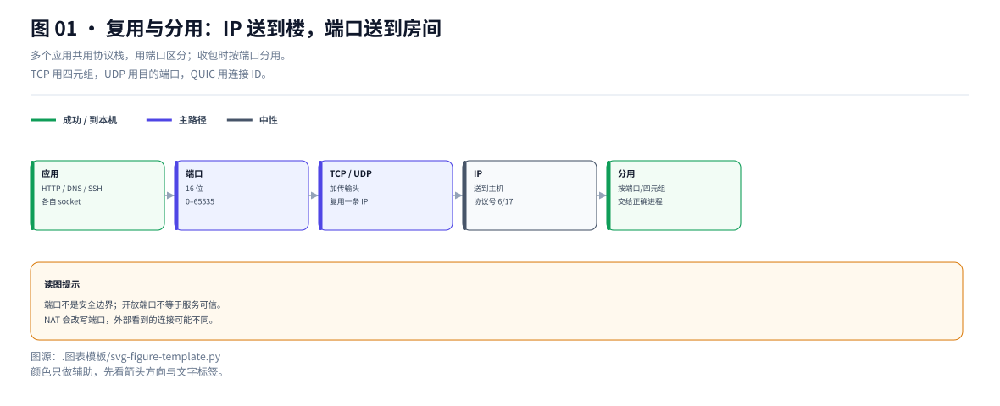

# 传输层概览

传输层解决两个问题：**交给哪个进程**，以及**要不要可靠**。端口负责第一个，TCP/UDP/QUIC 的选择负责第二个。

> 本篇定位：传输层入口，给端口、复用/分用、可靠与实时的取舍，以及协议地图。具体机制看 TCP、UDP 篇。

## 目录

- [1 一句话模型](#s1)
- [2 速览](#s2)
- [3 复用、分用与五元组](#s3)
- [4 可靠与实时的取舍](#s4)
- [5 本层协议地图](#s5)
- [6 边界与设计取舍](#s6)
- [7 与相邻层的关系](#s7)
- [名词解释](#名词解释)
- [8 参考与关联](#s8)

## 1 · 一句话模型：端口是门牌号

IP 把包送到主机，传输层把数据交给主机上的某个进程。IP 是「送到哪栋楼」，端口是「送到哪个房间」。

```text
IP 头：源 IP + 目的 IP        → 哪两台主机
TCP/UDP 头：源端口 + 目的端口  → 哪两个进程
四元组/五元组                  → 唯一标识一条连接/流
```

三个关键认知：

1. **端口是 16 位**，0–65535；0–1023 是知名端口，但「知名」不等于「必须」。
2. **TCP 的连接由四元组标识**，NAT 会改写端口，所以外部看到的连接不等同于内部。
3. **传输层不关心业务语义**，HTTP 的方法、DNS 的记录类型都属于应用层。

## 2 · 速览

| 项 | 内容 |
| --- | --- |
| 所属层 | 传输层（OSI 第四层） |
| PDU | TCP 报文段（segment）；UDP 数据报（datagram） |
| 地址 | 端口 16 位；连接用四元组/五元组 |
| 核心协议 | TCP、UDP、QUIC |
| 典型设备 | 主机协议栈、网关、负载均衡、NAT |
| 主要标准 | RFC 9293（TCP）、RFC 768（UDP）、RFC 9000（QUIC） |
| 上层 | HTTP、DNS、DHCP、SNMP 等 |
| 下层 | IP |

## 3 · 复用、分用与五元组



**读图**：应用→端口→TCP/UDP→IP；收包时按端口/TCP 四元组把数据交回正确进程。

> 图源：`images/图01-复用与分用.svg`

- **复用（multiplexing）**：多个应用共用同一个 IP 协议栈，各自用不同端口发送。
- **分用（demultiplexing）**：收到包后，按端口把数据交给正确的 socket。

| 协议 | 分用依据 |
| --- | --- |
| UDP | 目的 IP + 目的端口（连接less） |
| TCP | 源 IP + 源端口 + 目的 IP + 目的端口 |
| QUIC | 连接 ID + 五元组（支持连接迁移） |

端口范围：

| 范围 | 用途 |
| --- | --- |
| 0–1023 | 知名端口（HTTP 80、HTTPS 443、DNS 53 等） |
| 1024–49151 | 注册端口 |
| 49152–65535 | 动态/私有端口 |

## 4 · 可靠与实时的取舍

| 维度 | TCP | UDP | QUIC |
| --- | --- | --- | --- |
| 连接 | 面向连接 | 无连接 | 面向连接（基于 UDP） |
| 可靠性 | 可靠、按序 | 不保证 | 可靠、按流独立 |
| 拥塞控制 | 有 | 无（应用自管） | 有 |
| 队头阻塞 | 有 | 无 | 流级无，连接级仍有 |
| 加密 | 不带，靠 TLS | 不带 | 内置 TLS 1.3 |
| 开销 | 20–60 字节头 | 8 字节头 | 较大但可协商 |
| 典型场景 | Web/SSH/邮件 | DNS/DHCP/RTP/SNMP | HTTP/3、低延迟 Web |

选择原则：

- 要可靠、按序、通用：TCP。
- 要低开销、自己控制重传/时序：UDP。
- 要可靠又要低延迟、多路复用：QUIC。

## 5 · 本层协议地图

| 协议/机制 | 一句话 | 篇目 |
| --- | --- | --- |
| TCP | 编号、确认、重传、窗口、拥塞控制 | [01-TCP.md](./01-TCP.md) |
| UDP 与 QUIC | 无连接数据报与基于 UDP 的可靠传输 | [02-UDP与QUIC](02-UDP与QUIC.md) |
| 传输性能与调优 | BDP、窗口、RTT、bufferbloat | [03-传输性能与调优](03-传输性能与调优.md) |

## 6 · 边界与设计取舍

### 6.1 不负责路由

传输层假设 IP 能把包送到主机，不关心走哪条路。路径变化、丢包、乱序由传输层感知并适应。

### 6.2 可靠性的代价

可靠 = 确认 + 重传 + 排序 + 去重，代价是状态、延迟和队头阻塞。实时业务（语音、视频、游戏）宁愿丢包也不愿等重传，所以常用 UDP + 应用层策略。

### 6.3 端口不是安全边界

端口只用于分用，不提供认证。开放端口不等于安全，关闭端口也不等于隔离；安全靠防火墙、TLS、访问控制。

### 6.4 加密的位置

TCP/UDP 本身不加密。TLS 通常跑在 TCP 上，QUIC 内置 TLS 1.3。传输层加密与网络层加密（IPsec）是两条不同的路径。

## 7 · 与相邻层的关系

| 相邻对象 | 关系 |
| --- | --- |
| IP | 传输层段作为 IP 载荷；协议号 6/17 |
| 应用层 | 应用通过 socket 使用传输层服务 |
| NAT | 改写端口，影响连接标识与穿透 |
| 防火墙 | 状态防火墙跟踪 TCP 状态与 UDP 伪状态 |
| QUIC/TLS | 加密与传输的边界逐渐融合 |

一句话：**传输层负责「交给哪个进程、要不要可靠」，不负责「怎么走到」，也不负责「业务做什么」。**

## 名词解释

> 缩写给出英文全称；非缩写用“—”表示。

| 术语 | 英文全称 | 解释 |
| --- | --- | --- |
| 端口 | — | 16 位进程标识。 |
| 五元组 | — | 源/目的 IP、源/目的端口、协议。 |
| 复用/分用 | — | 多应用共用/按端口分发。 |
| socket | — | 应用使用传输层的编程接口。 |
| TCP/UDP/QUIC | Transmission Control Protocol / User Datagram Protocol / Quick UDP Internet Connections | 三种传输协议。 |
| 知名端口 | — | 0 到 1023 的约定端口。 |

## 8 · 参考与关联

**标准**

- RFC 9293（TCP）
- RFC 768（UDP）
- RFC 9000（QUIC）
- RFC 8446（TLS 1.3）

**关联**

- [01-TCP.md](./01-TCP.md)
- 03-网络层：IP、分片、NAT
- 05-应用层：HTTP、DNS、DHCP
- 20-平台与系统/21-Linux/06-网络子系统：socket 与协议栈实现

---

> **本篇定位**：传输层入口，先建立端口与复用/分用的模型，再理解 TCP/UDP/QUIC 的取舍。
> **素材来源**：`studyspace/1.知识体系/1.计算机网络/m-3-运输层--.md`、`studyspace/1.知识体系/2.TCP IP协议/m-10-UDP协议.md`。
> **待验证**：端口注册范围与具体服务端口以 IANA 注册表为准。
