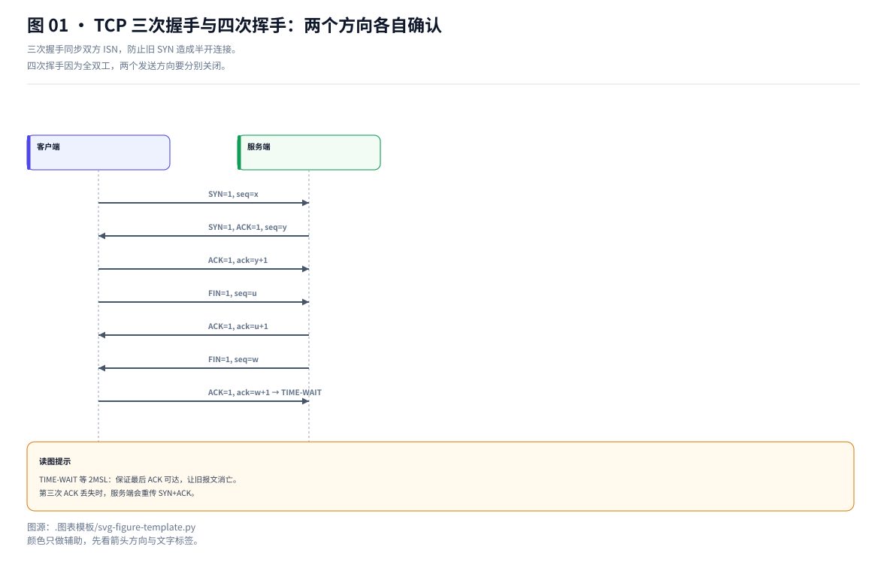
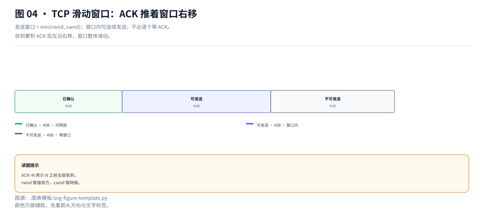
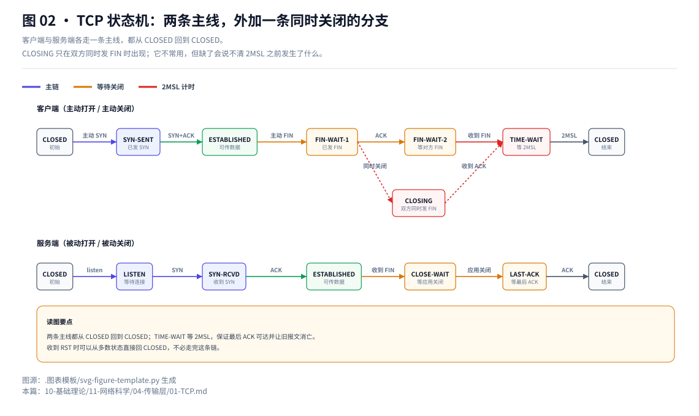
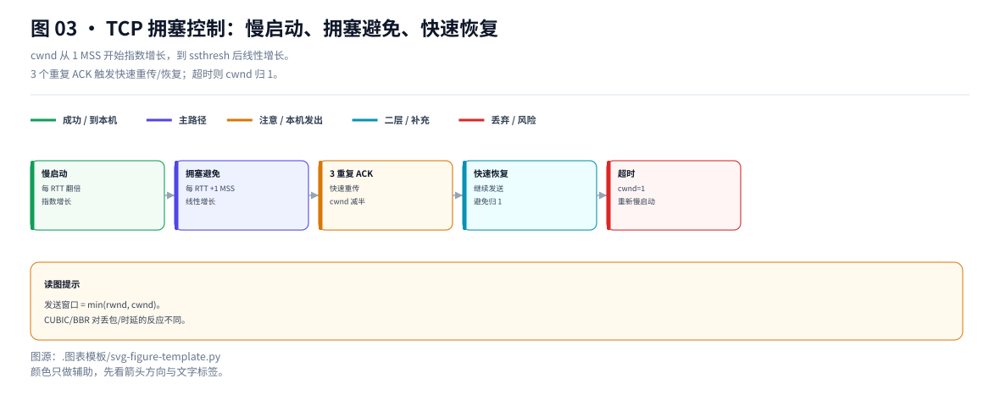

# TCP

TCP 用四件工具把不可靠的 IP 变成可靠的字节流：**编号、确认、重传、窗口**。代价是连接状态、延迟，以及一条连接上的队头阻塞。

> 本篇定位：TCP 的完整机制，覆盖报文、握手挥手、状态机、流量控制、拥塞控制与重传。UDP/QUIC 只做对照，细节在 UDP 篇。

## 目录

- [1 一句话模型](#s1)
- [2 速览](#s2)
- [3 报文格式](#s3)
- [4 交互流程](#s4)
- [5 状态机与定时器](#s5)
- [6 设计取舍与边界](#s6)
- [7 与相邻协议的关系](#s7)
- [名词解释](#名词解释)
- [8 参考与关联](#s8)

## 1 · 一句话模型：字节流 + 四个计数器

TCP 不按「包」管理，而按「字节」管理。连接两端各自维护四个关键量：

```text
发送方：
  已发送未确认  |  可以发送  |  还不能发送
                ^            ^
             发送窗口左沿   右沿 = 已确认 + min(rwnd, cwnd)

接收方：
  已交付应用  |  已收到未交付  |  还能接收
                              ^
                           接收窗口 rwnd
```

- **序号 seq**：这个报文段第一个字节在字节流中的位置。
- **确认号 ack**：我期待你下一个发来的字节序号，等价于「ack 之前我都收到了」。
- **rwnd**：接收方还能收多少，防止压垮自己。
- **cwnd**：发送方估计网络还能承受多少，防止压垮网络。

发送窗口 = `min(rwnd, cwnd)`。**rwnd 管端到端，cwnd 管全网**，两者取小。

## 2 · 速览

| 项 | 内容 |
| --- | --- |
| 所属层 | 传输层（OSI 第四层） |
| 协议号 | IP 头中 `6` |
| PDU | 报文段（segment），逻辑上是字节流 |
| 首部 | 固定 20 字节，带选项最多 60 字节 |
| 连接标识 | 四元组：源 IP、源端口、目的 IP、目的端口 |
| 状态数 | 11 种 |
| 核心机制 | 序号/确认、超时重传、快速重传、滑动窗口、拥塞控制 |
| 主要标准 | RFC 9293（原 RFC 793）、RFC 5681（拥塞控制）、RFC 6298（RTO）、RFC 2018（SACK）、RFC 7323（窗口缩放/时间戳） |
| 典型应用 | HTTP/1.1、HTTP/2、SSH、SMTP、FTP |

## 3 · 报文格式

### 3.1 固定首部

```text
 0                   1                   2                   3
 0 1 2 3 4 5 6 7 8 9 0 1 2 3 4 5 6 7 8 9 0 1 2 3 4 5 6 7 8 9 0 1
+-+-+-+-+-+-+-+-+-+-+-+-+-+-+-+-+-+-+-+-+-+-+-+-+-+-+-+-+-+-+-+-+
|          源端口(16)          |        目的端口(16)            |
+-+-+-+-+-+-+-+-+-+-+-+-+-+-+-+-+-+-+-+-+-+-+-+-+-+-+-+-+-+-+-+-+
|                        序列号(32)                             |
+-+-+-+-+-+-+-+-+-+-+-+-+-+-+-+-+-+-+-+-+-+-+-+-+-+-+-+-+-+-+-+-+
|                        确认号(32)                             |
+-+-+-+-+-+-+-+-+-+-+-+-+-+-+-+-+-+-+-+-+-+-+-+-+-+-+-+-+-+-+-+-+
| 数据偏移(4) | 保留(4) |标志(8)|          窗口大小(16)          |
+-+-+-+-+-+-+-+-+-+-+-+-+-+-+-+-+-+-+-+-+-+-+-+-+-+-+-+-+-+-+-+-+
|          校验和(16)          |        紧急指针(16)            |
+-+-+-+-+-+-+-+-+-+-+-+-+-+-+-+-+-+-+-+-+-+-+-+-+-+-+-+-+-+-+-+-+
|                          选项(可变)                           |
+-+-+-+-+-+-+-+-+-+-+-+-+-+-+-+-+-+-+-+-+-+-+-+-+-+-+-+-+-+-+-+-+
|                            数据                               |
+-+-+-+-+-+-+-+-+-+-+-+-+-+-+-+-+-+-+-+-+-+-+-+-+-+-+-+-+-+-+-+-+
```

| 字段 | 长度 | 作用 | 注意 |
| --- | --- | --- | --- |
| 源端口 / 目的端口 | 各 16 位 | 标识应用进程 | 与 IP 一起构成四元组 |
| 序列号 seq | 32 位 | 本报文段第一个字节的编号 | 初始值 ISN 随机，防止旧报文串入 |
| 确认号 ack | 32 位 | 期待对方下一个字节的编号 | 仅 ACK=1 时有效；累积确认 |
| 数据偏移 | 4 位 | 首部长度，单位 4 字节 | 最小 5（20 字节），最大 15（60 字节） |
| 保留 | 4 位 | 保留 | 置 0 |
| 标志位 | 8 位 | CWR/ECE/URG/ACK/PSH/RST/SYN/FIN | 经典教材常只讲后 6 个 |
| 窗口大小 | 16 位 | 接收窗口 rwnd | 最大 65535，靠窗口缩放扩展 |
| 校验和 | 16 位 | 首部 + 数据 + 伪首部 | 覆盖 IP 伪首部，防止误投 |
| 紧急指针 | 16 位 | 紧急数据末尾偏移 | 仅 URG=1 时有效 |
| 选项 | 可变 | MSS、SACK、窗口缩放、时间戳 | 主要在 SYN 中协商 |

### 3.2 标志位

| 标志 | 含义 | 典型场景 |
| --- | --- | --- |
| SYN | 同步序号，建立连接 | 握手前两步 |
| ACK | 确认号有效 | 除首个 SYN 外几乎都置 1 |
| FIN | 发送方数据发完 | 挥手 |
| RST | 强制重置连接 | 端口未监听、协议错误、拒绝非法连接 |
| PSH | 尽快交付应用层 | 交互式小包 |
| URG | 紧急指针有效 | 带外数据，现代很少用 |
| ECE / CWR | 显式拥塞通知 | ECN 协商与回显 |

### 3.3 关键选项

| 选项 | 作用 | 边界 |
| --- | --- | --- |
| MSS | 通告自己能接收的最大报文段数据长度 | 只在 SYN 中交换，双方取小；IPv4 典型 1460，IPv6 1440 |
| SACK | 告诉发送方哪些区间已收到 | 需双方在 SYN 中协商；减少不必要的重传 |
| 窗口缩放 | 把 16 位窗口左移 0–14 位 | 只在 SYN 中协商；最大窗口约 1GB |
| 时间戳 | 精确测 RTT、防序号回绕（PAWS） | 需双方协商；高带宽长距离链路常用 |

MSS 与 MTU 的关系：

```text
MSS = MTU - IP 头 - TCP 头
IPv4：1500 - 20 - 20 = 1460
IPv6：1500 - 40 - 20 = 1440
```

MSS 只约束 TCP 数据，不约束 IP 分片本身；路径 MTU 变化时，仍可能由 PMTUD 处理。

## 4 · 交互流程



**读图**：三次握手同步两个方向的 ISN；四次挥手因为全双工，两个发送方向要分别关闭。

> 图源：`images/图01-TCP三次握手与四次挥手.svg`

### 4.1 三次握手：同步两个方向

```text
客户端                                服务端
  │  SYN=1, seq=x                       │
  ├────────────────────────────────────►│  SYN-SENT → SYN-RCVD
  │  SYN=1, ACK=1, seq=y, ack=x+1       │
  │◄────────────────────────────────────┤
  │  ACK=1, seq=x+1, ack=y+1            │
  ├────────────────────────────────────►│  双方 ESTABLISHED
```

为什么不是两次：

1. **防止旧 SYN 造成半开连接。** 网络中滞留的旧 SYN 若在连接关闭后到达，两次握手会让服务端直接建立一条客户端并不存在的连接。
2. **确认双向能力。** 第一次让服务端确认「客户端能发、自己能收」；第二次让客户端确认「服务端能发、自己能收」；第三次让服务端确认「客户端收到了我的 SYN」。
3. **同步双方 ISN。** 两个方向各有一个初始序号，必须都被确认。

SYN 报文还会协商 MSS、窗口缩放、SACK、时间戳等选项。选项只在这一步交换，后续不再重复。

### 4.2 四次挥手：两个方向各自关闭

```text
主动方                                被动方
  │  FIN=1, seq=u                       │
  ├────────────────────────────────────►│  FIN-WAIT-1 → CLOSE-WAIT
  │  ACK=1, ack=u+1                     │
  │◄────────────────────────────────────┤
  │            （被动方还可继续发数据）   │
  │  FIN=1, seq=w                       │
  │◄────────────────────────────────────┤  LAST-ACK
  │  ACK=1, ack=w+1                     │
  ├────────────────────────────────────►│  TIME-WAIT → CLOSED
```

为什么是四次：TCP 是全双工的，**每一方都要独立关闭自己的发送方向**。主动方发 FIN 只表示「我不发了」，被动方可能还有数据要发，所以 ACK 与自己的 FIN 不能合并。

半关闭是正常状态：主动方进入 FIN-WAIT-2 后不再发送数据，但仍可接收；被动方在 CLOSE-WAIT 期间可以继续发送。

### 4.3 数据传输：窗口滑动与累积确认



**读图**：发送窗口由 rwnd 与 cwnd 取小；累积 ACK 推动左沿右移，窗口内的数据可以连续发送。

> 图源：`images/图04-TCP滑动窗口.svg`


1. 发送方按窗口发送若干报文段，不必逐个等 ACK。
2. 接收方按序收到后，回复 `ack = 下一个期待字节`，表示之前全部收到。
3. 发送方收到 ACK，窗口右移，继续发送。
4. 出现丢包时，接收方对后续到达的报文段重复回复同一个 ACK（重复 ACK），提示发送方「我缺这一段」。
5. 发送方收到 3 个重复 ACK，立即重传缺失段（快速重传），不等超时。

### 4.4 异常分支

| 异常 | 触发 | 结果 |
| --- | --- | --- |
| SYN 丢失 | 客户端未收到 SYN+ACK | 客户端按 RTO 重传 SYN，指数退避 |
| SYN+ACK 丢失 | 服务端等不到第三次 ACK | 服务端重传 SYN+ACK；仍无响应则回收半开连接 |
| ACK 丢失 | 服务端未确认建立 | 客户端已 ESTABLISHED，服务端可能重传 SYN+ACK，客户端再回 ACK |
| 数据段丢失 | 后续段到达触发重复 ACK | 3 个重复 ACK 触发快速重传；否则等 RTO |
| FIN 丢失 | 对方收不到关闭请求 | 主动方重传 FIN，直到超时或收到 ACK |
| 对端不存在 | 端口未监听 | 回复 RST，连接立即失败 |
| 中途异常 | 协议栈错误、防火墙拦截 | 任一方发 RST，双方回到 CLOSED |

## 5 · 状态机与定时器



**读图**：两条主线都从 CLOSED 回到 CLOSED；TIME-WAIT 等 2MSL，保证最后 ACK 可达并让旧报文消亡。

> 图源：`images/图02-TCP状态机.svg`

### 5.1 11 种状态

| 状态 | 含义 |
| --- | --- |
| CLOSED | 初始状态，无连接 |
| LISTEN | 服务端被动监听 |
| SYN-SENT | 客户端已发 SYN，等 SYN+ACK |
| SYN-RCVD | 服务端已回 SYN+ACK，等最终 ACK |
| ESTABLISHED | 连接建立，可传数据 |
| FIN-WAIT-1 | 主动方已发 FIN，等 ACK |
| FIN-WAIT-2 | 主动方已收 ACK，等对方 FIN |
| CLOSE-WAIT | 被动方已收 FIN，等应用层关闭 |
| LAST-ACK | 被动方已发 FIN，等最终 ACK |
| TIME-WAIT | 主动方已发最后 ACK，等 2MSL |
| CLOSING | 双方同时发 FIN 的过渡状态（少见） |

关键迁移：

```text
客户端：CLOSED → SYN-SENT → ESTABLISHED → FIN-WAIT-1 → FIN-WAIT-2 → TIME-WAIT → CLOSED
服务端：CLOSED → LISTEN → SYN-RCVD → ESTABLISHED → CLOSE-WAIT → LAST-ACK → CLOSED
```

### 5.2 定时器

| 定时器 | 作用 | 关键点 |
| --- | --- | --- |
| 重传定时器 RTO | 超时未确认则重传 | 由 SRTT/RTTVAR 动态计算；实现有最小值差异 |
| 坚持定时器 persist | 窗口为 0 时定期探测 | 防止窗口更新丢失导致双方死锁 |
| TIME-WAIT 定时器 | 等待 2MSL | 保证最后 ACK 可达，并让旧报文消亡 |
| 保活定时器 keepalive | 长时间空闲后探测对端 | 默认通常 2 小时，不是协议必需 |

TIME-WAIT 的两个作用：

1. **保证最后的 ACK 能到达。** 若 ACK 丢失，对方会重传 FIN；主动方还在 TIME-WAIT 就能再回 ACK。
2. **让旧连接的报文在网络中消失。** 2MSL 后，旧报文不会再被误认为新连接的报文。

RTO 的估算（RFC 6298）：

```text
SRTT   = (1 - 1/8) * SRTT + (1/8) * RTT
RTTVAR = (1 - 1/4) * RTTVAR + (1/4) * |RTT - SRTT|
RTO    = SRTT + 4 * RTTVAR
```

发生重传时不使用该次 RTT 样本（Karn 算法），避免「重传二义性」。

## 6 · 设计取舍与边界

### 6.1 累积确认：简单，但丢一个要等一串

TCP 的 ACK 是累积的：`ack=N` 表示 N 之前全部收到。好处是 ACK 可以合并、实现简单；坏处是一个段丢失后，后续到达的段只能重复 ACK，发送方要么等 3 个重复 ACK，要么等 RTO。

SACK 是对这个缺陷的补丁：接收方明确告诉发送方「我收到了哪些不连续区间」，发送方只重传真正缺失的部分。没有 SACK 的高丢包链路，性能会明显下降。

### 6.2 滑动窗口：流量控制不是拥塞控制

- **rwnd** 由接收方根据缓冲区剩余空间通告，解决「接收方来不及处理」。
- **cwnd** 由发送方根据网络反馈调整，解决「网络过载」。
- 发送窗口取两者最小值。只调大 rwnd 而不看 cwnd，会把网络压垮；只调 cwnd 而不看 rwnd，会压垮接收方。

### 6.3 AIMD 与拥塞控制



**读图**：慢启动指数增长，拥塞避免线性增长；3 个重复 ACK 快速恢复，超时才把 cwnd 归 1。

> 图源：`images/图03-TCP拥塞控制.svg`


经典 TCP 拥塞控制分四段：

| 阶段 | 行为 | 触发 |
| --- | --- | --- |
| 慢启动 | 每个 RTT cwnd 翻倍 | 连接开始或超时后 |
| 拥塞避免 | 每个 RTT cwnd 加 1 MSS | cwnd ≥ ssthresh |
| 快速重传 | 3 个重复 ACK 立即重传 | 单个丢包 |
| 快速恢复 | ssthresh 减半，cwnd 减半后继续 | 快速重传后 |

超时被视为严重拥塞：`ssthresh = cwnd/2`，`cwnd = 1 MSS`，重新慢启动。快速重传代价更小，因为它说明网络还在送后续包，只是丢了一个。

现代 Linux 默认多为 CUBIC，还有 BBR 等基于带宽/时延模型的算法；机制不同，目标一致：在不造成持续拥塞的前提下尽量跑满。

### 6.4 队头阻塞：TCP 的固有边界

TCP 保证按序交付，所以前一个字节没到，后面的字节即使到了也不能交给应用。这就是**队头阻塞（HOL blocking）**：

- HTTP/1.1 用多条连接规避；
- HTTP/2 在一条 TCP 连接上多路复用，但 TCP 层丢包仍会阻塞所有流；
- QUIC 把可靠流移到 UDP 之上，每条流独立重传，规避 TCP 层 HOL。

这不是 TCP 的实现缺陷，而是「可靠 + 按序」的必然代价。

### 6.5 安全边界

- **SYN Flood**：大量半开连接占满 backlog。防御靠 SYN Cookie、缩短半开超时、限速。
- **RST 注入**：伪造 RST 可切断连接，依赖序列号随机化提高难度。
- **序列号预测**：ISN 必须随机，否则可被猜测并注入数据。
- **明文传输**：TCP 本身不加密，敏感数据要靠 TLS/QUIC。

### 6.6 Nagle 与延迟确认

Nagle 算法会攒小包再发，延迟确认会推迟 ACK，两者叠加可能造成几十到几百毫秒的额外延迟。交互式应用（SSH、游戏、RPC）常用 `TCP_NODELAY` 关闭 Nagle；吞吐型应用则更在意包数量。这是「延迟 vs 开销」的取舍，没有统一最优。

## 7 · 与相邻协议的关系

| 相邻对象 | 关系 |
| --- | --- |
| IP | TCP 段作为 IP 载荷；MSS 由 MTU 推导，避免分片 |
| UDP | 同为传输层；UDP 无连接、无重传、开销小，适合实时与请求/响应 |
| QUIC | 跑在 UDP 上，自带可靠流、加密与多路复用，规避 TCP 队头阻塞 |
| TLS / HTTP | TLS 通常跑在 TCP 上；HTTP/3 改走 QUIC |
| NAT | NAT 依赖 TCP/UDP 端口做复用；conntrack 跟踪连接状态 |
| 防火墙 | 状态防火墙依据 SYN/ACK/FIN/RST 判断连接生命周期 |

一句话：**TCP 把「网络可能丢包」这件事，变成应用看不见的字节流；代价是状态、延迟和队头阻塞。**

## 名词解释

> 缩写给出英文全称；非缩写用“—”表示。

| 术语 | 英文全称 | 解释 |
| --- | --- | --- |
| TCP | Transmission Control Protocol | 可靠、按序的字节流协议。 |
| seq/ack | Sequence Number / Acknowledgment Number | 序列号/确认号。 |
| ISN | Initial Sequence Number | 初始序列号。 |
| MSS | Maximum Segment Size | 最大报文段长度。 |
| SACK | Selective Acknowledgment | 选择确认。 |
| 窗口缩放 | — | 扩大 16 位窗口。 |
| rwnd/cwnd | Receive Window / Congestion Window | 接收窗口/拥塞窗口。 |
| RTO | Retransmission Timeout | 重传超时。 |
| SRTT/RTTVAR | Smoothed Round-Trip Time / Round-Trip Time Variation | 平滑 RTT/偏差。 |
| 慢启动/拥塞避免/快速重传/快速恢复 | — | 拥塞控制四阶段。 |
| TIME-WAIT | — | 主动关闭后的等待状态。 |
| 2MSL | Two Maximum Segment Lifetime | 两倍最大报文段寿命。 |
| HOL | Head-of-Line | 队头阻塞。 |

## 8 · 参考与关联

**标准**

- RFC 9293：Transmission Control Protocol（TCP）
- RFC 5681：TCP Congestion Control
- RFC 6298：Computing TCP's Retransmission Timer
- RFC 2018：TCP Selective Acknowledgment Options
- RFC 7323：TCP Extensions for High Performance（窗口缩放、时间戳）
- RFC 3168：The Addition of Explicit Congestion Notification

**关联**

- [00-传输层概览](00-传输层概览.md)
- [UDP 与 QUIC](02-UDP与QUIC.md)：无连接与可靠传输的另一条路
- [IP 分片与 MTU](../03-网络层/03-IP分片与MTU.md)：MSS 的上游约束
- [NAT](../03-网络层/05-NAT.md)：端口复用与 conntrack
- [HTTP](../05-应用层/04-HTTP.md)：TCP 之上的应用协议
- Linux TCP 实现与参数：`20-平台与系统/21-Linux/06-网络子系统`

---

> **本篇定位**：TCP 的完整机制，从报文、握手挥手到状态机、流量控制、拥塞控制与设计边界。
> **素材来源**：`studyspace/1.知识体系/2.TCP IP协议/m-11-TCP协议.md`（主）、`studyspace/1.知识体系/1.计算机网络/m-3-运输层--.md`（补）。
> **待验证**：RTO 最小值、keepalive 默认时长、默认拥塞控制算法随内核版本与发行版而变。
