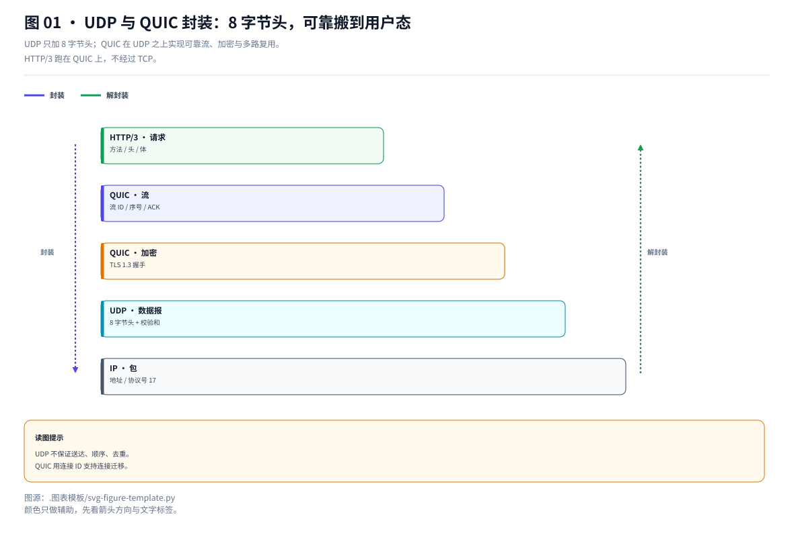
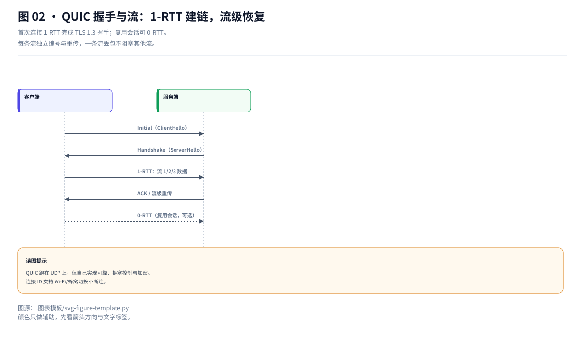

# UDP 与 QUIC

UDP 只做两件事：加 8 字节端口头、把报文原样发出去。可靠性、顺序、拥塞控制全部交给上层——QUIC 就是把这个「上层」做成了通用传输协议。

> 本篇定位：UDP 的报文、校验和与适用边界，以及 QUIC 如何在 UDP 之上补回可靠性。TCP 的对照只在必要处出现。

## 目录

- [1 一句话模型](#s1)
- [2 速览](#s2)
- [3 报文格式](#s3)
- [4 交互流程](#s4)
- [5 状态、定时器与「没有状态」的代价](#s5)
- [6 设计取舍与边界](#s6)
- [7 与相邻协议的关系](#s7)
- [8 参考与关联](#s8)

## 1 · 一句话模型：明信片，不是挂号信

UDP 像寄明信片：写上地址就投，不确认对方收没收到，也不保证顺序。应用想要可靠，就自己编号、确认、重传。

```text
应用给一个完整报文
  └─ UDP 加 8 字节头（端口、长度、校验和）
       └─ IP 加 20/40 字节头
            └─ 发出去，结束
```

三个关键认知：

1. **UDP 保留报文边界**：应用交一次，接收方读一次，不拆分也不合并。
2. **UDP 无连接状态**：没有握手、没有挥手、没有 RTT 估计，协议栈开销极小。
3. **UDP 不保证任何事**：丢包、重复、乱序、被 ICMP 拒绝，都需要应用自己处理。

## 2 · 速览

| 项 | 内容 |
| --- | --- |
| 所属层 | 传输层 |
| 协议号 | IP 头中 `17` |
| PDU | 用户数据报（datagram） |
| 首部 | 固定 8 字节 |
| 最大数据 | 65507 字节（65535 − 20 IP 头 − 8 UDP 头） |
| 连接 | 无连接 |
| 可靠性 | 不保证送达、顺序、去重 |
| 校验和 | IPv4 可选（可为 0），IPv6 强制 |
| 主要标准 | RFC 768（UDP）、RFC 9000（QUIC）、RFC 9001（QUIC-TLS）、RFC 9002（QUIC 丢失恢复） |
| 典型应用 | DNS、DHCP、SNMP、NTP、RTP、TFTP、QUIC |

## 3 · 报文格式



**读图**：UDP 只加 8 字节头；QUIC 在 UDP 上补可靠流、TLS 1.3 与多路复用，HTTP/3 因此不经过 TCP。

> 图源：`images/图01-UDP与QUIC封装.svg`

### 3.1 四个字段

```text
 0                   16                  31
+-------------------+-------------------+
|    源端口(16)     |    目的端口(16)    |
+-------------------+-------------------+
|     长度(16)      |    校验和(16)      |
+-------------------+-------------------+
|           数据（可变长度）            |
+--------------------------------------+
```

| 字段 | 长度 | 作用 | 注意 |
| --- | --- | --- | --- |
| 源端口 | 2 字节 | 发送方进程 | 不需要回复时可为 0 |
| 目的端口 | 2 字节 | 接收方进程 | 分用的依据 |
| 长度 | 2 字节 | UDP 头 + 数据的总长度 | 最小 8；最大受 IP 总长度限制 |
| 校验和 | 2 字节 | 校验伪首部 + UDP 头 + 数据 | IPv4 下可为 0，IPv6 下必须计算 |

长度字段上限的推导：

```text
IP 最大总长度 65535
  − IP 首部最小 20
  − UDP 首部 8
= UDP 数据最大 65507
```

### 3.2 校验和与伪首部

UDP 校验和覆盖三部分：

```text
伪首部（12 字节） + UDP 首部 + 数据
```

伪首部不是真实报文的一部分，而是从 IP 头借来的信息：

| 字段 | 长度 | 来源 |
| --- | --- | --- |
| 源 IP | 4 字节 | IP 头 |
| 目的 IP | 4 字节 | IP 头 |
| 保留 | 1 字节 | 固定 0 |
| 协议号 | 1 字节 | UDP 为 17 |
| UDP 长度 | 2 字节 | 与 UDP 头长度字段一致 |

计算步骤：按 16 位分组 → 反码求和 → 取反码填入。接收方同样计算，结果为全 1 则通过。

伪首部的作用是**把 IP 地址纳入校验**：如果报文被错误地投递到另一台主机或另一个协议栈，校验会失败。IPv6 的伪首部结构不同，且校验和强制。

### 3.3 报文边界

UDP 是「面向报文」的：应用一次 `send` 对应一个数据报，接收方一次 `recv` 得到一个完整报文。应用给 100 字节，UDP 就发 100 字节；给 2000 字节，UDP 尝试发 2000 字节，是否被 IP 分片由 MTU 决定。

这与 TCP 的字节流相反：TCP 不保留应用写入的边界，接收方可能一次读到多个写入，也可能只读到半个。

## 4 · 交互流程

### 4.1 基本模式：发完就忘

```text
应用 A                    应用 B
  │  sendto(数据, B:端口)    │
  ├─────────────────────────►│
  │                         │ recvfrom 得到完整报文
```

没有握手、没有确认、没有关闭。发送方甚至不知道 B 是否在监听；如果 B 没有监听，B 所在主机的协议栈可能回一个 ICMP 端口不可达（是否回、是否上报应用，取决于实现和防火墙）。

### 4.2 四种典型用法

| 用法 | 例子 | 为什么用 UDP |
| --- | --- | --- |
| 一问一答 | DNS、SNMP | 一个报文一次交互，省掉握手 |
| 广播发现 | DHCP DISCOVER | 客户端没有地址，只能广播 |
| 组播/实时 | RTP、IPTV | 宁可丢一帧，也不等重传 |
| 自定义可靠传输 | QUIC、TFTP | 在用户态实现更灵活的可靠/拥塞控制 |

### 4.3 QUIC：在 UDP 上重建可靠传输



**读图**：首次 1-RTT 握手，复用会话可 0-RTT；每条流独立重传，避免 TCP 层队头阻塞。

> 图源：`images/图02-QUIC握手与流.svg`


QUIC 不是「另一个 UDP 应用」那么简单，它把 TCP 的可靠性与 TLS 的安全性搬到了用户态：

```text
HTTP/3
  └─ QUIC（流、可靠、拥塞控制、加密）
       └─ UDP（端口、校验和）
            └─ IP
```

| 能力 | QUIC 怎么做 |
| --- | --- |
| 可靠传输 | 包号 + ACK + 重传，按流独立恢复 |
| 多路复用 | 一个连接内多条流，流之间不互相阻塞 |
| 0-RTT | 复用上次会话凭证，首包可带数据 |
| 连接迁移 | 用 Connection ID 标识连接，IP/端口变了也能续 |
| 加密 | TLS 1.3 集成在握手，默认加密 |
| 拥塞控制 | 可插拔，常见 Cubic/BBR |

QUIC 的「无队头阻塞」是流级的：一条流丢包只阻塞该流，其他流继续；但连接级仍受拥塞窗口约束。

### 4.4 异常分支

| 异常 | UDP 的表现 | 应用要做什么 |
| --- | --- | --- |
| 丢包 | 无通知 | 自己超时重传或容忍 |
| 重复 | 可能收到重复报文 | 自己去重（事务 ID） |
| 乱序 | 到达顺序不定 | 自己排序或接受乱序 |
| 对端未监听 | 可能回 ICMP 端口不可达 | 处理错误或忽略 |
| 报文过大 | IP 分片或丢弃 | 控制报文大小、做 PMTUD |
| NAT 超时 | 映射被删，回包丢失 | 保活、重注册 |

## 5 · 状态、定时器与「没有状态」的代价

UDP 协议本身没有连接状态机，也没有重传/保活定时器。它只有：

- **端口绑定**：哪个 socket 占哪个端口。
- **可选的校验和**：IPv4 可为 0。
- **内核缓冲**：收包队列满就丢。

「没有状态」的好处是简单、低延迟、易扩展；代价是所有可靠性工作都转移给应用：

| 能力 | TCP | UDP | 应用层要补 |
| --- | --- | --- | --- |
| 连接管理 | 有 | 无 | 会话 ID、超时 |
| 重传 | 有 | 无 | 定时器、ACK |
| 排序/去重 | 有 | 无 | 序号、窗口 |
| 拥塞控制 | 有 | 无 | 自建算法（如 QUIC） |
| 路径 MTU | 有 PMTUD | 依赖 IP | 控制报文大小 |

QUIC 把这些「应用层要补」的能力标准化了，所以它看起来像「UDP 上的 TCP + TLS」，但实现更灵活、可演进。

## 6 · 设计取舍与边界

### 6.1 8 字节头的价值

UDP 头只有 8 字节，TCP 至少 20 字节。对高频小报文（DNS、SNMP、游戏）来说，省下的不只是字节，还有握手、状态和协议栈处理时间。

### 6.2 校验和可选的历史包袱

IPv4 下 UDP 校验和可以为 0（不校验），这是早期为性能做的妥协。结果是「上层以为有校验，实际没有」。IPv6 取消了可选，强制校验。应用不能假设 UDP 一定校验过。

### 6.3 无拥塞控制的后果

UDP 本身不控制发送速率。大量应用同时用 UDP 猛发，会挤占网络，导致丢包和拥塞崩溃。实时业务通常有应用层码率控制；QUIC 则内置拥塞控制。**「UDP 快」不是因为协议快，而是因为它不做额外工作。**

### 6.4 分片与放大

- **分片**：UDP 报文超过 MTU 会被 IP 分片，任一片丢失整个报文报废。应用应控制报文大小（DNS 用 EDNS0/TCP，QUIC 有 PMTU 发现）。
- **放大**：UDP 无握手，源地址可伪造，容易被用于反射放大攻击（DNS、NTP、SNMP）。防御靠源地址验证、限速、关闭开放递归。

### 6.5 什么时候不该用 UDP

需要可靠、按序、通用文件传输、复杂状态机时，直接用 TCP 更省事。UDP 适合「丢了也能忍」或「自己实现更合适」的场景，不要为了「快」盲目选 UDP。

## 7 · 与相邻协议的关系

| 相邻对象 | 关系 |
| --- | --- |
| IP | UDP 数据报是 IP 载荷；协议号 17；受 MTU 与分片影响 |
| TCP | 同为传输层；TCP 可靠按序，UDP 轻量不可靠 |
| QUIC | 基于 UDP 实现可靠、加密、多路复用，是 HTTP/3 的传输层 |
| DNS/DHCP/SNMP | 典型 UDP 应用；依赖广播/组播或短交互 |
| RTP/RTCP | 实时音视频；UDP 承载，应用层处理丢包与抖动 |
| NAT | UDP 映射有超时，需保活；NAT 类型影响 P2P 穿透 |
| 防火墙 | 无连接，状态防火墙用「伪状态」跟踪 UDP 流 |

一句话：**UDP 负责「把报文扔出去」，是否送到、按什么顺序，由应用自己决定。**

## 8 · 参考与关联

**标准**

- RFC 768：User Datagram Protocol
- RFC 9000：QUIC: A UDP-Based Multiplexed and Secure Transport
- RFC 9001：Using TLS to Secure QUIC
- RFC 9002：QUIC Loss Detection and Congestion Control
- RFC 8085：UDP Usage Guidelines

**关联**

- [00-传输层概览.md](./00-传输层概览.md)
- [01-TCP.md](./01-TCP.md)：可靠传输的对照
- [DNS](../05-应用层/03-DNS.md)：UDP 53 与 TCP 53 的切换
- DHCPv4（已写）：UDP 广播发现
- [HTTP](../05-应用层/04-HTTP.md)：HTTP/3 与 QUIC
- [NAT](../03-网络层/05-NAT.md)：UDP 映射与穿透

---

> **本篇定位**：UDP 的报文、校验和、适用边界，以及 QUIC 如何在 UDP 之上补回可靠传输。
> **素材来源**：`studyspace/1.知识体系/2.TCP IP协议/m-10-UDP协议.md`（主）、`studyspace/1.知识体系/1.计算机网络/m-3-运输层--.md`（补）；QUIC 部分按 RFC 9000/9001/9002 补写。
> **待验证**：各系统 UDP 校验和开关、NAT 映射超时、QUIC 实现与部署策略差异较大。
