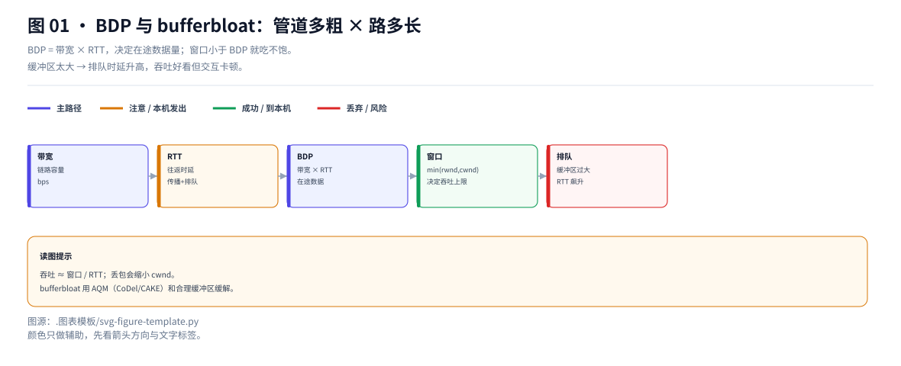

# 传输性能与调优

传输性能不是「带宽有多大」，而是「在这条路径上，协议能把多少数据持续送过去」。瓶颈可能在线路、窗口、丢包、排队，也可能在应用或网卡。

> 本篇定位：BDP、窗口、RTT、丢包、bufferbloat 与拥塞控制对吞吐的影响，给一套分层的性能分析框架。具体测试工具与参数只做概念性说明。

## 目录

- [1 一句话模型](#s1)
- [2 速览](#s2)
- [3 四个基本量](#s3)
- [4 吞吐如何被限制](#s4)
- [5 排队、丢包与 bufferbloat](#s5)
- [6 设计取舍与调优边界](#s6)
- [7 与相邻层的关系](#s7)
- [8 参考与关联](#s8)

## 1 · 一句话模型：管道 × 时间

把网络想成一根水管：

```text
带宽 = 管子多粗（每秒能过多少比特）
RTT  = 水从这头到那头再回来要多久
BDP  = 带宽 × RTT = 管子里能同时装多少水
窗口 = 你一次能放多少水进去
```

三个关键认知：

1. **吞吐 ≤ 窗口 / RTT**，窗口不够，带宽再高也跑不满。
2. **丢包会缩小窗口**，长肥网络（高带宽 × 高延迟）对丢包极其敏感。
3. **排队会抬高 RTT**，缓冲区太大反而让交互变慢（bufferbloat）。

## 2 · 速览

| 项 | 内容 |
| --- | --- |
| 所属层 | 传输层（受链路/网络/应用共同影响） |
| 关键指标 | 吞吐、RTT、丢包率、抖动、重传率 |
| 核心公式 | BDP = 带宽 × RTT；吞吐 ≈ 窗口 / RTT |
| TCP 窗口 | min(rwnd, cwnd) |
| 常见瓶颈 | 窗口太小、丢包、排队、单流哈希、CPU/加密 |
| 典型现象 | 单流慢、多流快；小文件快、大文件慢；延迟越跑越高 |
| 相关机制 | 慢启动、拥塞避免、快速重传、SACK、窗口缩放 |
| 主要标准 | RFC 5681、RFC 7323、RFC 8312（CUBIC）、RFC 8289（CoDel） |

## 3 · 四个基本量

### 3.1 带宽（Bandwidth）

链路的理论最大速率，单位 bps。它是上限，不是实际吞吐。

### 3.2 RTT（往返时延）

一个包从源到目的再回来的时间。包括传播、传输、排队、处理时延。RTT 越大，窗口需要越大才能填满管道。

### 3.3 BDP（Bandwidth-Delay Product）

```text
BDP = 带宽 × RTT
例：1 Gbps × 20 ms = 20 Mbit = 2.5 MB
```

BDP 是「在途数据」的容量。发送窗口小于 BDP，链路就吃不饱。

### 3.4 丢包率

丢包触发重传和窗口收缩。长肥网络里，极小的丢包率就能显著降低吞吐（Mathis 公式近似）：

```text
吞吐 ∝ MSS / (RTT × √丢包率)
```

这也是为什么跨洲/卫星链路对丢包特别敏感。

## 4 · 吞吐如何被限制

### 4.1 窗口限制

```text
吞吐上限 = 窗口 / RTT
```

窗口受两件事约束：

- **rwnd**：接收方缓冲区，靠窗口缩放选项可扩展到约 1GB。
- **cwnd**：发送方对网络的估计，受拥塞控制影响。

任何一个不够，吞吐就上不去。高带宽长距离链路要同时开大窗口缩放和缓冲区。

### 4.2 拥塞控制

| 阶段 | 行为 | 结果 |
| --- | --- | --- |
| 慢启动 | cwnd 每 RTT 翻倍 | 快速逼近可用带宽 |
| 拥塞避免 | 每 RTT 加 1 MSS | 稳定增长，探测上限 |
| 快速重传/恢复 | 3 个重复 ACK 触发 | 小幅回退，避免超时 |
| 超时 | cwnd 归 1 | 大幅回退，恢复慢 |

不同算法（CUBIC、BBR）对丢包/延迟的反应不同：CUBIC 以丢包为主要信号，BBR 以带宽/时延模型为主。选算法要看路径特征。

### 4.3 单流与多流

单条 TCP 流受窗口和拥塞控制限制；多条流可以并行占用更多带宽，但也更容易造成排队和不公平。应用层多连接（如 HTTP/2 多流、下载多线程）能提升单用户吞吐，但不增加链路总容量。

### 4.4 端主机瓶颈

- **CPU**：加密、校验和、协议栈处理可能先于网络饱和。
- **内存/缓冲区**：socket 缓冲区太小，窗口上不去。
- **网卡/offload**：TSO/GSO/checksum offload 能显著降低 CPU，但虚拟化/隧道场景可能失效。
- **磁盘/应用**：读写慢、序列化慢，网络再好也跑不满。

### 4.5 链路与中间设备

- 无线：共享介质、速率自适应、干扰，吞吐波动大。
- 隧道：封装开销、MTU、加密，降低有效带宽。
- 中间设备：QoS/限速/防火墙/NAT 会话表，可能成为瓶颈。

## 5 · 排队、丢包与 bufferbloat



**读图**：BDP 决定在途数据量；缓冲区过大把 RTT 推高，形成“吞吐还行但交互卡顿”的 bufferbloat。

> 图源：`images/图01-BDP与bufferbloat.svg`

### 5.1 排队时延

路由器/交换机的输出队列满时，包要排队。队列越长，RTT 越大；队列满则丢包。

### 5.2 bufferbloat

缓冲区过大时，持续拥塞会把队列填满，RTT 从几十毫秒涨到几百毫秒甚至秒级：

```text
空闲：RTT 20ms
满载：RTT 500ms+，交互卡顿，但吞吐看起来还行
```

这不是「带宽不够」，而是「排队太久」。对策：

- **AQM（主动队列管理）**：CoDel、FQ-CoDel、CAKE，按排队时延丢包/调度。
- **合理缓冲区**：按 BDP 配置，不要盲目加大。
- **QoS**：给交互/语音优先，限制大流量。

### 5.3 丢包的类型

| 类型 | 原因 | 表现 |
| --- | --- | --- |
| 拥塞丢包 | 队列满 | 吞吐下降，RTT 升高 |
| 误码丢包 | 链路质量 | CRC 错误、重传 |
| 策略丢包 | 防火墙/限速 | 特定流被丢 |
| 缓冲不足 | 网卡/驱动 | 突发流量丢包 |
| MTU 丢包 | 大包超 MTU | 小包通、大包断 |

区分丢包类型，才能对症下药；只看「丢包率」不够。

## 6 · 设计取舍与调优边界

### 6.1 带宽 vs 延迟

增加缓冲区/批量发送能提升吞吐，但会增加排队时延。交互业务（游戏、VoIP、远程桌面）更在意延迟，吞吐业务（下载、备份）更在意带宽。两者要用 QoS/AQM 分开。

### 6.2 窗口 vs 内存

窗口越大，吞吐潜力越高，但占用更多内存、放大丢包影响。窗口缩放和缓冲区要匹配 BDP，不是越大越好。

### 6.3 单流 vs 多流

多流能绕过单流窗口限制，但会增加公平性和排队问题。浏览器/下载器的并发数要结合网络容量，不是越多越快。

### 6.4 拥塞控制的选择

CUBIC 通用、部署广；BBR 在高丢包/长肥网络表现好，但对公平性和队列有争议。选择要基于路径测量，不要盲目追新。

### 6.5 调优的顺序

```text
① 确认瓶颈层：链路、窗口、CPU、应用、排队
② 再动参数：窗口/缓冲区/MTU/MSS/QoS
③ 最后换算法/换硬件
```

先定位再调参，否则容易「调了一个参数，掩盖了另一个问题」。

## 7 · 与相邻层的关系

| 相邻对象 | 关系 |
| --- | --- |
| TCP | 窗口、拥塞控制、重传直接决定吞吐 |
| UDP/QUIC | 无内建拥塞控制（UDP）或用户态拥塞控制（QUIC） |
| IP/MTU | 分片、PMTUD、MSS 影响大包性能 |
| 链路层 | 无线/隧道/聚合影响带宽与抖动 |
| QoS | 队列调度、限速、优先级 |
| 应用 | 并发数、缓冲区、加密、序列化 |

一句话：**性能是整条链路的乘积，不是某一层的参数；先找瓶颈，再谈调优。**

## 8 · 参考与关联

**标准与资料**

- RFC 5681：TCP Congestion Control
- RFC 7323：TCP Extensions for High Performance
- RFC 8312：CUBIC
- RFC 8289：CoDel
- RFC 7567：IETF Recommendations Regarding Active Queue Management
- 《TCP/IP 详解 卷 1》相关章节

**关联**

- [00-传输层概览.md](./00-传输层概览.md)
- [01-TCP.md](./01-TCP.md)：窗口、拥塞控制、重传
- [02-UDP与QUIC.md](./02-UDP与QUIC.md)：用户态拥塞控制
- [03-IP分片与MTU.md](../03-网络层/03-IP分片与MTU.md)：MSS 与分片
- [05-NAT.md](../03-网络层/05-NAT.md)：会话表与超时
- 20-平台与系统：内核参数、网卡 offload、QoS

---

> **本篇定位**：传输性能的四个基本量、吞吐限制、排队与 bufferbloat，以及调优顺序。
> **素材来源**：按 RFC 5681/7323/8312/8289 与通用网络性能资料补写；源仓库无对应成稿。
> **待验证**：具体内核参数默认值、网卡 offload 能力、无线/隧道开销随平台而变。
