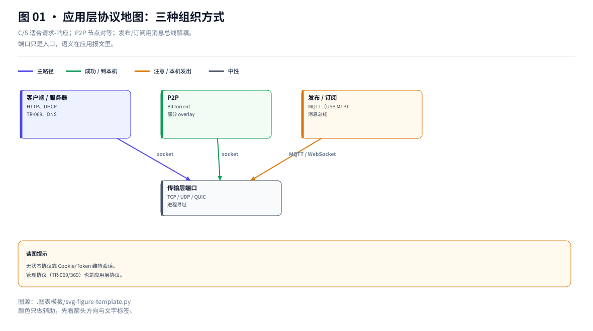

# 应用层概览

应用层定义「进程之间怎么对话」：谁是客户端、谁是服务器，报文长什么样，先发哪条、后发哪条，出错怎么办。传输层只负责把字节送到，业务语义全在这一层。

> 本篇定位：应用层入口，给进程寻址、协议组织方式、协议地图和管理协议族的位置。具体协议看各篇正文。

## 目录

- [1 一句话模型](#s1)
- [2 速览](#s2)
- [3 进程、端口与域名](#s3)
- [4 协议的三种组织方式](#s4)
- [5 本层协议地图](#s5)
- [6 边界与设计取舍](#s6)
- [7 与相邻层的关系](#s7)
- [名词解释](#名词解释)
- [8 参考与关联](#s8)

## 1 · 一句话模型：约好怎么说话

应用层协议 = **报文格式 + 交互顺序 + 状态与语义**。三者缺一不可：

```text
报文格式：字段怎么排、怎么编码
交互顺序：谁先发、回什么、什么时候结束
状态与语义：成功/失败怎么表示，参数怎么解释
```

三个关键认知：

1. **应用层不定义传输方式**，HTTP 可以跑 TCP 也可以跑 QUIC，DNS 可以 UDP 也可以 TCP。
2. **端口只是入口**，真正的语义在应用报文里。
3. **管理协议也是应用层协议**，TR-069/TR-369/OMA DM 与 DHCP/DNS 同级。

## 2 · 速览

| 项 | 内容 |
| --- | --- |
| 所属层 | 应用层（OSI 第五到第七层） |
| PDU | 报文（message） |
| 标识 | 域名、URL、事务 ID、会话 ID |
| 常见模型 | 客户端/服务器、P2P、发布/订阅 |
| 典型协议 | DHCP、DNS、HTTP、SNMP、UPnP、TR-069、TR-369、OMA DM |
| 传输依赖 | UDP、TCP、QUIC、TLS |
| 典型设备 | 主机、服务器、网关、ACS、网管 |

## 3 · 进程、端口与域名

| 标识 | 作用 | 边界 |
| --- | --- | --- |
| 端口 | 找到主机上的进程 | 端口不等于服务，服务可以换端口 |
| 域名 | 人可读的名字 | 需要 DNS 解析，解析结果可能变 |
| URL | 定位资源 | 包含协议、主机、路径、参数 |
| 事务 ID / 会话 ID | 匹配请求与响应 | 不同协议的字段名不同（xid、Message ID 等） |

应用层通过 socket 使用传输层：`bind` 端口、`listen`/`connect`、`send`/`recv`。这些是编程接口，不是协议本身。

## 4 · 协议的三种组织方式



**读图**：C/S、P2P、发布/订阅三种组织方式，最终都落到传输层端口；端口只是入口，语义在应用报文里。

> 图源：`images/图01-应用层协议地图.svg`

| 模型 | 特点 | 典型协议 |
| --- | --- | --- |
| 客户端/服务器 | 客户端主动请求，服务器被动响应 | HTTP、DHCP、TR-069 |
| P2P | 节点对等，互相提供资源 | BitTorrent、部分 overlay |
| 发布/订阅 | 通过消息总线解耦生产者和消费者 | MQTT（TR-369 的 MTP 之一） |

DHCP 是特殊的 C/S：客户端没有地址，只能广播找服务器；TR-069 是 CPE 主动连 ACS，形成「反向管理」；TR-369 的 USP 支持消息总线，弱化严格的 C/S。

## 5 · 本层协议地图

| 协议 | 一句话 | 篇目 |
| --- | --- | --- |
| DHCPv4 | 四步租约，跨网段靠中继 | [01-DHCPv4.md](./01-DHCPv4.md) |
| DHCPv6 | 有状态/无状态 + 前缀委派 | [02-DHCPv6](02-DHCPv6.md) |
| DNS | 域名到地址的分布式解析 | [03-DNS](03-DNS.md) |
| HTTP | Web 请求/响应与缓存 | [04-HTTP](04-HTTP.md) |
| SNMP | 网管站与代理的 MIB 读写/Trap | [05-SNMP](05-SNMP.md) |
| UPnP | 局域网设备发现与端口映射 | [06-UPnP](06-UPnP.md) |
| TR-069 | ACS 对 CPE 的 CWMP 管理 | [07-TR-069](07-TR-069.md) |
| TR-369 | USP 消息总线式管理 | [08-TR-369](08-TR-369.md) |
| OMA DM | SyncML 设备管理 | [09-OMA-DM](09-OMA-DM.md) |

管理协议为什么放在应用层：它们都建立在 HTTP/HTTPS、MQTT、WebSocket 等应用层传输之上，管理的是设备参数，不改变 IP/传输层行为。TR-069、TR-369、OMA DM 的正本在本目录，12-通信科学的协议索引只做引用。

## 6 · 边界与设计取舍

### 6.1 不定义传输

应用层只约定报文与交互，不规定必须用 TCP 还是 UDP。HTTP/3 从 TCP 迁到 QUIC，应用语义基本不变，就是分层带来的好处。

### 6.2 文本还是二进制

- 文本协议（HTTP/1.1、SMTP）易读、易调试，但解析开销大、体积大。
- 二进制协议（DHCP、DNS、SNMP）紧凑、解析快，但需要工具和规范。
- 现代趋势是「二进制传输 + 文本化调试接口」，如 HTTP/2 的二进制帧、Protobuf。

### 6.3 有状态还是无状态

- 无状态（HTTP 基本模型）易扩展、易负载均衡，但需要 cookie/token 维持会话。
- 有状态（DHCP 租约、TCP 连接、TR-069 会话）语义清晰，但需要超时、回收、故障恢复。

### 6.4 安全边界

应用层协议本身通常不带加密：HTTP 靠 TLS，DNS 有 DoT/DoH，SNMPv3 自带认证加密，TR-069 用 HTTPS。**协议设计时的信任模型**决定了它需要哪些安全补丁。

## 7 · 与相邻层的关系

| 相邻对象 | 关系 |
| --- | --- |
| 传输层 | 应用通过端口使用 TCP/UDP/QUIC |
| 网络层 | 应用不感知路由，但受 NAT/防火墙影响 |
| 12-通信科学 | TR-069/OMCI/运营商规范索引在 12-05，本目录保留协议正本 |
| 30-产品与方案 | 管理协议的部署、ACS 对接、产品实现归 40 |
| 安全 | TLS、认证、证书属于安全子层，不改变应用语义 |

一句话：**应用层负责「业务怎么对话」，不负责「字节怎么送到」。**

## 名词解释

> 缩写给出英文全称；非缩写用“—”表示。

| 术语 | 英文全称 | 解释 |
| --- | --- | --- |
| 应用层 | — | 业务语义层。 |
| C/S | Client/Server | 客户端/服务器模型。 |
| P2P | Peer-to-Peer | 对等网络。 |
| 发布/订阅 | — | 通过消息总线解耦。 |
| 端口 | — | 进程入口。 |
| 域名 | — | 人可读的主机名。 |
| URL | Uniform Resource Locator | 资源定位符。 |
| 事务 ID | — | 匹配请求与响应。 |
| MTP | Message Transport Protocol | 消息传输协议，TR-369 使用。 |

## 8 · 参考与关联

**标准**

- RFC 2131/2132（DHCPv4）
- RFC 8415（DHCPv6）
- RFC 1034/1035（DNS）
- RFC 9110/9112（HTTP）
- RFC 3411–3418（SNMP）
- TR-069（CWMP）、TR-369（USP）、OMA DM 规范

**关联**

- [01-DHCPv4.md](./01-DHCPv4.md)
- [04-传输层](../04-传输层/.readme.md)：TCP/UDP/QUIC
- [03-网络层](../03-网络层/.readme.md)：NAT 对应用的影响
- 12-通信科学/05-协议与标准：标准与运营商规范索引
- 30-产品与方案：CPE/网关的管理协议落地

---

> **本篇定位**：应用层入口，先建立「报文 + 顺序 + 语义」的模型，再看具体协议与管理协议族的位置。
> **素材来源**：`studyspace/1.知识体系/1.计算机网络/m-2-应用层.md`，管理协议部分按本仓库规划补写。
> **待验证**：TR-069/TR-369/OMA DM 的具体实现与运营商要求随项目而变。
