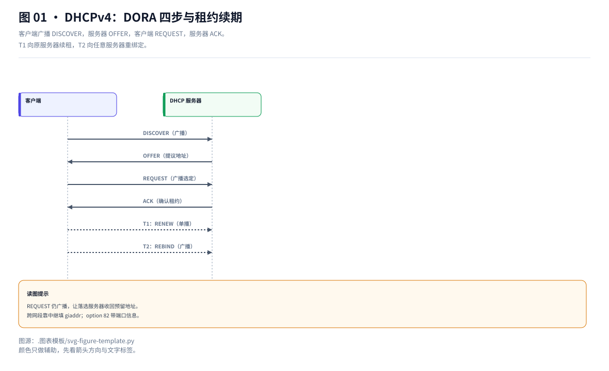
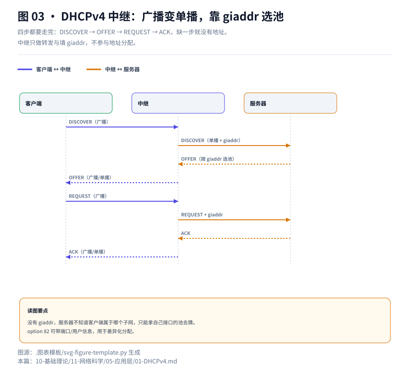
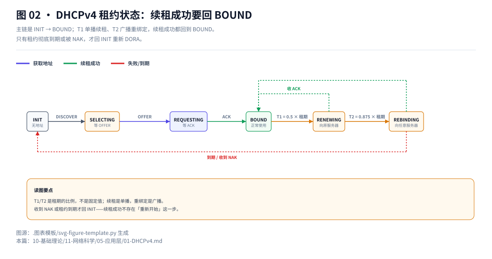

# DHCPv4

DHCPv4 把 IP 地址「租」给客户端：四步广播谈判拿到地址，租期到了要续，跨网段靠中继把请求转给服务器。

> 本篇定位：DHCPv4 的完整机制，覆盖报文、四步交互、租约状态机、中继与安全边界。DHCPv6 只做对照，细节在 DHCPv6 篇。

## 目录

- [1 一句话模型](#s1)
- [2 速览](#s2)
- [3 报文格式](#s3)
- [4 交互流程](#s4)
- [5 状态机与定时器](#s5)
- [6 设计取舍与边界](#s6)
- [7 与相邻协议的关系](#s7)
- [8 参考与关联](#s8)

## 1 · 一句话模型：地址是租来的

客户端上电时没有 IP，不能单播，只能在本广播域里喊「谁能给我一个地址」。服务器从地址池挑一个，连同掩码、网关、DNS 一起租给它，租期到了再续。

```text
没有地址 → 广播找服务器 → 服务器报价 → 客户端选定 → 确认租约
              DISCOVER        OFFER        REQUEST        ACK
```

三个关键认知：

1. **DHCP 是应用层协议**，跑在 UDP 上，但它配置的是网络层地址。
2. **租约是核心**：地址不是永久归客户端，而是有期限、可续、可回收。
3. **广播不出网段**：跨网段必须由中继代理把请求单播转给服务器，并用 `giaddr` 告诉服务器客户端在哪个子网。

## 2 · 速览

| 项 | 内容 |
| --- | --- |
| 所属层 | 应用层 |
| 传输 | UDP：服务器 67，客户端 68 |
| 前身 | BOOTP（RFC 951），报文格式沿用 |
| 固定报文 | 236 字节 + 4 字节 magic cookie + 变长 options |
| 地址分配 | 动态、自动、手动三种 |
| 租约定时器 | T1 = 0.5 × 租期，T2 = 0.875 × 租期 |
| 主要标准 | RFC 2131（协议）、RFC 2132（选项）、RFC 3046（中继 option 82） |
| 典型部署 | 家用网关 dnsmasq、企业 DHCP 服务器、运营商 BNG |

## 3 · 报文格式

### 3.1 固定头部

| 字段 | 长度 | 作用 | 注意 |
| --- | --- | --- | --- |
| op | 1 | 方向：1 请求，2 应答 | BOOTREQUEST / BOOTREPLY |
| htype | 1 | 硬件类型 | 以太网为 1 |
| hlen | 1 | 硬件地址长度 | 以太网为 6 |
| hops | 1 | 经过的中继数 | 客户端置 0，中继加 1 |
| xid | 4 | 事务 ID | 客户端用它匹配请求与应答 |
| secs | 2 | 请求已等待秒数 | 服务器可据此调整优先级 |
| flags | 2 | 最高位是广播标志 B | B=1 要求服务器广播回复 |
| ciaddr | 4 | 客户端当前 IP | 续租、释放时填写 |
| yiaddr | 4 | 服务器分配给客户端的 IP | OFFER/ACK 中填写 |
| siaddr | 4 | 下一跳服务器地址 | 无盘引导等场景 |
| giaddr | 4 | 中继代理接口 IP | 跨网段时由中继填写 |
| chaddr | 16 | 客户端硬件地址 | 客户端身份的核心 |
| sname | 64 | 服务器名 | 可选 |
| file | 128 | 启动文件名 | 可选 |
| magic cookie | 4 | 固定 `0x63825363` | 标识后面是 DHCP 选项 |
| options | 变长 | 选项列表 | 见 3.2 |

DHCP 靠 magic cookie + options 与 BOOTP 区分。客户端用 **xid + chaddr** 匹配回包，不靠源地址——因为此时它还没有地址。

### 3.2 选项格式与常用选项

选项格式：`选项号(1) + 长度(1) + 值(变长)`。

| 选项号 | 名称 | 作用 |
| --- | --- | --- |
| 1 | Subnet Mask | 子网掩码 |
| 3 | Router | 默认网关 |
| 6 | DNS Server | DNS 服务器列表 |
| 12 | Hostname | 客户端主机名 |
| 15 | Domain Name | 域名后缀 |
| 50 | Requested IP | 客户端希望得到的地址 |
| 51 | Lease Time | 租期（秒） |
| 52 | Option Overload | 选项溢出到 sname/file |
| 53 | Message Type | 报文类型 |
| 54 | Server Identifier | 服务器标识（IP） |
| 55 | Parameter Request List | 客户端想索取哪些选项 |
| 61 | Client Identifier | 客户端唯一标识（常用 MAC 或 DUID 风格） |
| 82 | Relay Agent Information | 中继附加的端口/用户信息 |

### 3.3 八种报文类型

| 类型值 | 报文 | 方向 | 作用 |
| --- | --- | --- | --- |
| 1 | DISCOVER | 客户端 → 广播 | 寻找服务器 |
| 2 | OFFER | 服务器 → 客户端 | 报价，预留地址 |
| 3 | REQUEST | 客户端 → 广播 | 选定服务器与地址 |
| 4 | DECLINE | 客户端 → 服务器 | 地址冲突，拒绝使用 |
| 5 | ACK | 服务器 → 客户端 | 确认租约 |
| 6 | NAK | 服务器 → 客户端 | 拒绝请求，客户端重来 |
| 7 | RELEASE | 客户端 → 服务器 | 主动释放地址 |
| 8 | INFORM | 客户端 → 服务器 | 已有地址，只取参数 |

## 4 · 交互流程



**读图**：DORA 四步拿租约；T1 向原服务器单播续租，T2 向任意服务器广播重绑定。

> 图源：`images/图01-DHCPv4-DORA与租约.svg`

### 4.1 四步：DORA

```text
客户端                                      服务器
  │  DISCOVER（广播，0.0.0.0 → 255.255.255.255）│
  ├──────────────────────────────────────────►│
  │  OFFER（提议地址 + 掩码/网关/DNS/租期）     │
  │◄──────────────────────────────────────────┤
  │  REQUEST（广播，选定服务器 + 请求地址）      │
  ├──────────────────────────────────────────►│
  │  ACK（确认租约）                            │
  │◄──────────────────────────────────────────┤
  │  BOUND，启动 T1/T2                         │
```

**为什么 REQUEST 还要广播**：同一网段可能有多台服务器发过 OFFER，广播 REQUEST 让落选的服务器也听到「客户端选了别人」，从而收回自己预留的地址，避免地址泄漏。

**为什么需要四步而不是两步**：DISCOVER/OFFER 是「报价」，REQUEST/ACK 是「成交」。多服务器场景下，必须先让客户端看到所有报价，再明确选定一家，否则同一地址可能被重复承诺。

### 4.2 租约续期

| 阶段 | 触发 | 行为 |
| --- | --- | --- |
| RENEWING | T1 到期（0.5 × 租期） | 向原服务器**单播** REQUEST 续租 |
| REBINDING | T2 到期（0.875 × 租期），Renew 无响应 | 向任意服务器**广播** REQUEST |
| 租约到期 | Rebind 仍无响应 | 地址失效，回到 INIT 重新 DISCOVER |

续租成功后，服务器下发新租期，客户端重置 T1/T2。续租请求携带 `ciaddr`（当前地址）和 Requested IP，服务器据此判断是否还能继续租给它。

### 4.3 释放与拒绝

- **RELEASE**：客户端关机或接口 down 时单播发送，服务器把地址收回池子。
- **DECLINE**：客户端拿到 ACK 后做 ARP 冲突检测，发现地址已被占用，就发 DECLINE；服务器把该地址标记为不可用（冷却期），避免再分配。
- **NAK**：服务器认为客户端请求的地址非法（跨子网、租约失效、策略不允许），回 NAK，客户端回到 INIT。

### 4.4 只取参数：INFORM

客户端已通过静态配置、PPPoE 等方式拿到地址，只缺 DNS/网关等参数时，发 INFORM（类型 8）。服务器回 ACK，但不填 `yiaddr`，也不建立租约。这是「地址与参数分离」的早期形态，DHCPv6 把它发展成完整的有状态/无状态两种模式。

### 4.5 跨网段：中继与 giaddr



**读图**：中继把广播转成单播并填 giaddr，服务器据此选择客户端所在子网的地址池。

> 图源：`images/图03-DHCPv4中继.svg`


```text
客户端 ──DISCOVER(广播)──► 中继路由器 ──DISCOVER(giaddr=中继 IP，单播)──► 服务器
客户端 ◄──ACK(广播/单播)── 中继路由器 ◄──ACK────────────────────────────── 服务器
```

中继做三件事：

1. 收到本地广播后，把 `giaddr` 填成自己面向客户端的接口 IP。
2. `hops` 加 1，单播转发给 DHCP 服务器。
3. 收到应答后，按 `giaddr` 找到客户端所在子网，把包送回去。

服务器靠 `giaddr` 判断客户端属于哪个地址池；没有 `giaddr`，跨网段就无法分配正确网段的地址。

中继还可以追加 **option 82**，携带接入端口、交换机/DSLAM 标识。服务器据此做按端口、按用户的差异化分配（不同地址段、租期、网关），运营商网络常用。

### 4.6 异常分支

| 异常 | 表现 | 原因 |
| --- | --- | --- |
| 收不到 OFFER | 客户端一直停在 SELECTING | 服务器不可达、广播被拦、地址池耗尽、中继配置错 |
| 收到多个 OFFER | 客户端选最先到达的一个 | 同网段有多台服务器，正常但需治理 |
| ACK 丢失 | 客户端重发 REQUEST | 服务器已建立租约，重复 ACK 即可 |
| 收到 NAK | 客户端回 INIT 重来 | 请求地址非法、跨子网、租约已被回收 |
| 地址冲突 | 客户端发 DECLINE | 静态地址占用、地址池配置重叠 |
| 拿到错误网段地址 | 能上链路但网关不通 | 中继 `giaddr` 错、服务器地址池与子网不匹配 |

## 5 · 状态机与定时器



**读图**：从 INIT 到 BOUND 是 DORA；T1 向原服务器续租，T2 向任意服务器重绑定，失败回到 INIT。

> 图源：`images/图02-DHCPv4租约状态.svg`

### 5.1 客户端状态

| 状态 | 含义 | 迁移 |
| --- | --- | --- |
| INIT | 初始，无地址 | 发 DISCOVER → SELECTING |
| SELECTING | 已发 DISCOVER，等 OFFER | 收到 OFFER 并发 REQUEST → REQUESTING |
| REQUESTING | 已发 REQUEST，等 ACK | 收到 ACK → BOUND；收到 NAK → INIT |
| BOUND | 正常使用，启动 T1/T2 | T1 到期 → RENEWING；租约到期 → INIT |
| RENEWING | 向原服务器单播续租 | 收到 ACK → BOUND；T2 到期 → REBINDING |
| REBINDING | 向任意服务器广播续租 | 收到 ACK → BOUND；租约到期 → INIT |

```text
INIT → SELECTING → REQUESTING → BOUND
                                  │ T1
                                  ▼
                              RENEWING ──ACK──► BOUND
                                  │ T2
                                  ▼
                              REBINDING ──ACK──► BOUND
                                  │ 租约到期
                                  ▼
                                 INIT
```

### 5.2 服务器侧租约状态

服务器通常维护：可用（free）、已分配（active）、冷却/冲突（declined）、过期（expired）、保留（reserved）。租约到期或收到 RELEASE 后回到可用池；收到 DECLINE 后进入冷却，避免立即再分配同一个冲突地址。

## 6 · 设计取舍与边界

### 6.1 为什么用广播

客户端在拿到地址前没有可用源 IP，无法被单播寻址，只能用 `0.0.0.0 → 255.255.255.255` 广播。广播的边界就是广播域，所以 DHCP 天然不能跨网段，必须靠中继。

### 6.2 为什么是四步

两步（请求 → 分配）在多服务器场景会出问题：多个服务器可能同时承诺同一个地址，客户端无法明确归属。四步把「报价」和「成交」分开，并用广播 REQUEST 通知落选者收回预留。

### 6.3 租约：复用与稳定的平衡

租期太短，续租报文多、服务器压力大；租期太长，地址回收慢、地址池利用率低。T1/T2 的设计让客户端在租期过半就开始续，留出两次重试机会，避免到期才发现续不上。

### 6.4 无认证的设计代价

DHCP 没有认证：任何设备都能架一台服务器发地址，任何客户端都能伪造 `chaddr` 大量申请地址。

- **恶意 DHCP 服务器**：下发错误网关/DNS，做中间人。防御靠 DHCP Snooping 信任端口、端口隔离。
- **DHCP  starvation**：伪造大量 MAC 耗尽地址池。防御靠端口 MAC 数量限制、RA guard 类机制。
- **伪造中继/option 82**：防御靠接入设备侧校验。

这些都不是 DHCP 协议能自己解决的，必须依赖二层接入控制。

### 6.5 与 BOOTP 的兼容

DHCP 复用 BOOTP 的报文格式，靠 magic cookie 和 options 扩展。好处是老 BOOTP 客户端还能工作；代价是报文固定部分有大量历史字段（sname、file），现代网络多数用不到。

## 7 · 与相邻协议的关系

| 相邻对象 | 关系 |
| --- | --- |
| IPv4 | DHCP 分配 IPv4 地址、掩码、网关；地址冲突检测常借 ARP |
| ARP | 客户端拿到地址后做 ARP 探测，冲突时发 DECLINE |
| DNS | DHCP 通过 option 6 下发 DNS 服务器，DNS 本身是独立协议 |
| DHCPv6 | 同一目标、不同协议：UDP 546/547、DUID、组播、支持 PD；v6 把地址与参数分离得更彻底 |
| PPPoE | 宽带接入常用 PPPoE 的 IPCP 下发地址，DHCP 用于 LAN 侧 |
| 中继/交换机 | 中继负责跨网段转发；交换机 DHCP Snooping 建立 IP-MAC 绑定，供 DAI 使用 |
| NAT | 家用网关常同时做 DHCP 服务器与 NAT，但两者职责独立 |

一句话：**DHCP 把「地址配置」从手工变成租约，但把「谁能发地址」的信任问题留给了接入层。**

## 8 · 参考与关联

**标准**

- RFC 2131：Dynamic Host Configuration Protocol
- RFC 2132：DHCP Options and BOOTP Vendor Extensions
- RFC 3046：DHCP Relay Agent Information Option
- RFC 3396：Encoding Long Options in DHCP
- RFC 951：BOOTP（前身）

**关联**

- [01-以太网与MAC.md](../02-链路层/01-以太网与MAC.md)：广播帧与广播域
- [05-ARP.md](../02-链路层/05-ARP.md)：地址冲突检测与 DECLINE
- [DHCPv6](02-DHCPv6.md)：有状态、无状态与 PD
- [DNS](03-DNS.md)：option 6 的下游
- PPPoE：另一种地址下发路径
- dnsmasq/odhcpd 配置与实现：`20-平台与系统`

---

> **本篇定位**：DHCPv4 的完整机制，从 DORA、租约状态机到中继与安全边界。
> **素材来源**：`studyspace/1.知识体系/2.TCP IP协议/m-4-DHCP协议.md`（主）、`studyspace/3.协议应用/4.dhcp/DHCP.md`（补）。
> **待验证**：各实现的默认租期、T1/T2 是否可配、option 82 的具体子选项随厂商而变。
