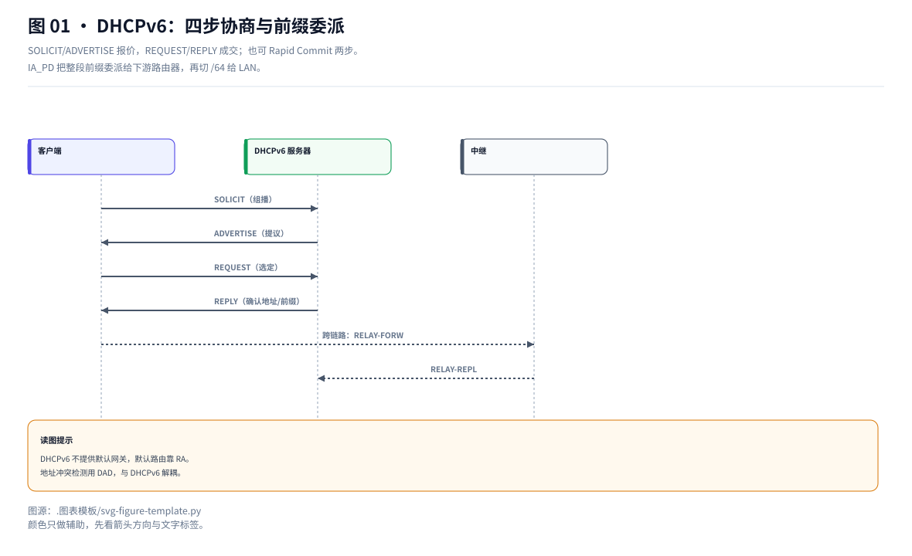
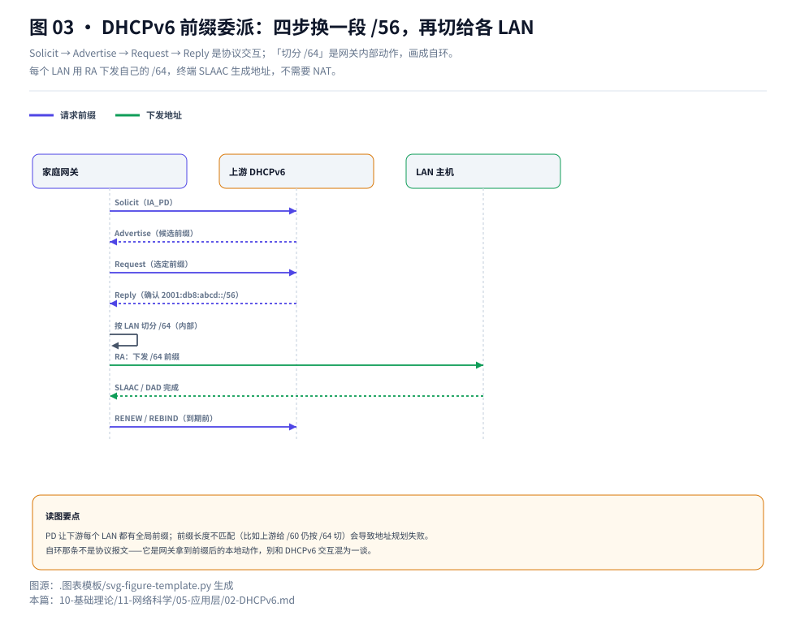
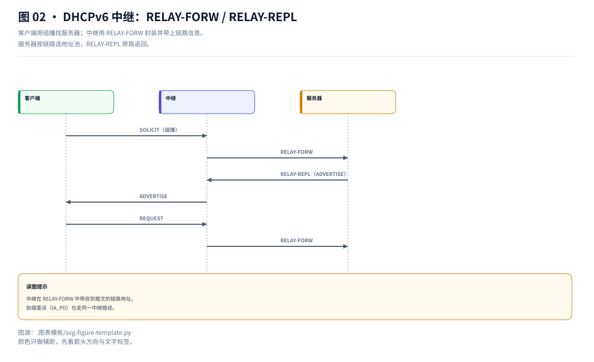
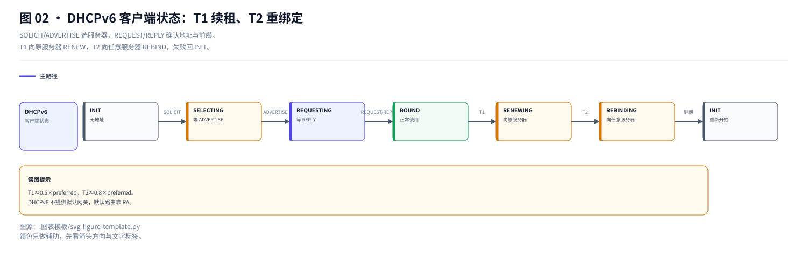

# DHCPv6

DHCPv6 给 IPv6 主机分配地址、下发参数，还能把一整段前缀「委派」给下游路由器。它和 RA/SLAAC 分工：RA 负责发现和默认路由，DHCPv6 负责可控的地址与参数。

> 本篇定位：有状态/无状态两种模式、四步与两步交互、IA_NA/IA_PD、中继与 DAD。SLAAC 的细节在 IPv6 篇。

## 目录

- [1 一句话模型](#s1)
- [2 速览](#s2)
- [3 报文格式](#s3)
- [4 交互流程](#s4)
- [5 状态与定时器](#s5)
- [6 设计取舍与边界](#s6)
- [7 与相邻协议的关系](#s7)
- [8 参考与关联](#s8)

## 1 · 一句话模型：地址、参数、前缀，分开给

DHCPv6 把三件事拆开：

```text
地址（IA_NA）  → 有状态 DHCPv6
参数（DNS 等） → 有状态或无状态都可以
前缀（IA_PD）  → 路由器向下游委派整段地址
```

三个关键认知：

1. **DHCPv6 用组播，不用广播**（IPv6 没有广播），服务器地址是 `ff02::1:2`。
2. **客户端用 DUID 标识**，不是 MAC；DUID 在重启/换网卡后可能保持不变。
3. **地址和参数可以分离**：地址用 SLAAC，DNS 用 DHCPv6（无状态模式）。

## 2 · 速览

| 项 | 内容 |
| --- | --- |
| 所属层 | 应用层 |
| 传输 | UDP：客户端 546，服务器 547 |
| 组播地址 | `ff02::1:2`（All DHCP Servers and Relay Agents） |
| 客户端标识 | DUID |
| 报文类型 | 13 种（SOLICIT/ADVERTISE/REQUEST/REPLY/…） |
| 地址机制 | IA_NA（非临时地址）、IA_TA（临时地址） |
| 前缀委派 | IA_PD（RFC 3633，现并入 RFC 8415） |
| 生命周期 | preferred lifetime、valid lifetime |
| 主要标准 | RFC 8415（DHCPv6）、RFC 3633（PD） |
| 典型场景 | 企业 IPv6、运营商家庭网关、Prefix Delegation |

## 3 · 报文格式

### 3.1 基本结构

```text
msg-type(1) + transaction-id(3) + options(变长)
```

- **msg-type**：报文类型。
- **transaction-id**：匹配请求与应答。
- **options**：TLV（type 2 字节 + length 2 字节 + value）。

### 3.2 关键选项

| 选项 | 作用 |
| --- | --- |
| Client Identifier | 客户端 DUID |
| Server Identifier | 服务器 DUID |
| IA_NA | 请求/分配非临时地址，含 IAID、T1、T2、地址列表 |
| IA_PD | 请求/委派前缀，含 IAID、T1、T2、前缀列表 |
| ORO | 客户端希望获取的选项列表 |
| Preference | 服务器优先级，客户端选高者 |
| Status Code | 成功/失败原因 |
| DNS Servers | 递归 DNS 地址 |
| Domain Search List | 域名搜索后缀 |
| Rapid Commit | 允许两步交互 |

### 3.3 十三种报文类型

| 类型 | 报文 | 作用 |
| --- | --- | --- |
| 1 | SOLICIT | 寻找服务器 |
| 2 | ADVERTISE | 服务器响应，携带提议 |
| 3 | REQUEST | 客户端选定服务器并请求配置 |
| 4 | CONFIRM | 确认地址是否仍可用 |
| 5 | RENEW | 续租 |
| 6 | REBIND | 原服务器无响应，向任意服务器续租 |
| 7 | REPLY | 服务器最终应答 |
| 8 | RELEASE | 释放地址/前缀 |
| 9 | DECLINE | 地址冲突，拒绝使用 |
| 10 | RECONFIGURE | 服务器要求客户端重新配置 |
| 11 | INFORMATION-REQUEST | 只请求参数，不要地址 |
| 12 | RELAY-FORW | 中继转发 |
| 13 | RELAY-REPL | 中继回复 |

## 4 · 交互流程



**读图**：SOLICIT/ADVERTISE/REQUEST/REPLY 完成协商；IA_PD 把整段前缀委派给下游，再切 /64 给 LAN。

> 图源：`images/图01-DHCPv6-四步与PD.svg`

### 4.1 四步：SOLICIT → ADVERTISE → REQUEST → REPLY

```text
客户端                                服务器
  │ SOLICIT（组播 ff02::1:2）           │
  ├────────────────────────────────────►│
  │ ADVERTISE（提议地址/前缀/参数）      │
  │◄────────────────────────────────────┤
  │ REQUEST（选定服务器，请求配置）       │
  ├────────────────────────────────────►│
  │ REPLY（确认，分配生效）              │
  │◄────────────────────────────────────┤
```

与 DHCPv4 类似：SOLICIT/ADVERTISE 是「报价」，REQUEST/REPLY 是「成交」。多服务器时，客户端根据 Preference、服务器优先级等选择。

### 4.2 两步：Rapid Commit

客户端在 SOLICIT 中带 Rapid Commit 选项，服务器直接在 ADVERTISE 中给出可用的 REPLY 语义，省掉 REQUEST/REPLY。适合快速上线，但需要双方支持。

### 4.3 续租、重绑定、释放

| 阶段 | 触发 | 行为 |
| --- | --- | --- |
| RENEW | T1（通常 0.5 × preferred） | 向原服务器单播 RENEW |
| REBIND | T2（通常 0.8 × preferred） | 原服务器无响应，向任意服务器组播 REBIND |
| 到期 | valid lifetime 到 | 地址/前缀失效，停止使用 |
| RELEASE | 主动放弃 | 通知服务器回收 |
| DECLINE | DAD 发现冲突 | 通知服务器该地址不可用 |

### 4.4 无状态：INFORMATION-REQUEST

主机已通过 SLAAC 拿到地址，只需要 DNS/域名等参数时，发 INFORMATION-REQUEST，服务器回 REPLY，不分配地址。RA 的 O 标志就是提示主机这么做。

### 4.5 前缀委派（IA_PD）



**读图**：上游委派 /56，网关切出多个 /64，用 RA 下发给各 LAN；不需要 NAT。

> 图源：`images/图03-DHCPv6-PD委派.svg`


运营商给家庭网关委派一段前缀（如 `/56`），网关再从中切出 `/64` 给 LAN：

```text
上游 DHCPv6 服务器 ──IA_PD 2001:db8:abcd::/56──► 家庭网关
                                               ├─ LAN1: /64
                                               └─ LAN2: /64
```

PD 让下游路由器不需要 NAT，也能给每个 LAN 分配全局可路由前缀。家庭宽带、企业分支常用。

### 4.6 中继



**读图**：RELAY-FORW 带上收到报文的链路信息，服务器按链路选池，RELAY-REPL 原路返回。

> 图源：`images/图02-DHCPv6中继.svg`


客户端与服务器不在同一链路时，中继用 RELAY-FORW/RELAY-REPL 封装：

```text
客户端 ──SOLICIT──► 中继 ──RELAY-FORW（含链路地址）──► 服务器
客户端 ◄──REPLY──── 中继 ◄──RELAY-REPL──────────────── 服务器
```

中继在 RELAY-FORW 中带上收到报文的入接口/链路地址，服务器据此选择对应地址池。

### 4.7 异常分支

| 异常 | 表现 | 原因 |
| --- | --- | --- |
| 收不到 ADVERTISE | 一直 SOLICIT | 组播被拦、服务器不可达、中继配置错 |
| 收到多个 ADVERTISE | 按 Preference 选 | 多服务器，正常但需治理 |
| REPLY 后地址不可用 | DAD 冲突 | 地址池重叠、静态地址占用 |
| 续租失败 | 地址过期 | 服务器不可达、租约被回收 |
| 前缀委派失败 | 下游无全局前缀 | 上游未开 PD、前缀池耗尽、长度不匹配 |
| 地址能配但无法上网 | 有地址无默认路由 | RA 未发/默认路由缺失，DHCPv6 不负责默认网关 |

## 5 · 状态与定时器



**读图**：SOLICIT/ADVERTISE/REQUEST/REPLY 后进入 BOUND；T1 续租、T2 重绑定，失败回 INIT。

> 图源：`images/图02-DHCPv6状态机.svg`


客户端状态与 DHCPv4 类似，但用 lifetime 而不是单一租期：

| 状态 | 含义 |
| --- | --- |
| INIT | 初始，发 SOLICIT |
| SELECTING | 等 ADVERTISE，选服务器 |
| REQUESTING | 发 REQUEST，等 REPLY |
| BOUND | 正常使用，启动 T1/T2 |
| RENEWING | 向原服务器续租 |
| REBINDING | 向任意服务器续租 |

| 定时器/参数 | 含义 |
| --- | --- |
| T1 | 续租时间，通常 0.5 × preferred lifetime |
| T2 | 重绑定时间，通常 0.8 × preferred lifetime |
| preferred lifetime | 地址首选期，到期后不再用于新连接 |
| valid lifetime | 地址有效期，到期必须停止使用 |
| DAD | 地址可用前的重复检测，与 DHCPv6 解耦 |

## 6 · 设计取舍与边界

### 6.1 组播而不是广播

IPv6 没有广播，DHCPv6 用 `ff02::1:2` 组播找服务器。组播需要交换机正确处理（MLD Snooping），否则会泛洪或丢包。

### 6.2 DUID 而不是 MAC

DUID 是客户端唯一标识，常见类型：

- DUID-LLT：链路层地址 + 时间。
- DUID-LL：仅链路层地址。
- DUID-UUID：基于 UUID。

DUID 不随 IP 变化，但可能随系统重装/网卡更换而变化。服务器按 DUID 绑定租约。

### 6.3 有状态 vs 无状态

| 模式 | 地址来源 | 参数来源 | 优点 | 缺点 |
| --- | --- | --- | --- | --- |
| 有状态 | DHCPv6 | DHCPv6 | 可控、可审计、可绑定 | 需要服务器、租约管理 |
| 无状态 | SLAAC | DHCPv6 | 网关无状态、部署简单 | 地址难审计、隐私地址多 |
| 纯 SLAAC | SLAAC | RA | 零配置 | 参数能力弱、难管理 |

企业常选「有状态」或「SLAAC + 无状态 DHCPv6」，运营商家庭网关常用「RA + PD」。

### 6.4 地址与默认路由分离

DHCPv6 不提供默认网关，默认路由靠 RA。即使 DHCPv6 分配了地址，如果 RA 没发默认路由，主机仍然上不了网。这是 IPv6 排障的常见盲点。

### 6.5 安全边界

- DHCPv6 没有内建认证， rogue server 可下发错误地址/DNS。
- 防御靠 DHCPv6 Guard、RA Guard、端口安全、交换机绑定表。
- 大量 SOLICIT 可耗尽服务器资源；需要限速和防护。

## 7 · 与相邻协议的关系

| 相邻对象 | 关系 |
| --- | --- |
| IPv6 / NDP | RA 的 M/O 标志决定是否用 DHCPv6；DAD 检测冲突 |
| SLAAC | 地址可由 SLAAC 生成，DHCPv6 只补参数 |
| DHCPv4 | 目标相同、机制不同：UDP 546/547、DUID、组播、PD |
| DNS | DHCPv6 下发 DNS 服务器与搜索域 |
| 中继/BNG | 跨链路转发与前缀委派 |
| 路由 | PD 的前缀要注入下游路由 |

一句话：**DHCPv6 负责「地址、参数、前缀」，默认路由仍归 RA；它不解决「谁来保证服务器可信」。**

## 8 · 参考与关联

**标准**

- RFC 8415：Dynamic Host Configuration Protocol for IPv6
- RFC 3633：IPv6 Prefix Options for DHCPv6
- RFC 3315：DHCPv6（已被 8415 取代）
- RFC 4862：SLAAC

**关联**

- [00-应用层概览.md](./00-应用层概览.md)
- [01-DHCPv4.md](./01-DHCPv4.md)：四步与租约对照
- [02-IPv6.md](../03-网络层/02-IPv6.md)：RA、SLAAC、NDP
- [06-ICMP与ICMPv6.md](../03-网络层/06-ICMP与ICMPv6.md)：DAD 与 NDP
- 路由与路由协议（已写）：PD 前缀注入

---

> **本篇定位**：DHCPv6 的有状态/无状态、四步/两步、IA_NA/IA_PD、中继与安全边界。
> **素材来源**：`studyspace/1.知识体系/2.TCP IP协议/m-12-DHCPv6协议.md`（主），PD 与安全按 RFC 8415/3633 补写。
> **待验证**：各实现的 T1/T2 比例、DUID 类型、RA 默认参数与 PD 长度策略不同。
