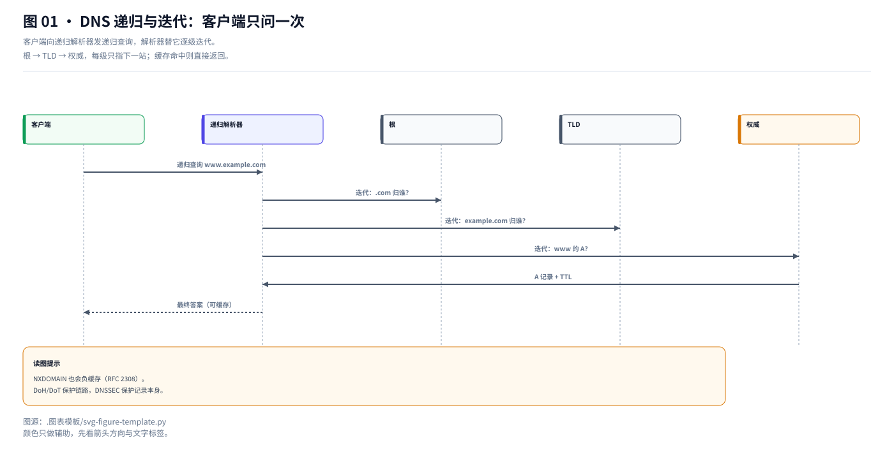
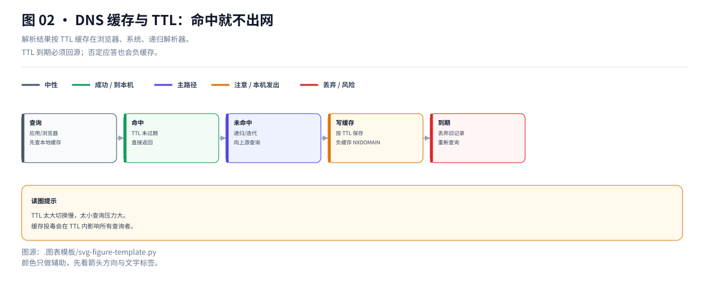

# DNS

DNS 是一个分布式、层次化的「名字 → 地址」目录：从右往左逐级下探，递归解析器替客户端跑腿，权威服务器只回答自己管辖的那一段。

> 本篇定位：DNS 的命名空间、报文、递归/迭代解析、缓存与 TTL、DoH/DoT 与 DNSSEC 的边界。不写具体服务器的部署命令。

## 目录

- [1 一句话模型](#s1)
- [2 速览](#s2)
- [3 报文格式](#s3)
- [4 解析流程](#s4)
- [5 缓存与定时器](#s5)
- [6 设计取舍与边界](#s6)
- [7 与相邻协议的关系](#s7)
- [名词解释](#名词解释)
- [8 参考与关联](#s8)

## 1 · 一句话模型：从右往左问路

域名是一棵树，越往右级别越高：

```text
.                      根
├─ com                 顶级域
│   └─ example         二级域
│       └─ www         主机
```

解析 `www.example.com` 时，从右往左逐级问：

1. 问根：`.com` 归谁管？
2. 问 `.com`：`example.com` 归谁管？
3. 问 `example.com` 的权威服务器：`www` 的地址是多少？

三个关键认知：

1. **每一级只负责下一级**，没有一台服务器知道整个互联网。
2. **递归与迭代是两种角色**：客户端要最终答案，权威服务器只给「下一站」。
3. **缓存由 TTL 驱动**：命中缓存就不出网，TTL 到期必须重新问。

## 2 · 速览

| 项 | 内容 |
| --- | --- |
| 所属层 | 应用层 |
| 传输 | UDP 53（默认）；TCP 53（大报文、区域传送）；DoT 853；DoH 443 |
| 报文结构 | 12 字节头 + Question + Answer + Authority + Additional |
| 名称长度 | 单标签 ≤63 字节，完整域名 ≤255 字节 |
| 记录类型 | A、AAAA、CNAME、MX、NS、PTR、SOA、TXT、SRV 等 |
| 缓存单位 | 每条 RR 的 TTL（秒） |
| 主要标准 | RFC 1034、RFC 1035、RFC 2308（负缓存）、RFC 4033–4035（DNSSEC）、RFC 7858（DoT）、RFC 8484（DoH） |
| 典型部署 | 递归解析器、权威服务器、根/TLD 服务器、本地 hosts |

## 3 · 报文格式

### 3.1 头部（12 字节）

| 字段 | 长度 | 作用 |
| --- | --- | --- |
| Transaction ID | 16 位 | 客户端随机生成，用来匹配应答 |
| Flags | 16 位 | QR、Opcode、AA、TC、RD、RA、AD/CD、RCODE |
| QDCOUNT | 16 位 | Question 区数量，通常 1 |
| ANCOUNT | 16 位 | Answer 区 RR 数 |
| NSCOUNT | 16 位 | Authority 区 RR 数 |
| ARCOUNT | 16 位 | Additional 区 RR 数 |

Flags 关键位：

| 位 | 名称 | 含义 |
| --- | --- | --- |
| QR | Query/Response | 0 查询，1 应答 |
| AA | Authoritative Answer | 应答来自权威服务器 |
| TC | Truncated | 应答被截断，需改用 TCP |
| RD | Recursion Desired | 客户端希望递归 |
| RA | Recursion Available | 服务器支持递归 |
| AD / CD | DNSSEC | 已认证 / 禁用校验 |
| RCODE | 应答码 | 0 NOERROR、2 SERVFAIL、3 NXDOMAIN、5 REFUSED |

### 3.2 Question 区

| 字段 | 长度 | 说明 |
| --- | --- | --- |
| QNAME | 变长 | 域名，每个标签前 1 字节长度，以 0 结尾 |
| QTYPE | 16 位 | 查询类型，如 A、AAAA、MX、ANY |
| QCLASS | 16 位 | 类别，通常 1（IN） |

QNAME 的编码示例：

```text
www.example.com → 03 www 07 example 03 com 00
```

### 3.3 资源记录（RR）

Answer / Authority / Additional 共用同一结构：

| 字段 | 长度 | 说明 |
| --- | --- | --- |
| NAME | 变长 | 记录所属域名；常用压缩指针指向前面的名字 |
| TYPE | 16 位 | 记录类型 |
| CLASS | 16 位 | 通常 IN |
| TTL | 32 位 | 可缓存秒数 |
| RDLENGTH | 16 位 | RDATA 长度 |
| RDATA | 变长 | 记录数据 |

**名称压缩**：DNS 用 2 字节指针（高两位为 `11`）指向报文前面出现过的名字，避免重复写长域名。解析报文时必须支持指针，否则会把压缩后的名字读错。

### 3.4 常见记录类型

| 类型 | 内容 | 用途 |
| --- | --- | --- |
| A | 4 字节 IPv4 | 域名 → IPv4 |
| AAAA | 16 字节 IPv6 | 域名 → IPv6 |
| CNAME | 目标域名 | 别名；同一名字不能与其他记录共存 |
| MX | 优先级 + 邮件服务器域名 | 邮件路由，数值越小越优先 |
| NS | 权威服务器域名 | 声明某域由谁负责 |
| PTR | 目标域名 | 反向解析，挂在 `in-addr.arpa` / `ip6.arpa` |
| SOA | 主服务器、负责人、序列号、刷新参数 | 每个区域唯一，描述区域元数据 |
| TXT | 任意文本 | SPF/DKIM、域名验证 |
| SRV | 优先级 + 权重 + 端口 + 目标 | 服务定位，如 SIP、LDAP |

**粘附记录（Glue）**：当 NS 指向的域名在被管域之下（如 `ns1.example.com` 管理 `example.com`），父级会在 Additional 区附带它的 A/AAAA，避免「找 NS 先要解析 NS」的循环依赖。

## 4 · 解析流程



**读图**：客户端只发一次递归查询；解析器逐级迭代根→TLD→权威，每一级的回答都是 referral（下一级找谁）。命中缓存则直接返回，不走右侧三段。

> 图源：`images/图01-DNS递归与迭代.svg`

### 4.1 递归查询与迭代查询

| 方式 | 发起者 | 行为 |
| --- | --- | --- |
| 递归 | 客户端 → 本地解析器 | 解析器必须给最终答案，查不到就替客户端逐级问 |
| 迭代 | 解析器 → 各级服务器 | 服务器只回答「下一级找谁」，不代查 |

```text
客户端       本地递归解析器        根          .com 服务器      example.com 权威
  │ 递归查询      │                │              │                │
  ├──────────────►│ 迭代：com 归谁？ │              │                │
  │               ├───────────────►│              │                │
  │               │◄── .com 地址 ──┤              │                │
  │               │ 迭代：example.com 归谁？       │                │
  │               ├──────────────────────────────►│                │
  │               │◄── 权威服务器地址 ─────────────┤                │
  │               │ 迭代：www 的 A？                                │
  │               ├───────────────────────────────────────────────►│
  │               │◄── A 记录 ─────────────────────────────────────┤
  │◄── 最终答案 ──┤                │              │                │
```

真实解析中，第 2–4 步大多命中缓存，客户端感知为毫秒级。

### 4.2 递归解析器的职责

- 从根开始逐级迭代，直到拿到答案或否定答案。
- 缓存每一级的 RR，按 TTL 过期。
- 处理 CNAME 链、DNSSEC 验证、EDNS0 协商。
- 对客户端只暴露「递归」接口，隐藏迭代过程。

### 4.3 否定应答

| RCODE | 含义 | 缓存 |
| --- | --- | --- |
| NXDOMAIN | 域名不存在 | 按 SOA 的负缓存 TTL 缓存 |
| NODATA | 域名存在，但没有该类型记录 | 同样可负缓存 |
| SERVFAIL | 服务器失败（上游超时、DNSSEC 验证失败等） | 通常短时缓存或不缓存 |
| REFUSED | 策略拒绝 | 不缓存 |

负缓存（RFC 2308）避免对不存在的域名反复查询，是递归解析器抗压的重要机制。

### 4.4 传输选择

- 默认 UDP 53，报文小、开销低。
- 应答超过 512 字节（或 EDNS0 协商的更大值）时，服务器置 TC=1，客户端改用 TCP 重查。
- 区域传送（AXFR/IXFR）必须用 TCP。
- DoT 用 TCP 853 + TLS；DoH 用 HTTPS 443。

### 4.5 异常分支

| 异常 | 表现 | 原因 |
| --- | --- | --- |
| 解析超时 | 客户端等待后失败 | 解析器不可达、上游丢包、防火墙拦 UDP 53 |
| TC=1 | 应答被截断 | 报文超过 UDP 限制，需 TCP 重试 |
| NXDOMAIN | 域名不存在 | 拼写错误、记录未配置、负缓存 |
| SERVFAIL | 解析失败 | 上游超时、DNSSEC 验证失败、权威不可达 |
| 结果与预期不符 | 拿到旧地址 | TTL 未过期、缓存投毒、本地 hosts |
| 只能解析部分域名 | 部分成功 | 分流规则、DNS 劫持、双栈选择 |

## 5 · 缓存与定时器



**读图**：查询先看本地缓存；TTL 未过期直接返回，过期才回源，否定应答也会负缓存。

> 图源：`images/图02-DNS缓存与TTL.svg`


DNS 没有连接状态机，核心是**缓存 + TTL**。

| 缓存位置 | 缓存内容 | 特点 |
| --- | --- | --- |
| 浏览器/应用 | 最近解析结果 | 各自实现，可能忽略 TTL |
| 操作系统 stub resolver | 系统级缓存 | systemd-resolved、nscd 等 |
| 本地递归解析器 | 各级 RR | 命中率最高，TTL 严格生效 |
| 权威服务器 | 不缓存 | 它是数据源 |

TTL 的权衡：

- **太大**：记录变更后，客户端长期拿旧地址，故障切换慢。
- **太小**：缓存频繁失效，查询压力大，解析延迟高。
- 常见 A 记录 TTL 为 300–86400 秒；故障切换场景会临时调小。

TTL 只约束缓存时间，不约束「记录什么时候生效」；权威服务器的 SOA 序列号、刷新/重试/过期参数决定区域同步行为。

## 6 · 设计取舍与边界

### 6.1 为什么分布式

集中式目录无法承受全球查询量，也无法让各组织自主管理自己的域名。层次化 + 缓存把负载分散到各级，根服务器只做「指路」，不存全量记录。

### 6.2 为什么默认 UDP

DNS 查询通常很小，一问一答，UDP 省掉握手。代价是大应答需要 TCP 回退，且 UDP 易被伪造源地址用于放大攻击。EDNS0 扩大了 UDP 报文上限，但也带来分片与放大风险。

### 6.3 明文 DNS 的边界

传统 DNS 明文传输，路径上的节点可以窥探和篡改。DoT/DoH 解决「传输链路」的机密性与完整性；DNSSEC 解决「记录本身」的真实性。两者层次不同，不能互相替代：

| 机制 | 保护什么 | 不保护什么 |
| --- | --- | --- |
| DoT/DoH | 查询链路的机密性、完整性 | 权威数据本身是否真实 |
| DNSSEC | 记录的数字签名与来源 | 查询内容是否被偷看 |

### 6.4 缓存与安全的冲突

缓存提升性能，也让错误结果传播得更快：一旦缓存被投毒，在 TTL 内所有查询者都会拿到错误地址。防御手段包括随机源端口、随机 Transaction ID、0x20 编码、DNSSEC。DNSSEC 是根治方案，但部署复杂、链路上有失败模式。

### 6.5 放大攻击与开放递归

UDP DNS 无握手，源地址可伪造。开放递归服务器会被利用，把大应答打向受害者。防御靠：限制递归范围（ACL）、响应速率限制、关闭开放递归、源地址验证（BCP38）。权威服务器只做迭代，不替别人递归，这是天然防线。

### 6.6 集中化与隐私

DoH 把 DNS 藏进 HTTPS，绕过网络管理员的审计，也让解析流量向少数大厂集中。便利与可管理性之间存在取舍，企业网络常用「内部 DoH/DoT + 出口策略」平衡。

## 7 · 与相邻协议的关系

| 相邻对象 | 关系 |
| --- | --- |
| UDP/TCP | DNS 默认 UDP 53，大报文/TCP 回退；DoT/DoH 走 TLS |
| DHCP | option 6 下发 DNS 服务器；DHCPv6 用 RDNSS/option 23 |
| HTTP | 浏览器解析域名后建连；HTTP/3 仍先做 DNS |
| NAT | DNS 应答中的地址可能被 ALG 改写（少见且易出错） |
| 防火墙 | 需放行 UDP/TCP 53；DoH 走 443，难以按域名审计 |
| DNSSEC | 在 DNS 报文上增加签名记录（RRSIG/DNSKEY/DS） |

一句话：**DNS 负责「名字换成地址」，不负责「地址能不能通」，也不保证换到的地址一定可信。**

## 名词解释

> 缩写给出英文全称；非缩写用“—”表示。

| 术语 | 英文全称 | 解释 |
| --- | --- | --- |
| DNS | Domain Name System | 域名系统。 |
| 递归/迭代 | — | 要最终答案/只给下一站。 |
| RR | Resource Record | 资源记录。 |
| TTL | Time To Live | 缓存生存时间。 |
| A/AAAA | Address / IPv6 Address | IPv4/IPv6 地址记录。 |
| CNAME | Canonical Name | 别名记录。 |
| MX | Mail Exchanger | 邮件交换记录。 |
| NS | Neighbor Solicitation | 权威服务器记录。 |
| PTR | Pointer | 反向解析记录。 |
| SOA | Start of Authority | 区域起始记录。 |
| TXT | Text | 文本记录。 |
| SRV | Service | 服务定位记录。 |
| 负缓存 | — | 缓存 NXDOMAIN 等否定应答。 |
| DoH/DoT | DNS over HTTPS / DNS over TLS | DNS over HTTPS/TLS。 |
| DNSSEC | Domain Name System Security Extensions | DNS 记录签名。 |
| EDNS0 | Extension Mechanisms for DNS version 0 | DNS 扩展机制。 |

## 8 · 参考与关联

**标准**

- RFC 1034：Domain Names — Concepts and Facilities
- RFC 1035：Domain Names — Implementation and Specification
- RFC 2308：Negative Caching of DNS Queries
- RFC 3596：DNS Extensions to Support IPv6（AAAA）
- RFC 4033–4035：DNSSEC
- RFC 6891：Extension Mechanisms for DNS（EDNS0）
- RFC 7858：DNS over TLS
- RFC 8484：DNS Queries over HTTPS

**关联**

- [00-应用层概览.md](./00-应用层概览.md)
- [01-DHCPv4.md](./01-DHCPv4.md)：option 6 下发 DNS
- [02-UDP与QUIC.md](../04-传输层/02-UDP与QUIC.md)：UDP 53 与 TCP 回退
- [DHCPv6](02-DHCPv6.md)：RDNSS 与 option 23
- [HTTP](04-HTTP.md)：域名解析后的建连
- [NAT](../03-网络层/05-NAT.md)：DNS ALG 的边界

---

> **本篇定位**：DNS 的命名空间、报文、递归/迭代解析、缓存与 TTL、加密与安全边界。
> **素材来源**：`studyspace/1.知识体系/2.TCP IP协议/m-9-DNS协议.md`（主）、`studyspace/1.知识体系/1.计算机网络/m-2-应用层.md`（补）。
> **待验证**：不同解析器的缓存策略、DoH/DoT 部署方式、DNSSEC 验证失败处理差异较大。
