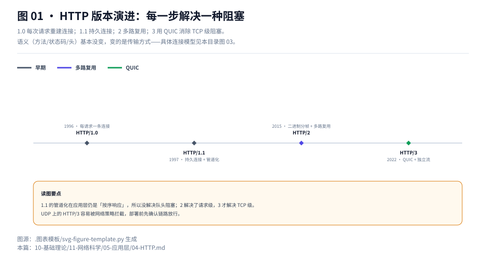
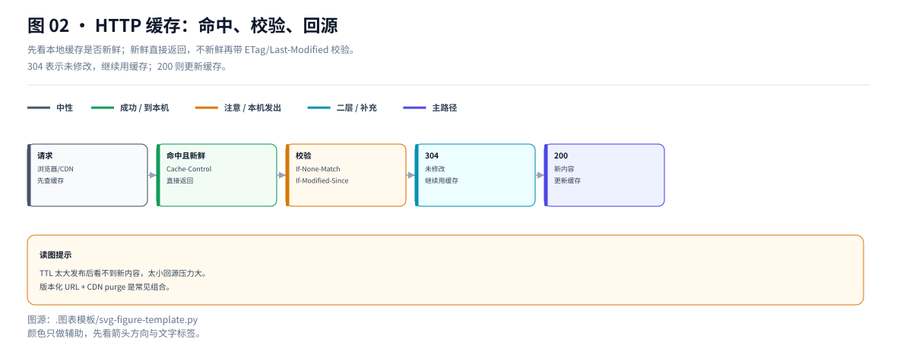
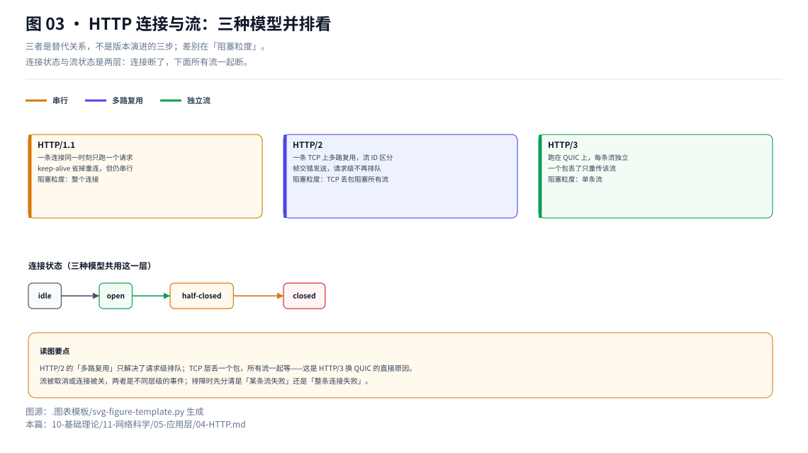

# HTTP

HTTP 是「请求—响应」式的应用层协议：客户端说「我要什么」，服务器回「状态码 + 头 + 内容」。它本身无状态，状态靠 Cookie/Session 维持。

> 本篇定位：HTTP 报文、方法/状态码、连接复用、HTTP/1.1→2→3 的演进、缓存与安全边界。TLS 握手与 TCP/QUIC 细节在各自篇目。

## 目录

- [1 一句话模型](#s1)
- [2 速览](#s2)
- [3 报文格式](#s3)
- [4 交互流程](#s4)
- [5 状态与连接](#s5)
- [6 设计取舍与边界](#s6)
- [7 与相邻协议的关系](#s7)
- [名词解释](#名词解释)
- [8 参考与关联](#s8)

## 1 · 一句话模型：一问一答，语义在头里

```text
请求：方法 + 路径 + 版本 + 头 + 体
响应：版本 + 状态码 + 原因 + 头 + 体
```

三个关键认知：

1. **HTTP 是无状态协议**，每个请求独立；会话靠 Cookie、Token、URL 参数维持。
2. **头字段承载大部分语义**：内容类型、长度、缓存、认证、连接管理。
3. **版本演进的是「怎么传」，不是「语义」**：方法、状态码、头在 1.1/2/3 中基本一致。

## 2 · 速览

| 项 | 内容 |
| --- | --- |
| 所属层 | 应用层 |
| 传输 | HTTP/1.1：TCP；HTTP/2：TCP；HTTP/3：QUIC（UDP） |
| 默认端口 | 80（明文）、443（TLS） |
| 报文形态 | 1.1 文本；2/3 二进制帧 |
| 核心语义 | 方法、状态码、头字段、缓存、内容协商 |
| 连接 | 1.1 持久连接；2 多路复用；3 流级多路复用 |
| 状态管理 | Cookie、Session、Token |
| 主要标准 | RFC 9110（语义）、9112（1.1）、9113（2）、9114（3） |

## 3 · 报文格式

### 3.1 请求

```text
GET /index.html HTTP/1.1
Host: example.com
User-Agent: ...
Accept: text/html
Cookie: ...

（可选请求体）
```

| 部分 | 作用 |
| --- | --- |
| 方法 | GET、POST、PUT、DELETE、HEAD、OPTIONS、PATCH |
| 路径 | 资源定位，可带查询参数 |
| 版本 | HTTP/1.1、HTTP/2、HTTP/3 |
| 头 | 主机、内容类型/长度、缓存、认证、Cookie |
| 体 | POST/PUT 的数据，GET 通常没有 |

### 3.2 响应

```text
HTTP/1.1 200 OK
Content-Type: text/html; charset=utf-8
Content-Length: 1234
Cache-Control: max-age=600
ETag: "abc"

（响应体）
```

### 3.3 方法与状态码

| 方法 | 语义 | 幂等 |
| --- | --- | --- |
| GET | 获取资源 | 是 |
| HEAD | 只取头 | 是 |
| POST | 提交/创建 | 否 |
| PUT | 替换资源 | 是 |
| PATCH | 部分更新 | 否 |
| DELETE | 删除 | 是 |
| OPTIONS | 查询支持的方法/CORS 预检 | 是 |

| 状态码段 | 含义 | 常见 |
| --- | --- | --- |
| 1xx | 信息 | 100 Continue、101 Switching Protocols |
| 2xx | 成功 | 200 OK、201 Created、204 No Content |
| 3xx | 重定向/缓存 | 301/302、304 Not Modified |
| 4xx | 客户端错误 | 400、401、403、404、429 |
| 5xx | 服务端错误 | 500、502、503、504 |

### 3.4 关键头字段

| 头 | 作用 |
| --- | --- |
| Host | 虚拟主机路由（1.1 必需） |
| Content-Type | 媒体类型与字符集 |
| Content-Length | 体长度 |
| Transfer-Encoding | 分块传输（chunked） |
| Connection | keep-alive/close |
| Cache-Control | 缓存策略 |
| ETag / Last-Modified | 条件请求与缓存校验 |
| Cookie / Set-Cookie | 会话状态 |
| Authorization | 认证凭证 |
| Location | 重定向目标 |

## 4 · 交互流程



**读图**：按时间看每一代解决了哪种阻塞——1.0 每请求一条连接、1.1 持久连接、2 请求级多路复用、3 用 QUIC 消除 TCP 级阻塞。语义基本不变，变的是传输方式。

> 图源：`images/图01-HTTP版本演进.svg`

### 4.1 一次请求

```text
DNS 解析 → TCP/QUIC 建连 →（TLS 握手）→ 发请求 → 收响应 → 关闭/复用
```

HTTP/1.1 默认持久连接，多个请求可以复用同一条 TCP；但同一连接上请求是串行的，前一个响应没完，后一个要等（队头阻塞）。

### 4.2 HTTP/1.1 → HTTP/2 → HTTP/3

| 版本 | 传输 | 关键改进 | 遗留问题 |
| --- | --- | --- | --- |
| 1.1 | TCP | 持久连接、chunked、缓存 | 应用层队头阻塞、头重复 |
| 2 | TCP | 二进制分帧、多路复用、头压缩（HPACK）、服务器推送 | TCP 层丢包仍阻塞所有流 |
| 3 | QUIC/UDP | 流级多路复用、0-RTT、连接迁移、内置 TLS 1.3 | UDP 可能被网络限制 |

HTTP/2 解决了「应用层串行」，但没解决「TCP 层队头阻塞」；HTTP/3 把可靠流移到 QUIC，每条流独立恢复。

### 4.3 缓存



**读图**：先看缓存是否新鲜；不新鲜再用 ETag/Last-Modified 校验，304 继续用缓存，200 更新。

> 图源：`images/图02-HTTP缓存.svg`


| 机制 | 作用 |
| --- | --- |
| Cache-Control | max-age、no-cache、no-store、private/public |
| Expires | 绝对过期时间（旧） |
| ETag | 内容指纹，配合 If-None-Match |
| Last-Modified | 配合 If-Modified-Since |
| 304 | 未修改，直接用缓存 |

缓存可以放在浏览器、CDN、反向代理、网关；TTL/策略决定命中率与新鲜度。

### 4.4 重定向与认证

- 301/302/307/308：永久/临时、是否保持方法。
- 401 + WWW-Authenticate：需要认证。
- 403：已认证但无权限。
- 429：限流，配合 Retry-After。

### 4.5 异常分支

| 异常 | 表现 | 原因 |
| --- | --- | --- |
| 连接被重置 | ERR_CONNECTION_RESET | 中间设备拦截、服务端崩溃、TLS 失败 |
| 502/504 | 网关错误/超时 | 反向代理后端不可达或太慢 |
| 304 无体 | 命中缓存 | 正常，客户端用本地副本 |
| 大文件卡住 | 小请求正常 | MTU/MSS、代理缓冲、超时 |
| 跨域失败 | CORS 报错 | 预检/响应头缺失 |
| 混合内容 | HTTPS 页面加载 HTTP 资源被拦 | 浏览器安全策略 |

## 5 · 状态与连接



**读图**：三种模型并排看阻塞粒度：1.1 卡整个连接、2 卡整条 TCP（丢包阻塞所有流）、3 只卡单条流。下排的连接状态是三者共用的一层，连接断则所有流一起断。

> 图源：`images/图03-HTTP连接与流.svg`


HTTP 本身无状态，但实现里有连接/会话状态：

| 层 | 状态 |
| --- | --- |
| 连接 | TCP/QUIC 连接、keep-alive、HTTP/2 流、HTTP/3 流 |
| 会话 | Cookie、Session ID、Token |
| 缓存 | 浏览器/CDN/代理的缓存条目与 TTL |
| 认证 | Basic/Bearer、Cookie、mTLS |

HTTP/2 的流有 idle/open/half-closed/closed 状态；HTTP/3 类似，但流在 QUIC 上独立。连接级流控和流级流控同时存在。

## 6 · 设计取舍与边界

### 6.1 文本 vs 二进制

HTTP/1.1 文本易读、易调试，但解析慢、头重复；HTTP/2 二进制分帧、头压缩，效率高但抓包可读性差。HTTP/3 继续二进制，并加密传输层元数据。

### 6.2 无状态的代价

无状态让服务器易扩展、易负载均衡，但每次请求都要带足上下文（Cookie/Token），也带来重复传输和安全问题（CSRF、XSS）。

### 6.3 队头阻塞

- HTTP/1.1：同连接串行，浏览器靠多连接缓解。
- HTTP/2：流多路复用，但 TCP 丢包阻塞整个连接。
- HTTP/3：QUIC 流独立，丢包只影响单流。

### 6.4 缓存与一致性

缓存提升性能，但会让「发布后看不到新内容」。需要版本化 URL、合理 TTL、主动刷新（CDN purge）配合。

### 6.5 安全边界

- HTTP 明文，内容可被窃听/篡改；敏感场景必须 TLS。
- HSTS 强制 HTTPS，防降级。
- Cookie 要加 Secure/HttpOnly/SameSite。
- 反向代理要正确传递 X-Forwarded-For/Proto，避免信任错源。

## 7 · 与相邻协议的关系

| 相邻对象 | 关系 |
| --- | --- |
| TCP | HTTP/1.1、HTTP/2 的传输层 |
| QUIC | HTTP/3 的传输层，内置 TLS 1.3 |
| TLS | HTTPS 的加密层，提供认证与机密性 |
| DNS | 先解析域名再建连 |
| CDN/反向代理 | 缓存、TLS 终止、负载均衡 |
| 网关 | 管理页面、TR-069 的 CWMP 都跑在 HTTP(S) 上 |

一句话：**HTTP 负责「请求什么、结果如何」，不负责「怎么可靠传输」，也不负责「内容是否可信」。**

## 名词解释

> 缩写给出英文全称；非缩写用“—”表示。

| 术语 | 英文全称 | 解释 |
| --- | --- | --- |
| HTTP | Hypertext Transfer Protocol | 请求-响应式应用协议。 |
| 方法 | — | GET、POST、PUT 等。 |
| 状态码 | — | 200、301、404 等。 |
| 头 | — | 元数据字段。 |
| Cookie | — | 会话状态。 |
| ETag | Entity Tag | 内容指纹。 |
| Cache-Control | — | 缓存策略。 |
| 304 | — | 未修改，继续用缓存。 |
| HTTP/2 | Hypertext Transfer Protocol version 2 | 二进制多路复用。 |
| HTTP/3 | Hypertext Transfer Protocol version 3 | 基于 QUIC。 |
| QUIC | Quick UDP Internet Connections | 基于 UDP 的可靠传输。 |
| TLS | Transport Layer Security | 传输层加密。 |
| HSTS | HTTP Strict Transport Security | 强制 HTTPS。 |
| CORS | Cross-Origin Resource Sharing | 跨域资源共享。 |

## 8 · 参考与关联

**标准**

- RFC 9110：HTTP Semantics
- RFC 9111：HTTP Caching
- RFC 9112：HTTP/1.1
- RFC 9113：HTTP/2
- RFC 9114：HTTP/3
- RFC 8446：TLS 1.3

**关联**

- [00-应用层概览.md](./00-应用层概览.md)
- [01-TCP.md](../04-传输层/01-TCP.md)：HTTP/1.1、HTTP/2 的传输
- [02-UDP与QUIC.md](../04-传输层/02-UDP与QUIC.md)：HTTP/3 的传输
- DNS（已写）：域名解析
- [TR-069](07-TR-069.md)：CWMP 基于 HTTP/SOAP
- 30-产品与方案：网关 Web 管理

---

> **本篇定位**：HTTP 报文、方法/状态码、连接复用与 1.1→2→3 的演进、缓存与安全边界。
> **素材来源**：`studyspace/1.知识体系/1.计算机网络/m-2-应用层.md` Web 节（薄）；其余按 RFC 9110/9112/9113/9114 补写。
> **待验证**：浏览器/服务器对 HTTP/2、HTTP/3 的支持与降级策略随版本而变。
