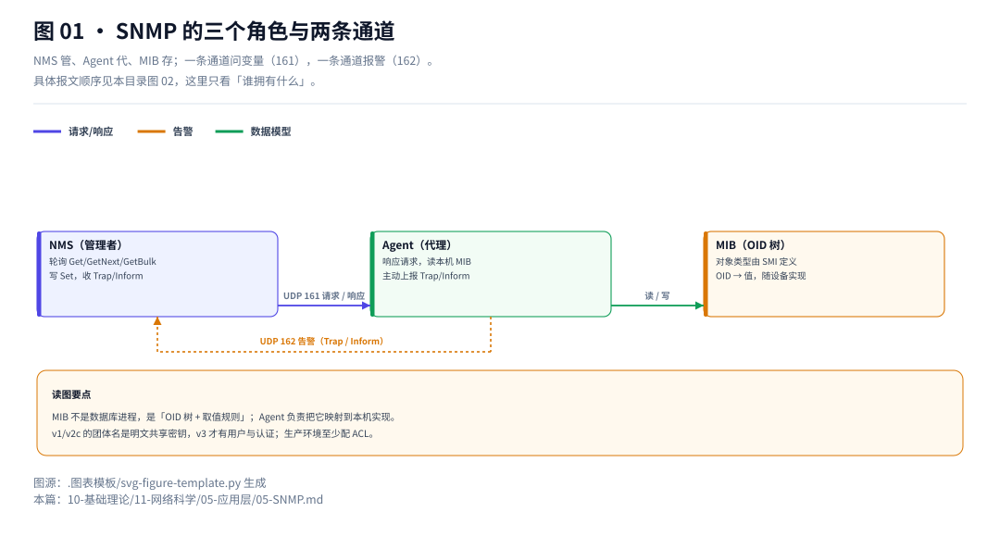
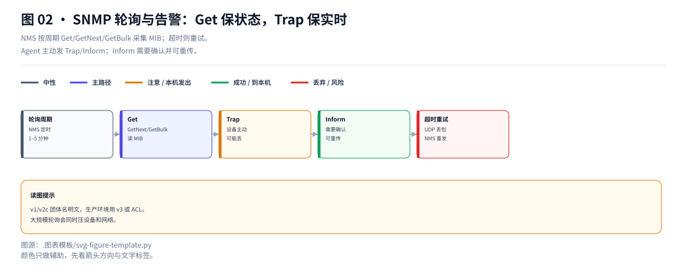

# SNMP

SNMP 是网管站（NMS）和设备代理之间的「读写变量」协议：NMS 通过 OID 查询/设置 MIB 里的值，设备也可以主动发 Trap 告警。

> 本篇定位：SNMP 的 NMS/Agent/MIB/OID 模型、v1/v2c/v3 的安全差异、Get/Set/Trap 交互与轮询/告警的取舍。MIB 文件与厂商私有 OID 不在本篇展开。

## 目录

- [1 一句话模型](#s1)
- [2 速览](#s2)
- [3 报文格式](#s3)
- [4 交互流程](#s4)
- [5 状态与定时器](#s5)
- [6 设计取舍与边界](#s6)
- [7 与相邻协议的关系](#s7)
- [名词解释](#名词解释)
- [8 参考与关联](#s8)

## 1 · 一句话模型：按 OID 读写变量

```text
NMS ──Get/Set（UDP 161）──► Agent ──► MIB（OID → 值）
Agent ──Trap/Inform（UDP 162）──► NMS
```

三个关键认知：

1. **MIB 是一棵树，OID 是节点路径**（如 `1.3.6.1.2.1.1.5.0` 是设备名）。
2. **SNMP 只定义「怎么读写」，不定义「变量是什么意思」**；语义在 MIB 定义里。
3. **轮询（Get）和告警（Trap）互补**：轮询保证状态可知，Trap 保证事件及时。

## 2 · 速览

| 项 | 内容 |
| --- | --- |
| 所属层 | 应用层 |
| 传输 | UDP：Agent 161，NMS 接收 Trap 162 |
| 版本 | SNMPv1、SNMPv2c、SNMPv3 |
| 数据模型 | SMI + MIB + OID |
| 编码 | ASN.1 BER |
| 操作 | Get、GetNext、GetBulk、Set、Response、Trap、Inform |
| 安全 | v1/v2c 团体名（明文）；v3 USM 认证/加密 + VACM |
| 主要标准 | RFC 3411–3418（v3）、RFC 2578（SMIv2） |
| 典型场景 | 交换机/路由器/服务器监控、告警、性能采集 |

## 3 · 报文格式

### 3.1 整体结构

```text
Version + Community（v1/v2c）或 USM 安全参数（v3） + PDU
```

PDU 通用字段：

| 字段 | 作用 |
| --- | --- |
| PDU Type | Get/GetNext/GetBulk/Set/Response/Trap/Inform |
| Request ID | 匹配请求与响应 |
| Error Status / Index | 错误码与出错 varbind 位置 |
| Varbind List | 一组「OID + 值」 |

### 3.2 常用 PDU

| PDU | 方向 | 作用 |
| --- | --- | --- |
| GetRequest | NMS → Agent | 读一个/多个 OID |
| GetNextRequest | NMS → Agent | 取下一个 OID，用于遍历 |
| GetBulkRequest | NMS → Agent | 一次取一批（v2c/v3） |
| SetRequest | NMS → Agent | 写 OID |
| Response | Agent → NMS | 返回结果 |
| Trap | Agent → NMS | 主动告警，不确认 |
| Inform | Agent → NMS | 主动告警，需确认（v2c/v3） |

### 3.3 OID 与 MIB

- **OID**：点分数字路径，如 `1.3.6.1.2.1.1.5.0`。
- **MIB**：用 ASN.1 定义 OID 的名称、类型、读写权限。
- **标量**：OID 末尾加 `.0`。
- **表**：按索引列展开，如接口表 `ifDescr.1`、`ifDescr.2`。

常见 MIB：`system`（设备名、 uptime）、`interfaces`（接口状态/流量）、`ip`、`tcp`、`udp`、厂商私有 MIB。

## 4 · 交互流程



**读图**：这里只分角色与通道——NMS 管、Agent 代、MIB 存；161 问变量、162 报警。谁先发、怎么应答，见本目录图 02。

> 图源：`images/图01-SNMP管理与Trap.svg`

### 4.1 轮询

```text
NMS：Get(ifInOctets.1) → Agent：Response(值)
NMS：GetNext(...) 逐个遍历 → 直到超出 MIB 范围
NMS：GetBulk(...) 一次取多行（v2c/v3）
```

轮询周期决定监控实时性与开销：周期短，数据细但流量/CPU 高；周期长，可能漏掉短时峰值。

### 4.2 Set

NMS 用 Set 修改可写 OID，如关闭接口、改设备名。Set 是事务性的：任一 varbind 失败，整个请求失败（v2c/v3 的 error status 指出位置）。

### 4.3 Trap 与 Inform

| 类型 | 确认 | 可靠性 | 适用 |
| --- | --- | --- | --- |
| Trap | 无 | 可能丢 | 大量、低价值事件 |
| Inform | 有 | 可重传 | 关键告警 |

Trap 是「设备主动说」，不依赖 NMS 轮询；但 UDP 可能丢，关键事件用 Inform。

### 4.4 SNMPv3 的安全

| 能力 | 机制 |
| --- | --- |
| 身份认证 | USM，HMAC-MD5/SHA |
| 加密 | USM，DES/AES |
| 访问控制 | VACM，按用户/组/视图限制 OID |
| 防重放 | 引擎 ID + 时间窗 |

v1/v2c 只用团体名（community），相当于明文密码；生产环境应使用 v3 或限制访问源。

### 4.5 异常分支

| 异常 | 表现 | 原因 |
| --- | --- | --- |
| 请求超时 | 无响应 | UDP 丢包、ACL 拦截、community 错 |
| noSuchObject | OID 不存在 | MIB 未实现/拼错 |
| noAccess | 无权限 | VACM 视图限制 |
| tooBig | 响应太大 | GetBulk 请求过多，需减小 |
| Trap 收不到 | 告警缺失 | 目的地址/端口错、路由不通、被防火墙拦 |
| 认证失败 | v3 报错 | 用户名/密钥/引擎 ID 不匹配 |

## 5 · 状态与定时器



**读图**：上下两段互不依赖——轮询是 NMS 按周期拉，告警是 Agent 主动推；Trap 无确认可能丢，Inform 有 Response 且可重传。

> 图源：`images/图02-SNMP轮询与告警.svg`


SNMP 基于 UDP，协议本身无连接状态；状态在 NMS 和 Agent 的配置里：

| 项 | 说明 |
| --- | --- |
| 轮询周期 | NMS 配置，常见 1–5 分钟 |
| 超时/重试 | NMS 侧，UDP 无应答时重发 |
| Inform 重传 | Agent 等待确认，超时重发 |
| Trap 队列 | Agent 侧可能缓存，队列满则丢 |
| v3 时间窗 | 防重放，依赖引擎时间同步 |

## 6 · 设计取舍与边界

### 6.1 轮询 vs Trap

轮询保证「定期有数据」，但实时性差、开销固定；Trap 实时，但可能丢、需要 NMS 监听。生产上两者结合：轮询采集性能，Trap 报事件。

### 6.2 v1/v2c vs v3

v2c 简单、兼容性好，但团体名明文、无认证；v3 有认证/加密/访问控制，但配置复杂、排障门槛高。对外只读监控可用 v2c + ACL，关键写操作必须 v3。

### 6.3 MIB 的复杂度

MIB 是 SNMP 的「语义层」，没有 MIB 就不知道 OID 是什么意思。厂商私有 MIB 的质量参差不齐，跨厂商监控往往要做映射。

### 6.4 UDP 的可靠性

SNMP 跑在 UDP 上，丢包靠 NMS 超时重试；大规模轮询会同时给设备和网络施压。可以用 GetBulk、分层轮询、采样聚合降低开销。

### 6.5 安全边界

- 团体名等于密码，默认 `public/private` 必须改。
- 限制访问源 IP、只读账户、关闭不必要的写权限。
- SNMP 不加密时，OID 和值可被窃听；敏感数据用 v3 authPriv。
- SNMP 不是配置管理协议，批量配置用 NETCONF/RESTCONF/TR-069 更合适。

## 7 · 与相邻协议的关系

| 相邻对象 | 关系 |
| --- | --- |
| UDP | SNMP 的传输层，161/162 |
| MIB/SMI | 定义 OID 的语义与类型 |
| ASN.1 BER | 报文编码 |
| TR-069 | CPE 管理用 HTTP/SOAP，能力更强、适合家庭网关 |
| Telemetry | 现代高频采集用 gNMI/NetFlow 等替代轮询 |
| 网管系统 | NMS 负责采集、存储、告警、展示 |

一句话：**SNMP 负责「按 OID 读写设备变量」，不负责「变量语义」，也不保证「告警一定送达」。**

## 名词解释

> 缩写给出英文全称；非缩写用“—”表示。

| 术语 | 英文全称 | 解释 |
| --- | --- | --- |
| SNMP | Simple Network Management Protocol | 简单网络管理协议。 |
| NMS | Network Management System | 网管站。 |
| Agent | — | 设备侧代理。 |
| MIB | Management Information Base | 管理信息库。 |
| OID | Object Identifier | 对象标识符。 |
| SMI | Structure of Management Information | 管理信息结构。 |
| BER | Basic Encoding Rules | ASN.1 编码。 |
| Get/GetNext/GetBulk/Set | — | 读、遍历、批量读、写。 |
| Trap/Inform | — | 主动告警/需确认告警。 |
| USM | User-based Security Model | 用户安全模型。 |
| VACM | View-based Access Control Model | 视图访问控制。 |
| community | — | v1/v2c 团体名。 |

## 8 · 参考与关联

**标准**

- RFC 3411–3418：SNMPv3 架构、USM、VACM、PDU
- RFC 2578：SMIv2
- RFC 1213：MIB-II（经典接口/系统 MIB）
- RFC 2863：IF-MIB

**关联**

- [00-应用层概览.md](./00-应用层概览.md)
- [02-UDP与QUIC.md](../04-传输层/02-UDP与QUIC.md)：UDP 传输
- [TR-069](07-TR-069.md)：另一种设备管理协议
- 20-平台与系统：net-snmp 部署与 MIB
- 40-产品与方案：设备网管对接

---

> **本篇定位**：SNMP 的 NMS/Agent/MIB/OID 模型、v1/v2c/v3、Get/Set/Trap 与安全边界。
> **素材来源**：`studyspace/3.协议应用/2.snmp/snmp.md`（薄），按 RFC 3411–3418 与 MIB-II 补写；`2.snmp/src` 只读，不引用代码。
> **待验证**：厂商私有 MIB、默认团体名、v3 加密算法支持差异较大。
