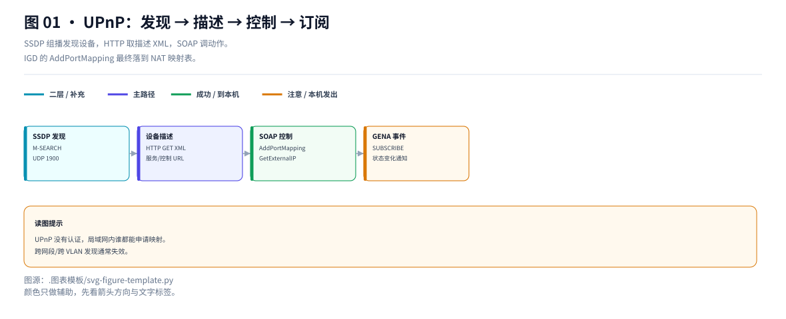
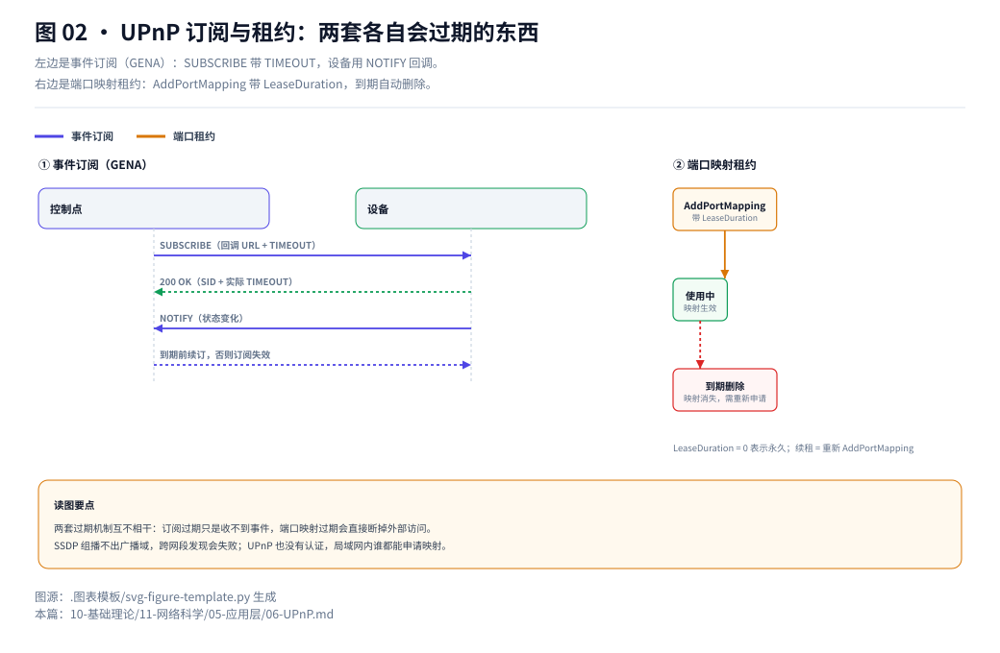

# UPnP

UPnP 让局域网设备「自己被发现、自己描述、自己配置」：最常见的用途是应用向网关申请端口映射（UPnP IGD），免去手工配 NAT。

> 本篇定位：SSDP 发现、设备描述、SOAP 控制、事件订阅，以及 IGD 的端口映射与安全边界。NAT-PMP/PCP 只做对照。

## 目录

- [1 一句话模型](#s1)
- [2 速览](#s2)
- [3 协议栈与报文](#s3)
- [4 交互流程](#s4)
- [5 状态与定时器](#s5)
- [6 设计取舍与边界](#s6)
- [7 与相邻协议的关系](#s7)
- [名词解释](#名词解释)
- [8 参考与关联](#s8)

## 1 · 一句话模型：发现 → 描述 → 控制 → 订阅

UPnP 不是单一协议，而是一套分层流程：

```text
① 发现：SSDP（UDP 1900，组播）找设备
② 描述：HTTP 取设备描述 XML，知道有哪些服务
③ 控制：SOAP over HTTP 调用动作（如 AddPortMapping）
④ 订阅：GENA 订阅状态变化，设备事件通知
⑤ 展示：可选的 Web 管理页
```

三个关键认知：

1. **发现靠组播**，所以 UPnP 通常只在一个广播域/局域网内有效，跨网段会失效。
2. **控制是 SOAP**，不是自定义二进制；HTTP 承载，XML 描述参数。
3. **IGD 只是 UPnP 的一个标准服务**，负责查公网 IP、加/删端口映射、查连接状态。

## 2 · 速览

| 项 | 内容 |
| --- | --- |
| 所属层 | 应用层 |
| 发现 | SSDP：UDP 1900，组播 `239.255.255.250`（IPv4）/ `ff02::c`（IPv6） |
| 描述/控制 | HTTP + XML + SOAP |
| 事件 | GENA（HTTP 回调） |
| 核心设备类型 | InternetGatewayDevice（IGD） |
| 核心服务 | WANIPConnection / WANPPPConnection |
| 关键动作 | GetExternalIPAddress、AddPortMapping、DeletePortMapping |
| 主要规范 | UPnP Device Architecture、UPnP IGD |
| 相邻方案 | NAT-PMP（RFC 6886）、PCP（RFC 6887） |

## 3 · 协议栈与报文

### 3.1 SSDP 发现

| 报文 | 方向 | 作用 |
| --- | --- | --- |
| M-SEARCH | 控制点 → 组播 | 搜索设备/服务 |
| NOTIFY | 设备 → 组播 | 上线/下线通告 |
| 响应 | 设备 → 控制点单播 | 返回描述 URL |

M-SEARCH 的关键字段：`ST`（搜索目标，如 `urn:schemas-upnp-org:device:InternetGatewayDevice:1`）、`MX`（最大等待时间）。设备在 MX 内随机延迟响应，避免同时回包。

### 3.2 设备描述

控制点拿到 `LOCATION` 后，用 HTTP GET 取 XML：

```xml
<root>
  <device>
    <deviceType>InternetGatewayDevice</deviceType>
    <friendlyName>...</friendlyName>
    <serviceList>
      <service>
        <serviceType>WANIPConnection:1</serviceType>
        <controlURL>/upnp/control/WANIPConn1</controlURL>
        <eventSubURL>/upnp/event/WANIPConn1</eventSubURL>
      </service>
    </serviceList>
  </device>
</root>
```

描述里给出每个服务的控制 URL、事件 URL、SCPD（动作/参数定义）。

### 3.3 SOAP 控制

调用动作就是向 controlURL 发 HTTP POST，body 是 SOAP envelope：

```xml
<u:AddPortMapping xmlns:u="urn:schemas-upnp-org:service:WANIPConnection:1">
  <NewRemoteHost></NewRemoteHost>
  <NewExternalPort>8080</NewExternalPort>
  <NewProtocol>TCP</NewProtocol>
  <NewInternalPort>80</NewInternalPort>
  <NewInternalClient>192.168.1.20</NewInternalClient>
  <NewEnabled>1</NewEnabled>
  <NewPortMappingDescription>web</NewPortMappingDescription>
  <NewLeaseDuration>0</NewLeaseDuration>
</u:AddPortMapping>
```

响应里带 `NewExternalIPAddress` 等返回值；出错用 SOAP Fault（如 718 ConflictInMappingEntry）。

### 3.4 GENA 事件

控制点向 eventSubURL 发 SUBSCRIBE，携带回调 URL 和超时；设备状态变化时向回调 URL 发 NOTIFY，body 是事件 XML。用于「公网 IP 变了」「连接状态变了」等。

## 4 · 交互流程



**读图**：四个阶段都是控制点发起、设备响应——所以用泳道看方向；IGD 的 AddPortMapping 最终落到 NAT 映射表。

> 图源：`images/图01-UPnP发现与控制.svg`

### 4.1 发现与描述

```text
控制点：M-SEARCH（组播）
设备：单播响应（LOCATION: http://192.168.1.1:5000/rootDesc.xml）
控制点：GET rootDesc.xml
控制点：解析服务列表，取 controlURL
```

### 4.2 申请端口映射

```text
控制点：AddPortMapping(外部 8080/TCP → 内部 192.168.1.20:80)
网关：校验权限/冲突 → 写入 NAT 映射 → 返回成功
控制点：可选订阅事件，感知公网 IP 变化
```

### 4.3 查询与删除

- `GetExternalIPAddress`：查 WAN 公网 IP。
- `GetSpecificPortMappingEntry`：查某条映射。
- `DeletePortMapping`：删除映射。
- `GetGenericPortMappingEntry`：按索引遍历映射表。

### 4.4 租约与续期

`NewLeaseDuration` 为 0 表示永久（直到删除/重启）；非 0 表示秒级租约，到期自动删除。应用要定期续期，否则映射会失效。

### 4.5 异常分支

| 异常 | 表现 | 原因 |
| --- | --- | --- |
| 发现不到设备 | M-SEARCH 无响应 | 组播被隔离、UPnP 关闭、跨网段 |
| 描述取不到 | HTTP 404/超时 | LOCATION 错、防火墙拦、端口变 |
| 映射失败 718 | ConflictInMappingEntry | 外部端口已被占用 |
| 映射成功但访问不通 | 外网连不上 | 网关防火墙未放行、ISP 封端口、NAT 回流 |
| 映射一段时间后失效 | 突然无法访问 | 租约到期、网关重启、公网 IP 变化 |
| 事件收不到 | 状态不同步 | 回调 URL 不可达、订阅超时 |

## 5 · 状态与定时器



**读图**：左右两套机制互不相干——GENA 订阅靠 TIMEOUT 过期（只影响收事件），端口映射靠 LeaseDuration 过期（直接影响外部访问）。

> 图源：`images/图02-UPnP订阅与租约.svg`


| 项 | 说明 |
| --- | --- |
| NOTIFY 周期 | 设备上线/下线通告，另有周期重发 |
| M-SEARCH MX | 设备在 MX 秒内随机响应 |
| 订阅超时 | SUBSCRIBE 带 TIMEOUT，到期需续订 |
| 端口映射租约 | LeaseDuration，0 表示永久 |
| 映射老化 | 网关重启/租约到期/手动删除 |

UPnP 本身没有连接状态机；状态在「设备是否在线」「订阅是否有效」「映射是否存在」。

## 6 · 设计取舍与边界

### 6.1 零配置 vs 安全

UPnP 的卖点是零配置：应用自己开端口，用户不用进网关。代价是**没有认证/授权**：局域网内任何设备都能申请映射，恶意软件可借此绕过 NAT。

工程上常见做法：

- 默认关闭 UPnP，按需开启。
- 只允许 LAN 侧、限制可映射的端口范围。
- 记录映射日志，定期审计。
- 用 PCP/NAT-PMP 替代，或要求认证。

### 6.2 组播的边界

SSDP 依赖组播，跨 VLAN/跨网段默认不通。即使网关支持 UPnP，二级路由下的设备也可能发现不到。解决方案是 UPnP 代理/中继，但部署复杂。

### 6.3 IGD 的碎片化

不同厂商对 IGD 服务的实现差异大：有的只支持 WANIPConnection，有的只支持 WANPPPConnection；有的返回字段不全。应用要兼容多种设备类型，不能假设标准完全一致。

### 6.4 UPnP vs NAT-PMP/PCP

| 方案 | 复杂度 | 认证 | 适用 |
| --- | --- | --- | --- |
| UPnP IGD | 高（SSDP+SOAP+XML） | 无 | 家庭网关、兼容性广 |
| NAT-PMP | 低（UDP 二进制） | 无 | Apple 生态、简单映射 |
| PCP | 中 | 可选 | 运营商级、IPv6/双栈 |

PCP 是 IETF 标准，能力更强（含 IPv6、租约、认证扩展），但终端支持不如 UPnP 广。

## 7 · 与相邻协议的关系

| 相邻对象 | 关系 |
| --- | --- |
| DHCP | 设备先拿到地址，才能发 SSDP/HTTP |
| NAT | IGD 的动作最终落到 NAT 映射表 |
| HTTP/SOAP | 描述、控制、事件的承载 |
| 组播 | SSDP 依赖组播发现 |
| mDNS/DNS-SD | 另一种零配置发现，常与 UPnP 并存 |
| PCP/NAT-PMP | 同类端口映射方案 |

一句话：**UPnP 负责「让应用自己找到网关并开端口」，不负责「认证」，也不保证「跨网段可用」。**

## 名词解释

> 缩写给出英文全称；非缩写用“—”表示。

| 术语 | 英文全称 | 解释 |
| --- | --- | --- |
| UPnP | Universal Plug and Play | 通用即插即用。 |
| SSDP | Simple Service Discovery Protocol | 简单服务发现协议。 |
| IGD | Internet Gateway Device | 互联网网关设备。 |
| SOAP | Simple Object Access Protocol | 基于 XML 的远程调用。 |
| GENA | General Event Notification Architecture | 通用事件通知。 |
| M-SEARCH | Multicast Search | SSDP 搜索报文。 |
| NOTIFY | — | SSDP 或事件通告。 |
| control URL | — | 服务控制入口。 |
| LeaseDuration | — | 端口映射租期。 |
| NAT-PMP/PCP | NAT Port Mapping Protocol / Port Control Protocol | 端口映射协议。 |

## 8 · 参考与关联

**标准**

- UPnP Device Architecture 1.x
- UPnP InternetGatewayDevice（IGD）规范
- RFC 6886：NAT Port Mapping Protocol（NAT-PMP）
- RFC 6887：Port Control Protocol（PCP）

**关联**

- [00-应用层概览.md](./00-应用层概览.md)
- [05-NAT.md](../03-网络层/05-NAT.md)：端口映射与 conntrack
- [01-DHCPv4.md](./01-DHCPv4.md)：设备先获得地址
- [04-HTTP.md](./04-HTTP.md)：描述/控制的承载
- 40-产品与方案：家庭网关 UPnP 实现

---

> **本篇定位**：UPnP 的 SSDP 发现、设备描述、SOAP 控制、GENA 事件与 IGD 端口映射、安全边界。
> **素材来源**：`studyspace/3.协议应用/8.upnp/upnp.md`（薄），按 UPnP Device Architecture/IGD 规范补写。
> **待验证**：厂商 IGD 实现差异、默认开关、可映射端口范围与租约策略不同。
