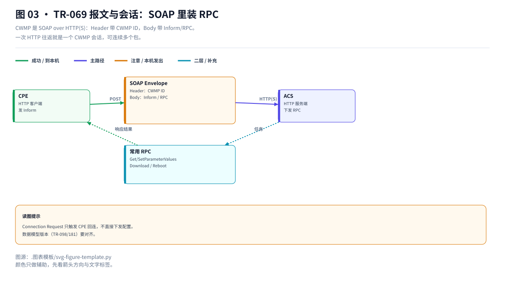
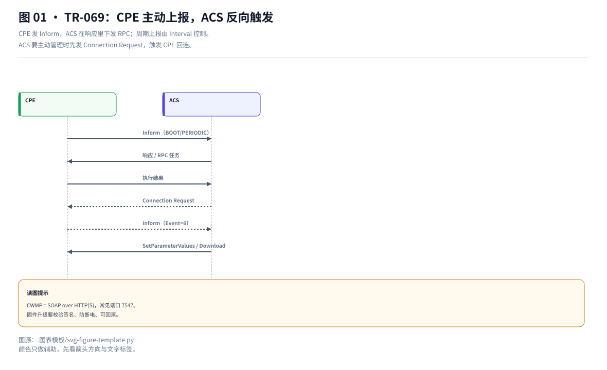
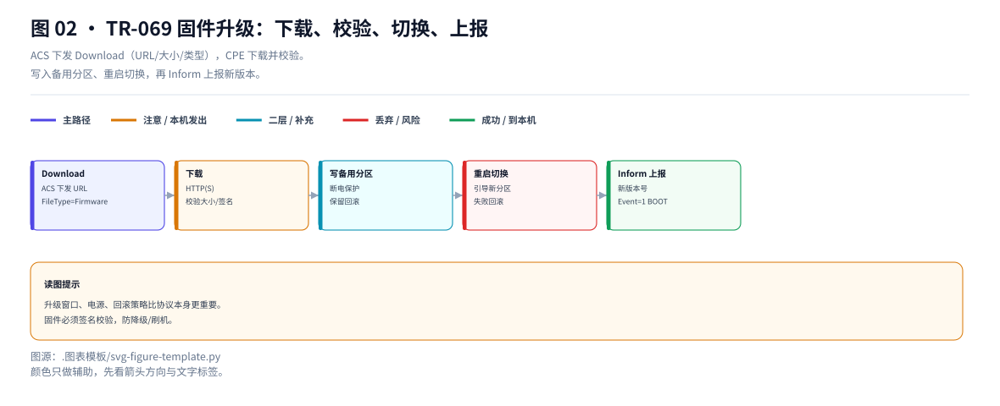
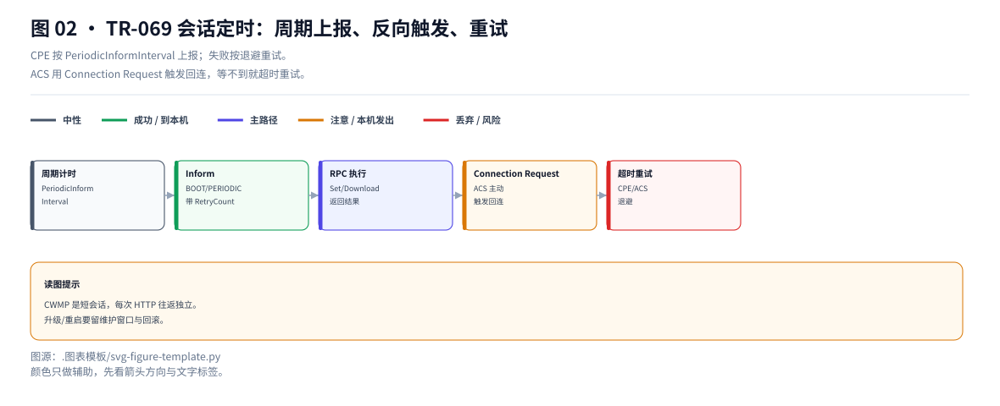

# TR-069

TR-069（CWMP）是运营商管理家庭网关/CPE 的标准：CPE 主动连 ACS，用 SOAP over HTTP 读写参数、下发配置、升级固件。它最大的设计点是「反向连接」——设备在 NAT 后面也能被管理。

> 本篇定位：CWMP 的会话模型、Inform/Connection Request、参数树与常用 RPC、安全与边界。TR-369 只做对照。

## 目录

- [1 一句话模型](#s1)
- [2 速览](#s2)
- [3 报文与会话](#s3)
- [4 交互流程](#s4)
- [5 状态与定时器](#s5)
- [6 设计取舍与边界](#s6)
- [7 与相邻协议的关系](#s7)
- [名词解释](#名词解释)
- [8 参考与关联](#s8)

## 1 · 一句话模型：设备主动报到，ACS 下发任务

```text
CPE ──Inform（HTTP/SOAP）──► ACS
ACS ──响应（可带 RPC 任务）──► CPE
CPE 执行任务 ──响应结果──► ACS
```

三个关键认知：

1. **CPE 是 HTTP 客户端**，ACS 是服务端；连接方向天然适配 NAT。
2. **ACS 要主动找 CPE 时**，先发 Connection Request（HTTP GET 到 CPE 的 7547 端口），触发 CPE 回连。
3. **管理的是参数树**，不是命令行：每个参数有路径、类型、读写权限。

## 2 · 速览

| 项 | 内容 |
| --- | --- |
| 所属层 | 应用层 |
| 传输 | HTTP/HTTPS，常见端口 7547（ACS）、CPE 侧监听 7547 |
| 编码 | SOAP/XML |
| 角色 | CPE（客户端）、ACS（自动配置服务器） |
| 核心 RPC | Inform、Get/SetParameterValues、GetParameterNames、AddObject、Download、Reboot |
| 数据模型 | TR-098（InternetGatewayDevice）、TR-181（Device:2） |
| 触发方式 | CPE 周期 Inform；ACS Connection Request |
| 主要规范 | TR-069、TR-106、TR-098、TR-181 |
| 典型场景 | 家庭网关、IPTV 机顶盒、VoIP 终端、FTTR 子机 |

## 3 · 报文与会话



**读图**：一次 HTTP 往返就是一个 CWMP 会话；SOAP Header 带 CWMP ID，Body 装 Inform 或 RPC。

> 图源：`images/图03-TR-069报文与会话.svg`


### 3.1 CWMP 会话

一个 CWMP 会话就是一次 HTTP 请求/响应，body 是 SOAP：

```xml
<soap:Envelope>
  <soap:Header>
    <cwmp:ID>123</cwmp:ID>
  </soap:Header>
  <soap:Body>
    <cwmp:Inform>
      <DeviceId>...</DeviceId>
      <Event>1 BOOT</Event>
      <ParameterList>...</ParameterList>
    </cwmp:Inform>
  </soap:Body>
</soap:Envelope>
```

响应可以是空（无任务），也可以携带一个或多个 RPC 调用。

### 3.2 Inform 的内容

| 字段 | 作用 |
| --- | --- |
| DeviceId | 厂商、OUI、产品类、序列号 |
| Event | 触发事件：0 BOOTSTRAP、1 BOOT、2 PERIODIC、4 VALUE CHANGE、6 CONNECTION REQUEST 等 |
| MaxEnvelopes | 一次会话最多几个 HTTP 往返 |
| CurrentTime | 设备时间 |
| RetryCount | 重试次数 |
| ParameterList | 关键参数（软件版本、连接状态等） |

### 3.3 常用 RPC

| RPC | 方向 | 作用 |
| --- | --- | --- |
| Inform | CPE → ACS | 上报事件与参数 |
| GetParameterValues | ACS → CPE | 读参数 |
| SetParameterValues | ACS → CPE | 写参数 |
| GetParameterNames | ACS → CPE | 列参数树 |
| GetParameterAttributes / SetParameterAttributes | ACS → CPE | 读/写通知属性 |
| AddObject / DeleteObject | ACS → CPE | 增删表项（如端口映射、Wi-Fi 实例） |
| Download / Upload | ACS → CPE | 固件/配置文件上传下载 |
| Reboot / FactoryReset | ACS → CPE | 重启/恢复出厂 |
| ScheduleInform | ACS → CPE | 安排下一次上报 |
| ConnectionRequest | ACS → CPE | 触发 CPE 回连 |

### 3.4 Connection Request

ACS 无法直接向 NAT 后的 CPE 建 HTTP 连接，所以：

```text
ACS：HTTP GET http://CPE:7547/... （带认证）
CPE：返回 200，并立即发起一个 Inform（Event=6 CONNECTION REQUEST）
ACS：在 Inform 响应里下发任务
```

CPE 必须监听一个端口（常见 7547），并配置 ACS 可访问的地址/端口；公网访问通常靠 ACS 侧路由/隧道或 CPE 主动上报。

## 4 · 交互流程



**读图**：CPE 主动 Inform；ACS 用 Connection Request 触发 CPE 回连，再在响应里下发 RPC 任务。

> 图源：`images/图01-TR-069会话与反向连接.svg`

### 4.1 启动/周期上报

```text
CPE 上电 → 发 Inform（Event=0 BOOTSTRAP 或 1 BOOT）
ACS → 返回空或任务
CPE 执行任务 → 响应结果
会话结束
之后按 PeriodicInformInterval 周期上报
```

### 4.2 ACS 主动下发

```text
ACS → Connection Request → CPE
CPE → Inform（Event=6）
ACS → 在响应中带 SetParameterValues/Download 等
CPE → 执行并返回结果
```

### 4.3 参数树

TR-098 的根是 `InternetGatewayDevice.`，TR-181 的根是 `Device.`。参数路径示例：

```text
InternetGatewayDevice.DeviceInfo.SoftwareVersion
InternetGatewayDevice.WANDevice.1.WANConnectionDevice.1.WANPPPConnection.1.ExternalIPAddress
InternetGatewayDevice.LANDevice.1.WLANConfiguration.1.SSID
```

表项用 `.{i}.` 表示实例，支持 AddObject/DeleteObject 动态增删。

### 4.4 固件升级



**读图**：ACS 下发 Download，CPE 下载/校验/写备用分区/重启切换，最后 Inform 上报新版本。

> 图源：`images/图02-TR-069固件升级.svg`


```text
ACS：Download(URL, FileType=1 Firmware, FileSize, TargetFileName)
CPE：下载 → 校验 → 写入备用分区 → 重启切换
CPE：上报新版本（Event=1 BOOT / 0 BOOTSTRAP）
```

升级要考虑断电保护、回滚、签名校验、升级窗口，不能只依赖 HTTP 200。

### 4.5 异常分支

| 异常 | 表现 | 原因 |
| --- | --- | --- |
| Inform 失败 | CPE 反复重试 | ACS 地址错、DNS 失败、证书不信任、网络不通 |
| Connection Request 失败 | ACS 无法主动管理 | CPE 端口不可达、NAT 未映射、认证错 |
| Set 失败 | 参数未生效 | 参数只读、类型/范围错、依赖未满足 |
| 升级失败 | 版本不变/变砖 | URL 不可达、校验失败、分区/电源问题 |
| 会话超时 | 任务中断 | CPE/ACS 处理慢、MaxEnvelopes 用尽 |
| 参数树不匹配 | 读写报错 | 数据模型版本（TR-098 vs TR-181）不一致 |

## 5 · 状态与定时器



**读图**：周期 Inform、RPC 执行、Connection Request 触发回连；失败都按退避重试。

> 图源：`images/图02-TR-069会话定时.svg`


| 项 | 说明 |
| --- | --- |
| PeriodicInformInterval | 周期上报间隔，ACS 可下发 |
| PeriodicInformTime | 首次上报时间 |
| CPE 重试 | Inform 失败按退避重试，带 RetryCount |
| 会话超时 | HTTP 超时/ACS 处理时限 |
| Connection Request 认证 | ACS 用户名/密码（HTTP Basic/Digest） |
| 任务队列 | CPE 可缓存多个 RPC，按顺序执行 |

CWMP 是「短会话」：每次 HTTP 请求/响应独立，没有长连接状态；状态体现在参数树和任务队列里。

## 6 · 设计取舍与边界

### 6.1 反向连接的价值

CPE 主动连 ACS，天然穿透 NAT；ACS 要主动管理时用 Connection Request 触发回连。代价是 CPE 要监听端口、ACS 要能访问到它，公网部署需要额外打通。

### 6.2 SOAP/XML 的重量

SOAP 报文冗长、解析开销大，不适合高频遥测。TR-069 适合「配置管理 + 低频状态」，高频数据用 TR-369/Telemetry。

### 6.3 数据模型的复杂度

TR-098 面向家庭网关，TR-181 更通用、更现代。两套模型差异大，ACS 要按设备能力适配；厂商私有参数又增加碎片化。

### 6.4 安全边界

- 必须用 HTTPS，并校验 ACS 证书；否则配置/固件可被篡改。
- Connection Request 要认证，防止被任意触发。
- 固件要签名/校验，防降级/刷机。
- ACS 侧要按设备/租户隔离权限，避免越权读写。

### 6.5 与 TR-369 的差异

| 对比项 | TR-069 | TR-369（USP） |
| --- | --- | --- |
| 传输 | HTTP/SOAP | MQTT/WebSocket/STOMP 等消息总线 |
| 模型 | 同步 RPC | 异步消息/订阅 |
| 实时性 | 周期/触发 | 事件驱动、近实时 |
| 扩展 | 数据模型重 | 更灵活、支持多控制器 |
| 迁移 | 存量大 | 新部署趋势 |

## 7 · 与相邻协议的关系

| 相邻对象 | 关系 |
| --- | --- |
| HTTP/HTTPS | CWMP 的传输与安全层 |
| SOAP/XML | RPC 编码 |
| DHCP/DNS | CPE 获取地址、解析 ACS 域名 |
| NAT | CPE 在 NAT 后仍能主动上报；反向连接需打通 |
| TR-369 | 下一代设备管理，消息总线模型 |
| OMA DM | 另一套设备管理协议，SyncML 承载 |

一句话：**TR-069 负责「让 ACS 管理 NAT 后的 CPE」，不负责「高频遥测」，也不保证「Connection Request 一定能穿透」。**

## 名词解释

> 缩写给出英文全称；非缩写用“—”表示。

| 术语 | 英文全称 | 解释 |
| --- | --- | --- |
| TR-069/CWMP | TR-069 / CPE WAN Management Protocol | CPE 广域网管理协议。 |
| ACS | Auto Configuration Server | 自动配置服务器。 |
| CPE | Customer Premises Equipment | 用户侧设备。 |
| RPC | Remote Procedure Call | 远程过程调用。 |
| Inform | — | CPE 主动上报。 |
| Connection Request | — | ACS 反向触发 CPE 回连。 |
| SOAP | Simple Object Access Protocol | CWMP 的 XML 编码。 |
| 参数树 | — | 设备参数的层级结构。 |
| TR-098/TR-181 | — | 两种数据模型。 |
| PeriodicInformInterval | — | 周期上报间隔。 |

## 8 · 参考与关联

**标准**

- TR-069：CPE WAN Management Protocol（CWMP）
- TR-106：Data Model Template for TR-069 Devices
- TR-098：Internet Gateway Device Data Model
- TR-181：Device Data Model（Device:2）
- TR-069 Amendment 系列（IPv6、固件管理等）

**关联**

- [00-应用层概览.md](./00-应用层概览.md)
- [04-HTTP.md](./04-HTTP.md)：CWMP 的传输
- [01-DHCPv4.md](./01-DHCPv4.md)：CPE 地址获取
- [05-NAT.md](../03-网络层/05-NAT.md)：反向连接的边界
- [TR-369](08-TR-369.md)：USP 对照
- [OMA DM](09-OMA-DM.md)：另一套管理协议

---

> **本篇定位**：TR-069 的 CWMP 会话、Inform/Connection Request、参数树与常用 RPC、安全边界。
> **素材来源**：`studyspace/3.协议应用/7.tr369/记录.md`（占位）与通用 TR-069 资料补写；具体数据模型以 TR-098/TR-181 为准。
> **待验证**：ACS/CPE 的端口、认证方式、数据模型版本与厂商私有参数差异较大。
