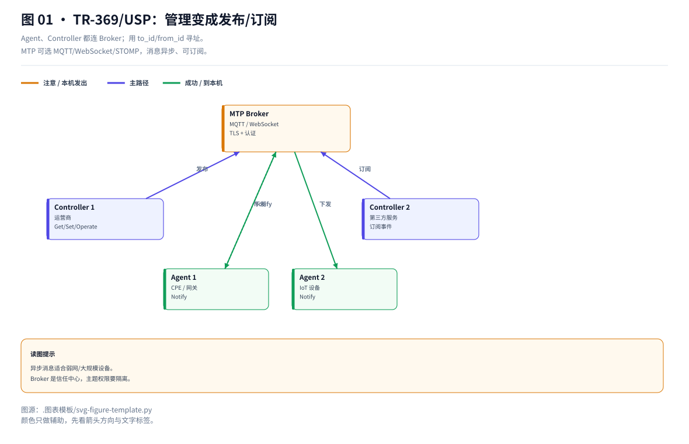

# TR-369

TR-369（USP，User Services Platform）是 TR-069 的下一代设备管理协议：不再用「CPE 连 ACS 发 SOAP」，而是把设备、控制器、应用都接到消息总线上，用发布/订阅和异步消息通信。

> 本篇定位：USP 的角色与消息总线、MTP、USP Record、常用消息、与 TR-069 的差异。具体数据模型与厂商实现不在本篇展开。

## 目录

- [1 一句话模型](#s1)
- [2 速览](#s2)
- [3 报文与消息](#s3)
- [4 交互流程](#s4)
- [5 状态与定时器](#s5)
- [6 设计取舍与边界](#s6)
- [7 与相邻协议的关系](#s7)
- [8 参考与关联](#s8)

## 1 · 一句话模型：设备管理变成消息总线

```text
Agent（设备） ──publish/subscribe──► MTP Broker（MQTT/WebSocket/STOMP） ◄── Controller（控制器）
```

三个关键认知：

1. **USP 把「管理」抽象成消息**：Get/Set/Notify/Operate，不再绑定 HTTP RPC 会话。
2. **MTP（Message Transport Protocol）可换**：MQTT、WebSocket、STOMP，按部署环境选。
3. **控制器和 Agent 解耦**：一个 Agent 可以接多个控制器，控制器也能管理大量设备。

## 2 · 速览

| 项 | 内容 |
| --- | --- |
| 所属层 | 应用层 |
| 角色 | Agent（设备侧）、Controller（管理侧）、Broker（消息中转） |
| 传输 | MQTT、WebSocket、STOMP（MTP） |
| 编码 | Protobuf（USP Record 的 payload） |
| 核心消息 | Get、Set、Add、Delete、Operate、Notify、Response、Error |
| 数据模型 | USP Data Model（路径 + 参数 + 对象） |
| 安全 | TLS、证书、消息级安全 |
| 主要规范 | TR-369（USP）、TR-369 Data Model |
| 典型场景 | 家庭网关、Wi-Fi Mesh、IPTV、物联网设备管理 |

## 3 · 报文与消息

### 3.1 USP Record

USP 消息在 MTP 之上包一层 Record：

| 字段 | 作用 |
| --- | --- |
| version | USP 版本 |
| to_id / from_id | 端点标识（Agent/Controller） |
| payload | 序列化的消息（Protobuf） |
| payload_security | 明文/加密/签名 |
| mac_signature | 完整性校验 |

Record 负责寻址与安全，payload 负责具体操作。

### 3.2 消息类型

| 消息 | 方向 | 作用 |
| --- | --- | --- |
| Get | Controller → Agent | 读参数 |
| GetSupportedDM | Controller → Agent | 查支持的数据模型 |
| GetInstances | Controller → Agent | 查对象实例 |
| Set | Controller → Agent | 写参数 |
| Add / Delete | Controller → Agent | 增删对象实例 |
| Operate | Controller → Agent | 执行命令（重启、测速等） |
| Notify | Agent → Controller | 事件/状态变化 |
| Response | 双向 | 成功结果 |
| Error | 双向 | 错误码与描述 |

### 3.3 路径与表达式

USP 用路径定位参数，支持通配和搜索表达式：

```text
Device.WiFi.SSID.1.SSID
Device.WiFi.SSID.*.SSID
Device.WiFi.SSID.[SSID=="home"].Enable
```

这比 TR-069 的逐级 GetParameterNames 更灵活，减少往返。

### 3.4 MTP

| MTP | 特点 | 适用 |
| --- | --- | --- |
| MQTT | 轻量、发布/订阅、QoS、广泛生态 | 大规模 IoT/CPE |
| WebSocket | 浏览器友好、双向、易穿透 | Web 管理、轻量部署 |
| STOMP | 简单文本协议、消息中间件 | 企业集成 |

MTP 只负责传输，USP 负责消息语义；换 MTP 不影响管理逻辑。

## 4 · 交互流程



**读图**：Agent 和 Controller 都连 Broker，用发布/订阅与 to_id/from_id 通信；MTP 可换 MQTT/WebSocket。

> 图源：`images/图01-TR-369消息总线.svg`

### 4.1 Agent 上线

```text
Agent → Broker：连接（TLS + 证书）
Agent → Broker：发布 Notify（上线、版本、能力）
Controller → Broker：订阅 Agent 的 topic
Controller → Agent：Get/Set/Operate
Agent → Controller：Response/Error
```

### 4.2 事件订阅

Controller 可以订阅 Agent 的事件（如「WAN 断开」「Wi-Fi 客户端上线」）。事件发生时 Agent 发 Notify，不需要 Controller 轮询。这是 USP 相对 TR-069 的最大改进之一。

### 4.3 多控制器

一个 Agent 可以同时被多个 Controller 管理（如运营商 + 第三方服务），通过 to_id/from_id 区分。权限和角色由 Agent 的控制器配置决定。

### 4.4 批量与异步

USP 支持批量消息、异步响应；Controller 发一条请求后可以做别的事，Response 到了再处理。适合大规模、慢设备、弱网环境。

### 4.5 异常分支

| 异常 | 表现 | 原因 |
| --- | --- | --- |
| 连不上 Broker | Agent 一直离线 | 地址/端口错、TLS 证书失败、网络不通 |
| 消息无响应 | 请求超时 | MQTT QoS 低、Broker 丢消息、Agent 忙 |
| 权限拒绝 | Error 码 | 控制器无权限、路径不在视图内 |
| 路径不存在 | Error | 数据模型版本不匹配、实例已删除 |
| 事件丢失 | 状态不同步 | 订阅未建立、QoS 0、Broker 重启 |
| 多控制器冲突 | 配置互相覆盖 | 权限/角色设计不清 |

## 5 · 状态与定时器

| 项 | 说明 |
| --- | --- |
| MQTT 会话 | clean session / persistent session，决定离线消息 |
| QoS | 0 最多一次、1 至少一次、2 恰好一次 |
| Keepalive | MQTT 心跳，检测连接存活 |
| 订阅 | Controller 订阅 Agent 的事件/响应 topic |
| 请求超时 | Controller 侧等待 Response 的时限 |
| Agent 重连 | 断线后按退避重连 Broker |

USP 本身没有「会话状态机」，状态在 MTP 连接、订阅、请求上下文里。

## 6 · 设计取舍与边界

### 6.1 异步 vs 同步 RPC

TR-069 是同步 RPC：一个 HTTP 会话里完成请求/响应。USP 是异步消息：请求和响应可以分开，适合弱网、慢设备、大规模并发。代价是状态管理更复杂，排障要看 Broker/消息链路。

### 6.2 MQTT 的优势与代价

MQTT 轻量、支持发布/订阅和 QoS，适合海量设备；但需要 Broker、要考虑离线消息/会话保持/主题权限。WebSocket 更简单，但大规模扩展不如 MQTT。

### 6.3 数据模型仍然复杂

USP 沿用并扩展了 TR-181 的数据模型，路径表达式更灵活，但「参数语义」仍然要按模型定义。厂商私有参数、模型版本差异依旧存在。

### 6.4 安全边界

- MTP 必须 TLS，双向证书认证。
- Record 级签名/加密，防中间人/篡改。
- Controller 权限按角色/视图限制，避免越权。
- Broker 是信任中心，要防未授权订阅/发布。

### 6.5 与 TR-069 的迁移

TR-069 存量大、生态成熟；TR-369 更适合新部署、事件驱动、多控制器场景。迁移通常不是「替换」，而是「共存 + 逐步接入」，网关可能同时支持 CWMP 和 USP。

## 7 · 与相邻协议的关系

| 相邻对象 | 关系 |
| --- | --- |
| TR-069 | 上一代 CPE 管理，HTTP/SOAP + 同步 RPC |
| MQTT/WebSocket/STOMP | USP 的 MTP 承载 |
| TLS | 传输安全与双向认证 |
| Protobuf | USP 消息编码 |
| OMA DM | 另一套设备管理，SyncML 承载 |
| 数据模型 | TR-181/USP Data Model 定义参数语义 |

一句话：**TR-369 负责「把设备管理变成可订阅、可异步的消息」，不负责「定义所有参数语义」，也不保证「Broker 一定可靠」。**

## 8 · 参考与关联

**标准**

- TR-369：User Services Platform（USP）
- TR-369 Data Model
- TR-181：Device Data Model
- MQTT 3.1.1 / 5.0
- RFC 6455：WebSocket

**关联**

- [00-应用层概览.md](./00-应用层概览.md)
- [07-TR-069.md](./07-TR-069.md)：CWMP 对照
- [09-OMA-DM.md](./09-OMA-DM.md)：另一套管理协议
- [04-HTTP.md](./04-HTTP.md)：WebSocket 的握手基础
- 40-产品与方案：USP 在网关/Mesh 的落地

---

> **本篇定位**：TR-369/USP 的角色、MTP、USP Record、消息类型与多控制器模型，以及与 TR-069 的差异。
> **素材来源**：`studyspace/3.协议应用/7.tr369/记录.md`（占位），按 TR-369/USP 规范与 MQTT 资料补写。
> **待验证**：MTP 选型、Broker 部署、数据模型版本与厂商实现差异较大。
