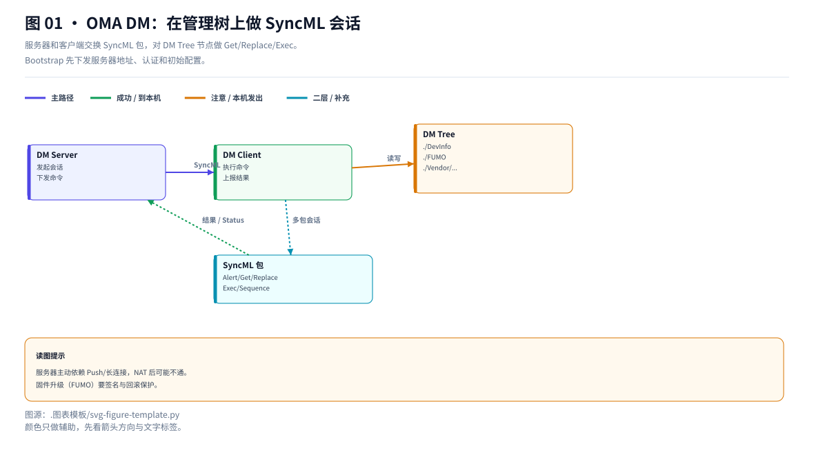
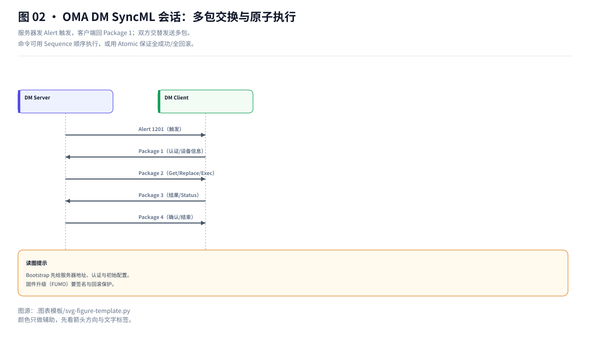
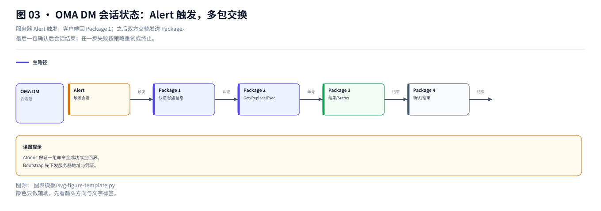

# OMA DM

OMA DM 是移动设备管理的老牌标准：服务器和设备通过 SyncML 交换「管理树」上的节点，完成配置、固件升级、锁定/擦除等操作。

> 本篇定位：DM 树、SyncML 会话、常用命令、Bootstrap 与安全边界。TR-069/TR-369 只做对照。

## 目录

- [1 一句话模型](#s1)
- [2 速览](#s2)
- [3 报文与树](#s3)
- [4 交互流程](#s4)
- [5 状态与定时器](#s5)
- [6 设计取舍与边界](#s6)
- [7 与相邻协议的关系](#s7)
- [名词解释](#名词解释)
- [8 参考与关联](#s8)

## 1 · 一句话模型：管理一棵树

```text
DM Server ──SyncML（HTTP/OBEX）──► DM Client（设备）
                │
                └─ 操作 DM Tree 上的节点：
                   Get / Replace / Exec / Add / Delete
```

三个关键认知：

1. **管理对象是一棵树**（DM Tree），每个节点有 URI、类型、权限、值。
2. **SyncML 是承载语法**，DM 是在 SyncML 上定义的一套管理命令与树模型。
3. **服务器可以主动发起**（通过 Push/Alert 或长连接），也可以设备主动上报。

## 2 · 速览

| 项 | 内容 |
| --- | --- |
| 所属层 | 应用层 |
| 承载 | SyncML over HTTP/HTTPS、OBEX、WAP Push |
| 数据模型 | DM Tree（管理对象树） |
| 关键命令 | Alert、Get、Replace、Exec、Add、Delete、Sequence、Atomic |
| 标识 | IMEI/IMSI/设备 ID、服务器 ID |
| 引导 | Bootstrap（服务器地址、认证、初始配置） |
| 主要规范 | OMA DM 1.2 / 2.0、SyncML 1.2 |
| 典型场景 | 移动终端管理、FOTA、企业设备策略 |

## 3 · 报文与树

### 3.1 SyncML 包

一个 DM 会话由多个 SyncML 包组成，包体是 XML：

```xml
<SyncML>
  <SyncHdr>
    <VerDTD>1.2</VerDTD>
    <VerProto>DM/1.2</VerProto>
    <SessionID>1</SessionID>
    <MsgID>1</MsgID>
    <Target><LocURI>device-id</LocURI></Target>
    <Source><LocURI>server-id</LocURI></Source>
  </SyncHdr>
  <SyncBody>
    <Alert>
      <CmdID>1</CmdID>
      <Data>1201</Data>  <!-- 服务器发起的会话 -->
    </Alert>
    <Get>
      <CmdID>2</CmdID>
      <Item><Target><LocURI>./DevInfo/DevId</LocURI></Target></Item>
    </Get>
    <Final/>
  </SyncBody>
</SyncML>
```

### 3.2 常用命令

| 命令 | 作用 |
| --- | --- |
| Alert | 会话触发/通知，如 1201 服务器发起、1226 客户端发起 |
| Get | 读节点值 |
| Replace | 写节点值 |
| Exec | 执行节点上的操作（如重启、FOTA） |
| Add / Delete | 增删节点 |
| Sequence | 按顺序执行一组命令 |
| Atomic | 原子执行，要么全成功要么全回滚 |

### 3.3 DM Tree

DM Tree 的根通常是 `.`，节点用 URI 表示：

```text
./DevInfo/DevId
./DevInfo/Man
./DevInfo/Mod
./DevInfo/SwV
./Vendor/...
./FUMO/...        （固件更新管理对象）
```

每个节点有：

- **格式**：chr、int、bool、node、bin 等。
- **权限**：Get/Replace/Exec 是否允许。
- **出现次数**：零次、一次、多次。
- **作用域**：永久/动态。

### 3.4 Bootstrap

设备第一次接入管理服务器前，需要知道：

- 服务器 URL。
- 认证方式（Basic/Digest、证书）。
- 初始 APN/代理/网络参数。
- 设备 ID 与服务器 ID。

Bootstrap 可以通过工厂预置、短信/WAP Push、二维码、DHCP 选项等方式下发。Bootstrap 配置本身要防篡改，否则设备会被引导到恶意服务器。

## 4 · 交互流程



**读图**：左边是会话（Package 可多包往返），右边是它操作的 DM 树；会话断了下次接着做，树里的状态才是最终结果。

> 图源：`images/图01-OMA-DM会话与DM树.svg`

### 4.1 服务器发起（Server-Initiated）



**读图**：Alert 触发后双方交替发多包；Sequence 顺序执行，Atomic 保证全成功或全回滚。

> 图源：`images/图02-OMA-DM-SyncML会话.svg`


```text
服务器 → 设备：Push/Alert（触发 DM 会话）
设备 → 服务器：建立 SyncML 会话（Package 1）
服务器 → 设备：下发命令（Get/Replace/Exec）
设备 → 服务器：返回结果（Package 2）
服务器 → 设备：确认/继续（Package 3）
设备 → 服务器：最终结果（Package 4）
```

### 4.2 设备发起（Client-Initiated）

设备按计划或事件（如开机、漫游、错误）主动发起会话，上报状态或拉取配置。适合 NAT/防火墙后的设备。

### 4.3 典型操作

| 场景 | 命令序列 |
| --- | --- |
| 读设备信息 | Get ./DevInfo/* |
| 配置 APN | Replace ./Vendor/APN/... |
| 固件升级 | Exec ./FUMO/DownloadAndUpdate |
| 锁屏/擦除 | Exec ./DMAcc/... 或厂商节点 |
| 恢复出厂 | Exec ./DevDetail/... |

### 4.4 异常分支

| 异常 | 表现 | 原因 |
| --- | --- | --- |
| 会话建不起来 | 设备无响应 | Push 未送达、URL/认证错、网络不通 |
| 401/407 | 认证失败 | 凭证不匹配、Bootstrap 过期 |
| 404 | 节点不存在 | DM Tree 版本不匹配、路径错 |
| 命令失败 | Status 非 200 | 权限不足、值越界、依赖未满足 |
| 会话中断 | 部分命令生效 | 未用 Atomic、网络中断 |
| 固件升级失败 | 版本不变/变砖 | 包校验失败、电量不足、分区问题 |

## 5 · 状态与定时器



**读图**：Alert 触发后双方交替发 Package 1/2/3/4，每个 Package 都是一次 HTTP 往返；失败按策略重试或终止会话。

> 图源：`images/图03-OMA-DM会话状态.svg`


| 项 | 说明 |
| --- | --- |
| 会话状态 | 建立、认证、命令交换、结束 |
| 重试 | 服务器/设备按策略重发 |
| 会话超时 | 防止半开会话占用资源 |
| 大对象传输 | 分块/断点续传（视实现） |
| 定期上报 | 设备按策略主动发起 |
| Bootstrap 有效期 | 凭证/配置可能过期，需要更新 |

OMA DM 的会话是「短会话 + 多包」，状态主要在会话上下文里，不依赖长连接。

## 6 · 设计取舍与边界

### 6.1 树模型的优点与代价

树模型直观、可扩展，适合「配置项 + 对象实例」的管理；但路径/权限/版本复杂，跨厂商节点定义不统一，容易出现「同一个功能不同路径」。

### 6.2 SyncML 的重量

SyncML 是 XML，报文冗长、解析开销大。移动网络带宽有限时，要考虑压缩、批量、增量同步。现代部署更倾向轻量协议/JSON。

### 6.3 服务器主动 vs 设备主动

服务器主动依赖 Push/长连接，NAT 后可能不通；设备主动更适合受限网络，但实时性差。实际部署常混合：关键操作靠 Push，状态上报靠设备主动。

### 6.4 安全边界

- 传输必须 HTTPS/OBEX over TLS。
- 认证用 Digest/证书，Bootstrap 要防篡改。
- 命令要鉴权，敏感操作（擦除、锁屏）要二次确认/审计。
- 固件要签名校验，防降级。

### 6.5 与 TR-069/TR-369 的差异

| 对比项 | OMA DM | TR-069 | TR-369 |
| --- | --- | --- | --- |
| 模型 | DM Tree | 参数树（TR-098/181） | USP Data Model |
| 承载 | SyncML/HTTP/OBEX | HTTP/SOAP | MQTT/WebSocket |
| 主要领域 | 移动终端 | 家庭网关/CPE | 下一代 CPE/IoT |
| 实时性 | 中 | 低（周期/触发） | 高（事件驱动） |

## 7 · 与相邻协议的关系

| 相邻对象 | 关系 |
| --- | --- |
| HTTP/HTTPS | SyncML 的常见承载 |
| XML | SyncML 报文编码 |
| WAP Push | 服务器主动触发会话 |
| FOTA | 固件升级管理对象 |
| TR-069/TR-369 | 同类设备管理协议，模型/承载不同 |
| 运营商网管 | 设备注册、策略下发、诊断 |

一句话：**OMA DM 负责「按树读写设备管理对象」，不负责「定义所有厂商节点」，也不保证「Push 一定送达」。**

## 名词解释

> 缩写给出英文全称；非缩写用“—”表示。

| 术语 | 英文全称 | 解释 |
| --- | --- | --- |
| OMA DM | Open Mobile Alliance Device Management | 移动设备管理标准。 |
| SyncML | Synchronization Markup Language | 同步标记语言，DM 的承载。 |
| DM Tree | Device Management Tree | 管理对象树。 |
| Bootstrap | — | 首次配置引导。 |
| Alert | — | 会话触发报文。 |
| Package | — | SyncML 会话包。 |
| Atomic/Sequence | — | 原子执行/顺序执行。 |
| FUMO | Firmware Update Management Object | 固件更新管理对象。 |
| OBEX | Object Exchange | 对象交换承载。 |
| WAP Push | Wireless Application Protocol Push | 推送触发。 |

## 8 · 参考与关联

**标准**

- OMA Device Management 1.2 / 2.0
- OMA SyncML 1.2
- OMA DM Tree and Description
- OMA FUMO（固件更新管理对象）

**关联**

- [00-应用层概览.md](./00-应用层概览.md)
- [07-TR-069.md](./07-TR-069.md)：CPE 管理对照
- [08-TR-369.md](./08-TR-369.md)：USP 对照
- [04-HTTP.md](./04-HTTP.md)：SyncML 承载
- 30-产品与方案：终端管理落地

---

> **本篇定位**：OMA DM 的 DM Tree、SyncML 会话、常用命令、Bootstrap 与安全边界。
> **素材来源**：`studyspace/3.协议应用/11.oma dm/OMA DM.md`、`OMA DM TS.md`（规范摘录），按 OMA DM/SyncML 规范重写为工程视角。
> **待验证**：厂商 DM Tree 节点、Bootstrap 方式、FUMO 实现差异较大。
