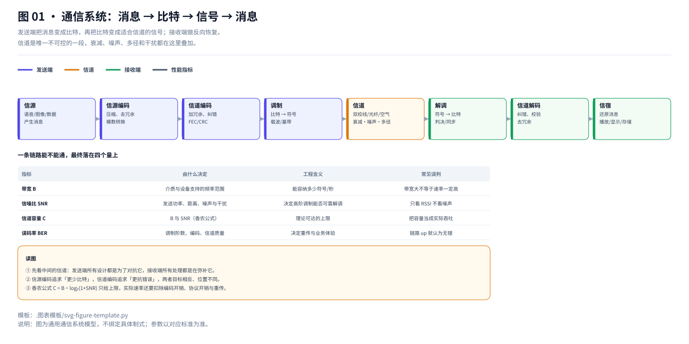

# 通信系统与性能指标

通信系统只做一件事：把信源的消息可靠地搬到信宿。发送端负责“变成适合信道的信号”，信道负责“把信号弄脏”，接收端负责“从脏信号里把消息捞回来”。

> 本篇定位：建立通信系统的通用模型和四个核心指标（带宽、信噪比、容量、误码率），不绑定任何具体制式。以太网 PHY、PON、Wi-Fi、LTE/5G 的细节分别去 02/03/04 看。

## 目录

- [1 一句话模型](#s1)
- [2 速览](#s2)
- [3 系统组成与职责](#s3)
- [4 发送与接收流程](#s4)
- [5 状态机与定时器](#s5)
- [6 设计取舍与边界](#s6)
- [7 与相邻主题的关系](#s7)
- [名词解释](#名词解释)
- [8 参考与关联](#s8)

## 1 · 一句话模型：消息 → 比特 → 信号 → 消息

```text
信源 → 信源编码 → 信道编码 → 调制 → 信道 → 解调 → 信道解码 → 信源解码 → 信宿
                                      ↑
                                 衰减·噪声·多径·干扰
```

三个关键认知：

1. **信源编码和信道编码目标相反**：前者去掉冗余、让比特更少；后者加入冗余、让比特更抗错。两者不能互相替代。
2. **调制解决“怎么把比特放进有限的频率资源”**，解调解决“在噪声里怎么判回比特”。调制阶数越高，越依赖高信噪比。
3. **所有性能指标最终都落在四个量上**：带宽 B、信噪比 SNR、信道容量 C、误码率 BER。工程问题先定位到这四个量，再谈具体制式。

## 2 · 速览

| 项 | 内容 |
| --- | --- |
| 所属领域 | 通信原理（跨有线、光、无线） |
| 核心对象 | 消息、比特、符号、信号、信道 |
| 关键指标 | 带宽、SNR、容量、误码率、时延、吞吐 |
| 典型环节 | 信源编码、信道编码、调制、信道、解调、解码 |
| 主要标准 | ITU-T 通用术语、IEEE 802、3GPP 38 系列 |
| 与网络的关系 | 通信系统提供“比特管道”，网络协议决定“怎么用这条管道” |

## 3 · 系统组成与职责

每个模块只回答一个问题。把职责分清，排障时就不会把“编码问题”误判成“信号问题”。

| 模块 | 回答什么问题 | 典型手段 | 作用 | 边界与误判 |
| --- | --- | --- | --- | --- |
| 信源 | 消息从哪来 | 麦克风、摄像头、传感器、应用数据 | 产生原始信息 | 信源质量差，后面无法凭空恢复 |
| 信源编码 | 怎样用更少比特表示消息 | 采样、量化、压缩（PCM、AAC、H.264） | 去冗余，降低比特率 | 有损压缩不可逆；压缩比越高，画质/音质越差 |
| 信道编码 | 怎样让比特抗错误 | CRC、卷积码、Turbo、LDPC、Polar | 加冗余、检错/纠错 | 编码增益用带宽和时延换；不能修复超出能力的错误 |
| 调制 | 比特怎样变成波形 | ASK/FSK/PSK/QAM、OFDM、扩频 | 适配信道频率与功率 | 高阶调制需要更高 SNR；不是“越高级越好” |
| 信道 | 信号经过什么 | 双绞线、同轴、光纤、空气 | 传输信号 | 衰减、噪声、多径、干扰都在这里叠加 |
| 解调 | 波形怎样判回符号 | 相干/非相干检测、同步、均衡 | 从含噪波形恢复符号 | 同步失步时，后面全错 |
| 信道解码 | 错误怎样被发现和纠正 | 维特比、BP、列表译码 | 纠错、检错 | 纠错能力有上限；坏帧仍会丢 |
| 信源解码 | 比特怎样还原消息 | 解压、数模转换 | 还原业务内容 | 前面丢包/误码会直接体现为花屏、卡顿 |

> **一个容易混淆的边界**：CRC 属于信道编码里的“检错”，不是“纠错”。收到 CRC 错的帧，链路层通常直接丢弃并依赖重传，而不是原地修复。

## 4 · 发送与接收流程

### 4.1 正常路径



**读图**：从左到右是发送链，从右到左是接收链；中间的信道是唯一不可控的一段。下面四个指标分别对应“管道多宽、信号多强、理论多快、出错多少”。

> 图源：`images/图01-通信系统模型.svg`

```text
发送：
  消息 → 采样/量化/压缩 → 加 CRC/FEC → 调制 → 上变频/驱动 → 介质

接收：
  介质 → 前端放大/滤波 → 同步 → 解调 → 信道解码 → 解压 → 消息
```

### 4.2 异常分支：信道变差时会发生什么

信道不会一直稳定。以无线链路为例，SNR 下降后系统通常按下面的顺序“降级”：

| 阶段 | 系统动作 | 用户看到的现象 | 设计意图 |
| --- | --- | --- | --- |
| SNR 轻微下降 | 降低调制阶数/码率（MCS 回退） | 速率下降，但连接不断 | 用速率换可靠性 |
| SNR 继续下降 | 重传次数增加（ARQ/HARQ） | 时延抖动、吞吐下降 | 用时间换正确性 |
| 错误超出纠错能力 | 丢帧/丢包，上层重传 | 卡顿、花屏、TCP 降速 | 把不可靠暴露给上层 |
| 同步彻底失败 | 链路重建/切换 | 断网、重新连接 | 止损，避免无效传输 |

> **关键结论**：通信系统不是“要么通、要么断”，大多数时间工作在“降速但可用”的中间态。判断故障时，先看它处在哪一档，而不是只看“通不通”。

## 5 · 状态机与定时器

本主题是通用模型，**没有连接状态机**。具体制式才有状态与定时器：

- 以太网自协商有链路训练与稳定定时器；
- Wi-Fi 有扫描、认证、关联、四次握手；
- LTE/5G 有 RRC 空闲/连接/非激活状态、TA 定时器、HARQ RTT 定时器。

通用层面只有两个“时间尺度”需要记住：

| 时间尺度 | 典型量级 | 影响 |
| --- | --- | --- |
| 符号/时隙 | 微秒级 | 调制、同步、CP 长度 |
| 帧/调度周期 | 毫秒级 | 调度、HARQ、语音时延 |
| 连接/会话 | 秒到分钟 | 鉴权、地址租期、休眠 |

## 6 · 设计取舍与边界

### 6.1 模拟与数字

模拟传输连续、实现简单，但噪声会逐级累积，难以再生；数字传输可以把“判决 + 再生”串起来，噪声只影响误码率，不影响波形累积。代价是采样、量化、同步和带宽开销。现代通信系统几乎都采用“数字基带 + 模拟射频/光前端”的混合结构。

### 6.2 带宽与功率

香农公式给出上限：

```text
C = B · log₂(1 + SNR)
```

- 增加带宽 B：容量近似线性增长，但频谱是稀缺资源。
- 增加功率：SNR 提升，容量按对数增长，收益递减，还会带来干扰和功耗。
- 所以工程上更愿意用“更好的编码/更多天线/更近的距离”换容量，而不是一味加大功率。

### 6.3 编码与重传

| 策略 | 优点 | 代价 | 适用 |
| --- | --- | --- | --- |
| FEC 前向纠错 | 不需要反馈，时延稳定 | 固定带宽开销 | 实时业务、单向链路 |
| ARQ 重传 | 只在出错时开销 | 时延抖动，需要反馈 | 数据业务、可容忍时延 |
| HARQ 混合 | 兼顾纠错与重传 | 实现复杂 | 蜂窝、Wi-Fi 高速链路 |

### 6.4 常见误判

1. **把信号强度当成链路质量**：RSSI 高只说明“收到得强”，不代表噪声低、不代表没有干扰。要看 SNR/SINR。
2. **把带宽当成吞吐**：带宽是频率资源，吞吐还要扣除编码开销、协议头、竞争与重传。
3. **把理论容量当成实际速率**：香农容量是上限，实际系统受调制阶数、编码、导频、调度限制。
4. **把“链路 up”当成“业务通”**：链路只证明物理与协商就绪，地址、路由、认证任何一层都可能断。
5. **把误码当成“设备坏了”**：先区分是功率不足、噪声过大、还是干扰/多径，三类问题的处理方式完全不同。

## 7 · 与相邻主题的关系

| 相邻主题 | 关系 |
| --- | --- |
| [11-网络科学/01-物理层](../../11-网络科学/01-物理层/00-物理层概览.md) | 网络视角的物理层职责与 PHY-MAC 边界；本篇讲通信系统内部 WHY |
| [01-调制与编码](./01-调制与编码.md) | 把“比特 → 符号 → 波形”展开 |
| [02-多址与双工](./02-多址与双工.md) | 多个用户如何共享同一套通信系统 |
| [03-信道与传输损伤](./03-信道与传输损伤.md) | 信道这一段的损伤模型与链路预算 |
| [02-有线通信](../02-有线通信/.readme.md) | 双绞线/同轴/光纤的介质与 PHY 实现 |
| [03-光通信](../03-光通信/.readme.md) | 光功率预算与 PON 系统 |
| [04-无线通信](../04-无线通信/.readme.md) | 射频、天线、Wi-Fi、蜂窝 |

一句话：**本篇给“通信系统”的通用骨架，后面三个子目录分别把骨架填上有线、光、无线的血肉。**

## 名词解释

> 缩写给出英文全称；非缩写用“—”表示。

| 术语 | 英文全称 | 解释 |
| --- | --- | --- |
| 信源 | Source | 产生原始消息的实体。 |
| 信宿 | Sink | 最终接收并还原消息的实体。 |
| 信源编码 | Source Coding | 压缩与去冗余，降低比特率。 |
| 信道编码 | Channel Coding | 加冗余以检错/纠错。 |
| 调制 | Modulation | 把比特映射成载波的幅度/相位/频率。 |
| 解调 | Demodulation | 从含噪波形恢复符号与比特。 |
| SNR | Signal-to-Noise Ratio | 信号功率与噪声功率之比，常用 dB 表示。 |
| SINR | Signal-to-Interference-plus-Noise Ratio | 信号与“干扰 + 噪声”之比，无线里更常用。 |
| BER | Bit Error Rate | 误比特率，错误比特占总比特的比例。 |
| FEC | Forward Error Correction | 前向纠错，收端直接纠错，不需要重传。 |
| ARQ | Automatic Repeat reQuest | 自动重传请求，出错后由发送端重发。 |
| HARQ | Hybrid Automatic Repeat reQuest | 纠错与重传结合。 |
| MCS | Modulation and Coding Scheme | 调制与编码组合，链路自适应的调节对象。 |
| 香农公式 | Shannon–Hartley Theorem | C = B·log₂(1+SNR)，给出可靠传输的上限。 |

## 8 · 参考与关联

**标准与经典**

- Shannon, C. E., *A Mathematical Theory of Communication*, 1948.
- ITU-T G.701：数字传输与复用术语。
- IEEE 802.3：以太网物理层与链路层。
- 3GPP TS 38.211 / 38.212 / 38.214：NR 物理层、复用与信道编码、物理层过程。

**关联**

- [01-调制与编码](./01-调制与编码.md)
- [02-多址与双工](./02-多址与双工.md)
- [03-信道与传输损伤](./03-信道与传输损伤.md)
- [11-网络科学/00-网络分层与模型](../../11-网络科学/00-网络分层与模型.md)
- [20-平台与系统/21-Linux](../../../20-平台与系统/21-Linux/.readme.md)

---

> **本篇定位**：通信系统的通用模型与指标，不绑定制式；具体系统实现见 02/03/04。
> **素材来源**：`studyspace/1.知识体系/1.计算机网络/m-6-无线网络和移动网络.md` 的概念框架；其余按公开通信原理与标准知识补写。
> **待验证**：具体容量、时延、误码率数字随制式、带宽、信道条件变化，工程取值以实测和对应标准为准。
