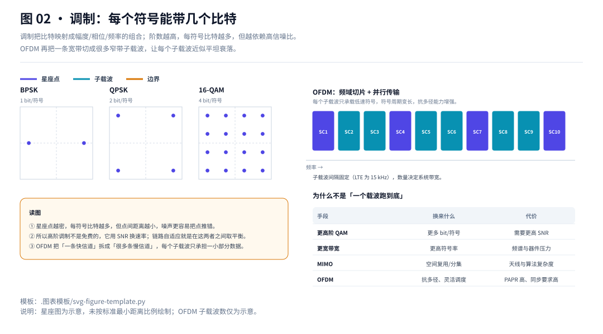

# 调制与编码

调制解决“一个符号能带几个比特”，编码解决“这些比特错了能不能被发现和纠正”。前者决定频谱效率，后者决定可靠性，两者一起构成链路自适应（MCS）的两个旋钮。

> 本篇定位：基带/频带调制、星座图、OFDM、线路编码与 FEC 的通用原理。Wi-Fi 的 MCS 表、LTE/NR 的物理层过程分别去 04 看；以太网的具体编码去 02 看。

## 目录

- [1 一句话模型](#s1)
- [2 速览](#s2)
- [3 调制方式与星座](#s3)
- [4 从比特到波形](#s4)
- [5 状态机与定时器](#s5)
- [6 设计取舍与边界](#s6)
- [7 与相邻主题的关系](#s7)
- [名词解释](#名词解释)
- [8 参考与关联](#s8)

## 1 · 一句话模型：比特 → 符号 → 波形

```text
比特流 → 加扰 → 信道编码 → 调制映射 → 资源映射 → OFDM/脉冲成形 → 射频/光前端
                                   ↑
                          星座图决定每符号比特数
```

三个关键认知：

1. **调制阶数与可靠性是一对矛盾**：BPSK 最抗噪但每符号只带 1 bit，256-QAM 每符号带 8 bit，却需要高得多的 SNR。
2. **编码增益不是免费的**：FEC 用冗余换纠错能力，表现为“同样 SNR 下误码率更低”，代价是带宽或时延。
3. **OFDM 不是一种调制，而是一种复用/传输方式**：每个子载波上仍然可以用 QPSK、16-QAM 等调制。

## 2 · 速览

| 项 | 内容 |
| --- | --- |
| 所属领域 | 通信原理 |
| 核心对象 | 比特、符号、星座点、子载波、码字 |
| 关键参数 | 调制阶数、码率、子载波间隔、CP 长度、PAPR |
| 常见调制 | ASK、FSK、PSK、QAM、OFDM、扩频 |
| 常见编码 | CRC、卷积码、Turbo、LDPC、Polar |
| 典型标准 | IEEE 802.11、IEEE 802.3、3GPP 38.211/38.212 |

## 3 · 调制方式与星座

### 3.1 基本调制方式

| 调制 | 改变什么 | 每符号比特 | 抗噪性 | 典型场景 | 边界 |
| --- | --- | --- | --- | --- | --- |
| ASK/OOK | 幅度 | 1 | 较差 | 光模块的简单调制、遥控 | 受幅度噪声影响大 |
| FSK | 频率 | 1 | 较好 | 蓝牙、低速遥控 | 占用带宽较大 |
| BPSK | 相位（2 点） | 1 | 最好 | 低 SNR 控制信道 | 频谱效率最低 |
| QPSK | 相位（4 点） | 2 | 好 | 导频、控制、低速数据 | 速率有限 |
| 16-QAM | 幅度+相位（16 点） | 4 | 中等 | 中高速数据 | 需要较高 SNR |
| 64-QAM | 幅度+相位（64 点） | 6 | 较差 | 高速数据 | 对相位噪声敏感 |
| 256-QAM | 幅度+相位（256 点） | 8 | 差 | 近距离高速 | 需要很好的信噪比与线性度 |
| 1024/4096-QAM | 幅度+相位 | 10/12 | 很差 | Wi-Fi 6/7 近距离 | 对 EVM、相位噪声极敏感 |

> **边界**：上表的“抗噪性”是相对排序，不是绝对门限。实际能否解调取决于目标误码率、编码方式、信道模型和接收机实现。

### 3.2 星座图怎么读

星座图把“一个符号”画成复平面上的一个点：横轴 I（同相），纵轴 Q（正交）。点越密，每符号能带的比特越多；点间距离越小，噪声越容易把点推过判决边界。



**读图**：左侧三个星座图分别是 BPSK、QPSK、16-QAM，点数越多，每符号比特越多；右侧是 OFDM 把一条宽带切成多个窄带子载波。图下方对比了提高速率的四种手段及代价。

> 图源：`images/图02-调制星座与OFDM.svg`

星座图上的三个量最实用：

| 量 | 含义 | 工程意义 |
| --- | --- | --- |
| 最小距离 d_min | 最近两个星座点的距离 | 越大越抗噪；给定功率下由调制阶数决定 |
| EVM | Error Vector Magnitude，误差矢量幅度 | 发射机/接收机的实际“星座模糊度” |
| PAPR | Peak-to-Average Power Ratio，峰均功率比 | OFDM 的固有缺点，影响功放效率 |

### 3.3 线路编码与信道编码不是一回事

| 类别 | 目的 | 例子 | 放在哪 |
| --- | --- | --- | --- |
| 线路编码 | 让接收端能恢复时钟、保持直流平衡 | 曼彻斯特、4B/5B、8B/10B、64B/66B | 物理层编码子层 |
| 信道编码 | 检错/纠错 | CRC、卷积码、Turbo、LDPC、Polar | 物理层信道编码链 |
| 信源编码 | 压缩 | PCM、AAC、H.264 | 业务/应用侧 |

线路编码关心“电平怎么跳”，信道编码关心“比特错了怎么办”。把 8B/10B 当成纠错码，是常见的概念混淆。

## 4 · 从比特到波形

### 4.1 发送链

```text
比特 → 加扰（随机化，避免长连 0/1）
     → 加 CRC（检错）
     → 信道编码（卷积/Turbo/LDPC/Polar）
     → 速率匹配（对齐物理资源）
     → 调制映射（QPSK/16-QAM/...）
     → 层映射/预编码（MIMO）
     → 资源映射（RE/PRB/子载波）
     → OFDM 调制（IFFT + CP）
     → 射频/光前端
```

接收端基本反向：同步 → FFT → 信道估计/均衡 → 解调（软判决）→ 解速率匹配 → 信道解码 → CRC 校验 → 解扰。

### 4.2 OFDM 的关键参数

| 参数 | 作用 | 取值变大时 | 取值变小时 |
| --- | --- | --- | --- |
| 子载波间隔 Δf | 决定符号周期与多普勒容忍度 | 符号变短，抗多普勒好，CP 开销大 | 符号变长，抗多径好，对频偏敏感 |
| CP 长度 | 吸收多径时延扩展 | 抗多径强，但频谱效率下降 | 效率高，但多径易造成 ISI |
| FFT 点数 | 决定带宽内的子载波数 | 带宽大、实现复杂 | 带宽小、粒度粗 |
| 调制阶数 | 每子载波比特数 | 速率高、抗噪差 | 速率低、抗噪好 |

LTE 固定 15 kHz 子载波间隔；NR 用参数集（numerology）支持 15/30/60/120 kHz，用“更灵活”换“更复杂”。

### 4.3 异常分支

| 异常 | 现象 | 原因 | 处理方向 |
| --- | --- | --- | --- |
| 相位噪声 | 高阶 QAM 误码升高、EVM 变差 | 本振不稳定、低成本晶振 | 降低阶数、改善本振、导频跟踪 |
| IQ 不平衡 | 星座图整体偏移/镜像 | 前端器件不一致 | 校准、数字预失真 |
| PAPR 过高 | 功放压缩、频谱再生 | OFDM 多子载波叠加 | 降低功率、削峰、DFT 扩展 |
| 同步失步 | 整帧解不出来 | 频偏/时偏超范围 | 加强同步序列、重新捕获 |
| 编码打孔过度 | 纠错能力不足 | 速率匹配过激进 | 降低码率、重传 |

## 5 · 状态机与定时器

本主题**没有连接状态机**，但有两个控制环需要理解：

| 控制环 | 输入 | 输出 | 时间尺度 |
| --- | --- | --- | --- |
| 链路自适应（AMC） | 信道质量指示（CQI）、误码/重传统计 | MCS（调制阶数 + 码率） | 毫秒到几十毫秒 |
| HARQ | 解码成功/失败 | ACK/NACK、重传/增量冗余 | 毫秒级 RTT |

AMC 是“慢环”，HARQ 是“快环”。AMC 判断长期信道质量，HARQ 兜底短期错误；两者配合，才能在信道波动时既不浪费容量，也不至于频繁丢包。

## 6 · 设计取舍与边界

### 6.1 高阶调制换速率

在给定带宽下，提高调制阶数是最直接的提速手段，但每提高一阶，星座点间距变小，需要更高的 SNR 和更好的前端线性度。工程上用“链路自适应”在速率和可靠性之间动态取平衡，而不是固定一个最高阶。

### 6.2 OFDM 与单载波

| 维度 | OFDM | 单载波（含 SC-FDMA） |
| --- | --- | --- |
| 抗多径 | 强（CP + 窄子载波） | 需要均衡 |
| PAPR | 高 | 低 |
| 调度粒度 | 频域细粒度 | 时域为主 |
| 实现复杂度 | FFT 复杂，均衡简单 | 均衡复杂 |
| 典型用途 | 下行、Wi-Fi、PON 下行 | LTE 上行、部分光接入 |

LTE 上行选 SC-FDMA，核心原因就是终端功放的 PAPR 和功率效率；NR 上行则同时支持 CP-OFDM 和 DFT-s-OFDM，按场景选择。

### 6.3 编码增益与代价

| 编码 | 纠错能力 | 时延 | 复杂度 | 典型用途 |
| --- | --- | --- | --- | --- |
| 卷积码 | 中 | 低 | 低 | 老式系统、控制信道 |
| Turbo | 强 | 中 | 中 | LTE 数据信道 |
| LDPC | 很强 | 中 | 高 | 5G NR 数据、Wi-Fi 6/7 |
| Polar | 强（短码） | 低 | 中 | 5G NR 控制信道 |

### 6.4 常见误判

1. **“QAM 阶数越高越先进”**：高阶只在近距离/高 SNR 下有效，远距离强行高阶只会增加重传。
2. **“编码率越低越可靠，所以一直用最低码率”**：低码率占更多资源，吞吐会下降；可靠性要用“满足业务目标”衡量。
3. **“OFDM 没有码间干扰”**：CP 只能吸收小于 CP 长度的多径，超出部分仍会 ISI。
4. **“EVM 好就一定解调得对”**：EVM 是发射质量，接收还受噪声、干扰、同步影响。
5. **“星座图点数 = 实际速率”**：实际速率还要乘码率、空间流、子载波数，并扣除导频/控制开销。

## 7 · 与相邻主题的关系

| 相邻主题 | 关系 |
| --- | --- |
| [00-通信系统与性能指标](./00-通信系统与性能指标.md) | 本篇是“调制/编码”两个模块的展开 |
| [02-多址与双工](./02-多址与双工.md) | 调制后的符号如何分配给多个用户 |
| [03-信道与传输损伤](./03-信道与传输损伤.md) | 噪声、多径、相位噪声如何限制调制阶数 |
| [02-有线通信/01-以太网PHY](../02-有线通信/01-以太网PHY与速率演进.md) | 线路编码（4B/5B、8B/10B、PAM4）的具体实现 |
| [03-光通信/02-光模块与SFP](../03-光通信/02-光模块与SFP.md) | 光模块的调制格式与 EVM/光功率关系 |
| [04-无线通信/03-蜂窝通信/01-LTE与NR物理层](../04-无线通信/03-蜂窝通信/01-LTE与NR物理层.md) | OFDMA、资源块、MCS 的具体系统参数 |

一句话：**调制决定“一个符号装多少”，编码决定“装错了怎么办”，多址决定“这辆车归谁用”。**

## 名词解释

> 缩写给出英文全称；非缩写用“—”表示。

| 术语 | 英文全称 | 解释 |
| --- | --- | --- |
| ASK | Amplitude Shift Keying | 幅移键控，用幅度表示比特。 |
| FSK | Frequency Shift Keying | 频移键控，用频率表示比特。 |
| PSK | Phase Shift Keying | 相移键控，用相位表示比特。 |
| QAM | Quadrature Amplitude Modulation | 正交幅度调制，同时用幅度与相位。 |
| BPSK | Binary Phase Shift Keying | 二相相移键控，每符号 1 bit。 |
| QPSK | Quadrature Phase Shift Keying | 四相相移键控，每符号 2 bit。 |
| OFDM | Orthogonal Frequency Division Multiplexing | 正交频分复用，多子载波并行传输。 |
| OFDMA | Orthogonal Frequency Division Multiple Access | 正交频分多址，OFDM 的多用户版本。 |
| CP | Cyclic Prefix | 循环前缀，吸收多径、保持子载波正交。 |
| FEC | Forward Error Correction | 前向纠错。 |
| CRC | Cyclic Redundancy Check | 循环冗余校验，检错不纠错。 |
| LDPC | Low-Density Parity-Check | 低密度奇偶校验码。 |
| Polar | Polar Code | 极化码，5G 控制信道采用。 |
| MCS | Modulation and Coding Scheme | 调制与编码组合。 |
| PAPR | Peak-to-Average Power Ratio | 峰均功率比。 |
| EVM | Error Vector Magnitude | 误差矢量幅度，衡量调制质量。 |
| AMC | Adaptive Modulation and Coding | 自适应调制编码。 |
| HARQ | Hybrid Automatic Repeat reQuest | 混合自动重传请求。 |

## 8 · 参考与关联

**标准与经典**

- Proakis, J. G., *Digital Communications*.
- 3GPP TS 38.211：NR 物理信道与调制。
- 3GPP TS 38.212：NR 复用与信道编码。
- 3GPP TS 38.214：NR 物理层数据传输过程。
- IEEE 802.11-2020：WLAN MAC 与 PHY。
- IEEE 802.3：以太网线路编码与 PAM4。

**关联**

- [00-通信系统与性能指标](./00-通信系统与性能指标.md)
- [02-多址与双工](./02-多址与双工.md)
- [03-信道与传输损伤](./03-信道与传输损伤.md)
- [04-无线通信/02-Wi-Fi](../04-无线通信/02-Wi-Fi/.readme.md)
- [02-有线通信](../02-有线通信/.readme.md)

---

> **本篇定位**：调制与编码的通用原理，重点在星座图、OFDM 参数和编码取舍；具体 MCS 表与物理层过程见各制式。
> **素材来源**：`studyspace/1.知识体系/9.lte5g相关/lte/lte-PHY.md` 的 OFDM/资源块/编码框架、`1.知识体系/1.计算机网络/m-6-无线网络和移动网络.md` 的 802.11 调制说明；其余按公开标准知识补写。
> **待验证**：各制式的具体调制阶数、码率、子载波间隔以对应标准版本为准。
