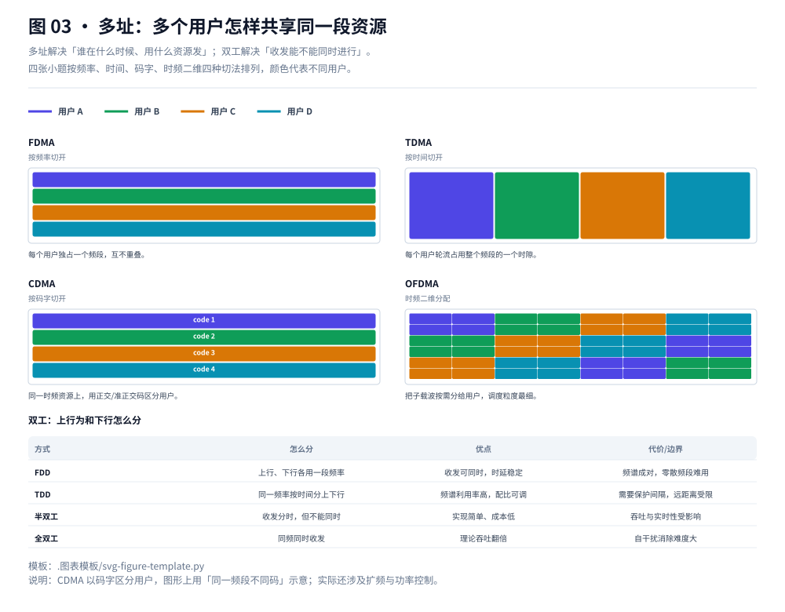
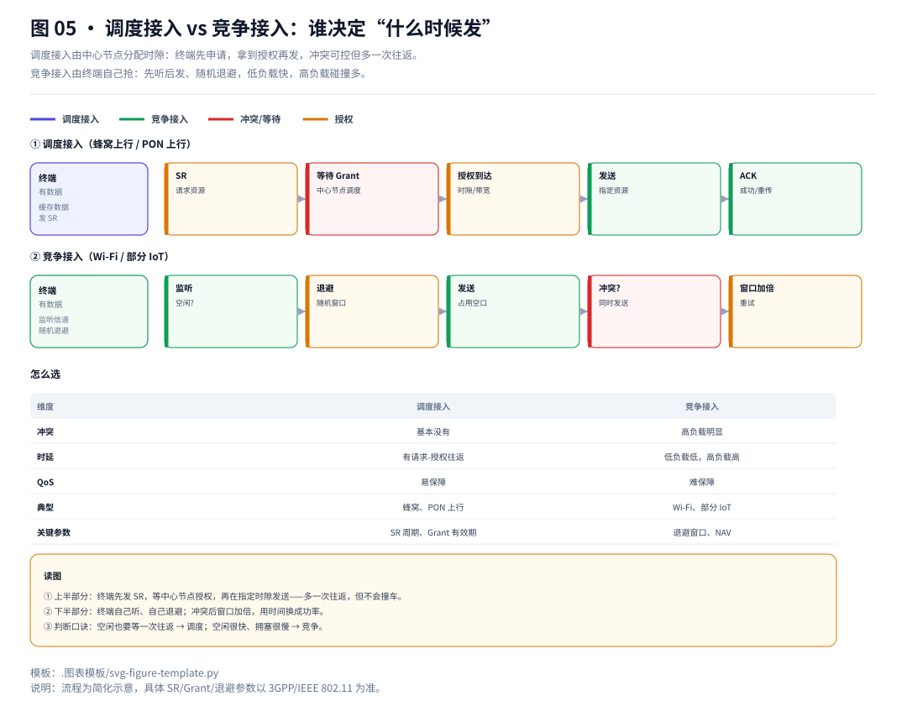

# 多址与双工

多址回答“多个用户怎样共享同一段频率、时间或码字”，双工回答“上行和下行能不能同时进行”。两者共同决定系统的资源利用率、时延特征和终端复杂度。

> 本篇定位：FDMA/TDMA/CDMA/OFDMA 四种多址、TDD/FDD 两种双工，以及竞争接入与调度接入的区别。Wi-Fi 的 CSMA/CA 细节去 04，蜂窝的调度与帧结构也去 04。

## 目录

- [1 一句话模型](#s1)
- [2 速览](#s2)
- [3 资源维度与多址方式](#s3)
- [4 接入流程：调度与竞争](#s4)
- [5 状态机与定时器](#s5)
- [6 设计取舍与边界](#s6)
- [7 与相邻主题的关系](#s7)
- [名词解释](#名词解释)
- [8 参考与关联](#s8)

## 1 · 一句话模型：把资源切成“谁都能用、但互不打架”的块

```text
一段频谱
  ├─ 按频率切 → FDMA
  ├─ 按时间切 → TDMA
  ├─ 按码字切 → CDMA
  └─ 按时频二维切 → OFDMA
```

三个关键认知：

1. **多址的本质是“正交化”**：让不同用户的信号在某个维度上互不重叠，接收端才能分离。
2. **正交资源有限，非正交就要付出干扰代价**：CDMA 用码字近似正交，靠功率控制抑制远近效应；OFDMA 用子载波正交，靠调度避免碰撞。
3. **双工方式决定上下行是否能同时**：FDD 用成对频率，TDD 用时间片；前者时延稳定，后者频谱灵活。

## 2 · 速览

| 项 | 内容 |
| --- | --- |
| 所属领域 | 通信原理 |
| 核心对象 | 频率、时隙、码字、子载波、空间流 |
| 关键参数 | 带宽、时隙长度、扩频因子、子载波间隔、上下行配比 |
| 常见多址 | FDMA、TDMA、CDMA、OFDMA、SDMA（MIMO） |
| 双工方式 | FDD、TDD、半双工、全双工 |
| 典型标准 | 3GPP 38.211/38.213、IEEE 802.11、ITU-T G.984 |

## 3 · 资源维度与多址方式

### 3.1 四种基本切法

| 多址 | 切哪个维度 | 用户间靠什么区分 | 优点 | 代价/边界 |
| --- | --- | --- | --- | --- |
| FDMA | 频率 | 不同频段 | 实现简单、连续传输 | 频谱碎片化、每用户带宽固定 |
| TDMA | 时间 | 不同时隙 | 共享同一频段、便于调度 | 需要同步、突发性强 |
| CDMA | 码字 | 不同扩频码 | 抗干扰、软容量 | 远近效应、功率控制复杂 |
| OFDMA | 时间 + 频率 | 不同子载波/时隙 | 调度粒度细、抗多径 | 同步要求高、PAPR 高 |
| SDMA | 空间 | 波束/空间流 | 频谱复用 | 依赖天线与信道估计 |

> **一个常见混淆**：OFDMA 不是“OFDM 的升级版”，而是“把 OFDM 的子载波按需分给不同用户”的多址方式。OFDM 是传输技术，OFDMA 是资源分配方式。

### 3.2 资源网格



**读图**：四张小图分别用频率、时间、码字、时频二维区分四个用户（颜色）。下方矩阵对比 FDD/TDD/半双工/全双工。先看“切哪个维度”，再看“代价是什么”。

> 图源：`images/图03-多址方式时频划分.svg`

OFDMA 的资源分配可以落到一个二维网格：

| 维度 | 单位 | 由谁分配 | 说明 |
| --- | --- | --- | --- |
| 频率 | 子载波 / 资源块（RB） | 基站调度器 | 一个 RB 通常包含多个连续子载波 |
| 时间 | 符号 / 时隙 / 子帧 | 基站调度器 | 时隙长度由参数集决定 |
| 空间 | 层 / 波束 | 预编码与调度 | MIMO 空间复用 |
| 功率 | dBm / 功率谱密度 | 功率控制 | 影响覆盖与干扰 |

> **边界**：资源网格的“单位”在不同制式里名字不同（RB、RU、tones），不要跨制式直接比较数值。

### 3.3 双工方式

| 方式 | 怎么分上下行 | 优点 | 代价/边界 |
| --- | --- | --- | --- |
| FDD | 上行、下行各用一段成对频率 | 收发可同时，时延稳定 | 频谱必须成对，零散频段难利用 |
| TDD | 同一频率按时间分上下行 | 频谱利用率高，配比可调 | 需要保护间隔，远距离传播时延受限 |
| 半双工 | 收发分时，但不能同时 | 实现简单、成本低 | 吞吐与实时性受影响 |
| 全双工 | 同频同时收发 | 理论吞吐翻倍 | 自干扰消除难度大，工程化有限 |

TDD 的上下行配比不是随便设的：配比越偏下行，下行容量越大，但上行控制/反馈会被压缩；配比切换点还要留保护间隔（GP），吸收传播时延。

## 4 · 接入流程：调度与竞争

多址只定义“资源怎么切”，真正决定“谁先用”的是接入机制。工程上有两大类：



**读图**：上半部分是调度接入（SR → Grant → 发送），下半部分是竞争接入（监听 → 退避 → 发送/冲突）。先看“谁决定发送时刻”，再看“冲突怎么恢复”。

> 图源：`images/图05-调度与竞争接入.svg`

### 4.1 调度接入（蜂窝、PON 上行）

```text
终端有数据 → 发送调度请求（SR）
  → 基站/OLT 分配上行资源（grant）
    → 终端在指定时频资源发送
      → 基站/OLT 反馈 ACK/NACK
```

特点：**谁发、何时发、发多少由中心节点决定**。优点是冲突可控、QoS 可保障；代价是需要请求-授权往返，增加时延。

### 4.2 竞争接入（Wi-Fi、部分物联网）

```text
终端有数据 → 监听信道
  ├─ 空闲 → 等待随机退避 → 发送
  └─ 忙   → 继续监听/退避
       └─ 冲突 → 退避窗口加倍 → 重试
```

特点：**没有中心调度，靠“先听后发 + 随机退避”降低碰撞概率**。优点是即插即用、低负载时延低；代价是高负载下碰撞增多、吞吐下降。

### 4.3 异常分支

| 异常 | 现象 | 原因 | 处理方向 |
| --- | --- | --- | --- |
| 碰撞 | 吞吐骤降、重传增多 | 多个终端同时发送 | 增大退避窗口、降低负载、改调度 |
| 隐藏终端 | 发送端听不到彼此，接收端冲突 | 物理位置导致载波侦听失效 | RTS/CTS、功率控制、AP 协调 |
| 远近效应 | 近端用户压住远端用户 | CDMA 中功率差异过大 | 功率控制、联合检测 |
| 调度饥饿 | 某用户长期拿不到资源 | 调度策略偏向高优先级 | 公平调度、最小速率保障 |
| TDD 交叉干扰 | 相邻小区上下行互扰 | 配比不一致 | 统一配比、隔离、协调 |

## 5 · 状态机与定时器

多址本身**没有连接状态机**，但接入过程有明确的状态与定时器：

| 机制 | 状态/定时器 | 作用 |
| --- | --- | --- |
| 竞争接入 | 退避计数器、NAV（网络分配矢量） | 决定何时可以发送、信道被占用多久 |
| 调度请求 | SR 周期、grant 有效期 | 终端请求资源、资源过期回收 |
| TDD | 帧定时、GP | 上下行切换与传播时延保护 |
| CDMA 功率控制 | 功控闭环周期 | 跟踪信道变化，抑制远近效应 |

> **一个判断原则**：如果系统“空闲时很快、拥塞时很慢”，多半是竞争接入；如果“空闲时也要等一次往返”，多半是调度接入。

## 6 · 设计取舍与边界

### 6.1 正交 vs 非正交

正交多址（FDMA/TDMA/OFDMA）实现简单、用户间无干扰，但资源块一旦分出去就不能被别人用；非正交多址（CDMA、NOMA）允许共享，靠码字/功率区分，容量潜力更大，但接收机复杂、干扰管理困难。

### 6.2 FDD vs TDD

| 维度 | FDD | TDD |
| --- | --- | --- |
| 频谱 | 需要成对 | 单段即可 |
| 上下行配比 | 固定 | 可调 |
| 时延 | 稳定 | 受配比与 GP 影响 |
| 覆盖 | 远距离友好 | 远距离受 GP 限制 |
| 典型场景 | 传统蜂窝、部分宽带 | 5G、Wi-Fi、PON 部分场景 |

### 6.3 调度 vs 竞争

| 维度 | 调度接入 | 竞争接入 |
| --- | --- | --- |
| 冲突 | 基本没有 | 高负载下明显 |
| 时延 | 有请求-授权往返 | 低负载低，高负载高 |
| QoS | 易保障 | 难保障 |
| 典型 | 蜂窝、PON 上行 | Wi-Fi、部分 IoT |

### 6.4 常见误判

1. **“OFDMA 一定比 TDMA 快”**：OFDMA 的优势是调度粒度和抗多径，不是无条件提速；低负载、简单场景 TDMA 可能更划算。
2. **“TDD 一定比 FDD 省频谱”**：TDD 不需要成对频谱，但需要 GP 和同步，跨站干扰更敏感。
3. **“CDMA 没有干扰”**：CDMA 用户间是准正交，存在多址干扰，必须靠功率控制和联合检测。
4. **“双工方式不影响业务”**：TDD 的上下行配比会直接影响上行覆盖和反馈时延，VoLTE/游戏等时延敏感业务尤其明显。
5. **“多址方式可以跨制式直接比较”**：RB、时隙、码片速率定义不同，数值不可直接横比。

## 7 · 与相邻主题的关系

| 相邻主题 | 关系 |
| --- | --- |
| [00-通信系统与性能指标](./00-通信系统与性能指标.md) | 多址是“共享通信系统”的资源分配层 |
| [01-调制与编码](./01-调制与编码.md) | 调制后的符号才进入多址资源网格 |
| [03-信道与传输损伤](./03-信道与传输损伤.md) | 干扰与远近效应决定多址方式的选择 |
| [02-有线通信](../02-有线通信/.readme.md) | 有线接入多为点对点/共享介质，多址问题较弱 |
| [03-光通信/01-PON复用测距与注册](../03-光通信/01-PON复用测距与注册.md) | PON 下行 TDM、上行 TDMA 的具体实现 |
| [04-无线通信/03-蜂窝通信](../04-无线通信/03-蜂窝通信/.readme.md) | OFDMA 调度、TDD 配比、随机接入 |
| [04-无线通信/02-Wi-Fi](../04-无线通信/02-Wi-Fi/.readme.md) | CSMA/CA 竞争接入 |

一句话：**多址决定“资源怎么切”，接入决定“谁先拿”，双工决定“上下行怎么排”。**

## 名词解释

> 缩写给出英文全称；非缩写用“—”表示。

| 术语 | 英文全称 | 解释 |
| --- | --- | --- |
| FDMA | Frequency Division Multiple Access | 频分多址，按频率区分用户。 |
| TDMA | Time Division Multiple Access | 时分多址，按时隙区分用户。 |
| CDMA | Code Division Multiple Access | 码分多址，按扩频码区分用户。 |
| OFDMA | Orthogonal Frequency Division Multiple Access | 正交频分多址，按时频资源块区分用户。 |
| SDMA | Space Division Multiple Access | 空分多址，按空间/波束区分用户。 |
| FDD | Frequency Division Duplex | 频分双工，上下行用成对频率。 |
| TDD | Time Division Duplex | 时分双工，上下行用同一频率的不同时间。 |
| GP | Guard Period | 保护间隔，TDD 上下行切换时留的空隙。 |
| RB | Resource Block | 资源块，OFDMA 调度的基本频率单位。 |
| SR | Scheduling Request | 调度请求，终端向基站申请上行资源。 |
| NAV | Network Allocation Vector | 网络分配矢量，Wi-Fi 中表示信道被占用的时间。 |
| CSMA/CA | Carrier Sense Multiple Access with Collision Avoidance | 载波侦听多路访问/冲突避免。 |
| NOMA | Non-Orthogonal Multiple Access | 非正交多址，用户共享资源、靠功率/码字区分。 |
| QoS | Quality of Service | 服务质量。 |

## 8 · 参考与关联

**标准与经典**

- 3GPP TS 38.211：NR 物理信道与调制（帧结构、资源网格）。
- 3GPP TS 38.213：NR 物理层控制过程（调度、随机接入）。
- IEEE 802.11-2020：WLAN MAC 的 CSMA/CA 与 EDCA。
- ITU-T G.984：GPON 的 TDM/TDMA 复用。
- ITU-R M.1036：IMT 频段与双工安排。

**关联**

- [00-通信系统与性能指标](./00-通信系统与性能指标.md)
- [01-调制与编码](./01-调制与编码.md)
- [03-信道与传输损伤](./03-信道与传输损伤.md)
- [03-光通信/01-PON复用测距与注册](../03-光通信/01-PON复用测距与注册.md)
- [04-无线通信/03-蜂窝通信](../04-无线通信/03-蜂窝通信/.readme.md)

---

> **本篇定位**：多址与双工的通用模型，重点在“资源维度”和“调度/竞争”两类接入；具体帧结构与配比见各制式。
> **素材来源**：`studyspace/1.知识体系/1.计算机网络/m-6-无线网络和移动网络.md` 的 CDMA/WLAN 接入说明、`9.lte5g相关/lte/lte-PHY.md` 的 OFDMA/帧结构；其余按公开标准知识补写。
> **待验证**：TDD 配比、RB 定义、竞争窗口参数随标准版本与厂商实现变化。
