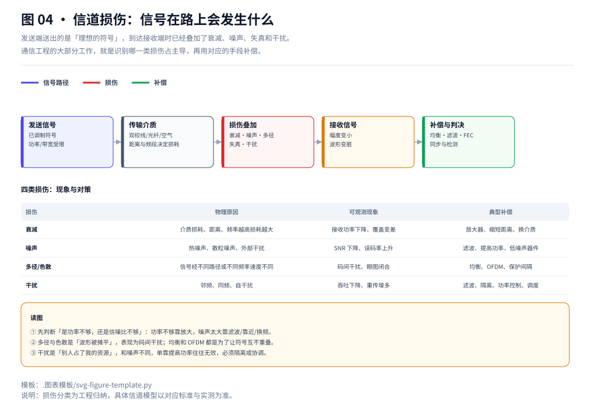

# 信道与传输损伤

信道是通信系统里唯一不可控的一段。发送端能做的只有“把信号做得更抗造”，接收端能做的只有“从被弄脏的信号里把原来的符号判出来”。理解损伤类型，才能判断该加功率、该换介质，还是该改调制。

> 本篇定位：衰减、噪声、失真、多径、干扰五类损伤，以及 dB/dBm、链路预算、SNR/SINR 的通用算法。有线介质损耗去 02，光功率预算去 03，无线衰落去 04。

## 目录

- [1 一句话模型](#s1)
- [2 速览](#s2)
- [3 五类损伤与观测](#s3)
- [4 信号如何被损伤与补偿](#s4)
- [5 状态机与定时器](#s5)
- [6 设计取舍与边界](#s6)
- [7 与相邻主题的关系](#s7)
- [名词解释](#名词解释)
- [8 参考与关联](#s8)

## 1 · 一句话模型：信号 = 有用功率 + 各种“不想要的”

```text
接收功率 = 发送功率 − 路径损耗 + 增益
信噪比   = 有用信号功率 / (噪声功率 + 干扰功率)
判决正确 = 符号间距足够大，且噪声/干扰没有把它推过边界
```

三个关键认知：

1. **衰减可以靠增益补，噪声不能靠增益补**：放大器同时放大信号和噪声，SNR 不会因为“再加一级放大”而变好。
2. **SNR 和 SINR 不是一回事**：SNR 只看噪声，SINR 还把干扰算进去；无线现场更多看 SINR。
3. **链路预算算的是“最坏情况”**：把发送功率、天线增益、路径损耗、噪声系数、解调门限都换成 dB，收支平衡才算链路可用。

## 2 · 速览

| 项 | 内容 |
| --- | --- |
| 所属领域 | 通信原理 |
| 核心对象 | 信号功率、噪声、干扰、多径、链路预算 |
| 关键参数 | 路径损耗、噪声系数、SNR/SINR、解调门限、余量 |
| 常用单位 | dB（比值）、dBm（绝对功率）、dB/decade 或 dB/倍频程 |
| 典型场景 | 有线长度/串扰、光纤功率预算、无线覆盖/干扰 |
| 主要标准 | ITU-R P.525/P.526、3GPP 38.901、IEEE 802.3 |

## 3 · 五类损伤与观测

| 损伤 | 物理原因 | 可观测现象 | 典型补偿 | 边界 |
| --- | --- | --- | --- | --- |
| 衰减 | 介质损耗、距离、频率 | 接收功率下降、覆盖变差 | 放大器、缩短距离、换低损耗介质 | 放大器有噪声系数，不能无限补 |
| 噪声 | 热噪声、散粒噪声、外部噪声 | SNR 下降、误码率上升 | 滤波、低噪声器件、提高功率 | 热噪声底不可消除，只能逼近 |
| 失真 | 器件非线性、滤波器群时延 | EVM 变差、星座图畸变 | 预失真、均衡、back-off | 非线性与效率是一对矛盾 |
| 多径/色散 | 多路径、不同频率速度不同 | 码间干扰、眼图闭合、频率选择性衰落 | 均衡、OFDM+CP、分集 | 超出 CP/均衡范围仍会 ISI |
| 干扰 | 邻频、同频、自干扰 | 吞吐下降、重传、SINR 恶化 | 滤波、隔离、功率控制、调度 | 提高功率可能加剧干扰 |

> **一个实用区分**：噪声是“宽带的、无规律的底噪”，干扰是“有来源、有结构的能量”。看频谱时，底噪抬升像“整体抬高”，干扰像“某个频段鼓包”。

### 3.1 dB、dBm 与链路预算

| 量 | 定义 | 用途 |
| --- | --- | --- |
| dB | 10·log₁₀(P₁/P₂) | 表示两个功率的比值（增益/损耗） |
| dBm | 10·log₁₀(P/1 mW) | 表示绝对功率，0 dBm = 1 mW |
| dBW | 10·log₁₀(P/1 W) | 表示绝对功率，0 dBW = 30 dBm |
| dB/倍频程 | 随频率变化的损耗斜率 | 描述线缆/介质的频率相关损耗 |

链路预算的基本形式：

```text
接收功率 Prx = Ptx + Gtx − Lpath + Grx − Lfeeder
SNR        = Prx − N
链路可用     ⇔ SNR ≥ 解调门限 + 余量
```

其中 N 是接收端噪声功率，与带宽和噪声系数有关：

```text
N(dBm) = −174 + 10·log₁₀(B) + NF
```

-174 dBm/Hz 是室温下的热噪声功率谱密度；B 是带宽（Hz），NF 是接收机噪声系数（dB）。

> **边界**：上式只算热噪声。实际还要叠加干扰、相位噪声、量化噪声；5G/Wi-Fi 现场更多用 SINR 而不是 SNR。

## 4 · 信号如何被损伤与补偿



**读图**：从左到右是信号经过信道的过程，红色是损伤叠加点，绿色是接收端补偿。下方矩阵把五类损伤的“原因—现象—对策”对齐。先判断哪一类占主导，再选手段。

> 图源：`images/图04-信道损伤与补偿.svg`

### 4.1 正常路径

```text
发送 → 介质/空间（衰减 + 噪声 + 多径 + 干扰）→ 接收
  → 前端放大/滤波 → 同步 → 信道估计 → 均衡
    → 解调（软判决）→ 信道解码 → 上层
```

### 4.2 异常分支

| 异常 | 可能原因 | 现场表现 | 优先动作 |
| --- | --- | --- | --- |
| 接收功率正常但误码高 | 噪声/干扰大、EVM 差 | SNR/SINR 低、重传多 | 看频谱与噪声底，查干扰源 |
| 接收功率低且误码高 | 衰减过大、连接器/光纤脏 | 光功率/RSRP 低 | 查链路损耗、清洁/更换连接器 |
| 功率正常、SNR 也正常，仍丢包 | 多径/色散、同步问题 | 特定速率/距离下才出错 | 降速验证、看均衡/CP 配置 |
| 白天正常、晚上变差 | 外部干扰、温度漂移 | 时段性恶化 | 频谱扫描、记录时间规律 |
| 近距离正常、远距离掉线 | 覆盖/路径损耗 | 随距离阶跃恶化 | 链路预算复核、加功率/换天线 |

## 5 · 状态机与定时器

本主题**没有连接状态机**，但信道是时变的，有两个时间尺度必须理解：

| 时间尺度 | 典型量级 | 影响 |
| --- | --- | --- |
| 相干时间 | 毫秒到秒 | 信道在这个时间内近似不变；快衰落会破坏相干性 |
| 时延扩展 | 纳秒到微秒 | 决定 CP/均衡器长度；超出则 ISI |
| 多普勒扩展 | 赫兹到千赫兹 | 移动速度越高，频偏/信道变化越快 |

工程上的“链路自适应周期”“信道估计周期”“HARQ RTT”都是围绕这些时间尺度设计的：估计太快浪费资源，太慢就跟不上信道变化。

## 6 · 设计取舍与边界

### 6.1 功率与带宽

提高功率能改善 SNR，但收益是对数的，且会带来干扰、功耗和线性度问题。增加带宽能提高容量，但噪声功率也随带宽增加（N = −174 + 10logB + NF），所以 SNR 不一定变好。工程上要在“功率、带宽、距离、复杂度”之间取平衡。

### 6.2 介质选择

| 介质 | 损耗特征 | 适用距离 | 主要损伤 |
| --- | --- | --- | --- |
| 双绞线 | 随频率上升，100 m 内可用 | 短距 | 衰减、串扰、回波 |
| 同轴 | 比双绞线低，但高频损耗仍明显 | 中短距 | 衰减、反射、接头 |
| 光纤 | 极低（单模 0.2–0.4 dB/km 量级） | 长距 | 衰减、色散、连接器损耗 |
| 空气 | 自由空间损耗随距离平方 | 视距/覆盖 | 多径、衰落、干扰 |

### 6.3 余量的意义

链路预算不能算到“刚好等于门限”。要留余量吸收：器件老化、温度变化、安装误差、人体/车辆遮挡、干扰波动。余量不足的链路，晴天正常、雨天/高峰就掉线。

### 6.4 常见误判

1. **“信号强就是质量好”**：RSSI 高但 SINR 低，说明噪声/干扰大，照样掉速。
2. **“加放大器就能解决弱信号”**：放大器在链路前端会同时放大噪声，NF 变差时 SNR 反而下降。
3. **“光纤没有损耗”**：光纤有衰减、色散、连接器损耗和弯曲损耗，长距/多分光需要预算。
4. **“误码一定是线路坏”**：可能是干扰、时钟、均衡、连接器脏污，甚至是对方发送端 EVM 差。
5. **“链路预算算通就一定通”**：预算只算平均功率，没算衰落余量、干扰和遮挡。

## 7 · 与相邻主题的关系

| 相邻主题 | 关系 |
| --- | --- |
| [00-通信系统与性能指标](./00-通信系统与性能指标.md) | 本篇把“信道”这一段展开 |
| [01-调制与编码](./01-调制与编码.md) | 损伤决定可选调制阶数与编码率 |
| [02-多址与双工](./02-多址与双工.md) | 干扰与远近效应影响多址方式 |
| [02-有线通信/00-有线传输介质](../02-有线通信/00-有线传输介质.md) | 双绞线/同轴的损耗与串扰 |
| [03-光通信/03-ODN与光功率预算](../03-光通信/03-ODN与光功率预算.md) | 光功率预算的具体算法 |
| [04-无线通信/01-射频与天线/00-无线传播与射频基础](../04-无线通信/01-射频与天线/00-无线传播与射频基础.md) | 自由空间损耗、衰落、天线增益 |

一句话：**有线看“损耗 + 串扰”，光纤看“功率预算 + 色散”，无线看“路径损耗 + 干扰 + 多径”。**

## 名词解释

> 缩写给出英文全称；非缩写用“—”表示。

| 术语 | 英文全称 | 解释 |
| --- | --- | --- |
| 路径损耗 | Path Loss | 信号从发送端到接收端的功率衰减。 |
| 噪声 | Noise | 与信号无关的随机能量，典型为热噪声。 |
| 噪声系数 | Noise Figure | 器件/接收机使 SNR 恶化的程度，单位 dB。 |
| SNR | Signal-to-Noise Ratio | 信号功率与噪声功率之比。 |
| SINR | Signal-to-Interference-plus-Noise Ratio | 信号与干扰加噪声之比。 |
| 多径 | Multipath | 信号经不同路径到达接收端，产生叠加/抵消。 |
| 时延扩展 | Delay Spread | 多径到达时间的展宽，决定码间干扰程度。 |
| 相干时间 | Coherence Time | 信道保持近似不变的时间长度。 |
| 多普勒扩展 | Doppler Spread | 移动引起的频率展宽。 |
| ISI | Inter-Symbol Interference | 码间干扰，前一个符号拖到后一个符号。 |
| CP | Cyclic Prefix | 循环前缀，吸收多径。 |
| EVM | Error Vector Magnitude | 误差矢量幅度。 |
| NF | Noise Figure | 噪声系数。 |
| 链路预算 | Link Budget | 把发送、增益、损耗、噪声、门限折算成 dB 的收支计算。 |
| 衰落余量 | Fade Margin | 为信道波动预留的额外功率余量。 |

## 8 · 参考与关联

**标准与经典**

- ITU-R P.525：自由空间衰减计算。
- ITU-R P.526：绕射传播。
- 3GPP TR 38.901：5G 信道模型。
- IEEE 802.3：双绞线/光纤 PMD 与链路预算。
- Friis, H. T., *A Note on a Simple Transmission Formula*, 1946.

**关联**

- [00-通信系统与性能指标](./00-通信系统与性能指标.md)
- [01-调制与编码](./01-调制与编码.md)
- [02-多址与双工](./02-多址与双工.md)
- [02-有线通信/00-有线传输介质](../02-有线通信/00-有线传输介质.md)
- [03-光通信/03-ODN与光功率预算](../03-光通信/03-ODN与光功率预算.md)
- [04-无线通信/01-射频与天线/00-无线传播与射频基础](../04-无线通信/01-射频与天线/00-无线传播与射频基础.md)

---

> **本篇定位**：信道损伤与链路预算的通用方法，重点在“先分类、再补偿”；具体介质/频段参数见 02/03/04。
> **素材来源**：`studyspace/1.知识体系/1.计算机网络/m-6-无线网络和移动网络.md` 的无线信道概念；其余按公开标准知识补写。
> **待验证**：噪声系数、路径损耗指数、光纤衰减系数等具体数值随器件、频段、环境变化，工程取值以实测和器件手册为准。
