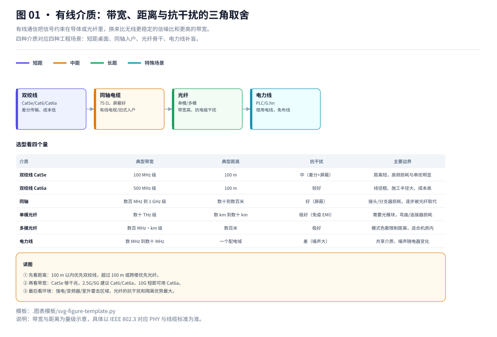

# 有线传输介质

有线通信的本质是“把电磁能量或光能量约束在介质里”，用物理隔离换来比无线更稳定的信噪比。介质选错，后面再好的 PHY、再高的调制都救不回来。

> 本篇定位：双绞线、同轴、光纤、电力线四类介质的结构、参数与选型边界。以太网 PHY 的编码与自协商去 01，xDSL 去 02，PON 的光功率预算去 [03-光通信](../03-光通信/.readme.md)。

## 目录

- [1 一句话模型](#s1)
- [2 速览](#s2)
- [3 四类介质与关键参数](#s3)
- [4 信号在介质里怎么走](#s4)
- [5 状态机与定时器](#s5)
- [6 设计取舍与边界](#s6)
- [7 与相邻主题的关系](#s7)
- [名词解释](#名词解释)
- [8 参考与关联](#s8)

## 1 · 一句话模型：介质决定“带宽 × 距离”的上限

```text
双绞线：差分对 + 绞距 → 抗共模干扰，100 m 内
同轴：  内导体 + 外屏蔽 → 带宽较高，适合分配网
光纤：  纤芯 + 包层 → 全反射，带宽最高、距离最远
电力线：借电线传信号 → 免布线，但噪声与共享是硬伤
```

三个关键认知：

1. **“带宽 × 距离”是介质的硬约束**：同一根线，速率越高，可靠距离越短。
2. **双绞线的抗干扰来自“差分 + 绞距”**，不是来自“线粗”；屏蔽只解决电场耦合，不解决低频磁场。
3. **光纤的优势不只是带宽，还有电磁隔离**：它不导电，天然抗 EMI、抗地环路。

## 2 · 速览

| 项 | 内容 |
| --- | --- |
| 所属领域 | 有线通信 |
| 核心对象 | 双绞线、同轴、光纤、电力线 |
| 关键参数 | 特性阻抗、带宽、衰减、串扰、距离 |
| 常见标准 | TIA/EIA-568、ISO/IEC 11801、IEEE 802.3、ITU-T G.652 |
| 典型场景 | 桌面接入、家庭入户、园区骨干、FTTH |

## 3 · 四类介质与关键参数

### 3.1 双绞线

| 类别 | 典型带宽 | 典型速率 | 距离 | 说明 |
| --- | --- | --- | --- | --- |
| Cat5e | 100 MHz | 1G | 100 m | 最常见，2.5G/5G 视质量而定 |
| Cat6 | 250 MHz | 1G/2.5G | 100 m | 有十字骨架，串扰更小 |
| Cat6a | 500 MHz | 10G | 100 m | 线径粗、施工半径大 |
| Cat7 | 600 MHz | 10G | 100 m | 屏蔽结构，接口多为 GG45/TERA |
| Cat8 | 2 GHz | 25G/40G | 30 m | 数据中心短距 |

双绞线的几个关键点：

- **特性阻抗 100 Ω**（以太网），阻抗不连续会产生反射，表现为回波损耗。
- **UTP/FTP/STP**：无屏蔽/整体屏蔽/每对屏蔽；屏蔽必须正确接地，否则可能变成天线。
- **T568A/T568B**：两种线序，同一链路两端必须一致；不一致会导致收发对错位。
- **PoE**：利用 spare pair 或数据对供电，功率等级由 802.3af/at/bt 定义。

> **边界**：Cat6 在 100 m 内可跑 10G 的说法有条件（取决于串扰、安装工艺、环境温度），工程上 10G 首选 Cat6a。

### 3.2 同轴电缆

| 项 | 内容 |
| --- | --- |
| 结构 | 内导体 + 绝缘层 + 外屏蔽 + 护套 |
| 特性阻抗 | 75 Ω（视频/有线电视）、50 Ω（射频测试） |
| 优点 | 屏蔽好、带宽较高、机械强度好 |
| 缺点 | 粗、硬、接头/分支器损耗大 |
| 典型场景 | 有线电视 HFC、旧式以太网、射频跳线 |

同轴的损耗随频率上升，接头和分支器是主要故障点。HFC 网络里，同轴段越短、分支越少，上行噪声汇聚越轻。

### 3.3 光纤

| 类型 | 纤芯/包层 | 典型波长 | 典型距离 | 场景 |
| --- | --- | --- | --- | --- |
| 多模 OM3/OM4 | 50/125 μm | 850 nm | 数百米 | 机房、楼内 |
| 单模 OS2 | 9/125 μm | 1310/1550 nm | 数 km 到数十 km | 园区骨干、FTTH、PON |

光纤的四个工程参数：

| 参数 | 含义 | 影响 |
| --- | --- | --- |
| 衰减 | 每公里损耗（dB/km） | 决定无中继距离 |
| 色散 | 不同波长/模式传播速度不同 | 高速长距需要色散补偿 |
| 连接器损耗 | 每个接头/熔接点的损耗 | 多一个接头就多一份预算 |
| 弯曲半径 | 光纤可承受的最小弯曲 | 施工不当会造成弯曲损耗 |

> **边界**：单模/多模不能混用；波长、光模块类型、光纤类型三者必须匹配。多模光纤用 1310 nm 单模模块，通常无法工作。

### 3.4 电力线

电力线通信（PLC/G.hn）把信号调制到电线上，优点是“有电就能通、免布线”，缺点是：

- 电力线是为 50/60 Hz 电能设计的，高频特性差、阻抗随负载变化；
- 多个用户共享同一配电域，噪声和隐私都是问题；
- 不同插座之间可能衰减很大，速率不稳定。

它适合“补盲”，不适合作为主接入手段。

## 4 信号在介质里怎么走



**读图**：四种介质按“短距 → 中距 → 长距 → 特殊场景”排列；下方矩阵对比带宽、距离、抗干扰和边界。先按距离筛，再按带宽和环境定。

> 图源：`images/图01-有线传输介质.svg`

### 4.1 双绞线的差分传输

```text
发送端：TX+ / TX− 一对反相信号
  → 两根线绞在一起，外部干扰以共模形式叠加
    → 接收端取差值，共模干扰被抵消
      → 绞距越密、配对越准，抗干扰越好
```

### 4.2 光纤的全反射

```text
纤芯折射率 > 包层折射率
  → 光以大于临界角入射到界面
    → 全反射，光被约束在纤芯内前进
      → 单模：只允许一种模式；多模：多种模式并行
```

### 4.3 异常分支

| 异常 | 现象 | 原因 | 处理方向 |
| --- | --- | --- | --- |
| 链路 up 但 CRC 增长 | 大量坏帧 | 线缆质量、接头、串扰、长度超限 | 换线、重做水晶头、测线 |
| 速率上不去 | 自协商降速 | 线对/线序/线缆等级不匹配 | 查线序、换 Cat6、固定速率验证 |
| 光纤链路不通 | 光模块无光/收光低 | 光纤类型不匹配、脏污、弯折 | 清洁端面、查波长/类型、测光功率 |
| 同轴用户掉线 | 某频段 SNR 差 | 分支器/接头氧化、上行噪声 | 查接头、隔离噪声源 |
| PLC 速率波动 | 白天正常、晚上差 | 电器噪声、共享域拥塞 | 换插座、避开干扰源、改用网线 |

## 5 · 状态机与定时器

介质本身**没有状态机**，但物理层链路有“训练/稳定”过程：

| 机制 | 状态 | 说明 |
| --- | --- | --- |
| 以太网自协商 | 能力交换 → 共同配置 → 链路稳定 | 见 [01-以太网PHY与速率演进](./01-以太网PHY与速率演进.md) |
| 光模块 | 上电 → 初始化 → 收光/发光正常 | DDM 可读温度、电压、光功率 |
| xDSL | 握手 → 训练 → Showtime | 见 [02-xDSL与铜线接入](./02-xDSL与铜线接入.md) |

> 介质故障的典型特征是“链路反复 up/down”或“up 了但误码高”。前者查物理连接，后者查信号质量。

## 6 · 设计取舍与边界

### 6.1 铜线与光纤

| 维度 | 双绞线 | 光纤 |
| --- | --- | --- |
| 成本 | 低 | 高（模块 + 施工） |
| 距离 | 100 m | 数 km 到数十 km |
| 带宽 | 100 M–2 GHz 级 | 数十 THz 级 |
| 抗干扰 | 中 | 极好 |
| 供电 | 可 PoE | 不能直接供电 |
| 维护 | 简单 | 需要清洁/熔接工具 |

### 6.2 屏蔽与否

屏蔽线不是“更高级就一定更好”。屏蔽层必须接地，否则会引入地环路和天线效应；在强干扰环境（变频器、电机、室外）才值得用。普通办公环境，非屏蔽 Cat6/Cat6a 足够。

### 6.3 常见误判

1. **“Cat6 一定能跑 10G”**：取决于距离、串扰、安装工艺，10G 长距应选 Cat6a。
2. **“光纤不会坏”**：光纤怕弯、怕脏、怕压；端面污染是现场最常见的故障。
3. **“屏蔽线抗干扰一定强”**：接地不良时，屏蔽线可能比非屏蔽更差。
4. **“线序无所谓，能通就行”**：T568A/B 混用会导致收发对错位，表现为不通或降速。
5. **“同轴和双绞线可以随便转接”**：阻抗、平衡/不平衡、带宽都不同，必须用对应转换器。

## 7 · 与相邻主题的关系

| 相邻主题 | 关系 |
| --- | --- |
| [01-以太网PHY与速率演进](./01-以太网PHY与速率演进.md) | 介质之上的编码、自协商、PoE |
| [02-xDSL与铜线接入](./02-xDSL与铜线接入.md) | 电话铜线的高频利用 |
| [03-有线接入网形态](./03-有线接入网形态.md) | 介质如何组成 FTTx/HFC 接入网 |
| [03-光通信](../03-光通信/.readme.md) | 光纤的类型、光模块、PON |
| [11-网络科学/01-物理层](../../11-网络科学/01-物理层/00-物理层概览.md) | 网络视角的物理层职责 |
| [03-信道与传输损伤](../01-通信原理/03-信道与传输损伤.md) | 衰减、串扰、链路的通用模型 |

一句话：**介质决定“能传多快、多远”，PHY 决定“怎么把比特放进去”，协议决定“传什么”。**

## 名词解释

> 缩写给出英文全称；非缩写用“—”表示。

| 术语 | 英文全称 | 解释 |
| --- | --- | --- |
| UTP | Unshielded Twisted Pair | 非屏蔽双绞线。 |
| FTP | Foiled Twisted Pair | 整体铝箔屏蔽双绞线。 |
| STP | Shielded Twisted Pair | 屏蔽双绞线。 |
| Cat | Category | 双绞线等级，如 Cat5e/Cat6/Cat6a。 |
| EMI | Electromagnetic Interference | 电磁干扰。 |
| PoE | Power over Ethernet | 以太网供电。 |
| HFC | Hybrid Fiber-Coaxial | 光纤同轴混合接入网。 |
| PLC | Power Line Communication | 电力线通信。 |
| SMF | Single-Mode Fiber | 单模光纤。 |
| MMF | Multi-Mode Fiber | 多模光纤。 |
| OS2 | Optical Single-mode 2 | 单模光纤类别。 |
| OM3/OM4 | Optical Multi-mode 3/4 | 多模光纤类别。 |
| 回波损耗 | Return Loss | 阻抗不连续导致的反射程度。 |
| 串扰 | Crosstalk | 相邻线对之间的能量耦合。 |

## 8 · 参考与关联

**标准**

- TIA/EIA-568、ISO/IEC 11801：综合布线。
- IEEE 802.3：以太网 PHY 与介质。
- ITU-T G.652：单模光纤特性。
- ITU-T G.651.1：多模光纤特性。
- ITU-T G.9960/G.9961：G.hn 电力线/同轴/电话线。

**关联**

- [01-以太网PHY与速率演进](./01-以太网PHY与速率演进.md)
- [02-xDSL与铜线接入](./02-xDSL与铜线接入.md)
- [03-有线接入网形态](./03-有线接入网形态.md)
- [03-光通信/02-光模块与SFP](../03-光通信/02-光模块与SFP.md)
- [11-网络科学/01-物理层](../../11-网络科学/01-物理层/00-物理层概览.md)

---

> **本篇定位**：有线介质的结构、参数与选型；不展开具体 PHY 编码与协议。
> **素材来源**：`studyspace/1.知识体系/1.计算机网络/m-1-计算机网络和因特网.md` 物理媒体节；其余按 TIA/EIA-568、IEEE 802.3、ITU-T G.65x 公开知识补写。
> **待验证**：Cat 等级对应的频率/距离、光纤衰减系数、PoE 功率等级随标准版本与厂商器件变化。
