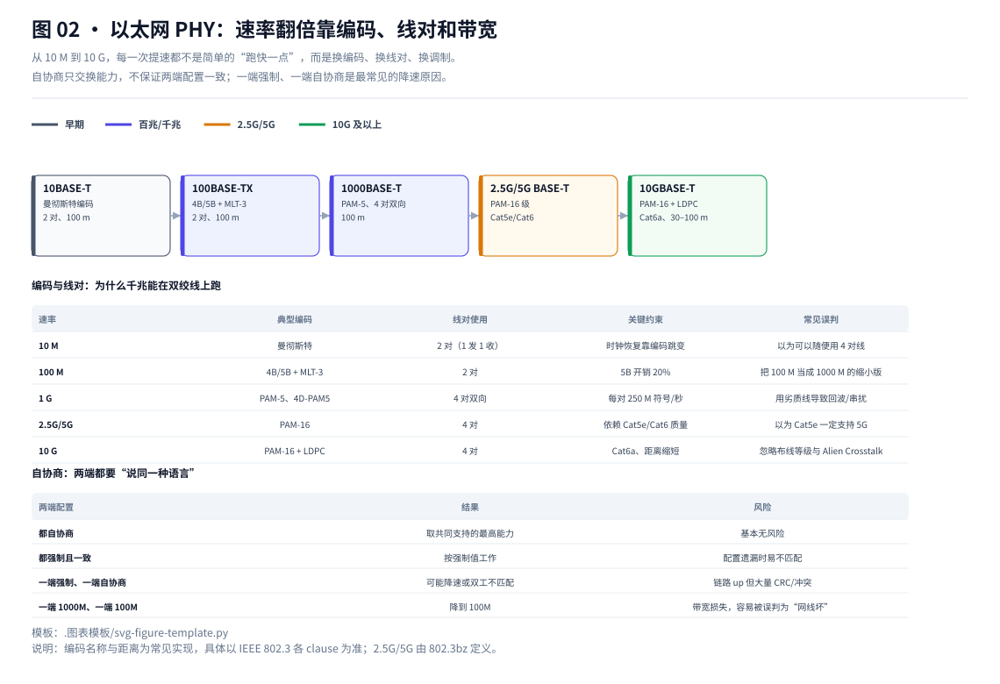

# 以太网 PHY 与速率演进

以太网 PHY 只做三件事：把 MAC 的比特流编码成线路信号、把线路信号解回比特、和链路对端协商“用什么速率和双工”。速率从 10 M 到 10 G，变的不是“跑得更快”，而是编码、线对和调制方式。

> 本篇定位：以太网物理层的编码、线对使用、自协商、MDI/MDIX 与 PoE。帧格式、MAC 地址、交换转发去 [11-网络科学/02-链路层](../../11-网络科学/02-链路层/.readme.md)，不在这里重复。

## 目录

- [1 一句话模型](#s1)
- [2 速览](#s2)
- [3 速率、编码与线对](#s3)
- [4 上电到链路 up](#s4)
- [5 状态机与定时器](#s5)
- [6 设计取舍与边界](#s6)
- [7 与相邻主题的关系](#s7)
- [名词解释](#名词解释)
- [8 参考与关联](#s8)

## 1 · 一句话模型：MAC 给比特，PHY 给波形

```text
MAC ──MII/RGMII/SGMII── PHY ──MDI── 变压器/连接器 ── 双绞线/光纤
                              ↑
                    编码、串并转换、驱动、均衡、时钟恢复
```

三个关键认知：

1. **PHY 不认帧、不认地址**：它只负责比特流和链路状态；帧边界、FCS、MAC 地址都在 MAC。
2. **速率提升靠“每符号更多比特 + 更多线对 + 更好编码”**，不是单纯提高时钟。
3. **自协商只交换能力，不保证结果符合预期**：两端配置不一致时，可能“链路 up 但大量出错”。

## 2 · 速览

| 项 | 内容 |
| --- | --- |
| 所属层 | 物理层（OSI L1） |
| 核心对象 | 比特、符号、线对、链路状态 |
| 关键参数 | 速率、双工、编码、线对、距离、PoE 等级 |
| 常见接口 | MII、RMII、GMII、RGMII、SGMII、SerDes |
| 主要标准 | IEEE 802.3（含 802.3bz 2.5G/5G、802.3bt PoE） |

## 3 · 速率、编码与线对

| 速率 | 标准 | 典型编码 | 线对 | 距离 | 关键点 |
| --- | --- | --- | --- | --- | --- |
| 10 M | 10BASE-T | 曼彻斯特 | 2 对 | 100 m | 编码自带时钟，抗长连 0/1 |
| 100 M | 100BASE-TX | 4B/5B + MLT-3 | 2 对 | 100 m | 5B 有 20% 编码开销 |
| 1 G | 1000BASE-T | 4D-PAM5 | 4 对双向 | 100 m | 每对 250 M 符号/秒，需要回波消除 |
| 2.5G/5G | 802.3bz | PAM-16 | 4 对 | 100 m | 复用 Cat5e/Cat6，依赖线缆质量 |
| 10 G | 10GBASE-T | PAM-16 + LDPC | 4 对 | 55–100 m | Cat6 约 55 m，Cat6a 约 100 m |
| 25G/40G/100G | 802.3by/bm/cd | PAM-4/ NRZ + FEC | 光纤/DAC | 数米到数十 km | 数据中心以光/铜缆为主 |



**读图**：上半部分是速率演进链，下半部分对比编码、线对和常见误判。重点看“千兆为什么能在 4 对双绞线上跑”——靠 PAM-5 和回波消除，不是靠提高电压。

> 图源：`images/图02-以太网PHY演进.svg`

### 3.1 编码为什么重要

线路编码要解决两个问题：**时钟恢复**和**直流平衡**。

- 长连 0 或长连 1 会让接收端丢失时钟；曼彻斯特在每个比特中间强制跳变，代价是带宽翻倍。
- 4B/5B 把 4 bit 映射成 5 bit，保证足够的跳变，代价是 25% 带宽开销（有效 80%）。
- 8B/10B 用于千兆/万兆的 SerDes，兼顾直流平衡和跳变密度。
- 64B/66B 用于 10G/40G/100G，开销更低，靠扰码保证跳变。

> **边界**：线路编码不是纠错码。它保证“能恢复时钟”，不保证“比特一定对”；纠错靠 FEC（如 10GBASE-T 的 LDPC）。

### 3.2 MDI/MDIX

MDI 是 PHY 与线缆的接口，收发对的定义有 MDI/MDI-X 两种。现代 PHY 支持 **Auto-MDIX**，能自动识别直通线/交叉线，所以“网线要不要交叉”在千兆以后基本不再是问题。

### 3.3 PoE

PoE 通过以太网线同时传数据和电，常见标准：

| 标准 | 典型功率（PSE 输出） | 说明 |
| --- | --- | --- |
| 802.3af | 15.4 W | 基础 PoE，摄像头/AP |
| 802.3at | 30 W | PoE+，双频 AP |
| 802.3bt | 60/90 W | 4 对供电，高性能 AP/显示设备 |

PoE 的边界：线缆等级、线长、环境温度都会影响可传输功率；不是“插上就能满功率”。

## 4 上电到链路 up

```text
上电/插线
  → PHY 检测对端（能量/信号）
    → 自协商：交换速率、双工、流控、PoE 能力
      → 选择双方共同支持的最高配置
        → 链路训练/均衡
          → 链路 up，MAC 可收发
```

### 4.1 自协商的四种组合

| 本端 | 对端 | 结果 | 风险 |
| --- | --- | --- | --- |
| 自协商 | 自协商 | 取共同最高能力 | 基本正常 |
| 强制 | 强制（一致） | 按强制值 | 配置遗漏时不匹配 |
| 自协商 | 强制 | 可能降速/半双工 | 链路 up 但 CRC/冲突增长 |
| 强制 | 自协商 | 同上，方向相反 | 难以定位，常被误判为线缆问题 |

### 4.2 异常分支

| 异常 | 现象 | 原因 | 处理方向 |
| --- | --- | --- | --- |
| 链路 up、CRC 增长 | 大包丢、吞吐低 | 双工不匹配、线缆串扰、接头 | 两端统一自协商；测线；换口 |
| 频繁 up/down | 链路抖动 | 供电、PHY 时钟、线缆接触 | 换线换口；看 DDM/寄存器 |
| 速率只有 100M | 协商降速 | 线对断/线序错/Cat5e 质量差 | 查 8 芯全通；换 Cat6 |
| PoE 不上电 | 设备不启动 | 功率等级不匹配、线损大 | 查 PSE 预算、线长、bt 分级 |
| 光口不通 | 无 link | 光模块类型/波长不匹配、脏污 | 清洁、核对模块型号 |

## 5 状态机与定时器

以太网 PHY 有明确的状态机，但大多在芯片内部：

| 状态/定时器 | 作用 |
| --- | --- |
| 链路检测（Link Detect） | 判断对端是否存在 |
| 自协商（Auto-Negotiation） | 交换能力、选择共同配置 |
| 链路训练（Link Training） | 高速率下均衡器收敛 |
| 链路稳定定时器 | 防止抖动导致频繁 up/down |
| PoE 分级（Classification） | 协商供电功率 |

> 工程上最有用的是“链路状态变化事件”：如果 `link up/down` 频繁，优先查物理层；如果一直 up 但误码高，优先查信号质量与双工配置。

## 6 设计取舍与边界

### 6.1 速率与距离

双绞线的速率越高，对带宽、串扰、回波越敏感，可靠距离越短。10G 在 Cat6a 上可到 100 m，在 Cat6 上通常只保证 55 m 左右；2.5G/5G 则利用 Cat5e/Cat6 的存量布线，属于“在旧线上榨出新速率”。

### 6.2 自协商 vs 强制

| 方式 | 优点 | 缺点 | 适用 |
| --- | --- | --- | --- |
| 自协商 | 即插即用、能力匹配 | 依赖对端也开启 | 绝大多数场景 |
| 强制 | 结果确定、便于复现 | 配置不一致会出问题 | 测试、老旧设备、特殊链路 |

原则：**要么两端都自协商，要么两端都强制且配置完全一致**，不要混用。

### 6.3 常见误判

1. **“链路 up 就说明网线没问题”**：链路 up 只证明最低限度的信号与协商通过，CRC 可能仍在增长。
2. **“千兆口插上就是千兆”**：线缆、水晶头、线序、对端能力任何一项不满足都会降速。
3. **“自协商一定最优”**：一端强制时，自协商端可能退到半双工，形成“假 up”。
4. **“PoE 功率只看标准”**：线长、线径、温度都会造成压降和功率损失。
5. **“光模块能插就能用”**：波长、速率、单模/多模、DDM 类型都要匹配。

## 7 · 与相邻主题的关系

| 相邻主题 | 关系 |
| --- | --- |
| [00-有线传输介质](./00-有线传输介质.md) | 双绞线/光纤的物理参数 |
| [02-xDSL与铜线接入](./02-xDSL与铜线接入.md) | 另一种铜线高频传输技术 |
| [03-有线接入网形态](./03-有线接入网形态.md) | PHY 如何组成接入网 |
| [11-网络科学/02-链路层/01-以太网与MAC](../../11-网络科学/02-链路层/01-以太网与MAC.md) | 帧格式、MAC 地址、FCS |
| [11-网络科学/01-物理层](../../11-网络科学/01-物理层/00-物理层概览.md) | PHY-MAC 分工与链路 up 的含义 |
| [40-平台与芯片](../../../40-平台与芯片/.readme.md) | PHY/交换芯片选型与调试 |

一句话：**PHY 管“比特怎么上线”，MAC 管“帧怎么组织”，交换芯片管“帧往哪转发”。**

## 名词解释

> 缩写给出英文全称；非缩写用“—”表示。

| 术语 | 英文全称 | 解释 |
| --- | --- | --- |
| PHY | Physical Layer | 物理层芯片。 |
| MAC | Media Access Control | 介质访问控制子层。 |
| MII | Media Independent Interface | MAC 与 PHY 的标准接口。 |
| RGMII | Reduced Gigabit Media Independent Interface | 精简千兆接口。 |
| SGMII | Serial Gigabit Media Independent Interface | 串行千兆接口。 |
| MDI | Medium Dependent Interface | 与介质的接口。 |
| Auto-MDIX | Automatic Medium Dependent Interface Crossover | 自动识别直通/交叉线。 |
| PAM | Pulse Amplitude Modulation | 脉冲幅度调制，如 PAM-5/PAM-16。 |
| LDPC | Low-Density Parity-Check | 低密度奇偶校验码。 |
| PoE | Power over Ethernet | 以太网供电。 |
| PSE | Power Sourcing Equipment | 供电设备（交换机/注入器）。 |
| PD | Powered Device | 受电设备（AP/摄像头）。 |
| CRC | Cyclic Redundancy Check | 循环冗余校验。 |
| FEC | Forward Error Correction | 前向纠错。 |

## 8 · 参考与关联

**标准**

- IEEE 802.3：以太网（10/100/1000/10G）。
- IEEE 802.3bz：2.5G/5G BASE-T。
- IEEE 802.3af/at/bt：PoE/PoE+/4 对 PoE。
- IEEE 802.3by/bm/cd：25G/40G/100G。

**关联**

- [00-有线传输介质](./00-有线传输介质.md)
- [02-xDSL与铜线接入](./02-xDSL与铜线接入.md)
- [03-有线接入网形态](./03-有线接入网形态.md)
- [11-网络科学/02-链路层/01-以太网与MAC](../../11-网络科学/02-链路层/01-以太网与MAC.md)

---

> **本篇定位**：以太网物理层的编码、协商与供电；不重复链路层的帧格式与转发。
> **素材来源**：`studyspace/1.知识体系/1.计算机网络/m-5-链路层.md` 的以太网概述；其余按 IEEE 802.3 公开知识补写。
> **待验证**：具体编码、距离、PoE 等级随标准修订与 PHY 厂商实现变化。
