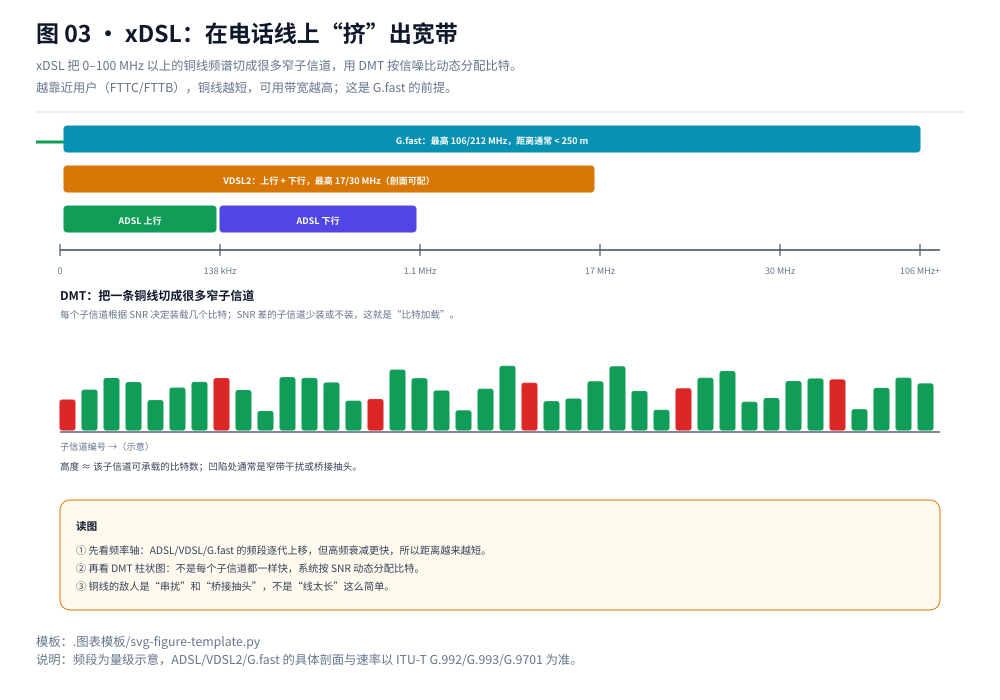
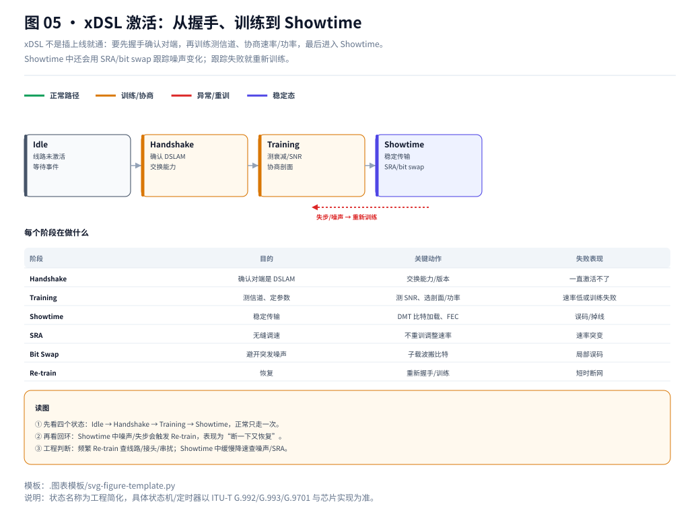

# xDSL 与铜线接入

xDSL 是在已有的电话铜线上“挤出”宽带：把 0 到上百 MHz 的频谱切成大量窄子信道，用 DMT 按每个子信道的信噪比动态分配比特。铜线越短、干扰越小，能挤出的速率越高。

> 本篇定位：ADSL/VDSL/G.fast 的频段、DMT、串扰与向量化，以及 DSLAM/CPE 的接入位置。PON 与 FTTx 的对比去 [03-有线接入网形态](./03-有线接入网形态.md) 和 [03-光通信](../03-光通信/.readme.md)。

## 目录

- [1 一句话模型](#s1)
- [2 速览](#s2)
- [3 频段、DMT 与速率](#s3)
- [4 从握手到 Showtime](#s4)
- [5 状态机与定时器](#s5)
- [6 设计取舍与边界](#s6)
- [7 与相邻主题的关系](#s7)
- [名词解释](#名词解释)
- [8 参考与关联](#s8)

## 1 · 一句话模型：铜线的“频谱复用 + 比特加载”

```text
电话线（0–100 MHz+）
  ├─ 低频：传统电话/POTS
  ├─ 中频：ADSL/VDSL 上下行
  └─ 高频：G.fast（距离更短）

DMT：把可用频段切成 N 个窄子信道
  └─ 每个子信道按 SNR 决定装几个比特（bit loading）
```

三个关键认知：

1. **xDSL 不是“把电话线当网线”**，而是把铜线的高频段拿来做数据，低频段仍可保留电话。
2. **速率由“可用带宽 × 每子载波比特数”决定**，而每子载波能装多少比特由 SNR 决定。
3. **铜线的头号敌人是串扰**：同一捆线里其他线对的信号会耦合进来，距离越长、频率越高越严重。

## 2 · 速览

| 项 | 内容 |
| --- | --- |
| 所属领域 | 有线通信/接入网 |
| 核心对象 | 铜线、子载波、DSLAM、CPE、串扰 |
| 关键参数 | 频段、子载波间隔、SNR、线路长度、串扰 |
| 主要技术 | DMT、TDD/FDD、向量化（Vectoring）、G.fast |
| 主要标准 | ITU-T G.992（ADSL）、G.993（VDSL）、G.9701（G.fast） |

## 3 频段、DMT 与速率

### 3.1 三代 xDSL

| 技术 | 典型频段 | 典型速率 | 典型距离 | 场景 |
| --- | --- | --- | --- | --- |
| ADSL/ADSL2+ | 最高约 1.1/2.2 MHz | 下行数 M–20 M 级 | 数 km | 早期宽带、FTTN |
| VDSL2 | 最高 17/30 MHz | 下行数十 M–100 M 级 | 数百米到 1 km | FTTC/FTTB |
| G.fast | 最高 106/212 MHz | 下行数百 M–1 G 级 | < 250 m | FTTB/FTTdp |

> **边界**：表中的速率是量级，实际受线路长度、线径、串扰、噪声、剖面配置影响，不能直接当承诺速率。

### 3.2 DMT 与比特加载



**读图**：上方是频率轴，ADSL/VDSL/G.fast 的频段逐代上移；下方柱状图表示每个子信道能装多少比特，凹陷处通常是窄带干扰或桥接抽头。先看频段，再看“哪些子信道被放弃”。

> 图源：`images/图03-xDSL频段与DMT.svg`

DMT 的核心是“把一条频率选择性信道拆成很多条平坦子信道”：

```text
可用频段 → N 个子载波（正交）
  → 每个子载波测 SNR
    → SNR 高：多装比特（高阶 QAM）
    → SNR 低：少装/不装（甚至关闭）
      → 汇总成实际可达速率
```

这解释了两个现象：

- **同一栋楼，不同住户速率差很多**：线路长度、线径、接头、串扰不同。
- **白天/晚上速率不同**：电器噪声、其他用户上线导致串扰变化。

### 3.3 串扰与向量化

| 串扰类型 | 方向 | 影响 |
| --- | --- | --- |
| NEXT | 近端串扰 | 发送端附近耦合，影响本端接收 |
| FEXT | 远端串扰 | 远端接收端耦合，是 xDSL 的主要限制 |

向量化（Vectoring）通过联合处理多对线的信号，抵消 FEXT；代价是需要所有线对在同一 DSLAM 上统一调度。没有向量化时，绑定/共享线束的用户会互相“拖速”。

## 4 从握手到 Showtime



**读图**：四个状态从左到右推进；Showtime 中噪声/失步会沿红色虚线回到 Training。先看“正常只走一次”，再看“为什么会反复断一下又恢复”。

> 图源：`images/图05-xDSL激活状态.svg`

```text
CPE 上电
  → 线路激活/握手（Handshake）
    → 训练（Training）：测信道、协商速率/功率/剖面
      → Showtime：进入稳定数据传输
        → 持续自适应（Seamless Rate Adaptation, SRA）
```

### 4.1 训练阶段在做什么

| 阶段 | 目的 | 失败表现 |
| --- | --- | --- |
| 握手 | 确认对端是 DSLAM、交换能力 | 一直激活不了 |
| 信道探测 | 测衰减、SNR、桥接抽头 | 速率很低或训练失败 |
| 协商 | 选剖面、功率、上下行频段 | 双方能力不匹配 |
| Showtime | 稳定传输，持续监控 | 频繁重训练/掉线 |

### 4.2 异常分支

| 异常 | 现象 | 原因 | 处理方向 |
| --- | --- | --- | --- |
| 频繁重训练 | 掉线、速率波动 | 线路噪声、接头氧化、串扰 | 查线路、换线对、开向量化 |
| 上行速率特别低 | 下载正常、上传差 | 上行频段受干扰/功率不足 | 查上行噪声、调整剖面 |
| 速率远低于套餐 | 训练速率低 | 线路长、线径细、桥接抽头 | 测线路参数、改光纤 |
| 某个频段凹陷 | 特定速率上不去 | 窄带干扰/广播台/电器 | 频谱分析、避开干扰 |
| 绑定后更差 | 多线互相拖累 | FEXT、未做向量化 | 向量化、减少绑定 |

## 5 状态机与定时器

xDSL 有明确的状态机，通常在 DSL 芯片/驱动内部：

| 状态 | 含义 |
| --- | --- |
| Idle/Handshake | 未激活或正在握手 |
| Training | 训练、测信道、协商参数 |
| Showtime | 稳定传输 |
| Re-train | 重新训练（掉线恢复） |

常见定时器/机制：

- **SRA**：无缝速率自适应，在不重训练的情况下调整速率。
- **比特交换（Bit Swap）**：在子载波之间搬比特，避开突发噪声。
- **去激活/激活**：线路空闲或管理动作触发的状态迁移。

> 工程判断：如果“每次掉线都伴随重训练”，优先查物理线路；如果“Showtime 中速率缓慢下降”，优先查串扰/噪声。

## 6 设计取舍与边界

### 6.1 铜线 vs 光纤

| 维度 | xDSL | PON/光纤 |
| --- | --- | --- |
| 介质 | 现有电话铜线 | 光纤 |
| 速率 | 受距离/串扰限制 | 高得多，距离远 |
| 部署 | 利用存量，成本低 | 需要铺纤/熔接 |
| 维护 | 铜线接头/噪声多 | 光功率/端面清洁 |
| 演进 | G.fast 缩短距离 | GPON→XG(S)-PON→50G PON |

xDSL 的价值在于“复用存量铜线”，在光纤未覆盖区域仍是重要补充；但长距、高速场景最终会让位给光纤。

### 6.2 距离与速率

铜线的高频衰减随距离指数上升，所以 G.fast 把频段推到 106/212 MHz 的同时，把距离压到 250 m 以内。工程上“能不能用 G.fast”首先看铜线长度，而不是看设备支持不支持。

### 6.3 常见误判

1. **“套餐速率 = 实际速率”**：xDSL 是速率自适应，实际取决于线路。
2. **“换 Modem 就能提速”**：如果线路/串扰是瓶颈，换 CPE 收益有限。
3. **“掉线一定是运营商问题”**：室内线、接头、滤波器、电器噪声都可能导致。
4. **“绑定多条线一定更快”**：没有向量化时，FEXT 会让多线互相拖累。
5. **“G.fast 可以长距”**：G.fast 的高频特性决定了它只适合短距。

## 7 · 与相邻主题的关系

| 相邻主题 | 关系 |
| --- | --- |
| [00-有线传输介质](./00-有线传输介质.md) | 电话铜线的结构与损耗 |
| [01-以太网PHY与速率演进](./01-以太网PHY与速率演进.md) | 另一种铜线/网线传输技术 |
| [03-有线接入网形态](./03-有线接入网形态.md) | FTTN/FTTC/FTTB 中 xDSL 的位置 |
| [03-光通信](../03-光通信/.readme.md) | PON 与光功率预算 |
| [01-通信原理/03-信道与传输损伤](../01-通信原理/03-信道与传输损伤.md) | 衰减、噪声、串扰的通用模型 |
| [11-网络科学/02-链路层/06-PPP与PPPoE](../../11-网络科学/02-链路层/06-PPP与PPPoE.md) | xDSL 上常见的 PPPoE 拨号 |

一句话：**xDSL 是“铜线上的最后一公里”，光纤是“把这一公里缩短甚至取消”。**

## 名词解释

> 缩写给出英文全称；非缩写用“—”表示。

| 术语 | 英文全称 | 解释 |
| --- | --- | --- |
| xDSL | Digital Subscriber Line (family) | 数字用户线家族。 |
| ADSL | Asymmetric Digital Subscriber Line | 非对称数字用户线。 |
| VDSL | Very-high-bit-rate Digital Subscriber Line | 甚高速数字用户线。 |
| G.fast | Fast Access to Subscriber Terminals | 短距超高速铜线接入标准。 |
| DMT | Discrete Multi-Tone | 离散多音调制，xDSL 的核心调制方式。 |
| DSLAM | Digital Subscriber Line Access Multiplexer | DSL 接入复用器（局端设备）。 |
| CPE | Customer Premises Equipment | 用户侧设备。 |
| NEXT | Near-End Crosstalk | 近端串扰。 |
| FEXT | Far-End Crosstalk | 远端串扰。 |
| SRA | Seamless Rate Adaptation | 无缝速率自适应。 |
| POTS | Plain Old Telephone Service | 传统电话业务。 |
| FTTdp | Fiber to the Distribution Point | 光纤到分配点。 |

## 8 · 参考与关联

**标准**

- ITU-T G.992.1/G.992.5：ADSL/ADSL2+。
- ITU-T G.993.2：VDSL2。
- ITU-T G.993.5：向量化。
- ITU-T G.9701：G.fast。
- ITU-T G.997.1：DSL 线路管理。

**关联**

- [00-有线传输介质](./00-有线传输介质.md)
- [01-以太网PHY与速率演进](./01-以太网PHY与速率演进.md)
- [03-有线接入网形态](./03-有线接入网形态.md)
- [03-光通信](../03-光通信/.readme.md)
- [11-网络科学/02-链路层/06-PPP与PPPoE](../../11-网络科学/02-链路层/06-PPP与PPPoE.md)

---

> **本篇定位**：xDSL 的频段、DMT、串扰与接入位置；不展开运营商配置与设备命令。
> **素材来源**：`studyspace/1.知识体系/1.计算机网络/m-5-链路层.md` 的接入网概念；其余按 ITU-T G.99x/G.9701 公开知识补写。
> **待验证**：具体速率/距离/频段剖面随标准版本、线路条件与局端配置变化。
