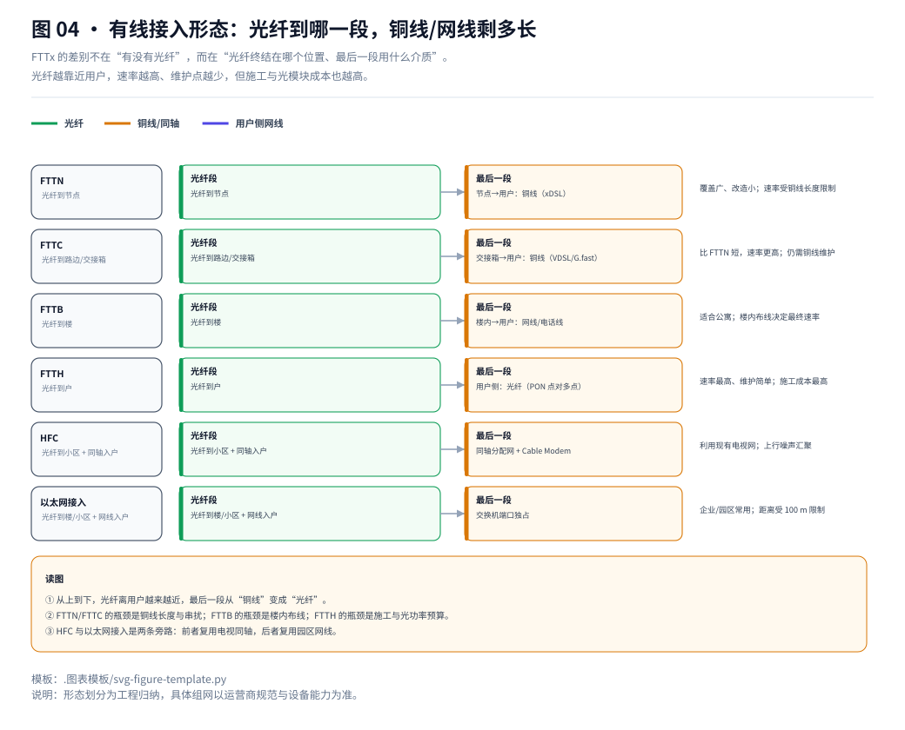

# 有线接入网形态

有线接入网要回答一个问题：**光纤修到哪里，最后一段用什么介质把用户接进来**。FTTN/FTTC/FTTB/FTTH 的差别不在“有没有光纤”，而在“光纤终结的位置”和“最后一段是铜线、同轴还是光纤”。

> 本篇定位：FTTx、HFC、以太网接入、电力线接入的形态与取舍，是介质、PHY、xDSL 之上的组网层。PON 的内部机制去 [03-光通信](../03-光通信/.readme.md)，产品方案去 [30-产品与方案](../../../30-产品与方案/.readme.md)。

## 目录

- [1 一句话模型](#s1)
- [2 速览](#s2)
- [3 六种接入形态](#s3)
- [4 从局端到用户](#s4)
- [5 状态机与定时器](#s5)
- [6 设计取舍与边界](#s6)
- [7 与相邻主题的关系](#s7)
- [名词解释](#名词解释)
- [8 参考与关联](#s8)

## 1 · 一句话模型：光纤尽量往前推，最后一段越短越快

```text
局端/机房
  ├─ FTTN：光纤到节点，节点→用户用铜线（xDSL）
  ├─ FTTC：光纤到路边/交接箱，交接箱→用户用铜线
  ├─ FTTB：光纤到楼，楼内→用户用网线/电话线
  └─ FTTH：光纤到户，用户侧直接接光
```

三个关键认知：

1. **“光纤到哪”决定最后一段的长度**：最后一段越短，可用带宽越高、维护点越少。
2. **接入形态不是纯技术选择**：它受存量介质、施工成本、用户密度、运维体系共同约束。
3. **HFC 和以太网接入是两条旁路**：前者复用电视同轴，后者复用园区网线，不必都走 FTTx。

## 2 · 速览

| 项 | 内容 |
| --- | --- |
| 所属领域 | 有线通信/接入网 |
| 核心对象 | 局端、光节点、交接箱、分光器、CPE |
| 关键参数 | 光纤到用户的距离、最后一段介质、分光比、速率 |
| 典型形态 | FTTN、FTTC、FTTB、FTTH、HFC、以太网接入 |
| 主要标准 | ITU-T G.984/G.987/G.9807、DOCSIS、IEEE 802.3 |

## 3 六种接入形态



**读图**：从上到下，光纤离用户越来越近，最后一段从铜线变成光纤。最右列是每种形态的瓶颈。先看“光纤终点”，再看“最后一段介质”。

> 图源：`images/图04-有线接入形态.svg`

| 形态 | 光纤终点 | 最后一段 | 典型速率 | 主要瓶颈 |
| --- | --- | --- | --- | --- |
| FTTN | 小区/节点 | 铜线（xDSL） | 数十 M | 铜线长度、串扰 |
| FTTC | 路边/交接箱 | 铜线（VDSL/G.fast） | 数十 M–数百 M | 铜线长度、G.fast 距离 |
| FTTB | 楼栋 | 网线/电话线 | 百 M–千 M | 楼内布线 |
| FTTH | 用户家 | 光纤 | 百 M–G 级 | 施工、光功率预算 |
| HFC | 小区光节点 | 同轴 | 数十 M–G 级 | 上行噪声汇聚、同轴分支 |
| 以太网接入 | 楼栋/园区 | 网线 | 百 M–10G | 100 m 距离限制 |

### 3.1 FTTN / FTTC

光纤到节点或路边，最后一段仍是电话铜线，靠 xDSL 传输。优点是复用存量铜线、改造量小；缺点是速率随距离快速下降，且线束内串扰难控。FTTC 比 FTTN 更靠近用户，所以能支撑 VDSL/G.fast。

### 3.2 FTTB

光纤到楼，楼内用网线或电话线分配到户。公寓场景常见。瓶颈从“接入铜线”转移到“楼内布线”：如果楼内是 Cat5e，可以千兆；如果是老电话线，仍要 xDSL。

### 3.3 FTTH

光纤直接到用户，用户侧接 ONU/ONT。速率最高、维护点最少，但施工成本最高。FTTH 通常采用 PON（点对多点），一根主干光纤经分光器服务多户，节省局端端口和光纤。

### 3.4 HFC

光纤到小区光节点，再用同轴分配网入户，用户侧用 Cable Modem。优点是复用有线电视的同轴网络；缺点是同轴段共享、上行噪声汇聚（“漏斗效应”），需要做好屏蔽与滤波。

### 3.5 以太网接入

光纤到楼/小区，楼内用交换机 + 网线，用户独占端口。企业、园区、校园常见。优点是带宽独占、时延低、运维简单；缺点是受双绞线 100 m 距离限制。

### 3.6 电力线接入

利用电力线传输（PLC/G.hn），免布线。适合老建筑补盲，但共享介质、噪声大、速率不稳定，通常作为补充而非主接入。

## 4 从局端到用户

```text
局端 OLT/交换机/CMTS
  → 主干光纤
    → 光节点/交接箱/分光器
      → 最后一段（铜线/同轴/网线/光纤）
        → 用户 CPE（DSL Modem/Cable Modem/ONU/AP）
```

### 4.1 正常路径

| 形态 | 局端设备 | 中间节点 | 用户设备 |
| --- | --- | --- | --- |
| FTTN/FTTC | DSLAM | 光节点/交接箱 | DSL Modem |
| FTTB | OLT/交换机 | 楼栋分光器/交换机 | ONU/网线 |
| FTTH | OLT | 分光器 | ONU/ONT |
| HFC | CMTS | 光节点 + 同轴分配网 | Cable Modem |
| 以太网接入 | 汇聚交换机 | 楼栋交换机 | 网线直连 |

### 4.2 异常分支

| 异常 | 现象 | 原因 | 处理方向 |
| --- | --- | --- | --- |
| 整片用户掉线 | 同一光节点/交接箱下全断 | 主干光纤/局端端口/供电 | 查 OLT/光功率/告警 |
| 单用户速率低 | 邻居正常 | 入户线/CPE/室内布线 | 换线、换口、测线路 |
| HFC 上行噪声 | 晚上掉线/速率低 | 同轴接头氧化、家电噪声 | 查接头、加滤波器、隔离 |
| FTTH 收光低 | ONU 不上线 | 分光比过大、光纤弯折/脏污 | 测光功率、清洁端面 |
| 以太网接入超距 | 链路不稳 | 网线超过 100 m | 加交换机/改光纤 |

## 5 状态机与定时器

接入网形态本身**没有统一状态机**，但每条链路都有自己的激活过程：

| 形态 | 激活过程 | 关键状态 |
| --- | --- | --- |
| xDSL | 握手 → 训练 → Showtime | 见 [02-xDSL与铜线接入](./02-xDSL与铜线接入.md) |
| PON | ONU 注册 → 测距 → 授权 | 见 [03-光通信/01-PON复用测距与注册](../03-光通信/01-PON复用测距与注册.md) |
| HFC | Cable Modem 扫描 →  ranging → 注册 | 下行同步、上行授权 |
| 以太网 | 自协商 → 链路 up | 见 [01-以太网PHY与速率演进](./01-以太网PHY与速率演进.md) |

> 判断“是接入网问题还是上层问题”的方法：看 CPE 的物理/链路状态。如果物理层没起来，先查介质与光功率；如果物理层正常但拨号失败，再查 PPPoE/DHCP/认证。

## 6 设计取舍与边界

### 6.1 施工成本 vs 运维成本

| 形态 | 施工成本 | 运维成本 | 适用 |
| --- | --- | --- | --- |
| FTTN/FTTC | 低（复用铜线） | 高（铜线/串扰） | 光纤未覆盖、存量铜线 | 
| FTTB | 中 | 中（楼内布线） | 公寓、园区 |
| FTTH | 高 | 低（无源光网络） | 新建、光纤到户 |
| HFC | 中（复用同轴） | 中高（上行噪声） | 有线电视网络 |
| 以太网接入 | 中 | 低 | 企业、园区 |

### 6.2 PON 的分光比

FTTH 不是“一根光纤只接一户”。PON 用分光器把一根主干光纤分给多户，分光比越大，局端端口越省，但每户光功率越低、可用预算越紧。分光比的选择要在“覆盖成本”和“光功率预算”之间取平衡。

### 6.3 常见误判

1. **“FTTH 一定比 FTTB 快”**：用户实际速率还受套餐、OLT 上行、家庭网络影响。
2. **“FTTC 升级 G.fast 就能千兆”**：G.fast 要求铜线很短，老小区往往达不到。
3. **“HFC 上行慢是设备问题”**：上行噪声汇聚是架构性问题，先查同轴接头与干扰源。
4. **“以太网接入可以随便拉远”**：双绞线超过 100 m 就不保证，必须加中继/改光纤。
5. **“接入网只影响带宽”**：它还影响时延、抖动、可用性和故障定位边界。

## 7 · 与相邻主题的关系

| 相邻主题 | 关系 |
| --- | --- |
| [00-有线传输介质](./00-有线传输介质.md) | 最后一段的介质选择 |
| [01-以太网PHY与速率演进](./01-以太网PHY与速率演进.md) | 以太网接入的 PHY 基础 |
| [02-xDSL与铜线接入](./02-xDSL与铜线接入.md) | FTTN/FTTC 的铜线技术 |
| [03-光通信/00-PON技术概览](../03-光通信/00-PON技术概览.md) | FTTH/FTTB 的 PON 机制 |
| [11-网络科学/02-链路层/06-PPP与PPPoE](../../11-网络科学/02-链路层/06-PPP与PPPoE.md) | 宽带拨号与认证 |
| [30-产品与方案](../../../30-产品与方案/.readme.md) | CPE/网关/FTTR 产品形态 |

一句话：**接入网形态决定“最后一公里”的成本与上限，PON 决定“光纤这一段”怎么复用。**

## 名词解释

> 缩写给出英文全称；非缩写用“—”表示。

| 术语 | 英文全称 | 解释 |
| --- | --- | --- |
| FTTx | Fiber to the x | 光纤到某处的统称。 |
| FTTN | Fiber to the Node | 光纤到节点。 |
| FTTC | Fiber to the Curb/Cabinet | 光纤到路边/交接箱。 |
| FTTB | Fiber to the Building | 光纤到楼。 |
| FTTH | Fiber to the Home | 光纤到户。 |
| HFC | Hybrid Fiber-Coaxial | 光纤同轴混合网。 |
| PON | Passive Optical Network | 无源光网络。 |
| OLT | Optical Line Terminal | 光线路终端（局端）。 |
| ONU | Optical Network Unit | 光网络单元。 |
| ONT | Optical Network Terminal | 光网络终端（用户侧）。 |
| DSLAM | Digital Subscriber Line Access Multiplexer | DSL 接入复用器。 |
| CMTS | Cable Modem Termination System | 电缆调制解调器终端系统。 |
| DOCSIS | Data Over Cable Service Interface Specification | 有线电视数据业务接口规范。 |
| CPE | Customer Premises Equipment | 用户侧设备。 |

## 8 · 参考与关联

**标准**

- ITU-T G.984：GPON。
- ITU-T G.987：XG-PON。
- ITU-T G.9807：XGS-PON。
- DOCSIS 3.0/3.1/4.0：HFC 数据接入。
- IEEE 802.3：以太网接入。

**关联**

- [00-有线传输介质](./00-有线传输介质.md)
- [01-以太网PHY与速率演进](./01-以太网PHY与速率演进.md)
- [02-xDSL与铜线接入](./02-xDSL与铜线接入.md)
- [03-光通信/00-PON技术概览](../03-光通信/00-PON技术概览.md)
- [30-产品与方案/33-CPE](../../../30-产品与方案/33-CPE/.readme.md)

---

> **本篇定位**：有线接入网的形态与取舍；PON 内部机制与产品实现分别去 03 和 40。
> **素材来源**：`studyspace/1.知识体系/1.计算机网络/m-1-计算机网络和因特网.md` 接入网节；其余按 ITU-T G.98x、DOCSIS、IEEE 802.3 公开知识补写。
> **待验证**：各形态的实际速率、分光比、覆盖距离随运营商方案与设备能力变化。
