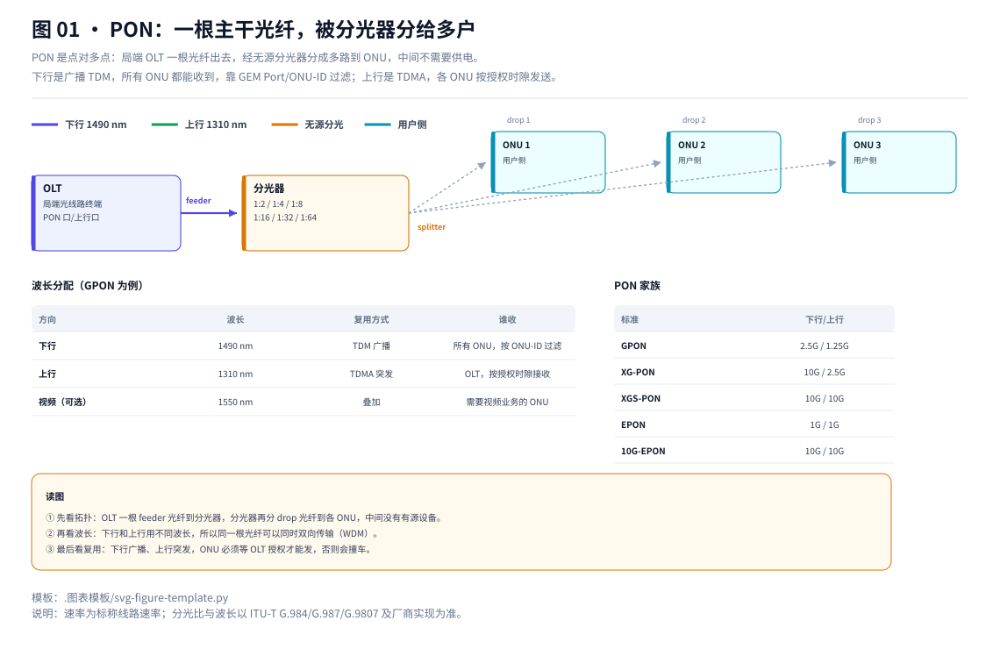

# PON 技术概览

PON（无源光网络）用一根主干光纤 + 无源分光器，把局端 OLT 的信号分给多个用户 ONU。它把“光纤到户”的成本从“每户一根纤”降到“一根纤分多户”，是 FTTH/FTTB 的主流形态。

> 本篇定位：PON 的拓扑、波长、速率家族、分光比与 AON/PON 的边界。上行复用、测距、注册去 [01-PON复用测距与注册](./01-PON复用测距与注册.md)，光模块去 [02-光模块与SFP](./02-光模块与SFP.md)，产品方案去 [30-产品与方案](../../../30-产品与方案/.readme.md)。

## 目录

- [1 一句话模型](#s1)
- [2 速览](#s2)
- [3 PON 家族与关键参数](#s3)
- [4 下行广播、上行突发](#s4)
- [5 状态机与定时器](#s5)
- [6 设计取舍与边界](#s6)
- [7 与相邻主题的关系](#s7)
- [名词解释](#名词解释)
- [8 参考与关联](#s8)

## 1 · 一句话模型：一根纤、一个分光器、多个 ONU

```text
OLT ──feeder 光纤── 分光器 ──drop 光纤── ONU 1
                              ├──drop 光纤── ONU 2
                              └──drop 光纤── ONU N
```

三个关键认知：

1. **PON 的“无源”指分光器不需要供电**：中间没有放大器、没有交换机，故障点少、维护简单。
2. **下行是广播，上行是突发**：下行所有 ONU 都能收到，靠 ONU-ID/GEM Port 过滤；上行各 ONU 必须在 OLT 授权的时隙发送。
3. **上下行用不同波长**：同一根光纤同时双向传输，靠 WDM 分离。

## 2 · 速览

| 项 | 内容 |
| --- | --- |
| 所属领域 | 光通信/接入网 |
| 核心对象 | OLT、分光器、ONU/ONT、feeder/drop 光纤 |
| 关键参数 | 线路速率、波长、分光比、传输距离、光功率预算 |
| 典型拓扑 | 树形（点对多点） |
| 主要标准 | ITU-T G.984（GPON）、G.987（XG-PON）、G.9807（XGS-PON）、IEEE 802.3ah（EPON） |

## 3 · PON 家族与关键参数

| 家族 | 标准 | 下行/上行速率 | 下行波长 | 上行波长 | 典型分光比 | 备注 |
| --- | --- | --- | --- | --- | --- | --- |
| GPON | ITU-T G.984 | 2.5G / 1.25G | 1490 nm | 1310 nm | 1:32/1:64 | 支持 1550 nm 视频叠加 |
| XG-PON | ITU-T G.987 | 10G / 2.5G | 1577 nm | 1270 nm | 1:64/1:128 | 非对称 |
| XGS-PON | ITU-T G.9807 | 10G / 10G | 1577 nm | 1270 nm | 1:64/1:128 | 对称 10G |
| EPON | IEEE 802.3ah | 1G / 1G | 1490 nm | 1310 nm | 1:32 | 以太网帧直接承载 |
| 10G-EPON | IEEE 802.3av | 10G / 10G 或 10G/1G | 1577 nm | 1270 nm | 1:32/1:64 | 与 EPON 共存需波长规划 |
| NG-PON2 | ITU-T G.989 | 40G（TWDM） | 多波长 | 多波长 | 1:64 级 | 多波长堆叠 |
| 50G PON | ITU-T G.9804 系列 | 50G 级 | 待验证 | 待验证 | 待验证 | 标准与产业仍在演进 |

> **边界**：上表是“标称线路速率/典型值”，不是用户套餐速率；实际可用速率受分光比、光功率预算、OLT 上行带宽、业务配置影响。

### 3.1 波长为什么这样分

| 波长 | 用途 | 原因 |
| --- | --- | --- |
| 1310 nm | GPON/EPON 上行 | 色散小、上行成本低 |
| 1490 nm | GPON/EPON 下行 | 与 1310 分离，便于 WDM |
| 1550 nm | 视频叠加/长距 | 光纤损耗最低，适合长距/视频 |
| 1270 nm | XG(S)-PON 上行 | 与 GPON 上行错开，支持共存 |
| 1577 nm | XG(S)-PON 下行 | 与 GPON 下行错开，支持共存 |

GPON 与 XG(S)-PON 可以在同一 ODN 上共存（WDM 叠加），这是运营商“平滑升级”的基础。

### 3.2 分光比与距离

分光比越大，局端端口越省，但每户光功率越低；距离越长，光纤损耗越大。两者共同受**光功率预算**约束：

```text
可用预算 ≥ 分光器损耗 + 光纤损耗 + 连接器/熔接损耗 + 余量
```

所以“1:128 + 20 km”不是随便能组合的，要看 OLT 发光功率、ONU 灵敏度和光预算等级。

## 4 下行广播、上行突发



**读图**：左边是 OLT，中间是无源分光器，右边是多个 ONU；颜色区分下行/上行波长。下方矩阵给出 GPON 的波长分配和 PON 家族速率。先看拓扑，再看“上下行为什么能同纤”。

> 图源：`images/图01-PON拓扑与波长.svg`

### 4.1 下行

```text
OLT 把发给所有 ONU 的数据复用到下行帧
  → 广播到 ODN
    → 每个 ONU 都收到
      → 按 ONU-ID / GEM Port 过滤出属于自己的部分
```

下行是“共享的广播信道”，不需要调度冲突；但所有 ONU 的带宽加起来不能超过下行线路速率。

### 4.2 上行

```text
OLT 通过 DBA 计算每个 ONU 的授权
  → 在下行帧里下发授权（Grant）
    → ONU 只在授权时隙发送突发
      → 各 ONU 的突发按时间排开，中间留保护间隔
```

上行是“共享的突发信道”，必须解决三件事：**谁先发（授权）、什么时候发（测距）、发多大（DBA）**。

### 4.3 异常分支

| 异常 | 现象 | 原因 | 处理方向 |
| --- | --- | --- | --- |
| ONU 不上线 | 无法注册 | 光功率低、SN/密码错、分光比过大 | 测收光、核对注册信息 |
| 某个 ONU 影响全 PON | 其他 ONU 掉线/误码 |  rogue ONU 持续发光 | 隔离/定位异常发光 ONU |
| 上行拥塞 | 忙时上行速率低 | DBA 分配不足/用户超售 | 调整 DBA/SLA、扩容 |
| 长距 ONU 不稳定 | 远端 ONU 掉线 | 光预算不足/测距超范围 | 缩短距离、提高功率等级 |
| 共存干扰 | GPON/XG-PON 互相影响 | 波长规划/滤波不当 | 检查 WDM 共存方案 |

## 5 状态机与定时器

PON 的“状态机”主要在 ONU 注册与测距过程：

| 状态（简化） | 含义 |
| --- | --- |
| 初始/待机 | ONU 上电，等待 OLT 发现 |
| 发现/序列号 | 上报 Serial Number，等待授权 |
| 测距 | 测量 RTT，分配均衡时延 |
| 运行 | 正常收发，受 DBA 调度 |
| 失联/重注册 | 光信号丢失或超时，重新注册 |

定时器/机制：

- **发现窗口**：OLT 周期性开放，允许新 ONU 上报。
- **测距周期**：跟踪光纤温度/老化引起的时延漂移。
- **DBA 周期**：动态分配上行带宽。
- **保护间隔**：防止相邻 ONU 突发重叠。

> 具体状态名与迁移条件以 ITU-T G.984.3 为准；不同厂商实现可能简化或扩展。

## 6 设计取舍与边界

### 6.1 PON vs AON

| 维度 | PON（无源） | AON（有源） |
| --- | --- | --- |
| 中间设备 | 无源分光器 | 有源交换机/放大器 |
| 供电 | 不需要 | 需要 |
| 故障点 | 少 | 多 |
| 覆盖 | 受光预算限制 | 可中继延伸 |
| 成本 | 低（分光器便宜） | 高（有源设备） |
| 典型 | FTTH/FTTB | 园区/长距骨干 |

### 6.2 分光比与覆盖

| 分光比 | 每户功率 | 局端端口 | 适用 |
| --- | --- | --- | --- |
| 1:8 | 高 | 多 | 长距/高带宽 |
| 1:32 | 中 | 中 | 常见 FTTH |
| 1:64 | 低 | 少 | 高密度、短距 |
| 1:128 | 很低 | 很少 | 需高功率等级/短距 |

### 6.3 常见误判

1. **“PON 是点对点”**：PON 是点对多点，下行广播、上行共享。
2. **“分光比越大越省钱，所以越大越好”**：分光比受光功率预算限制，过大会导致远户不上线。
3. **“GPON 和 XGS-PON 不能共存”**：通过 WDM 波长规划可以共存，但需要 OLT/ONU 支持。
4. **“ONU 收光正常就一定稳定”**：还要看发光、误码、测距、DBA 和上行噪声。
5. **“PON 没有安全问题”**：下行广播意味着其他 ONU 理论上能收到广播帧，需要加密（如 AES）与过滤。

## 7 · 与相邻主题的关系

| 相邻主题 | 关系 |
| --- | --- |
| [01-PON复用测距与注册](./01-PON复用测距与注册.md) | 下行 TDM、上行 TDMA、GEM/TCONT、测距 |
| [02-光模块与SFP](./02-光模块与SFP.md) | OLT/ONU 的光模块与波长 |
| [03-ODN与光功率预算](./03-ODN与光功率预算.md) | 分光器、光纤、连接器的预算 |
| [02-有线通信/03-有线接入网形态](../02-有线通信/03-有线接入网形态.md) | FTTH/FTTB 在接入网中的位置 |
| [01-通信原理/02-多址与双工](../01-通信原理/02-多址与双工.md) | TDM/TDMA 的通用模型 |
| [30-产品与方案/36-ONU-ONT](../../../30-产品与方案/36-ONU-ONT/.readme.md) | ONU/ONT 产品形态 |

一句话：**PON 用“无源分光 + 波长隔离 + 上下行复用”把光纤接入的成本摊薄。**

## 名词解释

> 缩写给出英文全称；非缩写用“—”表示。

| 术语 | 英文全称 | 解释 |
| --- | --- | --- |
| PON | Passive Optical Network | 无源光网络。 |
| AON | Active Optical Network | 有源光网络。 |
| OLT | Optical Line Terminal | 光线路终端（局端）。 |
| ONU | Optical Network Unit | 光网络单元。 |
| ONT | Optical Network Terminal | 光网络终端（用户侧）。 |
| ODN | Optical Distribution Network | 光分配网络（光纤/分光器/接头）。 |
| GPON | Gigabit-capable Passive Optical Network | 千兆级无源光网络。 |
| XG-PON | 10-Gigabit-capable Passive Optical Network | 10G 非对称 PON。 |
| XGS-PON | 10-Gigabit-capable Symmetric Passive Optical Network | 10G 对称 PON。 |
| EPON | Ethernet Passive Optical Network | 以太网无源光网络。 |
| NG-PON2 | Next-Generation Passive Optical Network 2 | 下一代 PON（TWDM）。 |
| WDM | Wavelength Division Multiplexing | 波分复用。 |
| TDM | Time Division Multiplexing | 时分复用。 |
| TDMA | Time Division Multiple Access | 时分多址。 |
| DBA | Dynamic Bandwidth Allocation | 动态带宽分配。 |

## 8 · 参考与关联

**标准**

- ITU-T G.984.1/2/3：GPON 总体、光预算、传输汇聚。
- ITU-T G.987 系列：XG-PON。
- ITU-T G.9807.1：XGS-PON。
- ITU-T G.989 系列：NG-PON2。
- IEEE 802.3ah：EPON。
- IEEE 802.3av：10G-EPON。

**关联**

- [01-PON复用测距与注册](./01-PON复用测距与注册.md)
- [02-光模块与SFP](./02-光模块与SFP.md)
- [03-ODN与光功率预算](./03-ODN与光功率预算.md)
- [02-有线通信/03-有线接入网形态](../02-有线通信/03-有线接入网形态.md)
- [30-产品与方案/36-ONU-ONT](../../../30-产品与方案/36-ONU-ONT/.readme.md)

---

> **本篇定位**：PON 的拓扑、波长、速率家族与分光比；不展开具体芯片/OLT 配置。
> **素材来源**：源仓库无 PON 素材，本篇按 ITU-T G.984/G.987/G.9807/G.989 与 IEEE 802.3ah/av 公开框架撰写。
> **待验证**：50G PON 的速率/波长/分光比、各厂商支持的 GPON/XGS-PON 共存方案与光预算等级。
