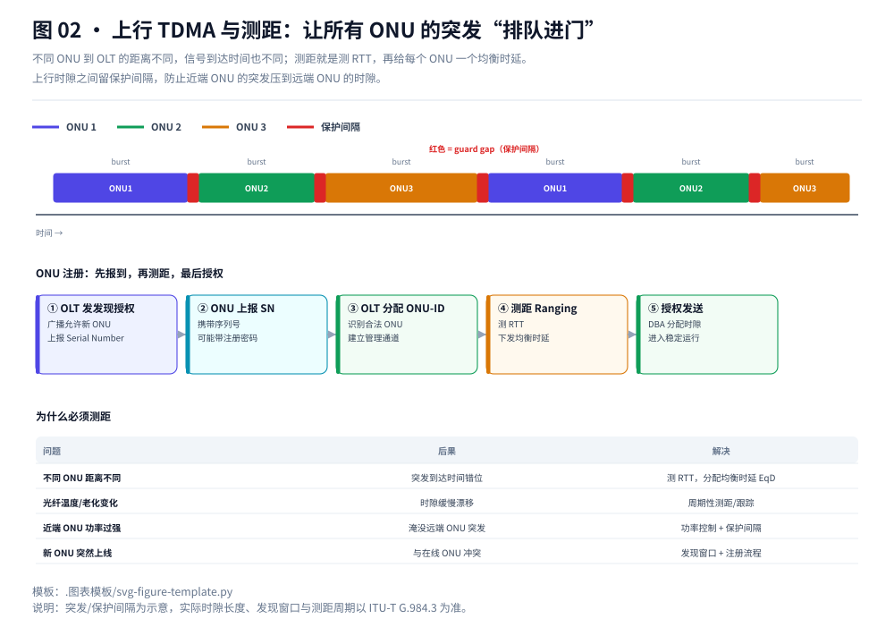

# PON 复用测距与注册

PON 的下行是“一个人说、所有人听”，上行是“大家排队、按号进场”。排队要解决三件事：**谁有资格发（注册）、什么时候发（测距）、发多少（DBA）**。这三件事做不好，上行就会撞车或浪费。

> 本篇定位：GPON 下行帧、上行突发、GEM/TCONT、DBA、ONU 注册与测距。PON 家族与波长去 [00-PON技术概览](./00-PON技术概览.md)，ODN 预算去 [03-ODN与光功率预算](./03-ODN与光功率预算.md)。

## 目录

- [1 一句话模型](#s1)
- [2 速览](#s2)
- [3 下行帧与上行突发](#s3)
- [4 注册、测距与授权](#s4)
- [5 状态机与定时器](#s5)
- [6 设计取舍与边界](#s6)
- [7 与相邻主题的关系](#s7)
- [名词解释](#名词解释)
- [8 参考与关联](#s8)

## 1 · 一句话模型：下行广播，上行排队

```text
下行：OLT ──广播帧（PCBd + GEM）──→ 所有 ONU
                                   └─ 各 ONU 按 ONU-ID/GEM Port 取自己的

上行：OLT ──Grant（授权时隙）──→ ONU
       ONU ──突发（burst）──→ OLT
       各 ONU 的突发在时间上排开，中间留 guard gap
```

三个关键认知：

1. **下行不需要“抢”**：OLT 是唯一发送者，所有 ONU 共享广播信道，按标识过滤。
2. **上行必须“排队”**：多个 ONU 共享同一根光纤的上行波长，不同时发就会撞。
3. **测距是排队的前提**：不知道每个 ONU 的往返时延，就无法把突发排进正确的时隙。

## 2 · 速览

| 项 | 内容 |
| --- | --- |
| 所属领域 | 光通信/PON |
| 核心对象 | 下行帧、上行突发、GEM Port、T-CONT、Grant |
| 关键机制 | TDM 下行、TDMA 上行、DBA、Ranging |
| 关键参数 | 授权周期、保护间隔、均衡时延、分光比 |
| 主要标准 | ITU-T G.984.3（GPON TC 层） |

## 3 下行帧与上行突发

### 3.1 下行帧

GPON 下行帧由 **PCBd（Physical Control Block downstream）** 和载荷组成：

| 部分 | 作用 | 关键字段 |
| --- | --- | --- |
| PCBd | 下行物理层控制 | 帧同步、Superframe 计数、DBA 授权、BW Map |
| 载荷 | 承载 GEM 帧 | GEM Port ID、数据 |

**BW Map** 是下行帧里最关键的字段：它告诉每个 ONU“你在本帧的哪个上行时隙、发多少”。所以上行调度不是“ONU 自己决定”，而是 OLT 每帧下发。

### 3.2 上行突发

上行以突发（burst）为单位：每个 ONU 在自己的授权时隙打开激光器，发送前导码/定界符 + 数据，然后关闭。OLT 需要在突发之间重新做时钟恢复、幅度恢复和定界。

| 部分 | 作用 |
| --- | --- |
| 前导码（Preamble） | 让 OLT 恢复时钟/幅度 |
| 定界符（Delimiter） | 标识突发开始 |
| 数据 | GEM 帧/管理消息 |
| 保护间隔（Guard） | 防止相邻突发重叠 |

> **边界**：突发之间的 guard gap 不是浪费，而是为距离差、温度漂移、器件抖动留的余量。guard 太小会撞车，太大则浪费上行带宽。

### 3.3 GEM 与 T-CONT

| 概念 | 作用 | 类比 |
| --- | --- | --- |
| GEM Port | 承载一种业务流（以太网/语音/管理） | 一条“逻辑管道” |
| T-CONT | 上行带宽的容器，按 SLA 分配 | 一张“上行通行证” |
| Alloc-ID | OLT 分配给 T-CONT 的标识 | 通行证编号 |
| DBA | 动态调整 T-CONT 的授权量 | 按需发通行证 |

业务流先映射到 GEM Port，再绑定到 T-CONT，T-CONT 由 DBA 调度。这样“业务优先级”和“带宽分配”就解耦了。

## 4 注册、测距与授权



**读图**：上半部分是上行时间轴，三个 ONU 的突发按授权排开，红色是保护间隔；下半部分是注册五步：发现授权 → 上报 SN → 分配 ONU-ID → 测距 → 授权发送。先看“为什么排队”，再看“怎么排进去”。

> 图源：`images/图02-上行TDMA与测距.svg`

### 4.1 注册流程

```text
① OLT 周期性开放发现窗口（Discovery）
   → 广播允许未注册 ONU 上报

② 新 ONU 在窗口内上报 Serial Number（SN）
   → 可能携带注册密码/设备信息

③ OLT 校验 SN/密码
   → 合法则分配 ONU-ID

④ 测距（Ranging）
   → 测 RTT，计算均衡时延 EqD
   → 把 EqD 下发给 ONU

⑤ 授权发送
   → DBA 分配 Alloc-ID/时隙
   → ONU 进入稳定运行
```

### 4.2 测距在算什么

```text
RTT = 2 × 光纤传播时延 + 设备处理时延
EqD = 参考时延 − 实测 RTT
ONU 发送时刻 = 授权时刻 − EqD
```

所有 ONU 都被“对齐”到同一个逻辑参考点，这样 OLT 才能按统一时隙接收。距离越远，EqD 越小（或补偿越大），具体符号约定以标准/实现为准。

### 4.3 异常分支

| 异常 | 现象 | 原因 | 处理方向 |
| --- | --- | --- | --- |
| ONU 注册失败 | 不上线 | SN/密码错、收光低、分光比过大 | 核对注册信息、测光功率 |
| 注册成功但频繁掉线 | 反复上下线 | 测距漂移、光功率临界、温度 | 查光预算、观察误码 |
| rogue ONU | 整个 PON 上行误码 | 某 ONU 不受控持续发光 | 逐户隔离/换 ONU |
| 上行时隙浪费 | 上行速率低 | guard 过大、DBA 保守 | 优化 DBA/时隙配置 |
| 新 ONU 上线撞车 | 在网 ONU 短时误码 | 发现窗口/测距冲突 | 检查发现窗口与注册流程 |

## 5 状态机与定时器

GPON ONU 的注册状态机（简化）：

| 状态 | 含义 | 迁移条件 |
| --- | --- | --- |
| O1 初始 | 上电/失联 | 收到下行同步 → O2 |
| O2 待机 | 已同步，等待发现 | 收到发现授权 → O3 |
| O3 序列号 | 上报 SN | 收到分配 ONU-ID → O4 |
| O4 测距 | 测 RTT、等 EqD | 测距完成 → O5 |
| O5 运行 | 正常收发 | 失联/超时 → O1 |
| O6 间歇失步 | 周期性失步/重新同步 | 恢复 → O5；持续失败 → O1 |
| O7 紧急停止 | 异常发光/保护 | 人工/自动恢复 |

关键定时器/周期：

| 机制 | 作用 | 影响 |
| --- | --- | --- |
| 发现窗口 | 允许新 ONU 注册 | 太频繁影响业务，太少新装慢 |
| 测距周期 | 跟踪时延漂移 | 太慢会失步，太快占管理带宽 |
| DBA 周期 | 调整上行授权 | 影响上行时延与利用率 |
| 保护间隔 | 防突发重叠 | 与距离差/器件抖动匹配 |

> 具体状态编号、定时器名称和取值以 ITU-T G.984.3 与厂商实现为准，这里只给工程理解。

## 6 设计取舍与边界

### 6.1 固定带宽 vs 动态带宽

| 方式 | 优点 | 缺点 | 适用 |
| --- | --- | --- | --- |
| 固定授权 | 简单、时延稳定 | 空闲时浪费 | 专线/TDM 业务 |
| DBA | 按需分配、利用率高 | 实现复杂、时延有波动 | 宽带上网/视频 |

DBA 的难点是“既要快，又要公平”：报告/计算/下发都有延迟，重载时容易出现“申请了但批不下来”的抖动。

### 6.2 测距精度与 guard

测距误差、温度漂移、器件抖动都要靠 guard 吸收。guard 越大越安全，但上行带宽浪费越多。工程上要在“距离覆盖”和“上行效率”之间取平衡。

### 6.3 常见误判

1. **“ONU 收光正常就能注册”**：还要 SN/密码正确、OLT 有可用 ONU-ID、测距在范围内。
2. **“上行慢是 ONU 问题”**：可能是 DBA 配置、OLT 上行拥塞、guard 过大或 rogue ONU。
3. **“分光器是无源的，所以不会坏”**：分光器会脏、会断纤、会接头损耗变大。
4. **“某个 ONU 坏了只影响自己”**：rogue ONU 可能拖垮整个 PON 的上行。
5. **“注册一次就一劳永逸”**：光纤温度/老化会让时延漂移，需要周期测距。

## 7 · 与相邻主题的关系

| 相邻主题 | 关系 |
| --- | --- |
| [00-PON技术概览](./00-PON技术概览.md) | PON 拓扑、波长、速率家族 |
| [02-光模块与SFP](./02-光模块与SFP.md) | OLT/ONU 光模块与收发光 |
| [03-ODN与光功率预算](./03-ODN与光功率预算.md) | 分光器/光纤损耗对注册的影响 |
| [01-通信原理/02-多址与双工](../01-通信原理/02-多址与双工.md) | TDM/TDMA 与调度接入的通用模型 |
| [02-有线通信/03-有线接入网形态](../02-有线通信/03-有线接入网形态.md) | FTTH/FTTB 的接入位置 |
| [30-产品与方案/36-ONU-ONT](../../../30-产品与方案/36-ONU-ONT/.readme.md) | ONU/ONT 产品与注册配置 |

一句话：**下行靠“广播 + 过滤”，上行靠“授权 + 测距 + 保护间隔”，三者缺一不可。**

## 名词解释

> 缩写给出英文全称；非缩写用“—”表示。

| 术语 | 英文全称 | 解释 |
| --- | --- | --- |
| PCBd | Physical Control Block downstream | GPON 下行物理控制块。 |
| BW Map | Bandwidth Map | 下行帧里携带的上行授权表。 |
| GEM | GPON Encapsulation Method | GPON 的业务封装方式。 |
| GEM Port | GEM Port | 承载一种业务流的逻辑端口。 |
| T-CONT | Transmission Container | 上行带宽容器。 |
| Alloc-ID | Allocation Identifier | T-CONT 的分配标识。 |
| DBA | Dynamic Bandwidth Allocation | 动态带宽分配。 |
| Ranging | Ranging | 测距，测量 RTT 并计算均衡时延。 |
| EqD | Equalization Delay | 均衡时延，用于对齐各 ONU 的发送时刻。 |
| SN | Serial Number | ONU 序列号。 |
| RTT | Round-Trip Time | 往返时延。 |
| rogue ONU | Rogue ONU | 异常发光/不受控的 ONU。 |
| guard gap | Guard Gap | 上行突发之间的保护间隔。 |

## 8 · 参考与关联

**标准**

- ITU-T G.984.3：GPON 传输汇聚层（帧、GEM、DBA、测距、注册）。
- ITU-T G.987.3：XG-PON 传输汇聚层。
- ITU-T G.9807.1：XGS-PON。
- ITU-T G.988：OMCI 管理模型。

**关联**

- [00-PON技术概览](./00-PON技术概览.md)
- [02-光模块与SFP](./02-光模块与SFP.md)
- [03-ODN与光功率预算](./03-ODN与光功率预算.md)
- [01-通信原理/02-多址与双工](../01-通信原理/02-多址与双工.md)
- [30-产品与方案/36-ONU-ONT](../../../30-产品与方案/36-ONU-ONT/.readme.md)

---

> **本篇定位**：PON 上下行复用、GEM/TCONT、DBA、注册与测距；不展开 OMCI 具体 MIB。
> **素材来源**：源仓库无 PON 素材，本篇按 ITU-T G.984.3 公开框架撰写。
> **待验证**：状态编号、定时器取值、DBA 算法与 EqD 符号约定随标准版本/厂商实现变化。
