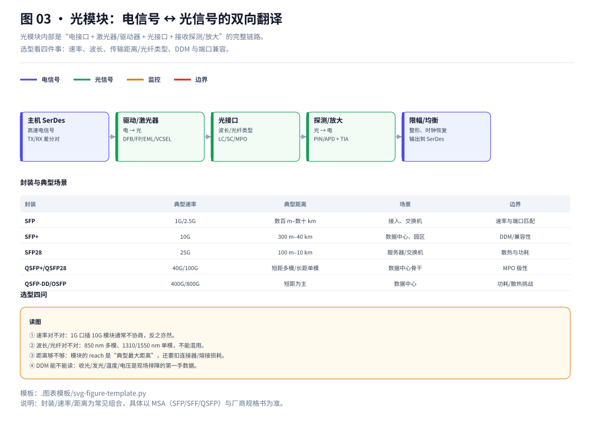

# 光模块与 SFP

光模块是“电信号 ↔ 光信号”的翻译器。它把主机的电信号变成激光，把收到的光变成电信号；同时通过 DDM 把温度、电压、收发光功率暴露给主机。选错模块，链路可能“插得上但起不来”。

> 本篇定位：光模块的内部链路、封装、波长/距离、DDM 与兼容性。PON 的波长规划去 [00-PON技术概览](./00-PON技术概览.md)，ODN 预算去 [03-ODN与光功率预算](./03-ODN与光功率预算.md)。

## 目录

- [1 一句话模型](#s1)
- [2 速览](#s2)
- [3 封装、速率与波长](#s3)
- [4 电到光、光到电](#s4)
- [5 状态机与定时器](#s5)
- [6 设计取舍与边界](#s6)
- [7 与相邻主题的关系](#s7)
- [名词解释](#名词解释)
- [8 参考与关联](#s8)

## 1 · 一句话模型：模块是“光电转换 + 监控”的小系统

```text
主机 SerDes ──电信号──→ 驱动 → 激光器 → 光信号 → 光纤
主机 SerDes ←─电信号──← 限幅/均衡 ← TIA ← 探测器 ← 光信号
                          ↑
                    DDM：温度/电压/收发光/告警
```

三个关键认知：

1. **光模块不是“无源转接头”**：它内部有激光器、探测器、放大器、时钟恢复和监控电路，是有源器件。
2. **速率、波长、距离、光纤类型必须同时匹配**：只对上速率，不等于能通。
3. **DDM 是现场排障的第一手数据**：收光/发光/温度/电压异常，比“link down”更能定位问题。

## 2 · 速览

| 项 | 内容 |
| --- | --- |
| 所属领域 | 光通信 |
| 核心对象 | 光模块、激光器、探测器、DDM |
| 关键参数 | 速率、波长、reach、光纤类型、收发光功率 |
| 常见封装 | SFP、SFP+、SFP28、QSFP+、QSFP28、QSFP-DD |
| 主要规范 | SFF-8472（DDM）、SFF-8431、MSA、IEEE 802.3 |

## 3 · 封装、速率与波长

| 封装 | 典型速率 | 典型介质/距离 | 场景 |
| --- | --- | --- | --- |
| SFP | 1G/2.5G | 多模 550 m / 单模 10–40 km | 接入、企业交换机 |
| SFP+ | 10G | 多模 300 m / 单模 10–40 km | 数据中心、园区 |
| SFP28 | 25G | 多模 100 m / 单模 10 km | 服务器/交换机 |
| QSFP+ | 40G | 多模/单模 | 数据中心 |
| QSFP28 | 100G | 多模/单模 | 数据中心骨干 |
| QSFP-DD/OSFP | 400G/800G | 短距多模/单模 | 数据中心 |

### 3.1 波长与光纤

| 波长 | 光纤 | 典型用途 | 注意 |
| --- | --- | --- | --- |
| 850 nm | 多模（OM3/OM4） | 短距数据中心 | 距离短，成本低 |
| 1310 nm | 单模 | 10–40 km | 色散小，常用 |
| 1550 nm | 单模 | 长距/视频 | 损耗最低，需考虑色散 |
| 1270/1577 nm | 单模 | XG(S)-PON | 与 GPON 波长共存 |
| 1490 nm | 单模 | GPON 下行 | 与 1310 上行配对 |

> **边界**：单模模块不能插多模光纤，多模模块也不能长距跑单模；波长/光纤类型不匹配时，可能“能收到一点光但误码很高”。

### 3.2 reach 与预算

模块标称的 reach（如 10 km、40 km）是“典型最大距离”，前提是光纤损耗、连接器、熔接都在预算内。实际可用距离要用光功率预算核算，不能只看模块标签。

## 4 电到光、光到电



**读图**：从左到右是发送链（SerDes → 驱动 → 激光器 → 光纤），从右到左是接收链（光纤 → 探测器 → TIA → 限幅 → SerDes）。下方矩阵给出封装/速率/距离，底部是选型四问。

> 图源：`images/图03-光模块与SFP.svg`

### 4.1 发送链

```text
主机 SerDes 高速电信号
  → 驱动（偏置/调制）
    → 激光器（DFB/FP/EML/VCSEL）
      → 光信号耦合进光纤
```

- **DFB**：分布反馈激光器，单模、窄线宽，适合长距。
- **FP**：法布里-珀罗激光器，成本低，适合短距。
- **EML**：电吸收调制激光器，高速长距。
- **VCSEL**：垂直腔面发射激光器，多模短距，成本低。

### 4.2 接收链

```text
光纤 → 探测器（PIN/APD）
  → TIA（跨阻放大）
    → 限幅/均衡
      → 时钟恢复
        → 主机 SerDes
```

APD 有雪崩增益，灵敏度更高但需要高压偏置；PIN 简单、成本低，短距常用。

### 4.3 DDM 能看什么

| 参数 | 正常含义 | 异常提示 |
| --- | --- | --- |
| 温度 | 模块工作温度 | 过高会降速/保护 |
| 电压 | 供电电压 | 偏低会导致不稳定 |
| TX Power | 发送光功率 | 偏低：激光器老化/驱动故障 |
| RX Power | 接收光功率 | 偏低：链路损耗/脏污；过高：可能过载 |
| Bias Current | 激光器偏置电流 | 随老化上升 |
| Alarm/Warning | 阈值告警 | 直接指向收发光异常 |

> **读 DDM 的顺序**：先看 RX Power 是否在范围内，再看 TX Power 是否正常，最后看温度/电压/告警。RX 低不一定是模块坏，可能是光纤/接头/对端。

## 5 状态机与定时器

光模块本身没有复杂状态机，但有几个关键状态：

| 状态 | 含义 | 观测 |
| --- | --- | --- |
| 上电/初始化 | 模块加载校准参数 | 主机能否识别 |
| 发送使能 | 激光器开启 | TX Power 有读数 |
| 接收就绪 | 收到有效光 | RX Power 有读数 |
| LOS（Loss of Signal） | 无光/光太弱 | link down、LOS 告警 |
| 温度保护 | 过温降功率/关断 | 温度告警 |

> 工程判断：`link down + RX Power 无读数` 优先查光纤/对端；`link up + RX 正常但误码` 优先查波长/光纤类型/模块兼容性。

## 6 设计取舍与边界

### 6.1 距离与成本

| 方案 | 成本 | 距离 | 适用 |
| --- | --- | --- | --- |
| 多模 VCSEL | 低 | 数百米 | 机房内 |
| 单模 DFB 10 km | 中 | 10 km | 园区/接入 |
| 单模 EML 40 km+ | 高 | 40 km+ | 骨干/长距 |
| 相干模块 | 很高 | 数百 km | 长途/城域 |

### 6.2 兼容性

光模块的“兼容性”通常指厂商对 EEPROM 的校验。即使电气/光学参数一致，主机也可能因为厂商码不匹配而拒绝识别。工程上要区分：

- **不识别**：主机读不到模块信息（兼容码/接口问题）。
- **识别但不通**：波长/光纤/速率/对端不匹配。
- **通但误码**：光功率不足、色散、反射、模块质量。

### 6.3 常见误判

1. **“能插上就能用”**：封装相同不代表速率/波长/协议兼容。
2. **“RX 有光就正常”**：收光过强会过载，过弱会误码；要看是否在规格窗口内。
3. **“模块温度高就是坏了”**：高密度交换机里温度高常见，关键看是否触发告警/降速。
4. **“reach 写 40 km 就能跑 40 km”**：还要扣连接器、熔接、光纤老化余量。
5. **“换模块能解决所有光路问题”**：光纤脏污、弯折、分光比过大，换模块也没用。

## 7 · 与相邻主题的关系

| 相邻主题 | 关系 |
| --- | --- |
| [00-PON技术概览](./00-PON技术概览.md) | PON 的波长规划与模块类型 |
| [01-PON复用测距与注册](./01-PON复用测距与注册.md) | OLT/ONU 收发光与注册 |
| [03-ODN与光功率预算](./03-ODN与光功率预算.md) | 模块预算与链路损耗 |
| [02-有线通信/00-有线传输介质](../02-有线通信/00-有线传输介质.md) | 单模/多模光纤的物理特性 |
| [02-有线通信/01-以太网PHY与速率演进](../02-有线通信/01-以太网PHY与速率演进.md) | 电口/光口与 SerDes |
| [30-平台与芯片](../../../30-平台与芯片/.readme.md) | 光模块选型与平台适配 |

一句话：**模块选型不是“看速率”，而是“速率 × 波长 × 距离 × 光纤 × 兼容性”五个条件的交集。**

## 名词解释

> 缩写给出英文全称；非缩写用“—”表示。

| 术语 | 英文全称 | 解释 |
| --- | --- | --- |
| SFP | Small Form-factor Pluggable | 小型可插拔光模块封装。 |
| SFP+ | Enhanced Small Form-factor Pluggable | 10G SFP 封装。 |
| SFP28 | Small Form-factor Pluggable 28 | 25G SFP 封装。 |
| QSFP | Quad Small Form-factor Pluggable | 四通道可插拔封装。 |
| QSFP-DD | Quad Small Form-factor Pluggable Double Density | 双密度 400G 封装。 |
| OSFP | Octal Small Form-factor Pluggable | 八通道 400G/800G 封装。 |
| DDM | Digital Diagnostic Monitoring | 数字诊断监控（温度/电压/收发光）。 |
| TOSA | Transmitter Optical Sub-Assembly | 光发送组件。 |
| ROSA | Receiver Optical Sub-Assembly | 光接收组件。 |
| TIA | Transimpedance Amplifier | 跨阻放大器。 |
| DFB | Distributed Feedback Laser | 分布反馈激光器。 |
| FP | Fabry–Pérot Laser | 法布里-珀罗激光器。 |
| EML | Electro-absorption Modulated Laser | 电吸收调制激光器。 |
| VCSEL | Vertical-Cavity Surface-Emitting Laser | 垂直腔面发射激光器。 |
| PIN | Positive-Intrinsic-Negative Photodiode | PIN 光电探测器。 |
| APD | Avalanche Photodiode | 雪崩光电探测器。 |
| LOS | Loss of Signal | 信号丢失。 |
| MSA | Multi-Source Agreement | 多源协议（模块封装/引脚约定）。 |

## 8 · 参考与关联

**规范**

- SFF-8472：光模块 DDM 接口。
- SFF-8431：SFP+ 电气接口。
- SFF-8665：QSFP28。
- IEEE 802.3：以太网光口 PMD。
- ITU-T G.984.2 / G.9807.1：PON 光接口。

**关联**

- [00-PON技术概览](./00-PON技术概览.md)
- [01-PON复用测距与注册](./01-PON复用测距与注册.md)
- [03-ODN与光功率预算](./03-ODN与光功率预算.md)
- [02-有线通信/00-有线传输介质](../02-有线通信/00-有线传输介质.md)
- [30-平台与芯片](../../../30-平台与芯片/.readme.md)

---

> **本篇定位**：光模块的内部链路、封装/波长/距离、DDM 与兼容性判断；不展开具体厂商型号。
> **素材来源**：源仓库无光模块素材，本篇按 SFF/MSA 与 IEEE 802.3 公开框架撰写。
> **待验证**：各封装的速率/距离组合、DDM 阈值、厂商兼容码策略随器件与平台变化。
