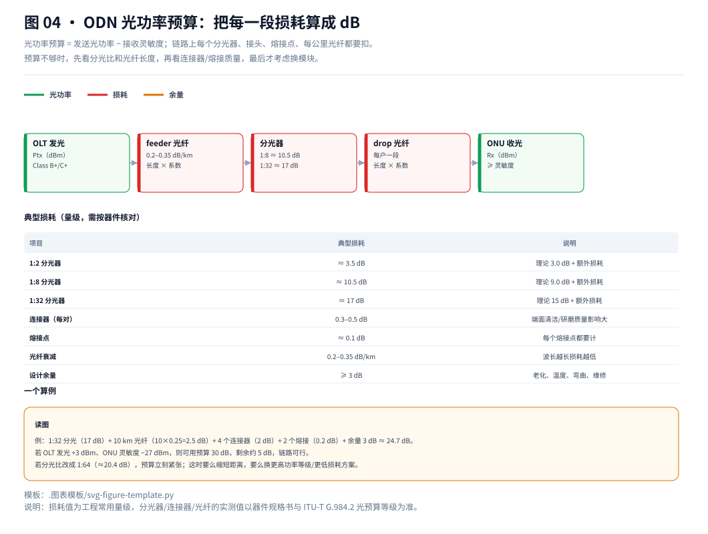

# ODN 与光功率预算

ODN 是 OLT 和 ONU 之间的“光纤 + 分光器 + 接头”网络。它没有放大器，所以每一段损耗都会直接吃掉光功率预算；预算算不平，远户就上不了线。

> 本篇定位：ODN 的组成、分光器/光纤/连接器损耗、光功率预算算法与故障定位。PON 家族去 [00-PON技术概览](./00-PON技术概览.md)，模块参数去 [02-光模块与SFP](./02-光模块与SFP.md)。

## 目录

- [1 一句话模型](#s1)
- [2 速览](#s2)
- [3 ODN 组成与损耗项](#s3)
- [4 预算怎么算](#s4)
- [5 状态机与定时器](#s5)
- [6 设计取舍与边界](#s6)
- [7 与相邻主题的关系](#s7)
- [名词解释](#名词解释)
- [8 参考与关联](#s8)

## 1 · 一句话模型：发光减去一路损耗，必须大于灵敏度

```text
可用预算 = OLT 发光功率 − ONU 接收灵敏度
链路损耗 = 分光器 + 光纤 + 连接器 + 熔接 + 余量
链路可用 ⇔ 可用预算 ≥ 链路损耗
```

三个关键认知：

1. **ODN 是无源的**：没有放大器，损耗只能靠“少分、短距、好接头”来控制。
2. **分光器是最大的一笔损耗**：1:32 约 17 dB，1:64 约 20 dB，分光比一升，预算立刻紧张。
3. **余量不是可选项**：光纤老化、温度变化、弯曲、维修都会增加损耗，预算必须留 3 dB 以上。

## 2 · 速览

| 项 | 内容 |
| --- | --- |
| 所属领域 | 光通信/ODN |
| 核心对象 | 光纤、分光器、连接器、熔接点、光缆接头盒 |
| 关键参数 | 分光比、光纤长度、损耗系数、连接器/熔接损耗、余量 |
| 常用工具 | 光功率计、OTDR、红光笔、光衰耗器 |
| 主要标准 | ITU-T G.984.2、G.987.2、G.9807.1、G.652 |

## 3 · ODN 组成与损耗项

```text
OLT ── feeder 光纤 ── 光缆接头盒/熔接 ── 分光器 ── distribution 光纤
                                                  └─ 接头盒/分光箱 ── drop 光纤 ── ONU
```

| 组成 | 作用 | 主要损耗 |
| --- | --- | --- |
| feeder 光纤 | 局端到分光器 | 长度 × 衰减系数 |
| distribution 光纤 | 分光器到分纤箱 | 长度 × 衰减系数 |
| drop 光纤 | 分纤箱到用户 | 长度 × 衰减系数 |
| 分光器 | 把光分给多户 | 分光比决定（3–20 dB+） |
| 连接器 | 活动连接 | 每个 0.3–0.5 dB |
| 熔接点 | 光纤永久连接 | 每个约 0.1 dB |
| 光缆接头盒 | 保护熔接/分支 | 引入额外连接器/熔接 |
| 余量 | 老化/温度/维修 | 建议 ≥ 3 dB |

### 3.1 分光器损耗

| 分光比 | 理论损耗 | 典型额外损耗 | 工程取值 |
| --- | --- | --- | --- |
| 1:2 | 3.0 dB | 0.3–0.8 dB | ≈ 3.5 dB |
| 1:4 | 6.0 dB | 0.5–1.2 dB | ≈ 7.2 dB |
| 1:8 | 9.0 dB | 0.8–1.5 dB | ≈ 10.5 dB |
| 1:16 | 12.0 dB | 1.0–1.8 dB | ≈ 13.8 dB |
| 1:32 | 15.0 dB | 1.5–2.1 dB | ≈ 17 dB |
| 1:64 | 18.0 dB | 2.0–2.4 dB | ≈ 20.4 dB |

> **边界**：上表是工程常用量级，实际以分光器规格书为准；不同波长/封装/厂商的额外损耗不同。

### 3.2 光纤衰减

| 波长 | 典型衰减 | 说明 |
| --- | --- | --- |
| 1310 nm | 0.30–0.35 dB/km | GPON/EPON 上行 |
| 1490 nm | 0.20–0.25 dB/km | GPON/EPON 下行 |
| 1550 nm | 0.18–0.22 dB/km | 长距/视频 |
| 1270 nm | 0.30–0.35 dB/km | XG(S)-PON 上行 |
| 1577 nm | 0.20–0.25 dB/km | XG(S)-PON 下行 |

实际预算通常按“最坏波长”取系数，避免只算下行、忽略上行。

## 4 预算怎么算



**读图**：上半部分是链路损耗链（发光 → feeder → 分光器 → drop → 收光），下半部分是损耗表和算例。先看“哪一项最大”，再看“余量够不够”。

> 图源：`images/图04-ODN光功率预算.svg`

### 4.1 计算步骤

```text
① 查 OLT 发光功率（dBm）与 ONU 灵敏度（dBm）
   → 可用预算 = Ptx − Rx_sensitivity

② 列链路损耗：
   分光器 + 光纤长度×系数 + 连接器数×0.4 + 熔接数×0.1 + 余量

③ 比较：可用预算 ≥ 链路损耗
   → 不满足：降分光比 / 缩短距离 / 提高功率等级 / 减少接头
```

### 4.2 算例

| 项目 | 取值 | 损耗 |
| --- | --- | --- |
| OLT 发光 | +3 dBm | — |
| ONU 灵敏度 | −27 dBm | 可用预算 30 dB |
| 1:32 分光器 | 1 个 | 17 dB |
| feeder + drop 光纤 | 10 km × 0.25 dB/km | 2.5 dB |
| 连接器 | 4 个 × 0.4 dB | 1.6 dB |
| 熔接 | 2 个 × 0.1 dB | 0.2 dB |
| 设计余量 | — | 3 dB |
| 合计 | — | 24.3 dB |

剩余约 5.7 dB，链路可行。若分光比改为 1:64（约 20.4 dB），合计约 27.7 dB，余量只剩 2.3 dB，接近临界。

### 4.3 异常分支

| 异常 | 现象 | 原因 | 处理方向 |
| --- | --- | --- | --- |
| ONU 收光低 | 不上线/误码 | 分光比过大、光纤长、接头脏 | 测光功率、清洁、降分光比 |
| 收光正常但误码 | 链路不稳定 | 反射、色散、模块不匹配 | 查回波损耗、波长/模块 |
| 某户特别差 | 单户故障 | drop 光纤弯折/接头坏 | OTDR/红光笔定位 |
| 整片掉线 | 多户同时 | feeder 断/分光器坏/OLT 口故障 | 查主干、OTDR、换端口 |
| 夏季/高温异常 | 时段性 | 光纤/接头盒温度漂移 | 查余量、改善散热/接头 |

## 5 状态机与定时器

ODN 是无源网络，**没有状态机**。可观测的是“光功率是否在窗口内”和“链路是否稳定”：

| 观测项 | 正常 | 异常 |
| --- | --- | --- |
| ONU 收光 | 在模块规格窗口内 | 过低（损耗大）/过高（过载） |
| OLT 收光 | 在各 ONU 突发窗口内 | 某 ONU 偏低/偏高 |
| 误码/CRC | 接近 0 | 持续增长 |
| 光功率波动 | 小 | 随时间/温度大幅波动 |

> PON 的注册/测距状态机在 OLT/ONU 侧，不在 ODN；ODN 只提供“损耗”这个约束。

## 6 设计取舍与边界

### 6.1 分光比与覆盖

| 目标 | 建议 |
| --- | --- |
| 长距/高带宽 | 小分光比（1:8/1:16） |
| 普通 FTTH | 1:32 |
| 高密度/短距 | 1:64 |
| 超高分光 | 需要高功率等级/低损耗器件，谨慎 |

### 6.2 预算余量的意义

余量不是“浪费”，而是给以下因素留空间：

- 光纤/连接器老化；
- 温度变化导致的光纤衰减变化；
- 施工弯曲、维修接头；
- 分光器/模块的批次差异。

余量不足的链路，验收时可能正常，运行一段时间后逐渐掉线。

### 6.3 常见误判

1. **“收光在模块范围内就没问题”**：还要看是否接近下限、误码是否增长、上行是否正常。
2. **“分光比越大越省成本”**：分光比受预算约束，过大导致远户不上线。
3. **“光纤损耗只算长度”**：连接器、熔接、弯曲、接头盒都要算。
4. **“OTDR 测通就没问题”**：OTDR 看的是回损/事件，不能替代收光功率和误码测试。
5. **“换大功率模块就能解决”**：可能让近端 ONU 过载，且不解决上行预算。

## 7 · 与相邻主题的关系

| 相邻主题 | 关系 |
| --- | --- |
| [00-PON技术概览](./00-PON技术概览.md) | PON 拓扑、分光比、波长 |
| [01-PON复用测距与注册](./01-PON复用测距与注册.md) | 收光/测距/注册的关系 |
| [02-光模块与SFP](./02-光模块与SFP.md) | 发光功率、灵敏度、DDM |
| [02-有线通信/00-有线传输介质](../02-有线通信/00-有线传输介质.md) | 光纤类型与衰减 |
| [01-通信原理/03-信道与传输损伤](../01-通信原理/03-信道与传输损伤.md) | 链路预算的通用方法 |
| [30-产品与方案/35-FTTR](../../../30-产品与方案/35-FTTR/.readme.md) | FTTR 的室内光纤预算 |

一句话：**ODN 预算就是“发光减损耗”，分光器和光纤长度是两个最大的变量。**

## 名词解释

> 缩写给出英文全称；非缩写用“—”表示。

| 术语 | 英文全称 | 解释 |
| --- | --- | --- |
| ODN | Optical Distribution Network | 光分配网络。 |
| feeder | Feeder Fiber | 局端到分光器的主干光纤。 |
| distribution | Distribution Fiber | 分光器到分纤箱的光纤。 |
| drop | Drop Fiber | 分纤箱到用户的光纤。 |
| 分光器 | Optical Splitter | 把一路光分成多路的无源器件。 |
| 插入损耗 | Insertion Loss | 器件引入的功率损失，单位 dB。 |
| 回波损耗 | Return Loss | 反射回来的功率比例。 |
| 光功率计 | Optical Power Meter | 测量收发光功率的仪表。 |
| OTDR | Optical Time-Domain Reflectometer | 光时域反射仪，用于定位断点/损耗事件。 |
| 红光笔 | Visual Fault Locator | 用可见红光查找光纤断点/弯曲。 |
| 灵敏度 | Receiver Sensitivity | 接收端能正确解调的最小光功率。 |
| 过载点 | Overload Point | 接收端能承受的最大光功率。 |

## 8 · 参考与关联

**标准**

- ITU-T G.984.2：GPON 光接口与光预算等级。
- ITU-T G.987.2：XG-PON 光接口。
- ITU-T G.9807.1：XGS-PON 光接口。
- ITU-T G.652：单模光纤特性。
- ITU-T G.671：光纤无源器件（分光器）特性。

**关联**

- [00-PON技术概览](./00-PON技术概览.md)
- [01-PON复用测距与注册](./01-PON复用测距与注册.md)
- [02-光模块与SFP](./02-光模块与SFP.md)
- [02-有线通信/00-有线传输介质](../02-有线通信/00-有线传输介质.md)
- [01-通信原理/03-信道与传输损伤](../01-通信原理/03-信道与传输损伤.md)

---

> **本篇定位**：ODN 组成、损耗项与光功率预算算法；不展开具体 OLT 配置与施工规范。
> **素材来源**：源仓库无 ODN 素材，本篇按 ITU-T G.984.2/G.987.2/G.9807.1/G.652 公开框架撰写。
> **待验证**：分光器额外损耗、光纤衰减系数、光预算等级（B+/C+ 等）与厂商器件规格。
