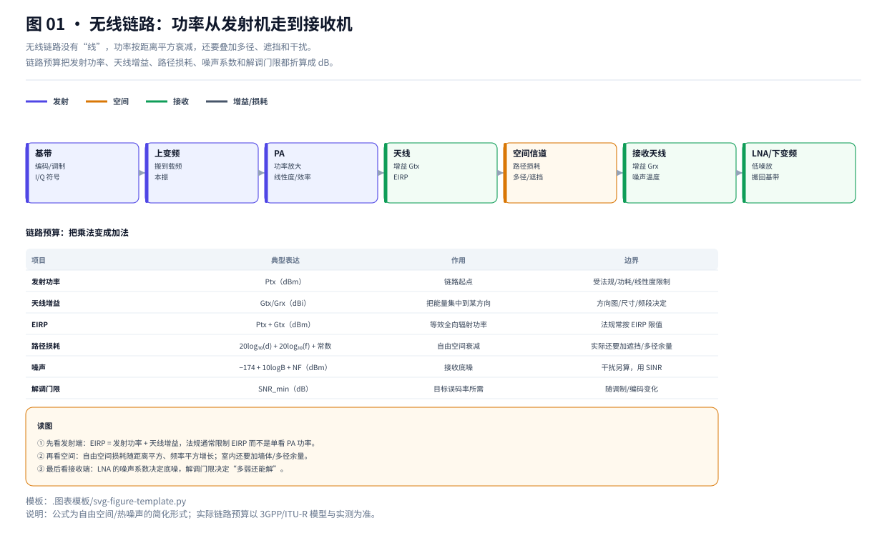

# 无线传播与射频基础

无线通信把信号交给空气，换来移动性，也换来一堆不可控：路径损耗、多径、遮挡、干扰。射频前端的任务是把基带信号搬到合适的频率、用足够的功率发出去，并在极弱的回波里把信号捞回来。

> 本篇定位：频率/波长、自由空间损耗、天线增益与 EIRP、多径与衰落、噪声与链路预算。Wi-Fi/蜂窝的具体协议去 02/03，测试优化去 05。

## 目录

- [1 一句话模型](#s1)
- [2 速览](#s2)
- [3 频率、波长与传播](#s3)
- [4 从基带到天线](#s4)
- [5 状态机与定时器](#s5)
- [6 设计取舍与边界](#s6)
- [7 与相邻主题的关系](#s7)
- [名词解释](#名词解释)
- [8 参考与关联](#s8)

## 1 · 一句话模型：功率 + 增益 − 损耗 ≥ 门限

```text
发射：基带 → 上变频 → PA → 天线（EIRP = Ptx + Gtx）
空间：自由空间损耗 + 遮挡 + 多径 + 干扰
接收：天线 → LNA → 下变频 → 基带（SNR ≥ 解调门限）
```

三个关键认知：

1. **频率越高，波长越短，路径损耗越大，穿透越差**：所以 6 GHz Wi-Fi 比 2.4 GHz 快但覆盖短。
2. **天线增益不是“放大功率”，而是“把能量集中到某个方向”**：全向天线增益低但覆盖均匀，定向天线增益高但角度窄。
3. **无线链路的质量看 SNR/SINR，不看单一 RSSI**：信号强但噪声/干扰大，照样解不出来。

## 2 · 速览

| 项 | 内容 |
| --- | --- |
| 所属领域 | 无线通信/射频 |
| 核心对象 | 电磁波、天线、PA/LNA、信道 |
| 关键参数 | 频率、波长、EIRP、路径损耗、SNR、噪声系数 |
| 常见频段 | 2.4/5/6 GHz（Wi-Fi）、700 MHz–3.5 GHz（蜂窝）、毫米波 |
| 主要标准 | ITU-R P.525/P.526、3GPP TR 38.901、IEEE 802.11 |

## 3 频率、波长与传播

### 3.1 频率与波长

```text
λ = c / f
```

| 频段 | 波长（约） | 传播特点 | 典型用途 |
| --- | --- | --- | --- |
| 700 MHz | 43 cm | 绕射好、穿透好、带宽小 | 广覆盖蜂窝 |
| 2.4 GHz | 12.5 cm | 穿透一般、干扰多 | Wi-Fi/蓝牙 |
| 3.5 GHz | 8.6 cm | 覆盖与带宽折中 | 5G |
| 5 GHz | 6 cm | 带宽大、穿透差 | Wi-Fi |
| 6 GHz | 5 cm | 干净、覆盖更短 | Wi-Fi 6E/7 |
| 毫米波（28/39 GHz） | 10.7/7.7 mm | 带宽极大、覆盖很短 | 5G 热点/回传 |

### 3.2 自由空间损耗

```text
FSPL(dB) = 20log₁₀(d) + 20log₁₀(f) + 20log₁₀(4π/c)
         ≈ 32.45 + 20log₁₀(d_km) + 20log₁₀(f_MHz)
```

两个结论：

- 距离翻倍，损耗增加约 6 dB；
- 频率翻倍，损耗也增加约 6 dB。

实际环境还要加**遮挡/多径余量**：室内墙体、金属、人体、植被都会让损耗大于自由空间。

### 3.3 天线与 EIRP

| 概念 | 含义 | 工程意义 |
| --- | --- | --- |
| 增益（dBi） | 相对全向天线的方向性增益 | 定向天线增益高，但覆盖角度窄 |
| EIRP | 等效全向辐射功率 = Ptx + Gtx | 法规常按 EIRP 限值 |
| 极化 | 电场方向（垂直/水平/圆极化） | 收发极化不匹配会额外损耗 |
| VSWR | 电压驻波比 | 反映天线/馈线匹配，越高反射越大 |
| 波束宽度 | 主瓣的角度范围 | 决定覆盖形状与对准要求 |

> **边界**：高增益天线不是“信号变强”，而是“把同样的功率压到更窄的方向”。方向没对准，反而更差。

### 3.4 多径与衰落

无线信号会遇到反射、绕射、散射，多条路径叠加：

- **大尺度衰落**：随距离/遮挡缓慢变化，用路径损耗模型描述。
- **小尺度衰落**：短距离/短时间内的幅度快速起伏，服从瑞利/莱斯分布。
- **频率选择性衰落**：不同频率衰落不同，宽带信号需要均衡/OFDM。
- **多普勒**：移动导致频偏，速度越高越明显。

对抗手段：分集（空间/频率/时间）、均衡、OFDM+CP、MIMO、波束赋形、重传。

## 4 从基带到天线



**读图**：从左到右是发射链（基带→上变频→PA→天线），中间是空间信道，右边是接收链（天线→LNA→下变频→基带）。下方矩阵把链路预算各项拆开。先看“功率从哪来、到哪去”，再看“哪一项最容易被低估”。

> 图源：`../images/图01-无线链路与链路预算.svg`

### 4.1 发射链

```text
基带 I/Q → 上变频（本振）→ 滤波 → PA → 双工器/开关 → 天线
```

- **PA**：功率放大器，效率与线性度是一对矛盾；靠 back-off 换线性度。
- **双工器**：FDD 系统里分离收发频段；TDD 用开关。
- **滤波**：抑制谐波/杂散，满足法规。

### 4.2 接收链

```text
天线 → 滤波 → LNA → 下变频 → 基带 ADC
```

- **LNA**：低噪声放大器，第一级噪声系数决定整机噪声。
- **动态范围**：强信号不能饱和，弱信号不能淹没在噪声里。
- **阻塞/互调**：强邻频信号可能让接收机饱和，表现为“信号很强但解不出”。

### 4.3 异常分支

| 异常 | 现象 | 原因 | 处理方向 |
| --- | --- | --- | --- |
| 覆盖差 | RSSI 低、远点掉线 | 路径损耗/遮挡/天线方向 | 调功率/天线/位置 |
| 有信号但速率低 | RSSI 高、SNR 低 | 干扰/噪声/邻频 | 换信道、滤波、隔离 |
| 近距离也差 | 靠近 AP 仍慢 | 接收过载/PA 非线性 | 降功率、加衰减、查 EVM |
| 移动中掉线 | 切换/多普勒 | 覆盖空洞、切换参数 | 优化切换/补点 |
| 极化不匹配 | 信号弱且不稳定 | 天线极化方向不一致 | 统一极化/调整安装 |

## 5 状态机与定时器

射频本身**没有连接状态机**，但有几个时间/频率尺度：

| 量 | 典型量级 | 影响 |
| --- | --- | --- |
| 相干时间 | 毫秒到秒 | 信道估计/自适应周期 |
| 时延扩展 | 纳秒到微秒 | CP/均衡长度 |
| 多普勒扩展 | 赫兹到千赫兹 | 高速移动/频偏跟踪 |
| AGC 收敛 | 微秒到毫秒 | 接收增益调整 |

## 6 设计取舍与边界

### 6.1 频率越低覆盖越好，频率越高带宽越大

低频绕射/穿透好，适合广覆盖；高频带宽大，适合高速率。工程上常用“低频做覆盖、高频做容量”的分层组网。

### 6.2 功率与干扰

提高功率能改善下行覆盖，但会干扰邻区、增加功耗、受法规限制；而且上行覆盖由终端功率决定，单方面加大下行功率会造成“下行满格、上行发不出去”的不对称。

### 6.3 天线增益与覆盖形状

| 天线 | 增益 | 覆盖 | 适用 |
| --- | --- | --- | --- |
| 全向 | 低 | 360° | 室内吸顶/均匀覆盖 |
| 定向 | 高 | 窄波束 | 室外回传/定向覆盖 |
| 阵列 | 更高 | 可扫描 | 5G 大规模天线 |

### 6.4 常见误判

1. **“RSSI 高就好”**：RSSI 只说明收到得强，不代表噪声低、干扰小。
2. **“天线增益越高越好”**：方向没对准、波束太窄，覆盖反而更差。
3. **“加大功率能解决所有覆盖问题”**：上行受限、干扰、法规都会卡住。
4. **“5 GHz 穿墙和 2.4 GHz 一样”**：频率越高穿透越差，这是物理规律。
5. **“MIMO 一定能翻倍”**：需要多径丰富、信道相关性低、终端支持。

## 7 · 与相邻主题的关系

| 相邻主题 | 关系 |
| --- | --- |
| [01-通信原理/03-信道与传输损伤](../../01-通信原理/03-信道与传输损伤.md) | 衰减/噪声/多径的通用模型 |
| [02-Wi-Fi](../02-Wi-Fi/.readme.md) | 2.4/5/6 GHz 的协议与信道 |
| [03-蜂窝通信](../03-蜂窝通信/.readme.md) | 蜂窝频段、覆盖与移动性 |
| [04-短距无线](../04-短距无线/.readme.md) | BLE/ZigBee/Thread 的射频参数 |
| [05-无线测试与优化](../05-无线测试与优化/00-无线覆盖与干扰优化.md) | RSSI/SNR/干扰的现场判断 |
| [02-有线通信/00-有线传输介质](../../02-有线通信/00-有线传输介质.md) | 有线介质与无线的对比 |

一句话：**无线链路 = 发射功率 + 天线增益 − 路径损耗 − 噪声/干扰，任何一项短板都会限制覆盖或速率。**

## 名词解释

> 缩写给出英文全称；非缩写用“—”表示。

| 术语 | 英文全称 | 解释 |
| --- | --- | --- |
| EIRP | Equivalent Isotropically Radiated Power | 等效全向辐射功率。 |
| dBi | Decibels relative to isotropic | 相对全向天线的增益。 |
| dBm | Decibels relative to one milliwatt | 以 1 mW 为基准的绝对功率。 |
| FSPL | Free-Space Path Loss | 自由空间路径损耗。 |
| PA | Power Amplifier | 功率放大器。 |
| LNA | Low-Noise Amplifier | 低噪声放大器。 |
| VSWR | Voltage Standing Wave Ratio | 电压驻波比。 |
| MIMO | Multiple-Input Multiple-Output | 多输入多输出。 |
| OFDM | Orthogonal Frequency Division Multiplexing | 正交频分复用。 |
| CP | Cyclic Prefix | 循环前缀。 |
| AGC | Automatic Gain Control | 自动增益控制。 |
| 多径 | Multipath | 多条传播路径叠加。 |
| 衰落 | Fading | 接收信号幅度随时间/位置起伏。 |
| 多普勒 | Doppler Effect | 相对运动引起的频率偏移。 |
| 极化 | Polarization | 电场振动方向。 |

## 8 · 参考与关联

**标准与经典**

- ITU-R P.525：自由空间衰减。
- ITU-R P.526：绕射传播。
- 3GPP TR 38.901：5G 信道模型。
- Friis, H. T., *A Note on a Simple Transmission Formula*, 1946.
- IEEE 802.11：WLAN PHY 与射频要求。

**关联**

- [01-通信原理/03-信道与传输损伤](../../01-通信原理/03-信道与传输损伤.md)
- [02-Wi-Fi](../02-Wi-Fi/.readme.md)
- [03-蜂窝通信](../03-蜂窝通信/.readme.md)
- [05-无线测试与优化](../05-无线测试与优化/00-无线覆盖与干扰优化.md)

---

> **本篇定位**：无线传播与射频前端的通用基础；具体协议/频段规划见 02/03。
> **素材来源**：`studyspace/1.知识体系/1.计算机网络/m-6-无线网络和移动网络.md` 的无线信道概念；其余按 ITU-R/3GPP 公开知识补写。
> **待验证**：具体频段、EIRP 限值、路径损耗模型参数随国家法规与环境变化。
