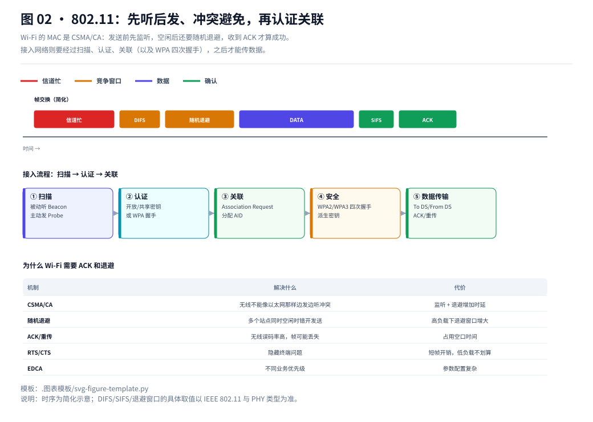

# 802.11 原理与接入流程

Wi-Fi 的核心不是“无线以太网”这么简单，而是“共享空口 + 冲突避免 + 确认重传”。一个站点想发数据，先要听、再等、再抢；抢到之后还要等 ACK，没 ACK 就重传。接入网络则要经过扫描、认证、关联和安全握手。

> 本篇定位：802.11 的 BSS/ESS 架构、CSMA/CA、帧类型、扫描/认证/关联/漫游。频段、信道、速率去 [01-Wi-Fi频段信道与速率](./01-Wi-Fi频段信道与速率.md)，射频与链路预算去 [01-射频与天线](../01-射频与天线/00-无线传播与射频基础.md)。

## 目录

- [1 一句话模型](#s1)
- [2 速览](#s2)
- [3 架构与帧](#s3)
- [4 接入与发送流程](#s4)
- [5 状态机与定时器](#s5)
- [6 设计取舍与边界](#s6)
- [7 与相邻主题的关系](#s7)
- [名词解释](#名词解释)
- [8 参考与关联](#s8)

## 1 · 一句话模型：先听、再退避、再确认

```text
发送前：监听信道
  ├─ 忙 → 等待
  └─ 空闲 → DIFS + 随机退避 → 发送
       └─ 等 SIFS → 收到 ACK？
            ├─ 是 → 成功
            └─ 否 → 退避窗口加倍 → 重传
```

三个关键认知：

1. **无线不能“边发边听”**：发送时自己的信号会淹没接收，所以用 CSMA/CA（冲突避免），而不是以太网的 CSMA/CD。
2. **ACK 是链路层确认**：没有 ACK 就重传，这是 Wi-Fi 在误码率较高的空口上保证可靠性的基础。
3. **接入和传输是两套流程**：先扫描/认证/关联/安全握手，之后才进入数据帧交换。

## 2 · 速览

| 项 | 内容 |
| --- | --- |
| 所属领域 | 无线通信/WLAN |
| 核心对象 | AP、STA、BSS、ESS、SSID、BSSID |
| 关键机制 | CSMA/CA、DIFS/SIFS、随机退避、ACK、RTS/CTS |
| 帧类型 | 管理帧、控制帧、数据帧 |
| 主要标准 | IEEE 802.11-2020、802.11k/r/v、WPA2/WPA3 |

## 3 · 架构与帧

### 3.1 基本架构

| 概念 | 含义 | 说明 |
| --- | --- | --- |
| STA | Station | 无线终端 |
| AP | Access Point | 无线接入点 |
| BSS | Basic Service Set | 一个 AP + 关联的 STA |
| ESS | Extended Service Set | 多个 BSS 通过 DS 互联 |
| SSID | Service Set Identifier | 网络名称 |
| BSSID | Basic Service Set Identifier | AP 的 MAC 地址 |
| DS | Distribution System | 连接 AP 的有线骨干 |

### 3.2 帧的三种类型

| 类型 | 作用 | 典型子类型 |
| --- | --- | --- |
| 管理帧 | 加入/维护网络 | Beacon、Probe Request/Response、Auth、Assoc |
| 控制帧 | 协调信道访问 | RTS、CTS、ACK、Block ACK |
| 数据帧 | 承载业务数据 | Data、QoS Data |

数据帧有 **4 个地址字段**（目的、源、BSSID、发送端），因为“最终目的”“产生者”“属于哪个 BSS”“谁在空口发送”是四个不同角色。以太网只有源/目的两个地址。

> **边界**：帧格式的完整字段与位图属于链路层细节，本篇只讲与接入/传输相关的部分。

## 4 接入与发送流程



**读图**：上半部分是帧交换时序（信道忙 → DIFS → 随机退避 → DATA → SIFS → ACK），下半部分是接入五步（扫描/认证/关联/安全/传输）。先看“为什么等”，再看“怎么加入网络”。

> 图源：`images/图02-802.11接入与CSMA.svg`

### 4.1 扫描

| 方式 | 做法 | 优点 | 代价 |
| --- | --- | --- | --- |
| 被动扫描 | 听 AP 的 Beacon | 省电、简单 | 要等 Beacon 周期 |
| 主动扫描 | 发 Probe Request | 发现快 | 增加空口开销 |

### 4.2 认证与关联

```text
① 认证（Authentication）
   → 开放系统认证，或 WPA/WPA2/WPA3 的握手

② 关联（Association）
   → STA 发 Association Request（SSID、速率集、能力）
   → AP 回 Association Response（AID）

③ 安全握手
   → WPA2 四次握手 / WPA3 SAE
   → 派生会话密钥
```

### 4.3 发送与确认

```text
监听 → 空闲 DIFS → 随机退避 → 发送 DATA
  → 等 SIFS → 收到 ACK？
       ├─ 是：继续
       └─ 否：退避窗口加倍，重传
```

### 4.4 异常分支

| 异常 | 现象 | 原因 | 处理方向 |
| --- | --- | --- | --- |
| 关联失败 | 连不上/反复重连 | 密码错、认证方式不匹配、AP 满 | 查安全配置/AP 容量 |
| 关联成功但无网 | 有 IP 但 ping 不通 | DHCP/VLAN/上行问题 | 查网络侧，不一定是 Wi-Fi |
| 速率低、重传多 | 空口忙、时延大 | 干扰、弱信号、隐藏终端 | 换信道、加 AP、开 RTS/CTS |
| 漫游粘滞 | 移动中不掉但很慢 | 终端不愿切换 | 开 802.11k/v、调漫游门限 |
| 大量管理帧 | 空口利用率高 | 扫描/探测过多、攻击 | 查终端行为、开管理帧保护 |

## 5 状态机与定时器

STA 的接入状态（简化）：

| 状态 | 含义 | 迁移 |
| --- | --- | --- |
| 未认证/未关联 | 初始 | 扫描到 AP → 认证 |
| 已认证 | 身份通过 | 关联成功 → 已关联 |
| 已关联 | 加入 BSS | 安全握手完成 → 可传输 |
| 已授权 | 可发数据 | 断链/超时 → 重新扫描 |

关键定时器/参数：

| 参数 | 作用 |
| --- | --- |
| Beacon 间隔 | AP 周期性广播，通常 100 ms 量级 |
| DIFS/SIFS | 帧间间隔，优先级不同 |
| 退避窗口（CW） | 冲突后加倍，降低再次碰撞 |
| ACK 超时 | 没收到 ACK 就重传 |
| 不活动超时 | 长时间无数据可能被踢出 |

> 具体取值由 PHY 类型和标准决定；工程上更常看的是“重传率、空口利用率、漫游次数”。

## 6 设计取舍与边界

### 6.1 CSMA/CA 的代价

CSMA/CA 用“等待 + 退避”换“减少碰撞”，代价是高负载下时延上升、吞吐下降。低负载时它很高效；高负载时，竞争本身会吃掉大量空口时间。

### 6.2 2.4 GHz vs 5 GHz

| 维度 | 2.4 GHz | 5 GHz |
| --- | --- | --- |
| 覆盖 | 好 | 差 |
| 干扰 | 多（蓝牙/微波/邻区） | 少 |
| 信道 | 少，只有 1/6/11 不重叠 | 多，含 DFS |
| 速率 | 低 | 高 |

### 6.3 常见误判

1. **“关联上就是网络通”**：关联只到链路层，DHCP/DNS/路由/认证都可能断。
2. **“信号满格就快”**：空口竞争、干扰、上行带宽、终端能力都会限制。
3. **“Wi-Fi 6 一定比 Wi-Fi 5 快”**：需要 AP 和终端都支持，且信道/干扰条件允许。
4. **“漫游是 AP 决定的”**：终端往往主导切换决策，AP 只能辅助（802.11k/v）。
5. **“5 GHz 穿墙差是 AP 坏了”**：这是频率的物理特性，靠补点/换位解决。

## 7 · 与相邻主题的关系

| 相邻主题 | 关系 |
| --- | --- |
| [01-Wi-Fi频段信道与速率](./01-Wi-Fi频段信道与速率.md) | 频段、信道、MCS、速率计算 |
| [01-射频与天线/00-无线传播与射频基础](../01-射频与天线/00-无线传播与射频基础.md) | 路径损耗、天线、链路预算 |
| [05-无线测试与优化/00-无线覆盖与干扰优化](../05-无线测试与优化/00-无线覆盖与干扰优化.md) | 现场覆盖/干扰判断 |
| [11-网络科学/02-链路层/01-以太网与MAC](../../../11-网络科学/02-链路层/01-以太网与MAC.md) | 以太网帧与 MAC 对比 |
| [20-平台与系统/OpenWrt](../../../../20-平台与系统/.readme.md) | Wi-Fi 驱动/hostapd 配置 |

一句话：**Wi-Fi 的“快”不只取决于 PHY 速率，还取决于空口竞争、干扰和上行链路。**

## 名词解释

> 缩写给出英文全称；非缩写用“—”表示。

| 术语 | 英文全称 | 解释 |
| --- | --- | --- |
| WLAN | Wireless Local Area Network | 无线局域网。 |
| AP | Access Point | 无线接入点。 |
| STA | Station | 无线站点/终端。 |
| BSS | Basic Service Set | 基本服务集。 |
| ESS | Extended Service Set | 扩展服务集。 |
| SSID | Service Set Identifier | 网络名称。 |
| BSSID | Basic Service Set Identifier | AP 的 MAC 标识。 |
| CSMA/CA | Carrier Sense Multiple Access with Collision Avoidance | 载波侦听多路访问/冲突避免。 |
| DIFS | Distributed Inter-Frame Space | 分布式帧间间隔。 |
| SIFS | Short Inter-Frame Space | 短帧间间隔。 |
| ACK | Acknowledgement | 确认帧。 |
| RTS/CTS | Request to Send / Clear to Send | 发送请求/清除发送，用于解决隐藏终端。 |
| AID | Association Identifier | 关联标识。 |
| WPA | Wi-Fi Protected Access | Wi-Fi 安全协议。 |
| SAE | Simultaneous Authentication of Equals | WPA3 的认证方式。 |

## 8 · 参考与关联

**标准**

- IEEE 802.11-2020：WLAN MAC 与 PHY。
- IEEE 802.11k：无线资源测量。
- IEEE 802.11r：快速漫游。
- IEEE 802.11v：网络管理/辅助漫游。
- Wi-Fi Alliance：WPA2/WPA3 认证。

**关联**

- [01-Wi-Fi频段信道与速率](./01-Wi-Fi频段信道与速率.md)
- [01-射频与天线/00-无线传播与射频基础](../01-射频与天线/00-无线传播与射频基础.md)
- [05-无线测试与优化/00-无线覆盖与干扰优化](../05-无线测试与优化/00-无线覆盖与干扰优化.md)
- [11-网络科学/02-链路层/01-以太网与MAC](../../../11-网络科学/02-链路层/01-以太网与MAC.md)

---

> **本篇定位**：802.11 的接入与发送机制，不展开具体 PHY 速率表与驱动实现。
> **素材来源**：`studyspace/1.知识体系/10.wifi/wifi记录.md` 的 WLAN/802.11 概念与接入流程、`1.知识体系/1.计算机网络/m-6-无线网络和移动网络.md` 的 CSMA/CA 说明；其余按 IEEE 802.11 公开知识补写。
> **待验证**：具体定时器/退避参数、漫游门限随 PHY 类型、厂商驱动与部署策略变化。
